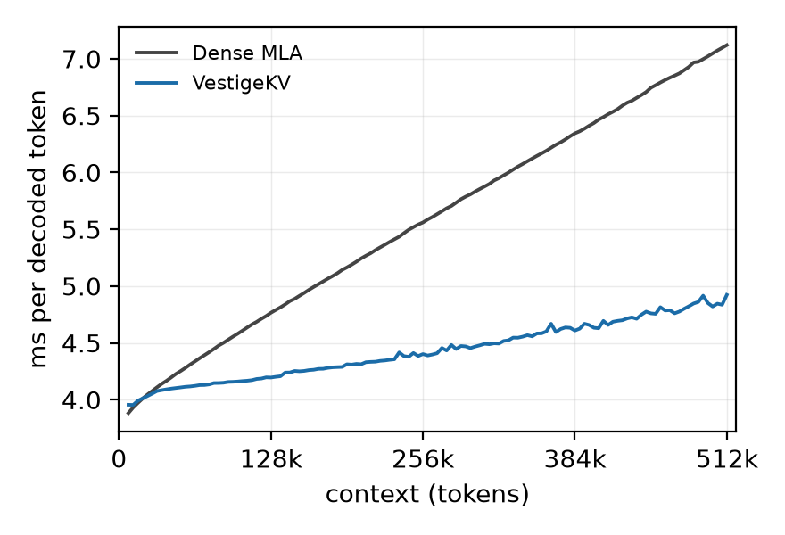
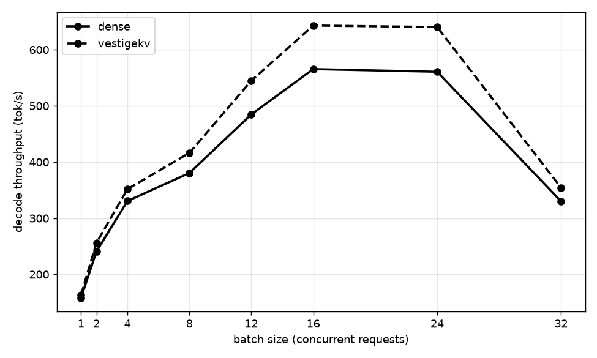

> **Branch `glm53-line`.** This branch carries the GLM-5.3-Flash-NVFP4 line:
> `mexp/glm53/` and `mexp/dsv2lite/` (arm scripts and queue), `docs/glm53-line.md`
> (the whole write-up, including "Closing the decode gap" and the 2026-09-23
> redesign measurements), `results/glm53/` and the GLM sections of this README.
> `main` is the Kimi Linear line alone. The shared runner and probes live in
> `mexp/exp/` on main; on this branch they are still under `mexp/glm53/`.

# VestigeKV — experiments

> **Initialize the submodule before anything else:**
> ```bash
> git clone --recurse-submodules <this-repo>
> # in an already-cloned checkout:
> git submodule update --init --depth 1
> ```
> The only code dependency is `engine/` (an sglang fork, branch
> `vestigekv`). Without it, everything under `mexp/` raises `ImportError`.
> The branch is no longer the single commit it began as; the one-commit form
> is preserved as `vestigekv-pre-rebase`. For a reviewer without this
> repository, `tools/make_supplement.py` emits the same code as upstream
> sglang at a pinned revision plus one patch.

## What it does

**VestigeKV** is a training-free KV-cache compression backend for NoPE-MLA
models (Kimi Linear family), shipped as the sglang attention backend
`vestigekv_mla`. It evicts by a query-independent signal the cache already
carries — the 64-dim un-roped sidecar branch, a vestige of RoPE that NoPE
training repurposes into a salience channel — keeping a global top-(S/32) of
rows attended while a **certified per-step recall tier** (rank-64 sketch +
conformal certificate) keeps every archived row reachable: no row is ever
dropped. The whole recall step runs as **six fused Triton kernels inside
the decode CUDA graph** — one launch per step, no extra fixed cost, and the
graph never recaptures for VestigeKV reasons. Cache rows stay bit-exact
bf16; no quantization anywhere.

## Results at a glance

> Throughout this repo and the paper, **k = 1024 tokens** (KiB-style, not
> 1000): 4k prefill = 4096 tokens, 64k = 65536, 512k = 524288.

| figure | what it shows |
|---|---|
|  | bs=1 streaming decode: one request prefilled at 4k and decoded continuously to 512k; per-token latency vs. sequence length, vestigekv vs. dense (same tree, triton backend). Crossover ~28k; 1.28x at 256k, 1.46x at 496k. |
|  | Decode throughput against measured live requests, 64k and 128k prefill, both arms (`tputA-*` at the default memory fraction, `tputB87-*` at 0.87 on both arms: at the default the VestigeKV arm exhausts the GPU above sixteen 128k requests). VestigeKV/dense: 1.06x at one request to 1.39x at 31 on 64k, 1.14x to 1.54x on 128k. Points are steady-decode windows from the server's own log (`mexp/kimi/make_throughput_numbers.py`). |

*(Both figures are produced by `mexp/kimi/make_figures.py --emit --out results/`
from the same server logs the paper's macros are read from; the panel title
names the checkpoint and the box as read from those logs. The exact
collection commands are in the experiment steps below.)*

<!-- quality-tables:begin (generated by mexp/kimi/make_readme_tables.py; do not edit) -->

**Quality** (Kimi-Linear-48B-A3B, 2x RTX PRO 6000 Blackwell, TP=2; dense = the same tree with `--attention-backend triton`,
VestigeKV = `--attention-backend vestigekv_mla`, seed 0, greedy):

| | Base, dense | Base, VestigeKV | Instruct, dense | Instruct, VestigeKV |
|---|---|---|---|---|
| GSM8K-Platinum, 64-shot, full set | 1027 / 1209 (84.9%) | 1031 / 1209 (85.3%) | 1107 / 1209 (91.6%) | 1097 / 1209 (90.7%) |
| MAUVE, 4k prefill (16 contexts x 256 generated tokens, gate vk >= dense - 0.10: PASS) | 0.9997 | 0.9960 | 0.9345 | 0.9805 |
| MAUVE, 64k prefill (64 contexts x 256 generated tokens, gate vk >= dense - 0.10: PASS) | 0.9954 | 0.9987 | 0.9905 | 0.9861 |
| RULER mean, 13 tasks x 4k-64k, n=50/cell | 0.922 | 0.860 | 0.942 | 0.920 |
| LongBench v1 summarisation, ROUGE-L F1 x 100, mean of gov_report/qmsum/multi_news (n=200 each) | -- | -- | 26.06 | 25.45 |

GSM8K-Platinum is madrylab/gsm8k-platinum (n=1209, label-corrected gsm8k test set), 64-shot, exact match on the final answer. MAUVE is scored against the reference continuations of the same prompts (`mexp/m7_mauve_serving.py`); the 4k and 64k rows differ in prefill length. RULER is lm-eval's 13-task suite; the 4k-64k grid below is the one the paper's Table reads (`mexp/kimi/make_ruler_numbers.py`). Records: `results/kimi/gsm8k_*`, `results/quality/quality_mauve*.json`, `results/kimi/ruler/results_*_n50_*.json`. ROUGE-L is LongBench's own scoring (`mexp/kimi/make_lb1_numbers.py`, records `results/kimi/longbench1/pred_*`), Instruct checkpoint only.

**RULER, Base checkpoint** (dense / VestigeKV, accuracy, n=50 per cell):

| task | 4k | 8k | 16k | 32k | 64k | mean |
|---|---|---|---|---|---|---|
| niah_single_1 | 1.00 / 1.00 | 1.00 / 1.00 | 1.00 / 1.00 | 1.00 / 1.00 | 1.00 / 1.00 | 1.000 / 1.000 |
| niah_single_2 | 1.00 / 1.00 | 1.00 / 1.00 | 1.00 / 1.00 | 1.00 / 1.00 | 1.00 / 1.00 | 1.000 / 1.000 |
| niah_single_3 | 1.00 / 1.00 | 1.00 / 0.98 | 1.00 / 1.00 | 1.00 / 1.00 | 1.00 / 1.00 | 1.000 / 0.996 |
| niah_multikey_1 | 1.00 / 1.00 | 0.98 / 0.98 | 1.00 / 1.00 | 1.00 / 1.00 | 1.00 / 0.98 | 0.996 / 0.992 |
| niah_multikey_2 | 1.00 / 1.00 | 1.00 / 0.90 | 1.00 / 0.86 | 1.00 / 0.86 | 1.00 / 0.76 | 1.000 / 0.876 |
| niah_multikey_3 | 1.00 / 1.00 | 1.00 / 0.64 | 1.00 / 0.34 | 1.00 / 0.22 | 1.00 / 0.16 | 1.000 / 0.472 |
| niah_multiquery | 1.00 / 1.00 | 1.00 / 1.00 | 1.00 / 1.00 | 1.00 / 1.00 | 1.00 / 1.00 | 1.000 / 1.000 |
| niah_multivalue | 0.97 / 0.96 | 0.97 / 0.97 | 0.97 / 0.98 | 0.99 / 0.99 | 0.99 / 1.00 | 0.981 / 0.980 |
| ruler_vt | 1.00 / 1.00 | 1.00 / 1.00 | 1.00 / 1.00 | 1.00 / 0.99 | 1.00 / 1.00 | 1.000 / 0.998 |
| ruler_cwe | 1.00 / 0.99 | 0.94 / 0.94 | 0.93 / 0.92 | 0.72 / 0.61 | 0.25 / 0.13 | 0.768 / 0.717 |
| ruler_fwe | 0.97 / 0.97 | 0.96 / 0.95 | 0.99 / 0.97 | 0.98 / 0.97 | 0.91 / 0.79 | 0.960 / 0.933 |
| ruler_qa_squad | 0.72 / 0.72 | 0.69 / 0.66 | 0.67 / 0.57 | 0.62 / 0.61 | 0.60 / 0.54 | 0.659 / 0.622 |
| ruler_qa_hotpot | 0.62 / 0.62 | 0.64 / 0.60 | 0.62 / 0.58 | 0.64 / 0.58 | 0.60 / 0.56 | 0.624 / 0.588 |
| **mean** | 0.944 / 0.943 | 0.937 / 0.894 | 0.937 / 0.863 | 0.920 / 0.834 | 0.873 / 0.764 | **0.922 / 0.860** |

**RULER, Instruct checkpoint** (dense / VestigeKV, accuracy, n=50 per cell):

| task | 4k | 8k | 16k | 32k | 64k | mean |
|---|---|---|---|---|---|---|
| niah_single_1 | 1.00 / 1.00 | 1.00 / 1.00 | 1.00 / 1.00 | 0.96 / 0.96 | 0.96 / 0.98 | 0.984 / 0.988 |
| niah_single_2 | 1.00 / 1.00 | 1.00 / 1.00 | 1.00 / 1.00 | 1.00 / 1.00 | 1.00 / 1.00 | 1.000 / 1.000 |
| niah_single_3 | 1.00 / 1.00 | 1.00 / 1.00 | 1.00 / 1.00 | 1.00 / 1.00 | 1.00 / 1.00 | 1.000 / 1.000 |
| niah_multikey_1 | 1.00 / 1.00 | 1.00 / 1.00 | 1.00 / 1.00 | 1.00 / 1.00 | 1.00 / 1.00 | 1.000 / 1.000 |
| niah_multikey_2 | 1.00 / 1.00 | 1.00 / 0.98 | 1.00 / 0.92 | 1.00 / 0.90 | 1.00 / 0.92 | 1.000 / 0.944 |
| niah_multikey_3 | 1.00 / 1.00 | 1.00 / 0.92 | 1.00 / 0.84 | 1.00 / 0.84 | 1.00 / 0.76 | 1.000 / 0.872 |
| niah_multiquery | 1.00 / 1.00 | 1.00 / 1.00 | 1.00 / 1.00 | 1.00 / 1.00 | 1.00 / 1.00 | 1.000 / 1.000 |
| niah_multivalue | 1.00 / 1.00 | 1.00 / 1.00 | 1.00 / 1.00 | 0.99 / 0.99 | 1.00 / 1.00 | 0.998 / 0.999 |
| ruler_vt | 1.00 / 1.00 | 1.00 / 1.00 | 1.00 / 1.00 | 1.00 / 1.00 | 1.00 / 1.00 | 0.999 / 0.999 |
| ruler_cwe | 0.99 / 1.00 | 0.97 / 0.95 | 0.98 / 0.98 | 0.98 / 0.98 | 0.97 / 0.97 | 0.977 / 0.977 |
| ruler_fwe | 0.79 / 0.79 | 0.97 / 0.97 | 0.99 / 0.98 | 0.98 / 0.95 | 0.71 / 0.69 | 0.885 / 0.875 |
| ruler_qa_squad | 0.79 / 0.78 | 0.78 / 0.73 | 0.74 / 0.67 | 0.74 / 0.71 | 0.76 / 0.64 | 0.760 / 0.704 |
| ruler_qa_hotpot | 0.70 / 0.66 | 0.68 / 0.66 | 0.62 / 0.60 | 0.60 / 0.56 | 0.62 / 0.54 | 0.644 / 0.604 |
| **mean** | 0.944 / 0.940 | 0.953 / 0.940 | 0.948 / 0.922 | 0.942 / 0.915 | 0.924 / 0.884 | **0.942 / 0.920** |

<!-- quality-tables:end -->

### GLM-5.3-Flash-NVFP4 (2 x RTX PRO 6000, TP=2): quality at parity

Hand-kept (not generated): the GLM line stays out of the paper; every row is
a queue record on engine 8b83b939a9 (`docs/glm53-line.md`), seed 0, one
serving slot, DSA baseline vs the split pair (DSA prefill, VestigeKV decode).

| RULER (13 tasks, n=10 per cell), mean accuracy | 4k | 8k | 16k | 32k | 64k | all |
|---|---|---|---|---|---|---|
| DSA baseline (rulerv0520s1-baseline) | 0.929 | 0.944 | 0.950 | 0.940 | 0.948 | 0.942 |
| VestigeKV (rulerv0520s1-vestigekv) | 0.980 | 0.957 | 0.947 | 0.958 | 0.948 | 0.958 |

The twelve retrieval/tracking tasks are 1.00 for both arms at every length
but cwe at 64k (0.94 / 0.97); the spread is in fwe and the two QA tasks,
where ten samples per cell move a mean by 0.1.

| | DSA baseline | VestigeKV |
|---|---|---|
| GSM8K-Platinum, 64-shot greedy, n=1209 (gsm8kv0520-*) | 0.950 | 0.955 |
| MAUVE 4k prefill x 16 contexts, 256 tokens (mauve4kv0520-*) | 0.993 | 0.930 (PASS) |
| MAUVE 64k prefill x 64 contexts (mauve64kv0520-*) | 0.994 | 1.000 (PASS) |
| LongBench v1 gov_report, ROUGE-L F1 x 100 (lb1sumv0520-*) | 36.20 | 33.27 |
| LongBench v1 qmsum | 25.15 | 24.94 |
| LongBench v1 multi_news | 26.69 | 26.05 |
| LongBench v1 mean | 29.35 | 28.09 |
| 4k prompt -> 128k decode, mean ITL / TTFT (stream-*-128k) | 11.35 ms / 919 ms | 11.61 ms / 1036 ms |

MAUVE PASS is the M7 gate (VestigeKV within 0.10 of the baseline); at 4k
sixteen contexts put the estimate's own spread at that scale. Throughput is
not measured on this line (decode is 2% slower than DSA per step at bs=1,
`docs/glm53-line.md` "Closing the decode gap").


## The vestigekv startup transient, and why bs=1 sits near dense

Every request pays a small **startup transient**: tier-2 fits its conformal
certificate on the first 8--64 live decode queries, rebuilding the index as
that window grows. Engineering has reduced it (all bit-exact; see
[docs/INFRA_OPTIMIZATIONS.md](docs/INFRA_OPTIMIZATIONS.md)):

- calibrated rebuilds now **reuse the scan operands** across the window
  (they are independent of the calibration queries), collapsing the 5--9
  per-request archive passes to one;
- the build path's `kept_len` device readbacks are removed by a host-side
  mirror (they had stalled step 0 on the prefill tail);
- the in-graph kernels are clipped **per batch-size class** to the live
  pair count, so capacity placeholders are not launched.

What remains is the synchronous provisional index at the first decode step
(tier-2 must serve from step 1). The transient is per-request-bounded and
independent of context length: the first bucket of the latency curve runs
~0.2 ms/step above steady state (gone by ~112k).

**Why bs=1 throughput sits ~2--3% below dense at 64k+4k is NOT this
transient.** A 4k-token decode request runs ~33 s; the transient is tens of
ms, under 0.3% of it. The real reason is the **steady-state attention
share**: at 64k, attention is only ~7% of the decode step (MoE + linear
layers + the two-node pipeline dominate), so compressing it 32x saves at
most a fraction of a percent of the step, which the recall scan roughly
offsets -- vestigekv and dense are within launch-noise at bs=1. The
advantage appears where attention's share grows: with batch (the throughput
curve, +12.4% by bs=12, since attention cannot batch) and with context length
(the latency curve, 1.28x at 256k and 1.46x at 496k).

## Experiment steps

Reproducibility repository for **VestigeKV: The NoPE-MLA KV Cache Carries Its
Own Eviction Signal in a Vestigial Branch**. This is the *experiment project*:
pre-registrations, the paper, results (`out/*.json`), and the minimal
experiment-side tooling. The system under test lives in the **sglang
submodule** (`sglang`, attention backend `vestigekv_mla`); the
official sglang benchmark is the authoritative measurement path.

Every experiment here is **pre-registered**: its decision rule is frozen (dated,
in a `PREREGxx.md`) before its data exists. Verdicts are appended after. Each
experiment also has a step-by-step **skill file** under `skills/` (indexed
below) — invoke or read the skill to reproduce that one experiment.

## Code layout

| | |
|---|---|
| `engine` | **the only code dependency** (submodule): serving engine + VestigeKV backend |
| `mexp/` | active experiment scripts: data collection + what sglang lacks (see `mexp/README.md`) |
| `tools/` | health check, config check, serving launch harness |
| `archive/` | frozen scripts of published gates (mini-sglang era; not runnable — its dependency is retired) |
| `docs/` | the third tier of the paper's evidence --- see below |
| `results/` | two figures and `results.zip`; run records for every number (`results/README.md`) |

### `docs/` --- evidence graded out of the paper

The paper grades its evidence into three tiers so a reader can tell what the
argument rests on. The body (9 pages) carries the core performance data and
whatever is needed to understand the algorithm and its implementation. The
appendix (7 pages) defends the claims a reviewer is most likely to contest ---
the proofs, why NoPE is required, the full RULER grid, what the baselines
actually do here, the measurement gates, where the gap is, and the cost
accounting. Everything true but not load-bearing for either lands here.

| path | what it is |
|---|---|
| `docs/multikey-findings.md` | working notes on the multi-key gap: the two mechanisms and their split, what was ruled out (and two earlier arguments that do not hold), the open per-step question and the free instrument queued for it, and three detection checks with their measured cost and false-alarm rates. Most of it is NOT in the paper; the file says which parts are |
| `docs/paper-appendices/` | material cut from the paper, each file the LaTeX exactly as it stood, with `README.md` giving the reason for each |
| `docs/paper-appendices/deployment-spec.tex` | the per-stage operational specification: block close, index build, decode step, per-layer cascade |
| `docs/paper-appendices/related-work-taxonomy.tex` | every family sorted by what its warm-up costs and whether its decision is reversible |
| `docs/paper-appendices/scope-boundaries.tex` | the long form of the limitation: three factors, the direction each pushes, the remove-one-factor evidence |
| `docs/paper-appendices/supporting-tables.tex` | four cited-but-unprinted tables (branch anatomy, bits/byte, per-tier recovery, defaults) |
| `docs/paper-appendices/tier1-ablation.tex` | the tier-1-only ablation, a configuration the paper does not ship |
| `docs/paper-appendices/interval-estimates.tex` | Wilson intervals on the small-n needle rates |
| `docs/nope-dividends.md` | what NoPE-MLA confers on seven prior algorithms; no new measurements, three empty on this checkpoint |
| `docs/INFRA_OPTIMIZATIONS.md` | serving-stack tuning notes |
| `docs/whitepaper/`, `docs/defense/` | earlier write-ups, kept as dated records |

Numbers in the `.tex` files are macros generated from `results/results.zip` by
the same scripts the paper uses, so these files and the paper cannot disagree.

`mexp/_bootstrap.py` puts the submodule's `python/` on `sys.path`; a sibling
checkout at `/home/user/fft/sglang` takes over when present.

## Setup

```bash
# 0. Submodule (REQUIRED — see the box at the top)
git submodule update --init --depth 1

# 1. Python env (conda): torch (cu128), transformers, datasets, safetensors, fla
conda activate sglang        # or your env with the above

# 2. Kimi Linear checkpoint in the HF cache (moonshotai/Kimi-Linear-48B-A3B-Base)
#    downloaded once; the scripts read it from ~/.cache/huggingface

# 3. (serving experiments only) a GPU; dual-machine experiments need the second
#    box reachable — see mexp/README.md.

# 4. Weights daemon (step 0 of every serving experiment): warms the checkpoint
#    into RAM, holds it there, and prints the content-level WEIGHT-FP once.
#    Every launch script prints the same WEIGHT-FP line, so any run's log can
#    be checked against the daemon's declaration — both arms provably load
#    the same bytes. Keep it running for the whole session:
python tools/weight_daemon.py &
# expected: WEIGHT-FP 6503cda5dbec0bfc14f65b9e2f17c335c31a89ecc1141ce3a2f481fea6f97f56
```

## Baseline arm (IMPORTANT)

The dense baseline uses THE SAME checkout as the experiment arm — just select
the stock backend: `--attention-backend triton`. Do NOT check out upstream
sglang for the baseline: the VestigeKV diff outside its own package is four
inert stock-file edits, and running both arms from one tree is precisely the
demonstration that they do not perturb stock behavior. Both arms' launch logs
print the same WEIGHT-FP line (see step 0), attesting identical weights.

## How to run an experiment

Each experiment is a skill under `skills/`. Read `skills/<name>.md` for its
PREREG, exact command, and verdict, then run the command it lists. The
directory-queue runner is retired to `archive/` along with the pre-port probe
scripts and the mini-sglang-era gate scripts (frozen, not runnable).

## Pre-registration: 2026-09-11 reproduction run

Frozen on 2026-09-11, before this run's performance data exists. Honesty
note: the Base-arm quality numbers (GSM8K-Platinum, MAUVE) were collected
*before* this prereg was written and are reported as-is, outside its gate;
every other item below is frozen prior to collection. Deviations from the
frozen PR tree (the TP=2 `_q_heads` fix, the GSM8K-Platinum protocol) are
recorded in `runs/2026-09-11/ERRATA.md`.

**Arms.** Experiment arm: `--attention-backend vestigekv_mla`. Baseline arm:
**the same tree with `--attention-backend triton`** (see "Baseline arm" —
never upstream sglang). Both arms: single node, TP=2, `NCCL_P2P_DISABLE=1`,
`--disable-custom-all-reduce`, byte-identical weights (WEIGHT-FP attested by
the weights daemon and both launch logs). Any arm asymmetry beyond the
backend flag invalidates the comparison.

**Measurement.** Official sglang benchmark only:
`python -m sglang.benchmark.serving`. If the official benchmark cannot
measure a quantity, that experiment is NOT run (no custom benchmarks).

**Models.** Both `moonshotai/Kimi-Linear-48B-A3B-Base` and
`moonshotai/Kimi-Linear-48B-A3B-Instruct`, all four (model x arm) cells.

**Q1 — quality gate (frozen rule).** GSM8K-Platinum full set (n=1209,
64-shot; `mexp/quality/gsm8k_platinum.jsonl`) accuracy per arm, and MAUVE
against the reference corpus. Gate: vestigekv MAUVE >= dense MAUVE - 0.10,
and GSM8K-Platinum accuracy reported for both arms with the delta stated
plainly. Long-context decode-path fidelity is gated by (a) serving needle
(Q4 below) for retrieval and (b) long-context MAUVE (64k prefill,
`M7_T=65536 mexp/m7_mauve_serving.py`, same frozen MAUVE bar) for
generation-distribution fidelity. The greedy continuation-agreement gate
was retired: its frozen bar (median first-divergence >= 128) is
unreachable even for a pure attention-kernel swap on the SAME dense model
(dense flashinfer vs dense triton: median 37.5, worst 2 — ERRATA #20); it
measured numeric sensitivity, not compression fidelity. The retired serving
bpb could never see compression at all (ERRATA #18).
The performance experiments below run only if this gate passes.

**P1 — decode latency curve (frozen rule).** bs=1, 4k prefill, continuous
decode to 512k, per arm per model (`--random-input-len 4096
--random-output-len 520192 --max-concurrency 1 --output-details`; the
**server decode log is the per-token authority**: the client stream path
(main-process SSE, `--stream-interval 1`) has a per-token cost that grows
with stream length and saturates well below this testbed's generation
rate, so client ITL/E2E penalise the FASTER arm — ERRATA #19; the client
jsonl is kept only for the ITL distribution below the cap).
Decision rule: report per-token
latency vs. sequence length for both arms; the claim is confirmed if a
crossover exists below 100k and vestigekv is faster than dense at 272k and
496k (frozen reference points from the published run: crossover ~48k, 1.20x
at 272k, 1.39x at 496k — hardware-dependent, so the direction and ordering,
not the exact ratios, are the bar). Outcome 2026-09-12: PASS — crossover
~28k, 1.29x at 272k, 1.46x at 496k, both models.

**P2 — throughput vs. batch (frozen rule).** 64k prefill + 4k decode, batch
sweep 1, 2, 4, 8, 12, 16, per arm per model (`--random-input-len 65536
--random-output-len 4096 --max-concurrency $BS`). Decision rule: report
output throughput vs. batch for both arms; the claim is confirmed if
vestigekv's throughput advantage over dense is monotonically non-decreasing
across the sweep and positive by bs=12 (frozen reference: +8% at bs=12;
bs=1 within a few percent of dense either way is expected and NOT a
failure — see "The vestigekv startup transient"). Post-freeze extension
(user decision 2026-09-12): sweep extended to 24 and 32; the bs=32 dip on
BOTH arms is chunked prefill occupying the batch window, not a method
effect. Outcome 2026-09-12: PASS — advantage positive at every point,
+12.4% at bs=12 (Base), +16.1% (Instruct), peak ~1.14-1.21x.

## Experiment index

> Filled from the experiment catalogue. Each row links its skill file; the
> skill carries the exact reproduce command, the frozen bar, and the
> verdict. The dated pre-registration files themselves (frozen before their
> data, never edited after) ship with the paper's supplementary materials,
> not this repository; the prereg column names the file each skill answers
> to.

<!-- INDEX moved to EXPERIMENTS.md -->

The full catalogue -- ~40 pre-registered experiments across three phases
(core compressor, deployment-port validation, dual-machine serving), each
with its frozen bar and verdict -- lives in **[EXPERIMENTS.md](EXPERIMENTS.md)**.

## Reproduce the headline results by hand

All commands below run from the repository root after Setup (submodule,
env, checkpoint, weights daemon). The engine is NOT installed: every
command runs with `PYTHONPATH=$PWD/engine/python` so `import sglang`
resolves to the vendored fork in place. Deployment is a single node with
2 GPUs: tensor-parallel (TP=2), no pipeline split, no second machine
(the paper's two-node PP=2 layout is deployment-specific; the protocol
is unchanged).
NOTE: on this container platform CUDA P2P between the two GPUs hangs
(NCCL `P2P/CUMEM` never completes the first collective), so every launch
below exports `NCCL_P2P_DISABLE=1`; TP collectives then go over SHM.

```bash
# --- launch the vestigekv arm (single node, 2 GPUs, TP=2) ---------------
# --vestigekv-activation-min-tokens 0 serves every request through the
# compressed path from token 0 rather than dense below a threshold, so the
# numbers below measure the method itself at every length, including the
# short-context regime where its fixed cost is a disadvantage. It is passed
# explicitly although 0 is now the default, because the command is the record.
# (The old SGLANG_VESTIGEKV_ACTIVATION_MIN_TOKENS env is deprecated and IGNORED;
# so is SGLANG_VESTIGEKV_TOPJ, whose per-head cap became
# --vestigekv-recall-capacity 4096 with a dense fallback on overflow.)
NCCL_P2P_DISABLE=1 PYTHONPATH=$PWD/engine/python \
python -m sglang.launch_server \
  --model-path <kimi-linear-48b> --trust-remote-code \
  --attention-backend vestigekv_mla --tp-size 2 \
  --vestigekv-activation-min-tokens 0 \
  --context-length 524288 --max-total-tokens 589824 \
  --cuda-graph-max-bs 2 --disable-custom-all-reduce --sampling-backend pytorch
# (radix cache stays ON here too; if the radix-on mamba bookkeeping leaves
# too little headroom for --max-total-tokens 589824, drop the explicit cap
# and let the pool auto-size -- bs=1 long-decode needs only ~520k tokens.)
# The dense baseline is the SAME command with --attention-backend triton
# (same tree; see "Baseline arm").

# --- metric 1: bs=1 latency curve (4k prefill -> 512k continuous decode) --
PYTHONPATH=$PWD/engine/python python -m sglang.benchmark.serving --backend sglang \
  --model <kimi-linear-48b> --num-prompts 1 --dataset-name random \
  --random-input-len 4096 --random-output-len 520192 --random-range-ratio 1 \
  --max-concurrency 1 --warmup-requests 0 --output-details \
  --output-file results/latency_stream_4k-512k_<arm>.jsonl
# keep the node-0 server log: it is the per-token authority above ~240k

# --- metric 2: throughput (64k prefill + 4k decode, batch sweep) ----------
# relaunch with --context-length 73728 --cuda-graph-max-bs 32 (same flags, incl. --disable-custom-all-reduce)
#   --max-running-requests 32
# (radix cache stays ON on both arms -- the production default. Cost on this
# hybrid model: ~16.3GB of mamba ssm_state for radix bookkeeping that random
# prompts never hit; the auto-sized pool still holds bs=32 at 0.89 usage.
# --cuda-graph-max-bs 32 + --max-running-requests 32 keep every decode step
# inside a CUDA graph -- no eager decode on either arm, matching production.
# The sweep below uses only exactly-captured batch sizes
# (bs=[1,2,4,8,12,16,24,32]), so no padding waste in either arm.
# No --max-total-tokens: let the pool auto-size so bs=16..32 are not
# capacity-bound. The vestigekv arm passes
# --vestigekv-activation-min-tokens 0.)
# Radix-on correctness of the vestigekv arm is covered by
# mexp/radix_probe.py (fresh vs full-prefix-hit outputs; vestigekv matches
# the triton backend's radix behavior exactly -- see ERRATA #13).
for BS in 1 2 4 8 12 16 24 32; do
  PYTHONPATH=$PWD/engine/python python -m sglang.benchmark.serving --backend sglang \
    --model <kimi-linear-48b> --num-prompts $((BS*2)) --dataset-name random \
    --random-input-len 65536 --random-output-len 4096 --random-range-ratio 1 \
    --max-concurrency $BS --warmup-requests 0 --output-details \
    --output-file results/throughput_64k+4k_bs${BS}_<arm>.jsonl
done

# --- quality: gsm8k-platinum long-shot + MAUVE (per arm) ------------------
# gsm8k uses GSM8K-Platinum (madrylab/gsm8k-platinum, arXiv:2502.03461):
# the cleaned revision of the FULL gsm8k test set (n=1209, label errors
# fixed, ill-posed questions dropped). The original gsm8k test set has
# known label noise, so the legacy n=800 subset protocol is retired.
# relaunch with --context-length 16384 --cuda-graph-max-bs 4 (same flags, incl. --disable-custom-all-reduce)
#   --max-running-requests 4 --disable-radix-cache
# (the vestigekv arm passes --vestigekv-activation-min-tokens 0, so
# gsm8k/MAUVE measure the compressed path, not the dense fallback).
# Quality is the REPRODUCIBILITY line, unlike the perf line above: radix
# OFF (cache hits shift chunk boundaries and flip greedy near-ties --
# ERRATA #13) and the client runs gsm8k serially (run_quality.sh uses
# --parallel 1), so every request recomputes the 64-shot prefix with a
# batch pinned to 1 and runs are bitwise repeatable on the same hardware.
# The perf metrics keep radix ON (production default) -- different goal.
bash mexp/quality/run_quality.sh vestigekv
bash mexp/quality/run_quality.sh dense
bash mexp/quality/run_quality.sh score     # after both arms; needs the GPU

# --- Kimi Linear RULER on 2x RTX PRO 6000 (engine branch vestigekv, the Kimi line) ---------
# Engine branches: `vestigekv` = upstream main + the VestigeKV backend + the general fixes
# (capacity fence / flags / int32 / eager step, stats, per-request calibration basis,
# rank flag, debug dumps, state-job unlink); it serves Kimi Linear only. The GLM-5.3 port
# lives on `vestigekv-glm53` (geometry, side pool, model hooks, key ring) with its box
# branch `vestigekv-pro6000x2` and the experiment branch `vestigekv-dsa-index`.
# Arms: baseline = dense MLA (--attention-backend triton, same tree), vestigekv = the
# vestigekv_mla backend at every flag default. Quality line as for GLM: CUDA graph ON
# (--cuda-graph-max-bs-decode 4), --disable-radix-cache, --max-running-requests 4,
# --max-mamba-cache-size 4, --chunked-prefill-size 4096, --context-length 73728,
# --random-seed 0, --sampling-backend pytorch, TP=2, NCCL_P2P_DISABLE=1; clients serial and
# greedy, RULER data generation and lm-eval seeded 0; model moonshotai/Kimi-Linear-48B-A3B-Instruct.
# Jobs (mexp/kimi/queue.jsonl, same runner as the GLM line with --line kimi):
#   WRITING A JOB: copy an existing line of the same client and edit it. The client's `args`
#       are not optional in the way they look -- `replay` raises KeyError without `samples`,
#       `stream` silently runs to 128k without `output_len`, and `ruler` writes an UNTAGGED
#       results file (overwriting the arm's canonical run) unless the job carries `server_args`,
#       `tasks` or `lengths`. Each of those three cost a rerun; a hand-written job has hit all
#       of them.
#   ruler-baseline, ruler-vestigekv -> 13 RULER tasks x {4k,8k,16k,32k,64k}, 10 samples/cell
#   stats-vestigekv-ruler-64k, stats-vestigekv-stream-128k -> the 13 tasks at 64k (10/cell) and a
#       4k-prefill 126976-token decode on the vestigekv arm with SGLANG_DEBUG_VESTIGEKV_STATS=1:
#       the server log's VKSTATS lines carry the recall fetch per scan (p50/p90/p99 rows) and the
#       fallback rate (overflowed scans / scans); separate jobs because the bookkeeping syncs.
#   margin-{0,1,2,3} -> smoke sweep of --vestigekv-recall-margin (engine commit "recall rows within
#       a margin of the kept max") on the tasks the max-recall criterion loses (niah_single_1,
#       niah_multikey_2/3, ruler_fwe, ruler_qa_hotpot) at 16k/32k/64k, 10/cell, stats on: each
#       job's scores plus its VKSTATS fetch p50/p90/p99 and fallback rate give the
#       quality-vs-fetch trade-off; the chosen margin then gets a plain (stats-off) latency check.
#       Decision rule and degradation gates are pre-registered in
#       mexp/kimi/prereg_recall_margin.md (frozen before any sweep result was read).
#   margin-lse-{2.3,4.6} -> the same sweep with --vestigekv-recall-threshold lse (margin taken
#       from the kept log-sum-exp: a dropped row holds <= e^-margin of the whole kept mass;
#       2.3 and 4.6 are mass fractions 0.1 and 0.01), the control for the max-based margin.
#   stream-baseline-256k, stream-vestigekv-256k -> metric 1 on this box (bs=1, 4k prefill,
#       258048-token decode, stats off): the dense vs margin-0 gain at 64k/128k/256k that the
#       pre-registered latency gate (give-back rate <= 0.25 of that gain) is measured against;
#       python mexp/glm53/stream_curve.py --line kimi --output-len 258048 (results/kimi/latency_stream_*);
#       the paper's metric is the server-side one, --source server (the scheduler's gen-throughput
#       lines within +/-2k tokens of each context, median with p10-p90): the client curve's last
#       window carries an end-of-stream artifact (dense 5.6 -> 12.7 ms at 256k on the client
#       side, no such step in the server log) and is read only up to ~200k.
#   stream-vestigekv-256k-m2, stats-vestigekv-stream-256k-m2 -> exploratory (outside the frozen
#       rule): the 4k -> 256k stream at margin 2, timed and with stats, so the long-decode cost
#       of a margin (gates 3 and 4 of the pre-registration) is on record even though the
#       short-answer gate 2 failed every max-base candidate in the sweep.
#   smoke-prefillcal-needle, smoke-prefillcal-replay-64k -> engineering smoke of
#       --enable-vestigekv-prefill-calibration (engine commit "calibrate the recall index during
#       prefill"): the head needle and three saved 64k prompts with stats on; the server log's
#       VKCAL lines show whether the prefill-time builds install before decode (async=True at a
#       seq below the prompt length) and what they fire. Not a pre-registered measurement.
#   lb2-baseline, lb2-vestigekv -> LongBench v2 on the 300 questions whose context is
#       <= 120k Kimi tokens (mexp/kimi/longbench2/: subset_120k.json from make_subset.py, the
#       prompt of upstream lm-eval's longbench2 task ending at "Answer:"), serial, greedy,
#       CTX=135168 with one running request; results/kimi/longbench2/results_<arm>_<tag>.json
#       (accuracy overall and per domain/length/difficulty) and samples_<arm>_<tag>.json.
#       lb2-vestigekv-stats -> the same with stats on: must reproduce the stats-off answers
#       exactly and gives the fetch/fallback figures on real documents. The four choices
#       A/B/C/D are scored at the "Answer:" position by ONE request per question
#       (max_tokens=1, logprobs=20), not generated and not four echo requests -- the model
#       does not reach an answer line inside 128 tokens (1% of 300 parsed), and lm-eval's
#       echo shape pins logprob_start_len=0, which clamps the radix prefix match to zero and
#       re-prefills the shared context four times. Deviations recorded in
#       mexp/kimi/prereg3_realdoc_and_fallback.md, amendment 1.
#         python mexp/kimi/run_longbench2.py --arm <baseline|vestigekv> --port 30000 --tag <job id>
#       Scoring-equivalence check behind that change (one top-k request against four echo
#       requests, argmax and logprob values, shortest subset documents):
#         python mexp/kimi/lb2_scoring_equiv.py [--n 3] [--port 30000]
#       The older generate-and-regex shape ran as longbench2-baseline / longbench2-vestigekv
#       and is superseded; its results files are archived, not carried forward.
#   ruler-vestigekv-nofallback -> the 13 tasks x 4k-64k, 10/cell, stats on, with
#       --disable-vestigekv-recall-overflow-fallback: an overflowed scan attends its first 4096
#       fired rows instead of the full row set, so this arm cannot escape to dense attention; the
#       control for "the RULER quality is the fallback's, not the method's".
#   fb-<task> (13 jobs) -> one stats-on RULER job per task (5 lengths, 10/cell) on a fresh server
#       each (the VK_JOB env entry only breaks the runner's server-reuse signature), so each server
#       log's last VKSTATS line is that task's fallback rate and fetch p50/p90/p99.
#   ruler-baseline-n50, ruler-vestigekv-n50 -> the 13 tasks x 4k-64k at 50 samples/cell (one sample
#       = 0.02), the numbers that replace the n=10 tables; compare with
#       python mexp/glm53/compare_ruler.py --out results/kimi/ruler --n 50.
#       Gates and interpretation rules for these three groups are pre-registered in
#       mexp/kimi/prereg3_realdoc_and_fallback.md (frozen before any of them ran).
#   base-ruler-probe -> whether Table 1's RULER row CAN have a Base column. That row reads
#       "---" for both Base arms and the caption says every row passes, which is a claim about
#       the cells that exist. GSM8K (64-shot) and MAUVE (continuation) work on a base model;
#       RULER asks zero-shot instruction-style questions, which a model with no instruction
#       tuning may simply not answer -- and if DENSE Base cannot do the task, the dense/vestigekv
#       comparison on that row is vacuous and the dash is the honest entry, not a gap.
#       One arm only (dense Base), two tasks, one length, n=10: enough to see whether the
#       baseline is on the floor. Run the full 13x5 grid on Base only if this says otherwise.
#         MODEL=moonshotai/Kimi-Linear-48B-A3B-Base VK_JOB=base-ruler-probe \
#           bash mexp/kimi/baseline.sh
#         python mexp/glm53/run_ruler.py --arm baseline --port 30000 \
#           --model moonshotai/Kimi-Linear-48B-A3B-Base --n 10 \
#           --tasks niah_single_1,ruler_qa_squad --lengths 32768 \
#           --out results/kimi/ruler --tag base-ruler-probe
#       READ: dense Base near 0 on both tasks => the dash stays and the caption says why.
#       Dense Base comparable to Instruct => the row is fillable and the full grid is worth 4.7h.
#       RESULT 2026-09-19, 1.1 min: niah_single_1 1.00, ruler_qa_squad 0.62 with sensible
#       answers ("France", "10th and 11th centuries"). Instruct dense is 0.75 on qa_squad at
#       32k, so Base is in the same band, not on the floor. The row is fillable; the hypothesis
#       that a base model cannot answer RULER's zero-shot prompts is WRONG. Full grid follows.
#   ruler-base-n50-{baseline,vestigekv} -> Table 1's missing Base column, at the Instruct line's
#       own protocol so the two halves of that row are comparable: 13 tasks x 4k-64k, n=50,
#       both arms, quality line (radix off, seed 0). Writes to results/kimi_base/ruler so it
#       cannot collide with the Instruct grid, whose files carry the same arm/n/lengths stem.
#         MODEL=moonshotai/Kimi-Linear-48B-A3B-Base VK_JOB=ruler-base-n50 \
#           bash mexp/kimi/{baseline,vestigekv}.sh
#         python mexp/glm53/run_ruler.py --arm {baseline,vestigekv} --port 30000 \
#           --model moonshotai/Kimi-Linear-48B-A3B-Base --n 50 \
#           --lengths 4096,8192,16384,32768,65536 --out results/kimi_base/ruler
#       Macros come from make_ruler_numbers.py's kimi_base line (tag KB); Table 1's two dashes
#       become \rulerKBDMean and \rulerKBVMean.
#   mk3-copyfidelity-n50-{baseline,vestigekv} -> the multi-key study. The generations say the
#       multikey_3 gap is TWO failures, not one: 6 of 9 errors across two arms return the correct
#       UUID with one character wrong, and 3 return a different needle. Only the second is the
#       selection failure the paper describes. Three checks (mexp/kimi/analyze_multikey.py) rule
#       out interference as the cause of the first: no near-miss output is any UUID in its own
#       haystack; the substituted character appears in 6.4% and 6.1% of the other haystack UUIDs
#       against 1/16 = 6.25% for a hex digit at chance; and the same shape appears in
#       niah_single_3, whose haystack holds ONE UUID. So it is copy fidelity, and a key-value
#       haystack raises its RATE (4/50 vs 1/50) without changing its mechanism.
#       THIS RUN TESTS THAT RATE CLAIM, which 4-vs-1 cannot carry. Two tasks only --
#       niah_multikey_3 (key-value haystack) and niah_single_3 (prose haystack), the same
#       36-char UUID copy in both, so the haystack is the only difference -- at 32k and 64k,
#       n=50, BOTH arms. The dense arm is not a formality: it says whether the copy ever fails
#       without compression, and the whole reading depends on the answer.
#       Samples MUST be kept: the split is invisible in the scores (results/README.md).
#       LAUNCH COMMANDS, exactly as issued (registered 2026-09-19 before the run):
#         # server -- quality line, so common.sh defaults apply (CTX=73728, radix OFF, seed 0)
#         VK_JOB=mk3-copyfidelity-n50 bash mexp/kimi/{baseline,vestigekv}.sh
#         # client
#         python mexp/glm53/run_ruler.py --arm {baseline,vestigekv} --port 30000 \
#           --model moonshotai/Kimi-Linear-48B-A3B-Instruct --n 50 \
#           --tasks niah_multikey_3,niah_single_3 --lengths 32768,65536 \
#           --out results/kimi/ruler --tag mk3-copyfidelity-n50
#       READ IT AS A RATE COMPARISON, not a quality number: 100 items per (task, arm).
#       The prediction under test is near-miss rate on multikey_3 > on single_3 in the
#       compressed arm, with neither showing near misses in the dense arm.
#   lb2gen-{dense,vk} -> LongBench v2 that actually reaches the compressed path. The existing
#       lb2-{baseline,vestigekv} runs score the four choices from ONE token, whose logits come
#       from the prefill's last position; vestigekv's forward_extend is the unmodified base
#       kernel over the full pool (compression only changes forward_decode), so that protocol
#       returns BIT-IDENTICAL logprobs on both arms by construction -- verified, 300/300
#       questions, same floats -- and measures nothing about the cache policy. Those runs are
#       kept: they are an exactness check on real documents and they price the compression
#       events at +1.3% of prefill. They are not a retrieval result and the paper no longer
#       calls them one.
#       These two answer by GENERATING 1024 tokens, so 1024 decode steps run on the compressed
#       path. NOT 128: utils.py already records that measurement -- this model reasons before
#       answering and reaches the answer line in 1% of 300 questions inside 128 tokens, both
#       arms at the 0.25 floor -- and 1024 is also far past the ~18 calibration queries the
#       recall index needs to leave the Z_MAX clamp. The letter is parsed by an explicit
#       verdict, then a parenthesised choice, then the last standalone letter; misses are
#       counted so a protocol that stops parsing is visible.
#       LAUNCH COMMANDS, exactly as the runner issues them (audited 2026-09-18):
#         # server -- QUALITY line, RADIX unset so --disable-radix-cache is ON
#         CTX=135168 MAX_REQS=1 MAMBA_SLOTS=8 CHUNK=4096 GRAPH_BS=1 \
#           [ENGINE=$HOME/vestigekv-wt/engine-fused] bash mexp/kimi/{baseline,vestigekv}.sh
#         # client
#         python mexp/kimi/run_longbench2.py --arm {baseline,vestigekv} --port 30000 \
#           --model moonshotai/Kimi-Linear-48B-A3B-Instruct \
#           --out results/kimi/longbench2 --max-tokens 1024 --tag lb2gen-{dense,vk}
#       SEEDS: server --random-seed 0 (common.sh default); the client is temperature 0 and
#       serial, so the run is deterministic. The answer is parsed as the first A/B/C/D in the
#       generated text; questions where none appears are counted in choices_absent_from_topk.
#   litspeed-{64,128,256}k-{dense,vk} -> the speedup on REAL DOCUMENTS with a real decode,
#       which the paper otherwise claims only from a synthetic stream of random tokens. Each job
#       continues full-length published novels (truncated to exactly --input-len, a
#       different window per request so the radix cache cannot serve the second from the first)
#       for 4096 tokens with ignore_eos, at bs=1 under the paper's serving config
#       (MAX_REQS=1 MAMBA_SLOTS=8 CHUNK=4096 GRAPH_BS=1 RADIX=on; vk on ENGINE=engine-fused,
#       3113f89790). Matched dense and vestigekv arms at each context, so the ratio is a real
#       speedup rather than a one-armed rate:
#       LAUNCH COMMANDS, exactly as the runner issues them (audited 2026-09-18 against
#       queue_runner.py run_client()/ServerHandle.ensure() and mexp/kimi/common.sh):
#         # server, dense arm            CTX: 64k->73728, 128k->135168, 256k->270336
#         CTX=<ctx> MAX_REQS=1 MAMBA_SLOTS=8 CHUNK=4096 GRAPH_BS=1 RADIX=on \
#           bash mexp/kimi/baseline.sh
#         # server, vestigekv arm
#         CTX=<ctx> MAX_REQS=1 MAMBA_SLOTS=8 CHUNK=4096 GRAPH_BS=1 RADIX=on \
#           ENGINE=$HOME/vestigekv-wt/engine-fused bash mexp/kimi/vestigekv.sh
#         # client, both arms            input-len/num-prompts: 65536/8, 131072/6, 262144/4
#         python mexp/kimi/continue_text.py --port 30000 \
#           --model moonshotai/Kimi-Linear-48B-A3B-Instruct \
#           --input-len <N> --output-len 4096 --num-prompts <K>
#       RADIX=on is not a tuning choice: mexp/kimi/common.sh documents it as the production
#       default and the protocol the paper's serving numbers were taken under, and it is what
#       drops --disable-radix-cache -- this is the PERFORMANCE line; every quality-line job
#       leaves RADIX unset, which is off, and 0 of the 126 queued jobs violates that (audited
#       2026-09-18). ENGINE is consumed by that same file
#       (PYTHONPATH=${ENGINE:-$ROOT/engine}/python), so the vk arm runs the tree the serving
#       figure used. SEEDS: the server is --random-seed 0 (common.sh default, not overridden
#       by any job); continue_text.py takes no seed because it has no random source -- the
#       novels are sorted longest-first and each request's window is offset by a fixed
#       (i // n_docs) * 997 -- and the client sends ignore_eos, temperature 0, max_tokens 4096,
#       so the run is deterministic end to end.
#       Prompt counts are set by how many novels are long enough at the *8 chars/token filter:
#       PROVENANCE: the text is ordinary long-form fiction -- The Count of Monte Cristo, Don
#       Quixote and Moby-Dick are identifiable among the eight used at 64k. They are read
#       from the Literary and Detective sub-domains of THUDM/LongBench-v2 because that is a
#       convenient packaged source of very long prose, NOT because anything here is a
#       LongBench measurement: no question, choice or score of that benchmark is used, only
#       its `context` field. The paper says 'published novels' for that reason.
#       19 documents clear 64k, 6 clear 128k, 4 clear 256k. The script fails loudly rather than
#       silently shortening if none does.
#       WHY REAL TEXT IS THE CONSERVATIVE CASE, not the flattering one: fallback is HIGHER on
#       novels than on random tokens at matched context and decode length (0.483 vs 0.407,
#       pre-registration 6), so a speedup that survives here is not an artifact of synthetic
#       input. This pairs with the LongBench-v2 quality run, which at max_tokens=1 prices the
#       warm-up with nothing to amortise it over (+1.3%); these price the other end, where a
#       4096-token decode has something to amortise it over.
#   ruler-{baseline,vestigekv}-long-{mid,max} -> RULER above 64k, the evidence gap this study
#       otherwise ships with: the paper claims 1.53x at 508k and a speedup at 256k while its
#       capability evidence stops at a 128k needle and 64k RULER. ONLY -mid RUNS
#       (131072,262144). -max was queued at 524288 and dropped, as 1048576 had been before it.
#       The reason is measured, not estimated: 136 s/question at this shape, so the 512k pair is
#       another ~8h on top of -mid's ~8h, while n=5 puts 2 sigma on the arm mean at ~0.053
#       against a gap measured at 0.020 -- it can bound collapse and nothing finer, and at 512k
#       the dense control is unlikely to be strong enough for even that to inform. 256k stays
#       because it is where the headline speedup is claimed. (My original sizing said 1.4h for
#       the -mid pair; it extrapolated prefill tokens linearly and ignored that attention grows
#       superlinearly with context.) Served with CTX=1064960 MAX_REQS=2 GRAPH_BS=2 and
#       SGLANG_ALLOW_OVERWRITE_LONGER_CONTEXT_LEN=1; the model declares model_max_length=1048576,
#       so these sit inside its window rather than testing extrapolation.
#       LAUNCH COMMANDS, exactly as the runner issues them (audited 2026-09-18):
#         # server -- QUALITY line, so RADIX stays unset i.e. --disable-radix-cache is ON
#         CTX=1064960 MAX_REQS=2 MAMBA_SLOTS=2 CHUNK=4096 GRAPH_BS=2 \
#           SGLANG_ALLOW_OVERWRITE_LONGER_CONTEXT_LEN=1 VK_JOB=<job> \
#           bash mexp/kimi/{baseline,vestigekv}.sh
#         # client                       -mid: --lengths 131072,262144   -max: --lengths 524288
#         python mexp/glm53/run_ruler.py --arm {baseline,vestigekv} --port 30000 \
#           --model moonshotai/Kimi-Linear-48B-A3B-Instruct --n 5 \
#           --lengths <lengths> --out results/kimi/ruler --tag <job>
#       SEEDS: server --random-seed 0 (common.sh default); run_ruler.py --seed 0 sets the
#       lm-eval random, numpy and torch seeds together, and requests are serial and greedy.
#       READ THESE AT n=5, WHICH IS WHAT THEY ARE FOR. 13 tasks x 2 lengths x 5 = 130 prompts per
#       arm puts 2 sigma on the arm mean at about 0.053, and the gap measured at 4k-64k is 0.020:
#       these bound COLLAPSE, they do not measure the gap. A result of "vestigekv tracks dense"
#       here means "it does not fall apart at 256k", and the sample size must be stated wherever
#       the number appears so it is not read against the n=50 table.
#       DEVIATION, recorded 2026-09-18, after the run. The band above treats the two arms as
#       independent; they are not, since both answer the same items under seed 0. A PAIRED
#       reading of the retained samples_*.json (exact sign-flip permutation, macros
#       \rulerKLPaired{N,Delta,TwoSigma,P} and \rulerKLDisagree*) gives 2 sigma 0.035 on the
#       measured -0.046, p=0.008, with all 8 disagreeing items against vestigekv. This analysis
#       was NOT pre-registered and was chosen after seeing the data; it is reported because it
#       cuts AGAINST this method -- it upgrades the 128k-256k gap from "unresolved" to real --
#       and the paper prints the pre-registered reading first and labels the paired one post-hoc.
#       The n=50 grid cannot be re-read this way: its samples_*.json were deleted in the results
#       reduction (results/README.md, "What was removed entirely"), and its vestigekv arm's
#       record predates the seed field, so item identity across its arms is not provable from
#       the records either. Its bands stay unpaired, hence conservative in the direction that
#       flatters the localisation claim. DO NOT delete samples_*.json for a compared arm again.
#   stream-vestigekv-256k-origin -> the same timed 4k->256k stream served from origin/vestigekv
#       (the paper's backend, ENGINE=~/vestigekv-wt/engine-origin, a detached worktree at
#       281abac) on this box and this protocol: the per-step cost of every commit since (fence,
#       int32 tables, int64 CSR, kernel tiles, margin argument, per-request basis) read as the
#       server-side latency ratio against stream-vestigekv-256k (the current tree) at 64k/128k/256k;
#       the "--log-level info" server arg is sglang's default and only makes the runner tag the
#       output file. A gap above the window spread is bisected with the same job at the
#       intermediate commits.
#   prod-stream-vestigekv-256k-{fused-base,fencestub} -> the probe that splits arming a fence
#       from running it (engine branch vestigekv-fused-fallback). Both arms are that branch
#       under the production protocol; the second sets SGLANG_DEBUG_VESTIGEKV_FENCE_STUB=1,
#       which compiles the gather's dense branch away while the rest of the fence stays armed.
#       If the gap to the disarmed arm collapses, the cost is the branch existing (register and
#       shared-memory pressure); if it stays, the cost is elsewhere, and the next suspect is the
#       eager path's per-step page-table materialization in _dense_rows. The stub arm's output
#       is wrong on the steps that fence: it is a timing probe, never a quality arm.
#   td-needle, td-replay-64k, td-stream-256k, td-ruler-64k, td-ruler-64k-off, td-profile-256k -> the tier-decode router
#       (engine branch vestigekv-fused-fallback, --enable-vestigekv-tier-decode): stage 1 reads
#       a lane's rows from the kept table and the fetch buffer, or from the page table when the
#       lane is fenced, so the per-step CSR copy goes away while the overflow path stays. The
#       fence stub says 4.33 ms/token at 256k is what that is worth; td-stream-256k is the same
#       production protocol and that is its gate. The first two are the correctness smoke (the
#       head needle, the three saved 64k replay prompts) and td-ruler-64k is the 13 tasks at
#       4k-64k, which must reproduce the default arm's answers: the row sets are unchanged, so a
#       difference is a bug, not a quality result. All four run with
#       ENGINE=/home/user/vestigekv-wt/engine-fused.
#       td-stream-256k-nodense adds --disable-vestigekv-recall-overflow-fallback, which turns the
#       fenced branch off: an overflowed scan then truncates to its fired rows, which is exactly
#       what origin/vestigekv does. It is the like-for-like comparison against
#       prod-stream-vestigekv-256k-origin, and it answers whether the forked stage 1 itself costs
#       anything, with the overflow work removed from both sides. Not a quality arm: truncating
#       is what pre-registration 3's C1 measured at -0.057 of the RULER mean.
#   stats-stream-64kprefill-long -> the one variable stats-stream-64k-x130 left confounded.
#       That control holds the context, the generated length and the request count against
#       RULER and changes only the text, which rules the text out (random continuation falls
#       back 0.41 against RULER's 0.36). But it still differs from the long stream in TWO ways:
#       its 64k arrived by prefill rather than by decoding up to it, and its calibration is
#       amortised over 14 steps rather than 258050. This job keeps the 64k prefill and decodes
#       4096 steps, so only the amortisation changes. Near 0.0002 puts the cause on the step
#       count; near 0.3-0.4 puts it on the context's provenance, and then "the speedup is a
#       long-decode number" needs a second qualifier in the paper.
#   stepattr-mk3, stepattr-s1 -> the blind spot: what happens at ANSWER steps.
#       Every offline study here runs on CALIBRATED tiers sampled at the eight decode steps
#       right after the build, while 81% of RULER's scans run on a PROVISIONAL tier at answer
#       positions. So "the certificate misses nothing" (99.9% held out, no decay to k=8),
#       "coverage rises with k" (0.620 -> 0.965) and "fired rows are 0 to 13" all describe the
#       19% of steps RULER barely enters -- and the third was already caught wrong by two
#       orders of magnitude (serving fires 90 to 230).
#       SGLANG_DEBUG_VESTIGEKV_STEPDUMP=1 writes one record per (step, layer, lane) to
#       results/kimi/stepattr/: dense coverage of the attended set, its per-head minimum,
#       whether dense's argmax row was attended at all, entropy, rows beating max1, plus the
#       tier's state (provisional, zp, built_at) so the 81% separates from the 19%.
#       Two jobs, one variable: niah_multikey_3 (0.760 at 64k) against niah_single_1 (1.000),
#       n=10 at 65536 only. Same answer length family, same haystack, different key count.
#       PREDICTION: on multikey_3's failing steps, coverage or top1_attended is materially
#       worse than on single_1's, and the difference sits on PROVISIONAL records.
#       FALSIFIER: the two tasks' records are indistinguishable. That would say the attended
#       set is not where multi-key is lost even at answer positions, and the remaining
#       candidate is the arithmetic of attending rather than the choice of them -- which the
#       answer-length test already argues against (r = -0.096, and niah_multikey_3 and
#       niah_single_3 emit the same 37 characters with gaps of +0.140 and +0.000).
#   fence-mk1-ruler, fence-mk4-ruler -> the retreat: fence multi-key instead of ranking it.
#       Eight recall-side mechanisms are ruled out and the gap survives all of them, so this
#       stops trying to recover the row and instead notices the case and attends densely. A
#       fenced lane IS dense, so the fence is exactly right where the certificate is weakest;
#       it costs fallback and nothing else. The detector is free: on the Kimi dumps the
#       fired-row count rises monotonically with how many archived rows the query needs --
#       median 0, 1, 2, 4, 13 for 0, 1, 2, 3, 4+ -- and per lane, fencing above ONE fired row
#       catches 100% of the lanes where some head needs two or more, fencing 29.7% of lanes
#       against the 0.305 RULER already pays.
#       Two arms: --vestigekv-multikey-fence-rows 1 (catch everything) and 4 (59.5% of
#       multi-key lanes, 13.5% of lanes). A0 at n=10 is multikey_2 0.920, multikey_3 0.860,
#       qa_hotpot 0.680, 65-cell mean 0.9179.
#       PREDICTION: multikey_2 and multikey_3 move toward dense (1.000) and the 65-cell mean
#       does not fall; fallback at 64k rises from 0.305 toward 0.5 at fence 1.
#       FALSIFIERS, either ending the retreat: (1) multi-key does NOT improve even though the
#       fenced lanes are attending densely -- which would mean the failing steps are not the
#       ones firing several rows, and the detector is aimed at the wrong thing; (2) any
#       currently-perfect task falls, i.e. the fence costs accuracy somewhere it was fine.
#       NOTE this is a SHORT-ANSWER knob: a long decode fires few rows per scan and would pay
#       far more fallback for far less, so it defaults off and the paper must say so.
#   lit-continue-64k-short, lit-continue-64k-long -> continue a NOVEL, to separate natural
#       text from decode length. mexp/kimi/continue_text.py, new client "continue": real
#       prose from LongBench v2's Literary and Detective sub-domains (Journey to the West,
#       The Count of Monte Cristo, Don Quixote -- 18 documents over 512k characters),
#       truncated to exactly 64k tokens, continued with ignore_eos so every request
#       generates its full length.
#       WHY: pre-registration 6's "naturalness" ordering -- self-continuation 0.003, real
#       documents 0.241, needles 0.360, random 0.407 -- is ALSO an ordering by decode length
#       (~250k, 1, 14, 14 tokens). The two axes were never separated, and the decode count
#       moves the rate 180x where the text type moves it 35%, so that ordering is mostly the
#       confound. These two hold the text natural and vary only the length; x130 (random,
#       same context, same counts) holds the length and varies only the text. The four are a
#       2x2 and the paper's applicability claim rests on which axis wins.
#       PREDICTION: short 0.25-0.40 (natural text shaves something off random's 0.41 but the
#       step count dominates) and long 0.002-0.01, with the short run ~80% provisional. A
#       novel is the most favourable case a spectral prior can get, so if it still falls back
#       like RULER at 14 steps, "the prior fails on non-natural text" is not the explanation
#       for the fallback rate and pre-registration 6's amendment 1 has to be rewritten.
#       FALSIFIER of the amortisation story: short comes in near 0.01, i.e. natural text
#       alone fixes it without any extra decode steps.
#   idxstate-stream-64k-short -> the third corner of the amortisation table, with buckets.
#       stats-stream-64k-x130 already showed that 64k prefill + 14 decode steps of RANDOM
#       text falls back on 0.407/0.439 -- MORE than RULER's 0.305 -- so the short-decode
#       regime reproduces the gap with no needle question anywhere. What that run predates is
#       the index-state instrument, so it cannot say WHY. This is the same job (input 65536,
#       output 14, 130 prompts) on ENGINE=engine-fused with the buckets on.
#       PREDICTION before running: provisional serves ~80% of scans, matching RULER's 81%
#       against the long stream's 0.6%, and the per-state overflow rates match both
#       (prov ~0.32). FALSIFIER: a fresh-dominated mix here would mean the short-decode
#       fallback has a second cause the index state does not explain, and the claim "the
#       fallback rate is the state mix times the per-state rate" is wrong.
#   omit-blend-ruler-n10 -> the omitted-mass arm, the one lever the six refutations left.
#       Six independent measurements now say more rows cannot help multi-key: the margin
#       sweep 0->3 does not move it, A2's corrected target nets zero, A4 has nothing to
#       recover, and held-out recall is 99.9% with no decay from k=1 to k=8. All six ask the
#       same question -- is the row that beats max1 fired -- and all six answer yes. None of
#       them looks at the softmax SCALE. Measured on the Kimi dumps: the attended set is ~6%
#       of rows and captures 57% of the dense softmax mass (min 24%), so every retained weight
#       is inflated by Z/Zv, mean 2.9x and up to 8.7x. Offline, correcting the denominator
#       from the certified bound the scan already computes AND carrying the omitted mass at
#       that set's MASS-WEIGHTED centroid cuts the attention-output error from 0.471 to
#       0.195; the plain archive mean only reaches 0.367, and the denominator alone makes it
#       WORSE (0.652), because that subtracts the mass without returning its value. An oracle
#       with the true mass and true values reproduces dense exactly, which is what says the
#       decomposition is right. The weighted centroid is not a tweak: the correction is one
#       turn of the online-softmax recurrence O_n = lerp(O_{n-1}, v_n, sigmoid(s_n - lse)),
#       and a synthetic row standing for the omitted set is exact only if it carries that
#       set's weighted centroid.
#       THREE JOBS. The first two measured NOTHING and their numbers are void, not null:
#         omit-blend-ruler-n10, omit-blend-exact-n10 -- decode replays a CUDA graph, so the
#           router's python runs once at CAPTURE; the blend was installed per step from
#           _recall_step, i.e. after capture, so its ops were never recorded and every replay
#           ran the uncompensated path. The tell was two compensators that differ by a lot
#           offline (0.367 vs 0.195) returning BIT-IDENTICAL answers on all 13 tasks over 650
#           questions. Do not quote either; VOID.
#         omit-blend-exact-n10-v2 -- the registered arm, commit 90df7a5: buffers allocated
#           before capture and installed where rows_for_layer is, so the blend is IN the
#           graph. Two log lines (VKBLEND active, VKBLEND fill) must appear in the server log
#           or the run is void again and must not be read as a result.
#         omit-blend-ruler-n10  the ARITHMETIC-mean variant (offline 0.367). It launched at
#           11:06 from a working tree rewritten at 11:10, so it has NO commit. Indicative
#           only; its numbers may not be quoted and do not go in the paper.
#         omit-blend-exact-n10  the registered arm: the mass-weighted centroid (offline
#           0.195), commit 974e266. This is the one that decides the line.
#       Testing the exact form rather than a cheap approximation is deliberate: if the BEST
#       available compensation does not move accuracy the line is dead, whereas a weak
#       variant failing proves nothing. Cheap approximations already ruled out offline, so
#       they are not retried: the rank-64 sketch is a poor basis for the VALUE (0.531, worse
#       than doing nothing); bucketing the archive on its top principal direction saturates
#       at 0.311; firing the top 2048 omitted rows exactly captures only 28.7% of the mass
#       (a long flat tail, not a head); and the NoPE dividend -- phi_j = (side, csk, rho) and
#       v_j are static, so a tail summary could be built once at block close, which RoPE
#       would forbid -- is structurally real but its FAVOR+ random-feature realisation
#       underflows at this score scale (exp(-|u|^2/2) -> 0) and returns the uncompensated
#       output at D = 128, 512 and 2048 alike.
#       This runs that arm end to end: SGLANG_DEBUG_VESTIGEKV_OMITTED_BLEND=1, 13 tasks,
#       4k-64k, n=10, against the delivered A0 at the same n (multikey_2 0.920,
#       multikey_3 0.860, qa_hotpot 0.680, 65-cell mean 0.9179). `probe: true` runs the head
#       needle first so a catastrophic sign or scale error costs one minute, not twenty.
#       PREDICTION, before running: multikey_2 and multikey_3 rise. FALSIFIERS, either of
#       which ends the arm: (1) the targeted tasks do not move -- output error was a weak
#       proxy and 20% of it buys nothing; (2) ANY currently-perfect task falls, which says
#       the blend trades the tasks that work for the ones that do not. Note the arm rewrites
#       every attention output, so collateral damage is the real risk and all 13 tasks run,
#       not just the three that are failing.
#       RISK: the arm materialises the [H, archive] score matrix and the side/csk/rho views
#       per lane per layer per step -- the three the steady-state footprint deliberately does
#       not hold. ~430 MB resident at 64k x 4 lanes against ~9 GB free. An OOM is a cost of
#       the probe, not a result.
#   mexp/kimi/cert_holdout_offline.py -> does the certificate hold OUT OF SAMPLE?
#       ent_margin_offline.py and z_topk_offline.py both score the fitted zp on the queries
#       zp was fitted on. A conformal quantile recovers its target in sample BY CONSTRUCTION,
#       so "1081 of 1081 rows recovered" was never evidence that the recall step loses nothing
#       -- and the ruling that stopped arms A2 and A4 rests on it. This refits zp on half the
#       calibration points with the delivered rule and scores the other half, reporting both
#       row recall (of the archived rows whose true score beats the kept maximum, how many
#       fire) and QUERY recall (of the queries needing at least one, how many get ALL of them,
#       broken down by how many they need). The second is the quantity a k-key question is
#       made of; a marginal per-row guarantee does not deliver it.
#         python mexp/kimi/cert_holdout_offline.py --split random   (and --split pos)
#       Offline, no GPU, reads results/kimi/caldump. PREDICTION before running: out-of-sample
#       row recall lands near the 0.90 target rather than the in-sample 1.00, and query recall
#       falls off with k. If instead out-of-sample recall is also ~1.00, the certificate really
#       is not where the rows go and the multi-key gap is tier-1's keep decision, not recall.
#   idxstate-ruler-64k, idxstate-stream-64kprefill -> WHICH index the misses are under.
#       The offline scan says a CALIBRATED certificate fires every archived row that beats the
#       kept maximum (1081 of 1081 on the Kimi snapshots), so the rows RULER loses on multi-key
#       are lost on steps some other index served. Until now the stats line pooled every scan
#       into one fired-row histogram, so that could not be checked. The delivered tree now
#       splits scans, fired rows and overflows three ways by the state of the index that served
#       them -- PROVISIONAL (no tier, or z clamped to Z_MAX because calibration has not met
#       min_hard), FRESH (fitted, context not outgrown), STALE (fitted past
#       INDEX_STALE_FACTOR x the length at the fit) -- and reports them as
#       idx(scans/fetch/ovf)[prov=.. fresh=.. stale=..].
#       These two run that instrument on the two ends of the amortisation axis that
#       stats-stream-64kprefill-long just isolated: the same 64k prefill, 14 decode steps
#       (RULER) against 4096 (the stream), where fallback measures 0.36 and 0.0045. Both on
#       ENGINE=/home/user/vestigekv-wt/engine-fused, which is the only tree carrying the
#       instrument.
#       PREDICTION, recorded before running: if the amortisation reading is right, RULER's
#       scans are mostly prov and its overflows are concentrated there, while the long stream's
#       are mostly fresh. The falsifier is sharp -- RULER showing a fresh-dominated mix, or its
#       per-bucket overflow rate being flat across the three, says the misses are NOT an
#       index-state effect and the multi-key gap needs a different explanation.
#   stats-stream-64k-x130 -> the controlled counterpart of stats-vestigekv-ruler-64k: the same
#       engine tree, the same env (CTX 73728, radix off, stats on), the same context (64k
#       prefill), the same generated length (14 tokens) and the same number of requests (130,
#       matching RULER's 13 tasks x 10 samples and its 1850 steps). The ONLY variable left is
#       what the text is -- random continuation instead of a needle question. RULER measures
#       fallback 0.360 at 64k while the long stream measures 0.00014 at the same context, and
#       this says how much of that 2100x is the question rather than the short-answer regime.
#         (queue job; the stream client takes args.num_prompts for this)
#   origin-stats-64k-eager, current-stats-64k-eager -> how many rows each tree's certificate
#       fires, measured where origin can report it. origin-stats-stream-256k produced no VKSTATS
#       because origin's in-graph branch returns before its stats branch, so the instrument
#       never runs under the production protocol; these two disable the cuda graph and read
#       fetched=<n>/call at 64k. Their timings are meaningless and are not read.
#   DELIVERED IMPLEMENTATION (engine branch vestigekv-fused-fallback): the decode step reads a
#       lane's rows from the tiers, and a fenced lane whose page table is one contiguous run
#       computes its row ids as base+offset. Both are unconditional -- the flags that used to
#       select them are gone, and the alternatives live in that branch's history. Affinity is
#       DETECTED, not asserted: _verify_affine re-checks the table when the batch composition
#       changes and the pack's prep kernel clears the flag on any step whose row does not land
#       at base+seq-1. 256k: 4.369 ms/token, 1.276x over dense, against the CSR design's 1.169x.
#   td-stream-512k -> the delivered implementation, 4k prefill decoded to 512k (CTX 528384,
#       520192 output tokens, ~50 min). One run answers two questions: passing 256k it must
#       reproduce td-stream-256k-affine's 4.369 ms/token, which confirms end to end that the
#       row-loop refactor generates equivalent code (the disassembly already says so: same
#       instruction histogram, 3024 each, same 237/0 registers, same 8 LDGSTS); and its 508k
#       point is the paper's long-context number on the delivered code.
#       The dense arm is NOT re-run: results/latency_stream_serverlog_dense_instruct.log from
#       the 2026-09-15 campaign gives 4.360 / 4.786 / 5.590 / 7.120 ms/token at 64k / 128k /
#       256k / 508k under the same server-side metric, and its first three reproduce this
#       line's own dense baseline to three decimals (4.360 / 4.783 / 5.576), so the protocols
#       are comparable and 7.120 is the 508k reference.
#   td-ruler-64k-final -> the 13 tasks x 4k-64k on that delivered default, the arm the paper's
#       quality numbers should cite. td-ruler-64k / td-ruler-64k-off are its matched pair for
#       the tier path alone (same tree, tier-decode on and off), from before the flags went.
#   td-stream-256k-affine -> the same 256k stream with --enable-vestigekv-affine-page-table:
#       a fenced lane computes its row ids as base+offset rather than loading them, which
#       makes the K address affine and gives the loop its own async-copy pipeline (LDGSTS 4
#       -> 8, checked with mexp/kimi/fence_disasm.py). It is an ASSERTION about the allocator,
#       not a check: SGLANG_DEBUG_VESTIGEKV_STATS reports pagetable_affine, measured 1.0000
#       over 258050 steps here, and a fragmented table would silently attend wrong rows.
#   td-stream-256k-nospill -> the 256k retest after the fenced arm stopped spilling (255 regs
#       and 40B of stack became 200 and none; see mexp/kimi/fence_disasm.py and the engine rule
#       .claude/rules/disassemble-check-for-spills.md).
#   origin-stats-stream-256k -> origin/vestigekv on the production 256k stream with
#       SGLANG_DEBUG_VESTIGEKV_STATS=1. Origin's stats line predates the fetch percentiles and
#       the fallback rate, but it carries fetched=<n>/call, the mean rows a scan fires, and that
#       is the question: origin clamps to the same 4096 buffer and truncates silently, so
#       whether it "never falls back" is a claim about how much its certificate fires, not about
#       its capacity. The calibration differs -- origin solves z against the kept maximum, the
#       current tree against the archived row's own true score -- so the current tree fires more
#       by construction, and this measures by how much.
#       td-profile-256k adds the per-kernel view
#       (200 profiled steps at 256k, diffed against profile-vestigekv-perf-256k with
#       mexp/kimi/kernel_diff.py): it is what shows the gather kernel gone from the step rather
#       than only a faster total.
#   Findings and the method of this audit: mexp/kimi/perf_audit_origin_vs_current.md.
#   mexp/kimi/bench_dense_mla.py times the experimental page-table dense MLA decode
#       (engine branch vestigekv-fused-fallback, module vestigekv/dense_mla.py) against a torch
#       reference and against the CSR copy it would remove, at a fenced lane's row count. Run
#       with ENGINE=~/vestigekv-wt/engine-fused and only when no timed job is measuring.
#   mexp/kimi/bench_gather.py reads N rows of 576 bf16 through an index list, contiguous
#       against scattered (one row every 32, the attended tier's spacing) and against random,
#       over a grid sweep: it says how much of the attended tier's ~88 GB/s is locality and
#       how much is parallelism, i.e. whether a contiguous arena for the kept rows is worth
#       building. Standalone GPU script, no server; run it when no timed job is measuring.
#   mexp/kimi/rank_skew.py <trace prefix>... splits each rank's collective time (a sink that
#       absorbs the wait for the slower rank) from its compute, which is what a code change
#       actually costs; it is how the 256k fence cost was found.
#   prod-stream-{baseline,vestigekv,vestigekv-origin,vestigekv-nofence}-256k -> the same timed
#       4k->256k stream under the PRODUCTION protocol (RADIX=on in common.sh keeps the prefix
#       cache, as the paper's serving numbers were taken; the quality line stays radix-off).
#       Four arms separate protocol from code: dense, the current tree, origin/vestigekv, and
#       the current tree with --disable-vestigekv-recall-overflow-fallback (origin's truncate
#       behaviour on overflow). MAMBA_SLOTS=8, not the radix-off streams' 1: with the prefix
#       cache on, sglang sizes the hybrid state cache at 5 mamba slots per request and refuses
#       to start below that ("state cache is too small to serve any requests").
#   profile-vestigekv-origin, profile-vestigekv-current -> kernel-level decode profiles of the two
#       trees (origin/vestigekv via ENGINE, and the current tree) on the same stream protocol:
#       mexp/kimi/profile_stream.py drives one 4k-in, ignore-eos request and, when the server's
#       decode log reaches 128k and 256k, runs the built-in torch profiler for 200 forward steps
#       (POST /start_profile with num_steps; CUPTI records the kernels inside the CUDA-graph
#       replay); traces in results/kimi/profile/<job>/ctx<N>k-TP-0.trace.json.gz. The diff:
#       python mexp/kimi/kernel_diff.py results/kimi/profile/profile-vestigekv-origin/ctx256k-TP-0.trace.json.gz \
#           results/kimi/profile/profile-vestigekv-current/ctx256k-TP-0.trace.json.gz --label-a origin --label-b current
#       gives per-kernel GPU us/step for both trees sorted by the difference, which is what
#       names the commit behind a latency gap (then bisected with the same job at that commit).
#   mexp/kimi/make_lb2_numbers.py regenerates the paper's LongBench v2 macros from
#       results/kimi/longbench2/results_{baseline,vestigekv}.json:
#       python mexp/kimi/make_lb2_numbers.py [--out ~/vestigekv_paper/lb2_numbers.tex]
#       Overall and per domain / difficulty / length bucket per arm, the signed paired
#       difference, and the questions the arms answer differently in each direction. An arm
#       that has not run emits \PENDING, which errors at build time rather than printing a
#       stale number.
#   mexp/kimi/fence_disasm.py compiles the forked decode stage 1 at both settings of the FENCE
#       constexpr and disassembles each, so "the two differ by one branch" is checked rather
#       than assumed:
#         python mexp/kimi/fence_disasm.py [--out <dir>]
#       Prints registers, spills and instruction counts for both and writes ptx.diff/sass.diff.
#       It found the fenced build at 255 registers with 40 bytes of stack against 200 and none,
#       which is a cost every step pays because register allocation is compile-time.
#   caldump-kimi-64k -> step 0 of pre-registration 6: one short RULER job (niah_multikey_3 at
#       64k, n=2) with SGLANG_DEBUG_VESTIGEKV_DUMP_DIR set, so the calibration snapshots exist
#       for Kimi's geometry. z_topk_offline.py then reads them and the table picks the k that
#       arm A2 uses. The GLM snapshots cannot: rank 128 and no sidecar against Kimi's rank 64
#       and a 64-dim one.
#   mexp/kimi/z_topk_offline.py asks what the conformal z has to be to certify a query's
#       top-k archived rows rather than its single best one, on the same dumped snapshots
#       bucket_offline.py reads:
#         python mexp/kimi/z_topk_offline.py --dir results/glm53/caldump --ks 1,3
#       The calibration solves z_req = (true_best - idxs_best)/cert_best, so its guarantee is
#       marginal and about ONE row, while a multi-key question needs k at once and a marginal
#       guarantee does not compose (tau^k). Measured on 8 GLM-5.3 snapshots, certifying the
#       top-3 instead of the top-1 costs a few percent of z and 10-33% more fired rows at p90
#       -- cheap against the 0.14 the method loses on niah_multikey_3. GLM geometry, not
#       Kimi's: the structure transfers, the numbers do not, and Kimi snapshots are not dumped.
#       It also shows z at 6.98-8.31 on the 64k snapshots against Z_MAX 8.0, so that clamp is
#       already binding and weakens the guarantee before k enters.
#   mexp/kimi/ruler_diff.py compares two RULER arms question by question:
#       python mexp/kimi/ruler_diff.py results/kimi/ruler/samples_<a>.json results/kimi/ruler/samples_<b>.json
#       For arms that must be identical (a stats-on twin, or a change that moves no row such as
#       --enable-vestigekv-tier-decode) any differing answer is a bug and the tool names the task,
#       the length and the document; exit status is 1 when they disagree, so a smoke job can gate
#       on it. The control has to be the SAME engine tree with the flag off (td-ruler-64k-off),
#       not the default arm's run on engine/: the two trees differ by eight commits and a
#       difference between them would not be the flag's.
#       A job whose only difference is a server flag needs `args.lengths` or `args.tasks` as well,
#       or the ruler client writes UNTAGGED and overwrites the arm's canonical results file. lm-eval scores only one length per record, so the per-question win counts cover the
#       scored cells alone while the answer comparison covers all 65.
#   PRIORITY (owner, 2026-09-17, supersedes the performance-first rule below): the RESEARCH
#       line runs first and keeps running until the multi-key gap is closed or shown to be
#       unclosable; then the QUALITY line; then the PERFORMANCE line. Research is whatever
#       decides an algorithm change -- today the truncation pair, the regime run, and
#       pre-registration 6's arms. Quality is the paper's numbers (RULER n=50, LongBench, the
#       per-task fallback column, the 1M pair). Performance is the timed streams.
#       A job of a higher line interrupts a running job of a lower one: its state line is
#       dropped from results/kimi/queue_state.jsonl so it reruns. Within the performance line
#       the timing job still goes first, ahead of its own correctness smokes. In-flight work of
#       a lower line is not a reason to queue a higher one behind it.
#   The order of the whole line is fixed: every performance job, then the pre-registration 4
#       candidate arms and their smoke, then the default is committed, and only then the
#       quality jobs -- which all run under that default. Draft rule:
#       mexp/kimi/prereg4_new_default.md (frozen once the performance line's numbers are in).
#   p4-{m0,m2,m3,lse46} -> the pre-registration 4 candidate arms (mexp/kimi/prereg4_new_default.md,
#       frozen with the performance line's numbers): the 5 targeted tasks at 16k/32k/64k, 10 per
#       cell, stats on, all four on the same package (prefill calibration, rebuild trigger 0.05,
#       capacity 16384) and differing only in the margin. The queue file drives the whole line
#       unattended from here; jobs that need the chosen default carry skip:true and are unskipped
#       in one edit once a candidate passes its gates.
#   pc-A{1,2,3}-{ruler,stats64k,stream256k-stats,stream256k} -> pre-registration 2
#       (mexp/kimi/prereg2_prefill_calibration.md): arms A1 = --enable-vestigekv-prefill-calibration,
#       A2 = A1 + --vestigekv-recall-margin 2, A3 = A1 + margin 4.6 with --vestigekv-recall-threshold
#       lse; per arm the 13-task 4k-64k RULER (10/cell), the 64k stats run, and the stats-on and
#       timed 4k->256k streams, read against the A0 (default) and dense records already on file.
#       The default chosen by its rule is committed before ruler-vestigekv-long and the n=50 pair run.
#       Amendment before any pc-* run (prereg2 file): all arms run on engine commit "prefill-time
#       calibrated builds at the first closed block, then at every doubling"; the pc-* jobs run
#       right after longbench2-baseline, and every vestigekv-arm quality job of prereg 3 (LongBench
#       v2 arms, nofallback, fb-*, n=50, ruler-vestigekv-long) is skip:true until the default is
#       chosen, then unskipped and run under it: results taken while decode starts on the
#       provisional index do not describe the method as served.
#   ruler-baseline-long, ruler-vestigekv-long -> the 13 tasks x {128k,256k,512k,1M}, 5 samples/cell,
#       with CTX=1064960 (1M + 16k; SGLANG_ALLOW_OVERWRITE_LONGER_CONTEXT_LEN=1 because the
#       model's derived context is exactly 1048576), --max-running-requests 2, two mamba slots,
#       --cuda-graph-max-bs-decode 2 (lm-eval's RULER generator is seeded 0 here too)
# step 0 of the line: the RAM weights daemon holds the Instruct checkpoint in the page cache
# and prints its WEIGHT-FP (same tool as the Base line's step 0; results/kimi/weight_daemon_ram.log):
nohup python tools/weight_daemon.py --model moonshotai/Kimi-Linear-48B-A3B-Instruct > results/kimi/weight_daemon_ram.log 2>&1 &
# GPU weight-cache daemon (one process per GPU holding the TP=2 bf16 shards; a server launched
# while its ready files name live pids loads the weights over CUDA IPC -- common.sh adds
# --weight-cache-mode client, and its GPU guard then only refuses a second server;
# WEIGHT_CACHE=off forces disk loading). NOT USABLE for Kimi Linear on this tree: the IPC
# load itself takes 0.7 s, but the client-mode server dies with an illegal memory access
# at CUDA-graph capture (KDA decode kernel) and, with graphs off, in the MoE fused gate:
# sglang's IpcModelLoader replaces parameters by object and rebuilds only Mamba-style
# conv1d views, while Kimi Linear's KDA layers, MoE gate and absorbed MLA weights keep
# construction-time references (results/kimi/weight_daemon.log and the smoke logs of
# 2026-09-16 07:44-07:48). Fixing it means per-model reference rebuilding in sglang
# (kimi_linear.py: qkv_conv1d/A_log/dt_bias, the gate's correction bias, w_kc/w_vc);
# the queue runs with disk loading (~60 s per server launch) until then.
nohup bash mexp/kimi/weight_daemon.sh > results/kimi/weight_daemon.log 2>&1 &
bash mexp/kimi/weight_daemon.sh status     # or stop
python mexp/glm53/queue_runner.py --line kimi
# health monitor (read-only; one line per 30 min in results/kimi/health.log: runner/server/
# daemon liveness, current job, client progress or STALL, new tracebacks in the newest
# server log counted per file, GPU, disk):
bash mexp/health_check.sh kimi 1800 &
# regression bisection over engine commits on the needle tasks (serves each commit from a
# throwaway worktree via ENGINE=<dir>, counts garbage answers; results/kimi/bisect.log):
#   bash mexp/kimi/bisect_niah.sh <engine-commit> [n=10] [tasks]
# by hand:
#   bash mexp/kimi/baseline.sh ; python mexp/glm53/run_ruler.py --arm baseline --n 10 \
#     --model moonshotai/Kimi-Linear-48B-A3B-Instruct --out results/kimi/ruler
#   bash mexp/kimi/vestigekv.sh ; (same client with --arm vestigekv)
# results: results/kimi/ruler/results_<arm>_n10_4096-8192-16384-32768-65536.json;
# two-arm table: python mexp/glm53/compare_ruler.py --out results/kimi/ruler

# --- GLM-5.3-Flash-NVFP4 on 2x RTX PRO 6000 Blackwell (SM120; branch vestigekv-pro6000x2) ---
# REBASED ONTO v0.5.20 AND RE-TESTED, 2026-09-21. Serving branch is now
# `glm53-v0520-box` = v0.5.20 + the VestigeKV line + three box commits, each
# committed and verified separately. Outcome: ALL FIVE PATCHES ARE STILL
# REQUIRED. The test existed because reading could not answer it; it answered
# the opposite way to the hypothesis, which is why it was run.
#   The hypothesis was that upstream had made three of them unreachable: at
#   v0.5.20 a DSA-family architecture with kv_cache_dtype bfloat16 and compute
#   capability >= 10 is routed by resolution alone, and one of those defaults
#   (trtllm) is already in the KPool allow-list. Served with NO --dsa-*-backend
#   and let it pick. It picked prefill=flashmla_sparse, decode=trtllm, loaded
#   every weight, allocated the KV pool (100736 tokens, 4.23 GB left) and died
#   on the first decode warm-up:
#     tvm.error.InternalError: Error in function 'TllmGenFmhaRunner' at
#     flashinfer/data/include/flashinfer/trtllm/fmha/fmhaRunner.cuh:37:
#     Unsupported architecture
#   trtllm has no FMHA kernel for SM120. Triton remains the only workable DSA
#   backend, so the SM120 exception, the KPool allow-list entry and the
#   D_TAIL == 0 compile all stay (engine commit fb9952b0). Note the KPool
#   NotImplementedError never fired -- the run died before any prefill with
#   tail tokens, so that path is untested by this experiment, not cleared.
#   modelopt_quant placeholders: also still required, and now measured rather
#   than argued (engine 2f2bf1f2). Without it the server dies loading weights
#   at 94.87 of 94.97 GiB on GPU 0, failing a 144 MiB allocation. Upstream does
#   now auto-select the flashinfer_cutlass MoE runner for modelopt_fp4 on SM120,
#   but the guard that patch replaces skips the allocation only for trtllm and
#   megamoe -- cutlass is neither, so the better auto-selection routes straight
#   into the branch that allocates.
#   --language-model-only: both halves still required (engine 09ffd672).
#   handle_language_model_only only validates against an architecture allow-list
#   Glm5Next is absent from, and glm5_next.py at v0.5.20 never reads the field.
#   Verified working end to end 2026-09-21 23:08 UTC: server up with
#   --dsa-{prefill,decode}-backend triton, KV pool 100736 tokens / 2.73 GB free,
#   `python mexp/glm53/needle.py` -> NEEDLE_OK.
#   Logs: results/glm53/verify_v0520{,_nopatch,_triton}.log.
# Arms: baseline = the model as shipped (DSA: indexer top-k 2048 + KPool 4:1, Triton DSA
# kernels); vestigekv = a split pair, --prefill-attention-backend dsa (sparse prefill, the
# indexer's top-k on, its un-rotated key filed as the salience channel) and
# --decode-attention-backend vestigekv_mla (decode over the dense-MLA substrate). Before the
# split VestigeKV attended densely at prefill and paid +5.6 s of TTFT at 32k against DSA's
# sparse prefill -- the whole gap between the arms, none of it decode (nsys, 2026-09-22).
# DSA_PREFILL=0 restores the single-backend shape for the ablation. fp8 side ring
# (the DSA index-cache format), recall capacity 2048 to match this checkpoint's DSA
# indexer top-k rather than the 4096 default -- the overflow fence on this line falls back
# to DSA, and a 4096-row recall budget against a 2048-row baseline is a difference in
# budget rather than in method; it also halves a per-layer [max_reqs, W] int32 buffer on a
# box with 2.73 GB left after the pool. Every other --vestigekv-* flag at its default
# (overflow fallback on, activation threshold 0, sketch rank 64 -- a queue job can raise
# the rank with "server_args": ["--vestigekv-index-rank", "256"]). "baseline" means DSA on this model
# (Dense MLA on Kimi Linear); mexp/glm53/dense_mla.sh is the substrate ablation, not a baseline.
# Quality/RULER line, fixed in mexp/glm53/common.sh: CUDA graph ON (--cuda-graph-max-bs-decode 4),
# --disable-radix-cache, --max-running-requests 4, --max-mamba-cache-size 4,
# --chunked-prefill-size 1024 (2048 and 4096 OOM the DSA prefill: weights take 88 GB/GPU, ~4.5 GB is left for the pool plus prefill working memory), --mem-fraction-static 0.955 (pool ~100k tokens: 0.95 gave 61k, below the 64k RULER prompts), --context-length 73728,
# --random-seed 0, --language-model-only (vision tower skipped), --sampling-backend pytorch;
# clients are serial and greedy, RULER data generation and lm-eval seeded 0. On the split pair the
# RULER config runs one slot (MAX_REQS, MAMBA_SLOTS, GRAPH_BS = 1, jobs rulerv0520s1-*): the
# client is serial, and at four slots the vestigekv arm's first 64k cell OOMed in the MoE with
# 129 MiB free, 0.955 being the smallest static fraction that fits a 64k prompt. After readiness the
# runner sends one CHUNK+128-token prefill with a one-token generation before any client: DSA's
# prefill kernel autotunes on its first launch at the chunk shape, and doing that inside a
# measured request once cost the server (CUDA OOM at 0.41 GiB free on the needle probe).
# Jobs are a JSONL queue (mexp/glm53/queue.jsonl: one job per line = arm + server env +
# client + args); the runner launches each job's server, runs the client, keeps the
# server across same-config jobs, and records results/glm53/queue_state.jsonl. Edit the
# queue while it runs: it is re-read before every job. Registered queue (in order):
#   ruler-baseline, ruler-vestigekv   -> 13 RULER tasks x {4k,8k,16k,32k,64k}, 10 samples/cell
#   diag-smoke32k-vestigekv -> niah_single_1 at 32768 only, n=2, on the ruler config. Not a
#       result: it is the gate in front of the two long jobs below. The vestigekv arm had
#       never been started on this tree, and the first attempt died with a Triton NameError
#       after loading 88 GB of weights (engine 62b69520a8) -- a failure that costs three
#       minutes to provoke at 32k and an hour to discover at 128k. Runs with --tag so it
#       writes beside the arm's full RULER run rather than over it.
#   stream-baseline-128k, stream-vestigekv-128k -> metric 1 (bs=1, 4k prefill, 126976-token
#       decode; per-token latency curve, 64k point included) with CTX=135168, one mamba slot,
#       --mem-fraction-static 0.96, --cuda-graph-max-bs-decode 1. Started 2026-09-22 on engine
#       ee8b4f5a58 (exact memory reductions, bit-identical to 9153bb6e4d), split pair on the
#       vestigekv arm, CHUNK 512 with the runner's chunk-sized pre-warm in front of the probe.
#       Stopped once on 2026-09-22 at 65k/131k decoded tokens of the baseline arm to give the
#       GPU to the quality gate below, then reinstated behind it (the line reports the 4k->128k
#       latency curve; GLM throughput is not measured).
#   gsm8kv0520-{baseline,vestigekv} -> GSM8K-Platinum full set (n=1209, 64-shot, greedy), the
#       Kimi protocol (mexp/quality/gsm8k_platinum.jsonl, sglang.test.few_shot_gsm8k --parallel 1)
#       on the RULER one-slot config; needle probe in front of each arm.
#   mauve4kv0520-*, mauve64kv0520-* -> MAUVE gate, the frozen M7 protocol: 4k prefill x 16
#       fineweb-edu contexts and 64k prefill x 64, 256 generated tokens at temperature 1.0 /
#       top-p 0.95 with sampling_seed 1000+i per context shared across arms; contexts are cut
#       with the served model's tokenizer (M7_MODEL) into results/glm53/quality/. The runner's
#       `mauve` client generates; scoring (gpt2-large features, GPU) runs after both arms with
#       `mexp/m7_mauve_serving.py score`, writing results/glm53/quality/mauve_verdict_T*_n*.json.
#   dsafb-smoke32k4k-vestigekv -> the gate in front of the vestigekv arm's re-run on engine 65a85c587e
#       (DSA's indexer runs at decode under the split pair; a fenced lane attends its selection):
#       needle probe, then the 32k/4k stream at MEM_FRAC 0.95 against diag-smoke32k4k-baseline's
#       record. Not a result; the server log must show 'salience: first DECODE keys filed' and
#       'DSA sibling drives decode metadata'. Every GLM vestigekv-arm quality record before this
#       tree was produced with tier-1 scoring +inf past the first 2048 tokens of a request and on
#       every decoded token (no indexer at decode), rescued by recall; they are superseded.
#   (2026-09-23) mexp/dsv2lite/ is the DeepSeek-V2-Lite-Chat line (RoPE MLA, dense-MLA baseline):
#       arm scripts only so far, no jobs registered; needle.py takes NEEDLE_MODEL and now allows
#       1024 tokens (300 let the model's thinking eat the answer). Redesign measurements are in
#       docs/glm53-line.md "Redesign measurements (2026-09-23)".
#   dsaopt-smoke32k4k-vestigekv -> the gate in front of the vestigekv arm on the OPTIMISED tree
#       (engine 8b83b939a9, branch glm53-dsa-decode, docs/glm53-line.md "Closing the decode gap"):
#       the fused salience-ring write, DSA's own split-K decode over the tiers, the model's split
#       q/k with the pool's two-tensor KV write, 256-row scan buckets and the 8-warp merge; the lean
#       graph is opt-in and off, so every step attends exactly what the single-graph tree attends.
#       Needle probe, then the 32k/4k stream at MEM_FRAC 0.95 against diag-smoke32k4k-baseline's
#       record. Not a result. dsafb-smoke32k4k-vestigekv's record (engine 63f2d6f994) is retired to
#       superseded/*.preopt*. rulerv0520s1-vestigekv's 09:31 record was produced BEFORE the indexer
#       fix (its server log has no 'DSA sibling drives'): retired to superseded/*.noindexer*, state
#       row marked superseded, and the job re-runs on this tree after gsm8kv0520-vestigekv (order:
#       smoke, mauve4k, mauve64k, the 128k pair's vestigekv arm, gsm8k, RULER, lb1sum). The baseline
#       arm's code path is untouched by these commits (diff restricted to VestigeKV files, one
#       backend-name list entry and a capture log line), so its records stand.
#       The first release (15:18, engine 3f2ab34150) passed this smoke but every vestigekv-arm job on
#       the RULER one-slot config (MEM_FRAC 0.955) then died at its first prefill: DSA's Triton sparse
#       prefill kernel autotunes 27 configs at first use, when the driver has <1 GiB, and the one-warp
#       configs' launches reserve 0.6-0.8 GB of local memory each (the same failure took mauve4k/64k,
#       the 128k arm and gsm8k at 12:26-12:33). Engine 8b83b939a9 tunes the kernel at backend init
#       and prunes the one-warp configs; the affected rows are marked superseded in queue_state and
#       re-run. The baseline arm is unaffected in what it computes (the selected config is the same).
#   lb1sumv0520-{baseline,vestigekv} -> LongBench v1 summarization (gov_report, qmsum, multi_news),
#       the Kimi lb1sum protocol (mexp/kimi/run_longbench1.py, ROUGE-L by make_lb1_numbers.py --line glm53)
#       on the RULER one-slot config, prompts cut with the GLM tokenizer. Order within the GLM line
#       after gsm8kv0520-baseline (already running when it was set, 2026-09-22): shortest experiment
#       first -- mauve4k, mauve64k (both arms), the 128k pair, gsm8k vestigekv, lb1sum -- and the
#       whole GLM line before the Kimi line so the served checkpoint switches once.
#   stats-vestigekv-stream-128k, stats-vestigekv-ruler-64k -> the same two workloads on the
#       vestigekv arm with SGLANG_DEBUG_VESTIGEKV_STATS=1 (separate jobs: the bookkeeping syncs
#       every step, so it never runs on a timed arm). The server log's VKSTATS lines (every 50
#       decode steps, cumulative) carry fetched rows per scan p50/p90/p99 and
#       fallback = overflow scans / scans; the stream job's successive lines are the
#       context-length curve, the RULER-64k job the value at 64k prompts.
#   replay-vestigekv-r64, -r128, -r256 -> the same three saved 64k RULER prompts
#       (niah_single_2, qa_squad, cwe from the baseline samples) replayed on the vestigekv arm
#       at sketch ranks 64, 128 and 256 with stats on; the per-job server log's VKCAL lines
#       carry need-vs-fire per calibrated build (mexp/glm53/replay_prompts.py). The r128 job
#       also sets SGLANG_DEBUG_VESTIGEKV_DUMP_DIR=results/glm53/caldump: one snapshot per
#       (slot, layer) of the rows, keep set and calibration queries the index was fitted on;
#       python mexp/glm53/cert_offline.py refits sketch bases and ranks on them offline
#       (certificate zp, fire counts vs need, fallback fraction) without re-serving.
#       They run before the two stats jobs: the rank decision gates the stats config.
#   dsadump-vestigekv-{64k,8k,4k} -> DSA-indexer certificate study (engine branch
#       vestigekv-dsa-index / serving vestigekv-dsa-index-pro6000x2, checked out in engine/ for
#       these jobs): saved RULER prompts (niah_single_2, cwe, fwe, qa_squad; 2-3 samples per
#       task) replayed with --ignore-eos (64 tokens, so every request reaches a calibrated
#       build), GRAPH=0 (the indexer stash copies to the host every step, which a captured
#       graph cannot) and SGLANG_DEBUG_VESTIGEKV_DUMP_DIR=results/glm53/dsadump, whose snapshots also
#       carry the indexer keys / KPool gates of every token and the indexer query heads of the
#       calibration queries; python mexp/glm53/dsa_cert_offline.py scores the indexer-based
#       certificate (mass coverage, conformal z) against the content-sketch one on them.
#   ruler-dense-mla-short -> fwe, cwe, qa_squad, niah_single_1 at 4k and 8k (10/cell) on the
#       dense_mla substrate (DSA off, no VestigeKV): RULER "4k" prompts are ~3.9k tokens, below
#       one 4096 close block, so the vestigekv arm attends them dense; this separates the
#       substrate's effect (a DSA-trained model run dense) from VestigeKV's at 4k/8k.
#   memtrace-vestigekv-64k -> 13 tasks x 3 samples at 64k on the vestigekv arm with
#       SGLANG_DEBUG_VESTIGEKV_MEM_DIR=results/glm53/memtrace and stats OFF: the server log's
#       VKMEM lines (allocated / reserved at every request's first prefill chunk) and one
#       allocator snapshot per five requests (mem_req<N>.pickle; diff two with
#       python mexp/glm53/memdiff.py). Background: ruler-vestigekv OOMed at its 27th 64k
#       prompt twice while the same prompts with stats on served 119; the stats syncs
#       change what the allocator sees, so the trace must not sync.
python mexp/glm53/queue_runner.py
# by hand (same commands the runner issues):
#   bash mexp/glm53/baseline.sh ; python mexp/glm53/run_ruler.py --arm baseline --n 10
#   bash mexp/glm53/vestigekv.sh ; python mexp/glm53/run_ruler.py --arm vestigekv --n 10
#   CTX=135168 MAX_REQS=1 MAMBA_SLOTS=1 MEM_FRAC=0.96 CHUNK=512 GRAPH_BS=1 bash mexp/glm53/<arm>.sh
#   PYTHONPATH=$PWD/engine/python python -m sglang.benchmark.serving --backend sglang \
#     --model nvidia/GLM-5.3-Flash-NVFP4 --num-prompts 1 --dataset-name random \
#     --random-input-len 4096 --random-output-len 126976 --random-range-ratio 1 \
#     --max-concurrency 1 --warmup-requests 0 --output-details \
#     --output-file results/glm53/latency_stream_4k-126976_<arm>.jsonl
# results: results/glm53/ruler/results_<arm>_n10_4096-8192-16384-32768-65536.json (+ samples),
#          results/glm53/latency_stream_4k-126976_<arm>.jsonl, server_<arm>_<job>.log per job.
#          RECORD NOTE: the vestigekv stream file on disk is the stats-on run (a stats job
#          used to write the same name and overwrote the timed one; the runner now suffixes
#          _stats). The timed vestigekv curve, read before that overwrite (fixed engine,
#          per-token median over the 4096 tokens ending at each point): 8k 11.535, 16k 11.613,
#          32k 11.731, 64k 11.885, 128k 12.207 ms vs baseline 11.265/11.283/11.301/11.340/11.398
#          (ratio 0.977 -> 0.934; means 11.908 vs 11.342 ms/token).
# two-arm RULER table (task x length, a/b, means): python mexp/glm53/compare_ruler.py
# per-token latency vs context from the stream jobs: python mexp/glm53/stream_curve.py
# GSM8K-Platinum (64-shot, n=1209, serial) on either arm: relaunch with CTX=16384, then
#   PYTHONPATH=$PWD/engine/python python -m sglang.test.few_shot_gsm8k --num-shots 64 \
#     --num-questions 1209 --data-path mexp/quality/gsm8k_platinum.jsonl --parallel 1 --port 30000
# Head-needle probe (10.6k tokens, code at position 0): python mexp/glm53/needle.py

# --- quality: long-context MAUVE (64k prefill; the decode-path fidelity gate)
# 16 fineweb-edu contexts of 65536 tokens (compression genuinely engaged),
# 256-token generations, per-context sampling_seed shared across arms; same
# frozen MAUVE bar (vk >= dense - 0.10). One-command pipeline (4 cells):
bash mexp/quality/run_mauve64k.sh
# (manual per-arm variant: M7_T=65536 python mexp/m7_mauve_serving.py gen
#  results/quality_mauve64k_ctx.json results/quality_mauve64k_<arm>.json,
#  then ... score with the same ctx file.)

# --- quality: greedy continuation agreement — RETIRED (ERRATA #20) --------
# The frozen bar (median first-divergence >= 128, min >= 8) is unreachable
# even for a pure attention-kernel swap on the SAME dense model (dense
# flashinfer vs triton: median 37.5, worst 2): the gate measured numeric
# sensitivity, not compression fidelity. Data kept for the record:
#   results/quality_continuation_{vestigekv,dense}[_instruct].json
#   results/quality_continuation_dense_flashinfer.json  (kernel-swap control)

# --- quality: needle-in-a-haystack on the serving path (per arm) ----------
# Serving counterpart of the harness needle: fixed-seed passcode spliced at
# a random depth into fineweb-edu filler, compressed at prefill BEFORE the
# query exists, greedy answer judged by exact string. Same prompts for both
# arms; frozen bar: vk intact rate >= dense intact rate (>= 8 trials or
# ABORT). Default L=131072 n=8; L=524288 n=4 is the long-context
# confirmation (prefill-bound, ~13 min/trial).
python mexp/quality/needle_serving.py gen 131072 8 results/quality_needle_vestigekv.json
# ... relaunch the dense arm, then:
python mexp/quality/needle_serving.py gen 131072 8 results/quality_needle_dense.json
python mexp/quality/needle_serving.py compare \
  results/quality_needle_vestigekv.json results/quality_needle_dense.json \
  results/quality_needle_verdict.json

# --- Q5: Chinese-corpus needle (serving, both arms) ---------------------------
# Same protocol as Q4 but haystack AND needle are Chinese: 三国演义 filler
# (mexp/quality/sanguoyanyi.txt, ~492k tokens) + a modern-Chinese fact
# ("{place}的接头暗号是「{code}」。") at random depth. Arabic digits never
# occur in the classical text, so the code is an unambiguous foreign token
# sequence; answers are accepted in Arabic or Chinese numerals. Same frozen
# bar. Scheduled AFTER all other experiments (exploratory, not a gate).
python mexp/quality/needle_chinese.py gen 131072 8 results/quality_needle_zh_vestigekv.json
# ... relaunch the dense arm, then:
python mexp/quality/needle_chinese.py gen 131072 8 results/quality_needle_zh_dense.json
python mexp/quality/needle_chinese.py compare \
  results/quality_needle_zh_vestigekv.json results/quality_needle_zh_dense.json \
  results/quality_needle_zh_verdict.json

# --- figures --------------------------------------------------------------
# Both README figures and the paper's are one script; the panel title carries the
# model, the hardware and TP read from every server log the panel draws from.
python mexp/kimi/make_figures.py --emit --out results   # README copies
python mexp/kimi/make_figures.py --emit                 # the paper's (default --out)
```

### Algorithm claims (single machine, HF-forward harness)

The needle-retrieval, observed-attention baselines (H2O / SnapKV /
StreamingLLM), the RoPE-collapse control, the sketch-rank and branch-width
ablations, and teacher-forced bits-per-byte are measured by the HF-forward
harness (`harness/`, no two-node serving). Each paper table names its
`--ops` and its PREREG in the matching skill file (see `EXPERIMENTS.md`).
The harness needs the pinned 4.x stack (ENV_PINS.txt); the serving env runs
transformers 5.x, which breaks the 4.x-era modeling code, so run the harness
with the isolated target dir on PYTHONPATH (checkpoints as plain dirs, see
`harness/extract.py`):
`pip install --target=$HOME/.cache/vestigekv/tf457 transformers==4.57.1 "huggingface-hub<1.0" "kernels<=0.9,>=0.6.1"`
`export PYTHONPATH=$HOME/.cache/vestigekv/tf457`

### Experiments are queue entries, not typed commands

Serving experiments go in `mexp/<line>/queue.jsonl` and are run by
`mexp/glm53/queue_runner.py --line <line>`, never launched by hand. Before the
runner starts, `python mexp/exp/audit_queue.py` resolves each pending job to
the command and output path it will actually produce and refuses on: a job
pinned to any tree but its line's one tree (`audit_queue.LINE_TREE`: `engine/`,
the unified v0.5.20 one, for Kimi; the v0.5.21 rebase worktree for GLM, whose
records are all taken there -- a line that names no tree falls back to
`engine/`, so a new line cannot pin itself to a scratch worktree by saying
nothing), an output file that already exists, paired arms whose env or args differ, an `arm` with no
launcher, a client the runner does not implement, and a seeded client with no
seed. Every one of those refusals was driven with known-bad input before the
check was trusted.

The queue is the record: `results/<line>/queue_state.jsonl` carries each job's
status, wall time and log path, and a retired job keeps its entry with a
`skip_reason` rather than being deleted.

### Harness experiments are scripts, not typed commands

`mexp/exp/` holds one shell script per registered experiment, and
`bash mexp/exp/audit.sh` is run before any of them. The rule exists because
hand-typed runs went wrong twice in ways a script could have caught: an OOM
from `--gpu-expert-layers 99`, and a wrong protocol from `--rhos 0.03125` where
that flag wants a compression RATIO. The audit refuses on exactly those, plus a
missing guard, an `--out` that already exists, and any script this README does
not mention. `_lib.sh` carries the guards: refuse to start while a server, the
queue runner or another harness run holds the GPU; refuse to overwrite a record;
refuse a model directory that is not a plain dir.

**Control the variables, and say which.** Every defect this project has shipped
in a comparison was a loose variable, never a wrong number: two arms of one
table row running different operators (a drop policy against a half-budget
merge); an arm measured at a detector bandwidth nobody deploys; a control whose
engine tree no surviving record names; rows of one table at different trial
counts. None of those is visible in the numbers afterwards, and all of them
were decided before the run.

So every script declares, and `audit.sh` refuses without it:

```
# CONTROL:
#   varies:  the one thing this experiment changes between arms
#   fixed:   seed, trial count, lengths, tasks, checkpoint, engine tree, and
#            every launch knob -- named, not implied
```

Three rules follow from it. Arms that will be printed in one table run from
**one script in one sitting**, because that is the only way to be sure they
differ in what the script says they differ in. Where they cannot -- Table 2's
rows come from three harness processes -- the generator **checks the shared
input rather than trusting the seed**: `make_kvzip_numbers.py` refuses to emit
unless the dense forward's NLL is bit-identical across records on every trial,
which it is iff the three processes saw the same needles, documents, codes and
depths. An arm measured on a different
engine tree is a different experiment, and the tree is part of `fixed:`. And
`--seed` is passed explicitly even where the runner defaults it, because a
default is not a declaration -- the audit greps for it with comments stripped,
having once been satisfied by a script whose only `--seed` was a sentence in
its own header.

| script | what it registers |
|---|---|
| `mexp/exp/kvzip-needle-8k.sh` | head-to-head against KVzip, the query-independent baseline the PAT review asked for three times, at 32x and 128x -- where THIS paper operates. Our transcription of the authors' scoring rule in our harness, at a matched budget |
| `mexp/exp/kvzip-inrange-8k.sh` | the same three arms at 2x, 4x, 8x -- where KVZIP operates, its README claiming 3-4x with minimal degradation. Reporting only the first script would repeat the criticism the review made of the H2O table: a method evaluated outside its stated range collapses by construction and says nothing. Also carries the timing reference, whose limits its header states |
| `mexp/exp/kvzip-selector-kappa16.sh` | the selector-only arm of that table at the DEPLOYED detector bandwidth. The two scripts above ran it as `digk64`, whose `k64` is the bandwidth kappa=64, not the shipped kappa=16; its row therefore disagreed with the Section 6.1 selector numbers (`dig_r64`, kappa=16) for the same quantity. This run is the one the table prints |
| `mexp/exp/kvzip-random-floor.sh` | the floor row of the same table: `imp_random` keeps top-m by a random score at the same budget, so the other rows have a scale. It exists to answer the cheapest attack on a transcribed baseline -- "your port is broken" -- because a broken port cannot score 24/24 at 2x on a metric where blind selection scores 0. Not a baseline anyone proposed |
| `mexp/exp/ruler-fallback-ablation.sh` | what the overflow fallback contributes, measured by deleting it: three arms back to back on engine-fused (the tree the n=50 RULER arms were measured on), differing only in `SGLANG_DEBUG_VESTIGEKV_NO_OVERFLOW_FALLBACK` and the truncation policy. Deleting it is an ablation, not a configuration -- the buffer sits behind an uncapped admission rule, so an overflow is the certificate reporting that a step cannot be served sparsely, and the fallback is the answer to that report |
| `mexp/exp/latency-pair-512k.sh` | the bs=1 latency curve with both arms on the released tree in one sitting, server log KEPT. The paper's 1.28x/1.53x are hand-maintained values naming server logs that no longer exist, and the client JSONL that does ship reduces to 0.066 at 508k -- VestigeKV 15x slower where the abstract claims 1.53x faster -- because the streaming client's ITL is contaminated above ~80-180 tok/s and the contamination penalises the faster arm. This run produces a pair that exists, shares a tree, and ships |
| `paired512k-bs1-{dense,vestigekv}` (queue) | the same pair again at `GRAPH_BS=1`. The first attempt captured a graph for bs=2 while decoding at bs=1, breaking the `GRAPH_BS == MAX_REQS` convention 128 of the other 130 queue rows keep. Its dense arm reproduced two independent earlier records at 256k (5.571 against 5.590 and 5.598) while its vestigekv arm came out 3.7% slower than both (4.508 against 4.364 and 4.345), which is what a surplus graph lane looks like: dispatch the six per-step VestigeKV kernels pay and the dense path does not. The first pair is retired, not deleted, under `~/vestigekv-retired/graphbs2-latency-pair/`, and `mexp/exp/audit_queue.py` now refuses a job whose captured graph is wider than its batch |
| `mexp/kimi/sidecar_spectrum_offline.py` (analysis, waits on `sidecardump-vestigekv`) | whether tier-1's low-pass misses periodic structure the real sidecar carries -- the part of the pre-review question no algebra settles. Reports, per snapshot, the share of energy above the kappa cutoff and the peakiness of what is there. The share is not diagnostic on its own: kappa=16 of 2048 bins keeps so little of a white spectrum that broadband noise already reads 99%. Peakiness is, because only a component shared across rows inflates every sigma alike and so cannot separate them. Driven with planted data before use: broadband reads 1.4, a periodic component at bin 200 reads 9224. It also refuses a snapshot whose `row_slots` are non-monotone, because pool order is the allocator's business and a shuffled block makes a token-axis spectrum meaningless while looking entirely normal |
| `sidecardump-vestigekv` (queue, tail) | the sidecar rows themselves, to answer a pre-review question on tier-1's low-pass with data rather than algebra. The reviewer asked whether pairing feature dims into complex numbers and low-passing the complex spectrum would work better, by analogy with RoPE. Two things answer it without a run: the branch is un-roped by construction (`SIDECAR_DIM`: "Un-roped half of the latent row"), which is the paper's own NoPE argument, so there is no rotation to exploit; and a symmetric complex low-pass is algebraically the current per-channel real low-pass -- measured identical to 8.9e-16, and unchanged when the pairing is permuted, which is the lock: a transform that used the pairing could not be indifferent to it. What is NOT answered is the question underneath: whether the low-pass misses periodic structure real keys carry. `SGLANG_DEBUG_VESTIGEKV_DUMP_DIR` already writes whole 576-dim pool rows, so `rows[:, 512:576]` is the sidecar and no new instrumentation is needed. One request, one task, 65536 tokens, about 0.5 GB of `.pt` -- a study input, not a shipped record |
| `rulern50base-{dense,vestigekv}` (queue, tail) | the RULER row of Table~\ref{tab:capability}, which compares both checkpoints and shows `---` in the two Base columns while GSM8K and MAUVE have them. The Base weights are already local and `common.sh` honours `MODEL`, so only the client was hardcoded to Instruct -- it would have asked a Base server for Instruct and labelled the record with a checkpoint it did not run. Records now carry a checkpoint marker in their name, because a Base run and an Instruct run at the same n and lengths otherwise write one file. Same protocol as the Instruct row, n=50, seed 0, about 2.3 h per arm |
| `tputB-bs32mf087/mf085-vestigekv` (queue) | whether the 128k top point is a limit of the method or of one deployment knob. VestigeKV OOMs there twice, reproducibly, at 31 live requests and 0.82 pool occupancy -- and the allocation that fails is 20 MiB, outside a KV pool both arms size identically at 37.70 GB. `expandable_segments` is already on, so this is not fragmentation the allocator can absorb. What differs is headroom: after startup dense has 9.02 GB free and VestigeKV 8.22, a 0.80 GB static footprint the paper already accounts for. These two rerun the point at `mem_fraction_static` 0.87 and 0.85. If it completes, the limitation is 'needs a smaller static fraction at this shape', not 'cannot run' -- a materially different sentence, and the wrong one is the one currently supported by the evidence |
| `tputB-bs32r2-{dense,vestigekv}` (queue, tail) | one repeat of the 128k top point, because `tputB-bs32-vestigekv` died there and a limitation claimed from a single crash is not a limitation. The dense arm completed the same point; VestigeKV's rank 0 was killed at 31 live requests and 82% pool occupancy, with an identical backend configuration to the 24-live run that survived, so the allocation that failed is outside the KV pool and scales with live requests times rows. If it reproduces it belongs in Limitations; if it does not, nothing is written |
| `tputA-bs{1,2,4,8,12,16,24}` and `tputB-...` -- each a `-dense` / `-vestigekv` pair (queue) | the throughput sweep rebuilt around what the machine actually does. `tput32`/`tput128k` are superseded and their records quarantined: the metric asked the client how fast a batch decoded and never asked whether the batch existed, and the server's log says 64k bs=32 ran 31-then-1 and 128k bs=4 ran 2. A point is now tokens counted into the KV pool over wall clock, inside a window where `#running-req` is constant and equal to the batch, cross-checked against the server's own reported rate. `output_len` is set per point so that window lasts about 150 s: the log stamps whole seconds, and the first sweep's bs=1 plateau lasted 18 s, which is 11% of quantisation on its own. At 128k the output is further raised to 1.4x the batch's total prefill, because otherwise early requests finish decoding before late ones finish prefilling and the batch is never whole. About 3.5 hours for both contexts, both arms |
| `tput128k-bs{N}r{2,3}` -- each a `-dense` / `-vestigekv` pair (queue) | three runs of every 128k point, because one is not enough to read a shape. At 64k the dense arm repeats to 0.00-0.11% while VestigeKV spreads 1.22% at bs=4 and 4.36% at bs=12, so the 0.7% dip that prompted the check is inside its own noise. The variance is one-sided and grows with batch, which is a property worth reporting rather than averaging away -- and it is not dispatch: every per-step kernel launches a grid of max_bs lanes regardless of the live batch, so bs=12 and bs=32 dispatch identically and non-powers-of-two cost nothing extra. About 108 minutes for the two extra passes across both arms |
| `tput128k-bs{1,2,4,8,12,16,24,32}` -- each a `-dense` / `-vestigekv` pair (queue) | the same throughput sweep at 128k prefill. 64k is the weakest context this method has: the bs=1 latency curve reads 1.052 there against 1.136 at 128k, so a throughput panel that stops at 64k understates the method at the context the paper argues for. Both contexts are kept rather than one replaced -- the pair is what shows the advantage growing with context at fixed batch, and 64k is already measured. Capacity is the binding constraint and dense is the arm that binds: 32 x (128k+4k) = 4325376 tokens against a 5020421-token pool, 86%. `GRAPH_BS=32=MAX_REQS`, radix off, seed 0, decode-only throughput (bs / mean ITL), about 56 minutes of prefill across both arms |
| `tput32-bs1`, `tput32-bs4`, `tput32-bs12`, `tput32-bs24`, `tput32-bs32` -- each a `-dense` / `-vestigekv` pair (queue, staged) | Figure 2's right panel, re-measured on the one tree. `GRAPH_BS=32` with `MAX_REQS=32` for every point in the sweep, so the captured graph is the same width at bs=1 as at bs=32 and the curve's shape is the batch's doing rather than the capture's; that width is stated in the caption. Radix cache off on both arms, per the RADIX POLICY block in `mexp/exp/latency-pair-512k.sh`. 64k prefill, 4096 decoded tokens, `concurrency == num_prompts` at each point. Staged in `mexp/kimi/queue_staged_throughput.jsonl` rather than queued, because the running runner holds the code from before `args.concurrency` existed and would have run all ten jobs at concurrency 1 and marked them done. Launch: `python mexp/exp/audit_queue.py && python mexp/glm53/queue_runner.py --line kimi` after appending the staged rows to `mexp/kimi/queue.jsonl` and restarting the runner |

| `tputB87-bs{1,2,4,8,12,16,24,32}` -- each a `-dense` / `-vestigekv` pair (queue) | the 128k sweep re-measured with `MEM_FRAC=0.87` on BOTH arms, because the published series stops at 16 and the two points it is missing are missing for two different reasons, neither of them a limit of the method. At 32 the VestigeKV arm dies: the server drops the streams mid-generation (`ClientPayloadError`, 4080 of 8192 tokens) and `tputB-bs32r2` reproduces it. That is the OOM already recorded two rows above -- an allocation outside a KV pool both arms size identically at 5020421 tokens, where after startup dense has 9.02 GB free and VestigeKV 8.22. At 24 the run completes cleanly (24/24, 196608 tokens, zero errors) and the POINT is refused: counted 1083.4 tok/s against a reported 1113.6, 2.72% over a 2% tolerance, reproduced at 2.29% on `bs24r2`. That gap is not an error, it is the metric disagreeing with itself -- `counted` is total tokens over wall clock, `reported` is the arithmetic mean of the server's per-line rate, and the two part company exactly in proportion to how variable the rate is. VestigeKV's rate is variable by construction: it closes a block and rebuilds an index every 4096 tokens, measured here as cv 13.8% against dense's 7.0%, with its mean 4.1% below its median where dense's is 0.5%. So the tolerance is a cap on how periodic an arm is allowed to be, and only one arm has periodic work. 0.87 and not 0.85: bs=32 at 128k needs 4456448 pool tokens, 0.87 gives 4707275 (5.6% of margin) and 10.58 GB of non-pool headroom, while 0.85 gives 4456759 -- 311 tokens above the requirement, which is luck rather than margin. Both arms move together because giving only VestigeKV a smaller static fraction would vary a launch knob alongside the backend, which is the defect this file already charges the superseded 512k pair with. 16 jobs, about 5 hours; the existing `tputB` records are then superseded, not deleted |
| `lb1sum-{dense,vestigekv}` (queue, before tputB87: shortest first within the Kimi line) | LongBench v1 summarization (gov_report, qmsum, multi_news; 200 items each, `mexp/kimi/longbench1/` from THUDM/LongBench data.zip), the dataset's prompt and max_gen (512), greedy, raw completion, prompts over 65536 tokens middle-truncated as LongBench's pred.py does; ROUGE-L F1 by LongBench's eval.py rule with py-rouge (`make_lb1_numbers.py`, plotting venv). The one generative long-context task where nothing points at the rows that matter: eviction plus recall has to hold with a whole-document query. Kimi Instruct, RULER one-slot config. Registered 2026-09-22. |

<!-- registered launches: audited verbatim against mexp/*/queue.jsonl -->

This block is the experiment set: the launches this paper needs run, written
exactly as they run. `mexp/<line>/queue.jsonl` is derived from it, not
maintained beside it --- two hand-kept copies is how they diverge:

```
python mexp/exp/init_queue.py --line kimi            # show the difference
python mexp/exp/init_queue.py --line kimi --write    # write queue.jsonl
python mexp/exp/audit_queue.py                       # nine refusals
python mexp/glm53/queue_runner.py --line kimi        # run it
```

`init_queue.py` refuses to rewrite the queue under a live runner, and
`audit_queue.py` compares each queued row against its line here character for
character, so a knob edited after registration is refused rather than run. To
change an experiment, change it here first.

```json
{"args":{"concurrency":32,"input_len":65536,"num_prompts":32,"output_len":4096,"seed":0},"arm":"baseline","client":"stream","env":{"CHUNK":"4096","CTX":"73728","GRAPH_BS":"32","MAMBA_SLOTS":"33","MAX_REQS":"32"},"id":"diag-slots33-bs32-dense","probe":false}
{"args":{"concurrency":4,"input_len":131072,"num_prompts":4,"output_len":16384,"seed":0},"arm":"baseline","client":"stream","env":{"CHUNK":"4096","CTX":"135168","GRAPH_BS":"32","MAMBA_SLOTS":"33","MAX_REQS":"32"},"id":"diag-long128k-bs4-dense","probe":false}
{"args":{"n":50,"seed":0},"arm":"vestigekv","client":"ruler","env":{"CHUNK":"4096","CTX":"73728","GRAPH_BS":"4","MAMBA_SLOTS":"4","MAX_REQS":"4"},"id":"rulern50-vestigekv","probe":false}
{"args":{"concurrency":1,"input_len":65536,"num_prompts":5,"output_len":8192,"seed":0},"arm":"baseline","client":"stream","env":{"CHUNK":"4096","CTX":"74752","GRAPH_BS":"32","MAMBA_SLOTS":"32","MAX_REQS":"32"},"id":"tputA-bs1-dense","probe":false}
{"args":{"concurrency":1,"input_len":65536,"num_prompts":5,"output_len":8192,"seed":0},"arm":"vestigekv","client":"stream","env":{"CHUNK":"4096","CTX":"74752","GRAPH_BS":"32","MAMBA_SLOTS":"32","MAX_REQS":"32"},"id":"tputA-bs1-vestigekv","probe":false}
{"args":{"concurrency":2,"input_len":65536,"num_prompts":8,"output_len":8192,"seed":0},"arm":"baseline","client":"stream","env":{"CHUNK":"4096","CTX":"74752","GRAPH_BS":"32","MAMBA_SLOTS":"32","MAX_REQS":"32"},"id":"tputA-bs2-dense","probe":false}
{"args":{"concurrency":2,"input_len":65536,"num_prompts":8,"output_len":8192,"seed":0},"arm":"vestigekv","client":"stream","env":{"CHUNK":"4096","CTX":"74752","GRAPH_BS":"32","MAMBA_SLOTS":"32","MAX_REQS":"32"},"id":"tputA-bs2-vestigekv","probe":false}
{"args":{"concurrency":4,"input_len":65536,"num_prompts":12,"output_len":8192,"seed":0},"arm":"baseline","client":"stream","env":{"CHUNK":"4096","CTX":"74752","GRAPH_BS":"32","MAMBA_SLOTS":"32","MAX_REQS":"32"},"id":"tputA-bs4-dense","probe":false}
{"args":{"concurrency":4,"input_len":65536,"num_prompts":12,"output_len":8192,"seed":0},"arm":"vestigekv","client":"stream","env":{"CHUNK":"4096","CTX":"74752","GRAPH_BS":"32","MAMBA_SLOTS":"32","MAX_REQS":"32"},"id":"tputA-bs4-vestigekv","probe":false}
{"args":{"concurrency":8,"input_len":65536,"num_prompts":16,"output_len":8192,"seed":0},"arm":"baseline","client":"stream","env":{"CHUNK":"4096","CTX":"74752","GRAPH_BS":"32","MAMBA_SLOTS":"32","MAX_REQS":"32"},"id":"tputA-bs8-dense","probe":false}
{"args":{"concurrency":8,"input_len":65536,"num_prompts":16,"output_len":8192,"seed":0},"arm":"vestigekv","client":"stream","env":{"CHUNK":"4096","CTX":"74752","GRAPH_BS":"32","MAMBA_SLOTS":"32","MAX_REQS":"32"},"id":"tputA-bs8-vestigekv","probe":false}
{"args":{"concurrency":12,"input_len":65536,"num_prompts":24,"output_len":8192,"seed":0},"arm":"baseline","client":"stream","env":{"CHUNK":"4096","CTX":"74752","GRAPH_BS":"32","MAMBA_SLOTS":"32","MAX_REQS":"32"},"id":"tputA-bs12-dense","probe":false}
{"args":{"concurrency":12,"input_len":65536,"num_prompts":24,"output_len":8192,"seed":0},"arm":"vestigekv","client":"stream","env":{"CHUNK":"4096","CTX":"74752","GRAPH_BS":"32","MAMBA_SLOTS":"32","MAX_REQS":"32"},"id":"tputA-bs12-vestigekv","probe":false}
{"args":{"concurrency":16,"input_len":65536,"num_prompts":16,"output_len":8192,"seed":0},"arm":"baseline","client":"stream","env":{"CHUNK":"4096","CTX":"74752","GRAPH_BS":"32","MAMBA_SLOTS":"32","MAX_REQS":"32"},"id":"tputA-bs16-dense","probe":false}
{"args":{"concurrency":16,"input_len":65536,"num_prompts":16,"output_len":8192,"seed":0},"arm":"vestigekv","client":"stream","env":{"CHUNK":"4096","CTX":"74752","GRAPH_BS":"32","MAMBA_SLOTS":"32","MAX_REQS":"32"},"id":"tputA-bs16-vestigekv","probe":false}
{"args":{"concurrency":24,"input_len":65536,"num_prompts":24,"output_len":8192,"seed":0},"arm":"baseline","client":"stream","env":{"CHUNK":"4096","CTX":"74752","GRAPH_BS":"32","MAMBA_SLOTS":"32","MAX_REQS":"32"},"id":"tputA-bs24-dense","probe":false}
{"args":{"concurrency":24,"input_len":65536,"num_prompts":24,"output_len":8192,"seed":0},"arm":"vestigekv","client":"stream","env":{"CHUNK":"4096","CTX":"74752","GRAPH_BS":"32","MAMBA_SLOTS":"32","MAX_REQS":"32"},"id":"tputA-bs24-vestigekv","probe":false}
{"args":{"concurrency":32,"input_len":65536,"num_prompts":32,"output_len":8192,"seed":0},"arm":"baseline","client":"stream","env":{"CHUNK":"4096","CTX":"74752","GRAPH_BS":"32","MAMBA_SLOTS":"32","MAX_REQS":"32"},"id":"tputA-bs32-dense","probe":false}
{"args":{"concurrency":32,"input_len":65536,"num_prompts":32,"output_len":8192,"seed":0},"arm":"vestigekv","client":"stream","env":{"CHUNK":"4096","CTX":"74752","GRAPH_BS":"32","MAMBA_SLOTS":"32","MAX_REQS":"32"},"id":"tputA-bs32-vestigekv","probe":false}
{"args":{"concurrency":1,"input_len":131072,"num_prompts":5,"output_len":8192,"seed":0},"arm":"baseline","client":"stream","env":{"CHUNK":"4096","CTX":"140288","GRAPH_BS":"32","MAMBA_SLOTS":"32","MAX_REQS":"32"},"id":"tputB-bs1-dense","probe":false}
{"args":{"concurrency":1,"input_len":131072,"num_prompts":5,"output_len":8192,"seed":0},"arm":"vestigekv","client":"stream","env":{"CHUNK":"4096","CTX":"140288","GRAPH_BS":"32","MAMBA_SLOTS":"32","MAX_REQS":"32"},"id":"tputB-bs1-vestigekv","probe":false}
{"args":{"concurrency":2,"input_len":131072,"num_prompts":8,"output_len":8192,"seed":0},"arm":"baseline","client":"stream","env":{"CHUNK":"4096","CTX":"140288","GRAPH_BS":"32","MAMBA_SLOTS":"32","MAX_REQS":"32"},"id":"tputB-bs2-dense","probe":false}
{"args":{"concurrency":2,"input_len":131072,"num_prompts":8,"output_len":8192,"seed":0},"arm":"vestigekv","client":"stream","env":{"CHUNK":"4096","CTX":"140288","GRAPH_BS":"32","MAMBA_SLOTS":"32","MAX_REQS":"32"},"id":"tputB-bs2-vestigekv","probe":false}
{"args":{"concurrency":4,"input_len":131072,"num_prompts":12,"output_len":8192,"seed":0},"arm":"baseline","client":"stream","env":{"CHUNK":"4096","CTX":"140288","GRAPH_BS":"32","MAMBA_SLOTS":"32","MAX_REQS":"32"},"id":"tputB-bs4-dense","probe":false}
{"args":{"concurrency":4,"input_len":131072,"num_prompts":12,"output_len":8192,"seed":0},"arm":"vestigekv","client":"stream","env":{"CHUNK":"4096","CTX":"140288","GRAPH_BS":"32","MAMBA_SLOTS":"32","MAX_REQS":"32"},"id":"tputB-bs4-vestigekv","probe":false}
{"args":{"concurrency":8,"input_len":131072,"num_prompts":16,"output_len":8192,"seed":0},"arm":"baseline","client":"stream","env":{"CHUNK":"4096","CTX":"140288","GRAPH_BS":"32","MAMBA_SLOTS":"32","MAX_REQS":"32"},"id":"tputB-bs8-dense","probe":false}
{"args":{"concurrency":8,"input_len":131072,"num_prompts":16,"output_len":8192,"seed":0},"arm":"vestigekv","client":"stream","env":{"CHUNK":"4096","CTX":"140288","GRAPH_BS":"32","MAMBA_SLOTS":"32","MAX_REQS":"32"},"id":"tputB-bs8-vestigekv","probe":false}
{"args":{"concurrency":12,"input_len":131072,"num_prompts":24,"output_len":8192,"seed":0},"arm":"baseline","client":"stream","env":{"CHUNK":"4096","CTX":"140288","GRAPH_BS":"32","MAMBA_SLOTS":"32","MAX_REQS":"32"},"id":"tputB-bs12-dense","probe":false}
{"args":{"concurrency":12,"input_len":131072,"num_prompts":24,"output_len":8192,"seed":0},"arm":"vestigekv","client":"stream","env":{"CHUNK":"4096","CTX":"140288","GRAPH_BS":"32","MAMBA_SLOTS":"32","MAX_REQS":"32"},"id":"tputB-bs12-vestigekv","probe":false}
{"args":{"concurrency":16,"input_len":131072,"num_prompts":16,"output_len":8192,"seed":0},"arm":"baseline","client":"stream","env":{"CHUNK":"4096","CTX":"140288","GRAPH_BS":"32","MAMBA_SLOTS":"32","MAX_REQS":"32"},"id":"tputB-bs16-dense","probe":false}
{"args":{"concurrency":16,"input_len":131072,"num_prompts":16,"output_len":8192,"seed":0},"arm":"vestigekv","client":"stream","env":{"CHUNK":"4096","CTX":"140288","GRAPH_BS":"32","MAMBA_SLOTS":"32","MAX_REQS":"32"},"id":"tputB-bs16-vestigekv","probe":false}
{"args":{"concurrency":24,"input_len":131072,"num_prompts":24,"output_len":8192,"seed":0},"arm":"baseline","client":"stream","env":{"CHUNK":"4096","CTX":"140288","GRAPH_BS":"32","MAMBA_SLOTS":"32","MAX_REQS":"32"},"id":"tputB-bs24-dense","probe":false}
{"args":{"concurrency":24,"input_len":131072,"num_prompts":24,"output_len":8192,"seed":0},"arm":"vestigekv","client":"stream","env":{"CHUNK":"4096","CTX":"140288","GRAPH_BS":"32","MAMBA_SLOTS":"32","MAX_REQS":"32"},"id":"tputB-bs24-vestigekv","probe":false}
{"args":{"concurrency":32,"input_len":131072,"num_prompts":32,"output_len":8192,"seed":0},"arm":"baseline","client":"stream","env":{"CHUNK":"4096","CTX":"140288","GRAPH_BS":"32","MAMBA_SLOTS":"32","MAX_REQS":"32"},"id":"tputB-bs32-dense","probe":false}
{"args":{"concurrency":32,"input_len":131072,"num_prompts":32,"output_len":8192,"seed":0},"arm":"vestigekv","client":"stream","env":{"CHUNK":"4096","CTX":"140288","GRAPH_BS":"32","MAMBA_SLOTS":"32","MAX_REQS":"32"},"id":"tputB-bs32-vestigekv","probe":false}
{"args":{"concurrency":32,"input_len":65536,"num_prompts":32,"output_len":4096,"rep":2,"seed":0},"arm":"baseline","client":"stream","env":{"CHUNK":"4096","CTX":"73728","GRAPH_BS":"40","MAMBA_SLOTS":"40","MAX_REQS":"40"},"id":"diag-slots40-bs32-dense","probe":false}
{"args":{"input_len":4096,"num_prompts":1,"output_len":520192,"seed":0},"arm":"baseline","client":"stream","env":{"CHUNK":"4096","CTX":"528384","GRAPH_BS":"1","MAMBA_SLOTS":"1","MAX_REQS":"1"},"id":"paired512k-bs1-dense","probe":false}
{"args":{"input_len":4096,"num_prompts":1,"output_len":520192,"seed":0},"arm":"vestigekv","client":"stream","env":{"CHUNK":"4096","CTX":"528384","GRAPH_BS":"1","MAMBA_SLOTS":"1","MAX_REQS":"1"},"id":"paired512k-bs1-vestigekv","probe":false}
{"args":{"n":50,"seed":0},"arm":"baseline","client":"ruler","env":{"CHUNK":"4096","CTX":"73728","GRAPH_BS":"4","MAMBA_SLOTS":"4","MAX_REQS":"4"},"id":"rulern50-baseline","probe":false}
{"args":{"lengths":"16384,32768,65536","n":50,"seed":0,"tasks":"niah_multikey_2,niah_multikey_3,ruler_qa_hotpot"},"arm":"vestigekv","client":"ruler","env":{"CHUNK":"4096","CTX":"73728","GRAPH_BS":"4","MAMBA_SLOTS":"4","MAX_REQS":"4"},"id":"fbablate-on","probe":false}
{"args":{"lengths":"16384,32768,65536","n":50,"seed":0,"tasks":"niah_multikey_2,niah_multikey_3,ruler_qa_hotpot"},"arm":"vestigekv","client":"ruler","env":{"CHUNK":"4096","CTX":"73728","GRAPH_BS":"4","MAMBA_SLOTS":"4","MAX_REQS":"4","SGLANG_DEBUG_VESTIGEKV_NO_OVERFLOW_FALLBACK":"1"},"id":"fbablate-off","probe":false}
{"args":{"input_len":4096,"output_len":126976,"seed":0},"arm":"vestigekv","client":"stream","env":{"CHUNK":"4096","CTX":"135168","GRAPH_BS":"1","MAMBA_SLOTS":"1","MAX_REQS":"1","SGLANG_DEBUG_VESTIGEKV_STATS":"1"},"id":"fbstream-on","probe":false}
{"args":{"input_len":4096,"output_len":126976,"seed":0},"arm":"vestigekv","client":"stream","env":{"CHUNK":"4096","CTX":"135168","GRAPH_BS":"1","MAMBA_SLOTS":"1","MAX_REQS":"1","SGLANG_DEBUG_VESTIGEKV_NO_OVERFLOW_FALLBACK":"1","SGLANG_DEBUG_VESTIGEKV_STATS":"1"},"id":"fbstream-off","probe":false}
{"args":{"lengths":"131072,262144","n":5,"seed":0},"arm":"baseline","client":"ruler","env":{"CHUNK":"4096","CTX":"270336","GRAPH_BS":"2","MAMBA_SLOTS":"2","MAX_REQS":"2"},"id":"rulerlong-baseline","probe":false}
{"args":{"lengths":"65536","n":10,"seed":0},"arm":"vestigekv","client":"ruler","env":{"CHUNK":"4096","CTX":"73728","GRAPH_BS":"4","MAMBA_SLOTS":"4","MAX_REQS":"4","SGLANG_DEBUG_VESTIGEKV_STATS":"1"},"id":"statsruler64-vestigekv","probe":false}
{"args":{"lengths":"131072,262144","n":5,"seed":0},"arm":"vestigekv","client":"ruler","env":{"CHUNK":"4096","CTX":"270336","GRAPH_BS":"2","MAMBA_SLOTS":"2","MAX_REQS":"2"},"id":"rulerlong-vestigekv","probe":false}
{"args":{"n":1209,"shots":64},"arm":"baseline","client":"gsm8k","env":{"CHUNK":"4096","CTX":"73728","GRAPH_BS":"1","MAMBA_SLOTS":"1","MAX_REQS":"1"},"id":"gsm8k-baseline","probe":false}
{"args":{"input_len":65536,"num_prompts":8,"output_len":4096},"arm":"baseline","client":"continue","env":{"CHUNK":"4096","CTX":"73728","GRAPH_BS":"1","MAMBA_SLOTS":"1","MAX_REQS":"1"},"id":"litspeed64k-baseline","probe":false}
{"args":{"input_len":65536,"num_prompts":8,"output_len":4096},"arm":"vestigekv","client":"continue","env":{"CHUNK":"4096","CTX":"73728","GRAPH_BS":"1","MAMBA_SLOTS":"1","MAX_REQS":"1"},"id":"litspeed64k-vestigekv","probe":false}
{"args":{"lengths":"65536","n":1,"seed":0,"tasks":"niah_multikey_3"},"arm":"vestigekv","client":"ruler","env":{"CHUNK":"4096","CTX":"73728","GRAPH_BS":"4","MAMBA_SLOTS":"4","MAX_REQS":"4","SGLANG_DEBUG_VESTIGEKV_DUMP_DIR":"/home/user/vestigekv/results/kimi/sidecardump"},"id":"sidecardump-vestigekv","probe":false}
{"args":{"input_len":131072,"num_prompts":6,"output_len":4096},"arm":"baseline","client":"continue","env":{"CHUNK":"4096","CTX":"135168","GRAPH_BS":"1","MAMBA_SLOTS":"1","MAX_REQS":"1"},"id":"litspeed128k-baseline","probe":false}
{"args":{"input_len":131072,"num_prompts":6,"output_len":4096},"arm":"vestigekv","client":"continue","env":{"CHUNK":"4096","CTX":"135168","GRAPH_BS":"1","MAMBA_SLOTS":"1","MAX_REQS":"1"},"id":"litspeed128k-vestigekv","probe":false}
{"args":{"reps":330},"arm":"baseline","client":"needle","env":{"CHUNK":"4096","CTX":"73728","GRAPH_BS":"4","MAMBA_SLOTS":"4","MAX_REQS":"4"},"id":"needle-baseline","probe":false}
{"args":{"reps":330},"arm":"vestigekv","client":"needle","env":{"CHUNK":"4096","CTX":"73728","GRAPH_BS":"4","MAMBA_SLOTS":"4","MAX_REQS":"4"},"id":"needle-vestigekv","probe":false}
{"args":{"input_len":262144,"num_prompts":4,"output_len":4096},"arm":"baseline","client":"continue","env":{"CHUNK":"4096","CTX":"270336","GRAPH_BS":"1","MAMBA_SLOTS":"1","MAX_REQS":"1"},"id":"litspeed256k-baseline","probe":false}
{"args":{"input_len":262144,"num_prompts":4,"output_len":4096},"arm":"vestigekv","client":"continue","env":{"CHUNK":"4096","CTX":"270336","GRAPH_BS":"1","MAMBA_SLOTS":"1","MAX_REQS":"1"},"id":"litspeed256k-vestigekv","probe":false}
{"args":{"input_len":65536,"num_prompts":1,"output_len":4096},"arm":"vestigekv","client":"continue","env":{"CHUNK":"4096","CTX":"73728","GRAPH_BS":"1","MAMBA_SLOTS":"1","MAX_REQS":"1","SGLANG_DEBUG_VESTIGEKV_DUMP_DIR":"/home/user/vestigekv/results/kimi/sidecardump_prose"},"id":"sidecardumpprose-vestigekv","probe":false}
{"args":{"lengths":"65536","n":5,"seed":0,"tasks":"niah_multikey_3"},"arm":"vestigekv","client":"ruler","env":{"CHUNK":"4096","CTX":"73728","GRAPH_BS":"4","MAMBA_SLOTS":"4","MAX_REQS":"4","SGLANG_DEBUG_VESTIGEKV_DUMP_DIR":"/home/user/vestigekv/results/kimi/sidecardump5"},"id":"sidecardump5-vestigekv","probe":false}
{"args":{"input_len":65536,"num_prompts":5,"output_len":4096},"arm":"vestigekv","client":"continue","env":{"CHUNK":"4096","CTX":"73728","GRAPH_BS":"1","MAMBA_SLOTS":"1","MAX_REQS":"1","SGLANG_DEBUG_VESTIGEKV_DUMP_DIR":"/home/user/vestigekv/results/kimi/sidecardump_prose5"},"id":"sidecardumpprose5-vestigekv","probe":false}
{"args":{"n":1209,"shots":64},"arm":"vestigekv","client":"gsm8k","env":{"CHUNK":"4096","CTX":"73728","GRAPH_BS":"1","MAMBA_SLOTS":"1","MAX_REQS":"1"},"id":"gsm8k-vestigekv","probe":false}
{"args":{"lengths":"16384,32768,65536","n":10,"seed":0,"tasks":"niah_single_1,niah_multikey_2,niah_multikey_3,ruler_fwe,ruler_qa_hotpot"},"arm":"vestigekv","client":"ruler","env":{"CHUNK":"4096","CTX":"73728","GRAPH_BS":"4","MAMBA_SLOTS":"4","MAX_REQS":"4","SGLANG_DEBUG_VESTIGEKV_STATS":"1"},"id":"margin0-vestigekv","probe":false,"server_args":["--vestigekv-recall-margin","0"]}
{"args":{"lengths":"16384,32768,65536","n":10,"seed":0,"tasks":"niah_single_1,niah_multikey_2,niah_multikey_3,ruler_fwe,ruler_qa_hotpot"},"arm":"vestigekv","client":"ruler","env":{"CHUNK":"4096","CTX":"73728","GRAPH_BS":"4","MAMBA_SLOTS":"4","MAX_REQS":"4","SGLANG_DEBUG_VESTIGEKV_STATS":"1"},"id":"margin2-vestigekv","probe":false,"server_args":["--vestigekv-recall-margin","2"]}
{"args":{"concurrency":32,"input_len":131072,"num_prompts":32,"output_len":8192,"rep":2,"seed":0},"arm":"baseline","client":"stream","env":{"CHUNK":"4096","CTX":"140288","GRAPH_BS":"32","MAMBA_SLOTS":"32","MAX_REQS":"32"},"id":"tputB-bs32r2-dense","probe":false}
{"args":{"input_len":63488,"num_prompts":1,"output_len":4096},"arm":"vestigekv","client":"continue","env":{"CHUNK":"4096","CTX":"73728","GRAPH_BS":"1","MAMBA_SLOTS":"1","MAX_REQS":"1","SGLANG_DEBUG_VESTIGEKV_DUMP_DIR":"/home/user/vestigekv/results/kimi/sidecardump_prose5"},"id":"sidecardumpprose62k-vestigekv","probe":false}
{"args":{"input_len":61440,"num_prompts":1,"output_len":4096},"arm":"vestigekv","client":"continue","env":{"CHUNK":"4096","CTX":"73728","GRAPH_BS":"1","MAMBA_SLOTS":"1","MAX_REQS":"1","SGLANG_DEBUG_VESTIGEKV_DUMP_DIR":"/home/user/vestigekv/results/kimi/sidecardump_prose5"},"id":"sidecardumpprose60k-vestigekv","probe":false}
{"args":{"input_len":59392,"num_prompts":1,"output_len":4096},"arm":"vestigekv","client":"continue","env":{"CHUNK":"4096","CTX":"73728","GRAPH_BS":"1","MAMBA_SLOTS":"1","MAX_REQS":"1","SGLANG_DEBUG_VESTIGEKV_DUMP_DIR":"/home/user/vestigekv/results/kimi/sidecardump_prose5"},"id":"sidecardumpprose58k-vestigekv","probe":false}
{"args":{"concurrency":32,"input_len":131072,"num_prompts":32,"output_len":8192,"rep":2,"seed":0},"arm":"vestigekv","client":"stream","env":{"CHUNK":"4096","CTX":"140288","GRAPH_BS":"32","MAMBA_SLOTS":"32","MAX_REQS":"32"},"id":"tputB-bs32r2-vestigekv","probe":false}
{"args":{"n":1209,"shots":64},"arm":"baseline","client":"gsm8k","env":{"CHUNK":"4096","CTX":"73728","GRAPH_BS":"1","MAMBA_SLOTS":"1","MAX_REQS":"1"},"id":"gsm8kcount-baseline","probe":false}
{"args":{"concurrency":24,"input_len":131072,"num_prompts":24,"output_len":8192,"rep":2,"seed":0},"arm":"vestigekv","client":"stream","env":{"CHUNK":"4096","CTX":"140288","GRAPH_BS":"32","MAMBA_SLOTS":"32","MAX_REQS":"32"},"id":"tputB-bs24r2-vestigekv","probe":false}
{"args":{"n":1209,"shots":64},"arm":"vestigekv","client":"gsm8k","env":{"CHUNK":"4096","CTX":"73728","GRAPH_BS":"1","MAMBA_SLOTS":"1","MAX_REQS":"1"},"id":"gsm8kcount-vestigekv","probe":false}
{"args":{"n":1209,"shots":64},"arm":"baseline","client":"gsm8k","env":{"CHUNK":"4096","CTX":"73728","GRAPH_BS":"1","MAMBA_SLOTS":"1","MAX_REQS":"1","MODEL":"moonshotai/Kimi-Linear-48B-A3B-Base"},"id":"gsm8kcountbase-baseline","probe":false}
{"args":{"n":1209,"shots":64},"arm":"vestigekv","client":"gsm8k","env":{"CHUNK":"4096","CTX":"73728","GRAPH_BS":"1","MAMBA_SLOTS":"1","MAX_REQS":"1","MODEL":"moonshotai/Kimi-Linear-48B-A3B-Base"},"id":"gsm8kcountbase-vestigekv","probe":false}
{"args":{"concurrency":32,"input_len":131072,"num_prompts":32,"output_len":8192,"rep":87,"seed":0},"arm":"vestigekv","client":"stream","env":{"CHUNK":"4096","CTX":"140288","GRAPH_BS":"32","MAMBA_SLOTS":"32","MAX_REQS":"32","MEM_FRAC":"0.87"},"id":"tputB-bs32mf087-vestigekv","probe":false}
{"args":{"concurrency":32,"input_len":131072,"num_prompts":32,"output_len":8192,"rep":85,"seed":0},"arm":"vestigekv","client":"stream","env":{"CHUNK":"4096","CTX":"140288","GRAPH_BS":"32","MAMBA_SLOTS":"32","MAX_REQS":"32","MEM_FRAC":"0.85"},"id":"tputB-bs32mf085-vestigekv","probe":false}
{"args":{"max_tokens":1024},"arm":"baseline","client":"longbench2","env":{"CHUNK":"4096","CTX":"135168","GRAPH_BS":"1","MAMBA_SLOTS":"1","MAX_REQS":"1"},"id":"lb2-baseline","probe":false}
{"args":{"max_tokens":1024},"arm":"vestigekv","client":"longbench2","env":{"CHUNK":"4096","CTX":"135168","GRAPH_BS":"1","MAMBA_SLOTS":"1","MAX_REQS":"1"},"id":"lb2-vestigekv","probe":false}
{"args":{"n":50,"seed":0},"arm":"baseline","client":"ruler","env":{"CHUNK":"4096","CTX":"73728","GRAPH_BS":"4","MAMBA_SLOTS":"4","MAX_REQS":"4","MODEL":"moonshotai/Kimi-Linear-48B-A3B-Base"},"id":"rulern50base-dense","probe":false}
{"args":{"n":50,"seed":0},"arm":"vestigekv","client":"ruler","env":{"CHUNK":"4096","CTX":"73728","GRAPH_BS":"4","MAMBA_SLOTS":"4","MAX_REQS":"4","MODEL":"moonshotai/Kimi-Linear-48B-A3B-Base"},"id":"rulern50base-vestigekv","probe":false}
{"args":{"n":1209,"shots":64},"arm":"baseline","client":"gsm8k","env":{"CHUNK":"4096","CTX":"73728","GRAPH_BS":"1","MAMBA_SLOTS":"1","MAX_REQS":"1"},"id":"gsm8krep3-baseline","probe":false}
{"args":{"n":1209,"shots":64},"arm":"vestigekv","client":"gsm8k","env":{"CHUNK":"4096","CTX":"73728","GRAPH_BS":"1","MAMBA_SLOTS":"1","MAX_REQS":"1"},"id":"gsm8krep3-vestigekv","probe":false}
{"args":{"input_len":32768,"output_len":4096,"seed":0},"arm":"baseline","client":"stream","env":{"CHUNK":"512","CTX":"135168","GRAPH_BS":"1","MAMBA_SLOTS":"1","MAX_REQS":"1","MEM_FRAC":"0.95"},"id":"diag-smoke32k4k-baseline","probe":true}
{"args":{"input_len":32768,"output_len":4096,"seed":0},"arm":"vestigekv","client":"stream","env":{"CHUNK":"512","CTX":"135168","GRAPH_BS":"1","MAMBA_SLOTS":"1","MAX_REQS":"1","MEM_FRAC":"0.95"},"id":"diag-smoke32k4k-vestigekv","probe":true}
{"args":{"n":10,"seed":0},"arm":"vestigekv","client":"ruler","env":{"CHUNK":"1024","CTX":"73728","GRAPH_BS":"4","MAMBA_SLOTS":"4","MAX_REQS":"4","MEM_FRAC":"0.955"},"id":"rulerv0520b-vestigekv","probe":true}
{"args":{"n":10,"seed":0},"arm":"baseline","client":"ruler","env":{"CHUNK":"1024","CTX":"73728","GRAPH_BS":"1","MAMBA_SLOTS":"1","MAX_REQS":"1","MEM_FRAC":"0.955"},"id":"rulerv0520s1-baseline","probe":true}
{"args":{"n":10,"seed":0},"arm":"vestigekv","client":"ruler","env":{"CHUNK":"1024","CTX":"73728","GRAPH_BS":"1","MAMBA_SLOTS":"1","MAX_REQS":"1","MEM_FRAC":"0.955"},"id":"rulerv0520s1-vestigekv","probe":true}
{"args":{"input_len":4096,"output_len":126976,"seed":0},"arm":"baseline","client":"stream","env":{"CHUNK":"512","CTX":"135168","GRAPH_BS":"1","MAMBA_SLOTS":"1","MAX_REQS":"1","MEM_FRAC":"0.96"},"id":"stream-baseline-128k","probe":true}
{"args":{"input_len":4096,"output_len":126976,"seed":0},"arm":"vestigekv","client":"stream","env":{"CHUNK":"512","CTX":"135168","GRAPH_BS":"1","MAMBA_SLOTS":"1","MAX_REQS":"1","MEM_FRAC":"0.96"},"id":"stream-vestigekv-128k","probe":true}
{"args":{"n":1209,"shots":64},"arm":"baseline","client":"gsm8k","env":{"CHUNK":"1024","CTX":"73728","GRAPH_BS":"1","MAMBA_SLOTS":"1","MAX_REQS":"1","MEM_FRAC":"0.955"},"id":"gsm8kv0520-baseline","probe":true}
{"args":{"contexts":16,"prefill":4096},"arm":"baseline","client":"mauve","env":{"CHUNK":"1024","CTX":"73728","GRAPH_BS":"1","MAMBA_SLOTS":"1","MAX_REQS":"1","MEM_FRAC":"0.955"},"id":"mauve4kv0520-baseline","probe":false}
{"args":{"contexts":64,"prefill":65536},"arm":"baseline","client":"mauve","env":{"CHUNK":"1024","CTX":"73728","GRAPH_BS":"1","MAMBA_SLOTS":"1","MAX_REQS":"1","MEM_FRAC":"0.955"},"id":"mauve64kv0520-baseline","probe":false}
{"args":{"n":1209,"shots":64},"arm":"vestigekv","client":"gsm8k","env":{"CHUNK":"1024","CTX":"73728","GRAPH_BS":"1","MAMBA_SLOTS":"1","MAX_REQS":"1","MEM_FRAC":"0.955"},"id":"gsm8kv0520-vestigekv","probe":true}
{"args":{"contexts":16,"prefill":4096},"arm":"vestigekv","client":"mauve","env":{"CHUNK":"1024","CTX":"73728","GRAPH_BS":"1","MAMBA_SLOTS":"1","MAX_REQS":"1","MEM_FRAC":"0.955"},"id":"mauve4kv0520-vestigekv","probe":false}
{"args":{"contexts":64,"prefill":65536},"arm":"vestigekv","client":"mauve","env":{"CHUNK":"1024","CTX":"73728","GRAPH_BS":"1","MAMBA_SLOTS":"1","MAX_REQS":"1","MEM_FRAC":"0.955"},"id":"mauve64kv0520-vestigekv","probe":false}
{"args":{"input_len":32768,"output_len":4096,"seed":0},"arm":"vestigekv","client":"stream","env":{"CHUNK":"512","CTX":"135168","GRAPH_BS":"1","MAMBA_SLOTS":"1","MAX_REQS":"1","MEM_FRAC":"0.95"},"id":"dsafb-smoke32k4k-vestigekv","probe":true}
{"args":{"input_len":32768,"output_len":4096,"seed":0},"arm":"vestigekv","client":"stream","env":{"CHUNK":"512","CTX":"135168","GRAPH_BS":"1","MAMBA_SLOTS":"1","MAX_REQS":"1","MEM_FRAC":"0.95"},"id":"dsaopt-smoke32k4k-vestigekv","probe":true}
{"args":{"max_length":65536,"subsets":"gov_report,qmsum,multi_news"},"arm":"baseline","client":"longbench1","env":{"CHUNK":"1024","CTX":"73728","GRAPH_BS":"1","MAMBA_SLOTS":"1","MAX_REQS":"1","MEM_FRAC":"0.955"},"id":"lb1sumv0520-baseline","probe":false}
{"args":{"max_length":65536,"subsets":"gov_report,qmsum,multi_news"},"arm":"vestigekv","client":"longbench1","env":{"CHUNK":"1024","CTX":"73728","GRAPH_BS":"1","MAMBA_SLOTS":"1","MAX_REQS":"1","MEM_FRAC":"0.955"},"id":"lb1sumv0520-vestigekv","probe":false}
{"args":{"concurrency":1,"input_len":131072,"num_prompts":5,"output_len":8192,"seed":0},"arm":"baseline","client":"stream","env":{"CHUNK":"4096","CTX":"140288","GRAPH_BS":"32","MAMBA_SLOTS":"32","MAX_REQS":"32","MEM_FRAC":"0.87"},"id":"tputB87-bs1-dense","probe":false}
{"args":{"concurrency":1,"input_len":131072,"num_prompts":5,"output_len":8192,"seed":0},"arm":"vestigekv","client":"stream","env":{"CHUNK":"4096","CTX":"140288","GRAPH_BS":"32","MAMBA_SLOTS":"32","MAX_REQS":"32","MEM_FRAC":"0.87"},"id":"tputB87-bs1-vestigekv","probe":false}
{"args":{"concurrency":2,"input_len":131072,"num_prompts":8,"output_len":8192,"seed":0},"arm":"baseline","client":"stream","env":{"CHUNK":"4096","CTX":"140288","GRAPH_BS":"32","MAMBA_SLOTS":"32","MAX_REQS":"32","MEM_FRAC":"0.87"},"id":"tputB87-bs2-dense","probe":false}
{"args":{"concurrency":2,"input_len":131072,"num_prompts":8,"output_len":8192,"seed":0},"arm":"vestigekv","client":"stream","env":{"CHUNK":"4096","CTX":"140288","GRAPH_BS":"32","MAMBA_SLOTS":"32","MAX_REQS":"32","MEM_FRAC":"0.87"},"id":"tputB87-bs2-vestigekv","probe":false}
{"args":{"concurrency":4,"input_len":131072,"num_prompts":12,"output_len":8192,"seed":0},"arm":"baseline","client":"stream","env":{"CHUNK":"4096","CTX":"140288","GRAPH_BS":"32","MAMBA_SLOTS":"32","MAX_REQS":"32","MEM_FRAC":"0.87"},"id":"tputB87-bs4-dense","probe":false}
{"args":{"concurrency":4,"input_len":131072,"num_prompts":12,"output_len":8192,"seed":0},"arm":"vestigekv","client":"stream","env":{"CHUNK":"4096","CTX":"140288","GRAPH_BS":"32","MAMBA_SLOTS":"32","MAX_REQS":"32","MEM_FRAC":"0.87"},"id":"tputB87-bs4-vestigekv","probe":false}
{"args":{"concurrency":8,"input_len":131072,"num_prompts":16,"output_len":8192,"seed":0},"arm":"baseline","client":"stream","env":{"CHUNK":"4096","CTX":"140288","GRAPH_BS":"32","MAMBA_SLOTS":"32","MAX_REQS":"32","MEM_FRAC":"0.87"},"id":"tputB87-bs8-dense","probe":false}
{"args":{"concurrency":8,"input_len":131072,"num_prompts":16,"output_len":8192,"seed":0},"arm":"vestigekv","client":"stream","env":{"CHUNK":"4096","CTX":"140288","GRAPH_BS":"32","MAMBA_SLOTS":"32","MAX_REQS":"32","MEM_FRAC":"0.87"},"id":"tputB87-bs8-vestigekv","probe":false}
{"args":{"concurrency":12,"input_len":131072,"num_prompts":24,"output_len":8192,"seed":0},"arm":"baseline","client":"stream","env":{"CHUNK":"4096","CTX":"140288","GRAPH_BS":"32","MAMBA_SLOTS":"32","MAX_REQS":"32","MEM_FRAC":"0.87"},"id":"tputB87-bs12-dense","probe":false}
{"args":{"concurrency":12,"input_len":131072,"num_prompts":24,"output_len":8192,"seed":0},"arm":"vestigekv","client":"stream","env":{"CHUNK":"4096","CTX":"140288","GRAPH_BS":"32","MAMBA_SLOTS":"32","MAX_REQS":"32","MEM_FRAC":"0.87"},"id":"tputB87-bs12-vestigekv","probe":false}
{"args":{"concurrency":16,"input_len":131072,"num_prompts":16,"output_len":8192,"seed":0},"arm":"baseline","client":"stream","env":{"CHUNK":"4096","CTX":"140288","GRAPH_BS":"32","MAMBA_SLOTS":"32","MAX_REQS":"32","MEM_FRAC":"0.87"},"id":"tputB87-bs16-dense","probe":false}
{"args":{"concurrency":16,"input_len":131072,"num_prompts":16,"output_len":8192,"seed":0},"arm":"vestigekv","client":"stream","env":{"CHUNK":"4096","CTX":"140288","GRAPH_BS":"32","MAMBA_SLOTS":"32","MAX_REQS":"32","MEM_FRAC":"0.87"},"id":"tputB87-bs16-vestigekv","probe":false}
{"args":{"concurrency":24,"input_len":131072,"num_prompts":24,"output_len":8192,"seed":0},"arm":"baseline","client":"stream","env":{"CHUNK":"4096","CTX":"140288","GRAPH_BS":"32","MAMBA_SLOTS":"32","MAX_REQS":"32","MEM_FRAC":"0.87"},"id":"tputB87-bs24-dense","probe":false}
{"args":{"concurrency":24,"input_len":131072,"num_prompts":24,"output_len":8192,"seed":0},"arm":"vestigekv","client":"stream","env":{"CHUNK":"4096","CTX":"140288","GRAPH_BS":"32","MAMBA_SLOTS":"32","MAX_REQS":"32","MEM_FRAC":"0.87"},"id":"tputB87-bs24-vestigekv","probe":false}
{"args":{"concurrency":32,"input_len":131072,"num_prompts":32,"output_len":8192,"seed":0},"arm":"baseline","client":"stream","env":{"CHUNK":"4096","CTX":"140288","GRAPH_BS":"32","MAMBA_SLOTS":"32","MAX_REQS":"32","MEM_FRAC":"0.87"},"id":"tputB87-bs32-dense","probe":false}
{"args":{"concurrency":32,"input_len":131072,"num_prompts":32,"output_len":8192,"seed":0},"arm":"vestigekv","client":"stream","env":{"CHUNK":"4096","CTX":"140288","GRAPH_BS":"32","MAMBA_SLOTS":"32","MAX_REQS":"32","MEM_FRAC":"0.87"},"id":"tputB87-bs32-vestigekv","probe":false}
{"args":{"max_length":65536,"subsets":"gov_report,qmsum,multi_news"},"arm":"baseline","client":"longbench1","env":{"CHUNK":"4096","CTX":"73728","GRAPH_BS":"1","MAMBA_SLOTS":"1","MAX_REQS":"1"},"id":"lb1sum-dense","probe":false}
{"args":{"max_length":65536,"subsets":"gov_report,qmsum,multi_news"},"arm":"vestigekv","client":"longbench1","env":{"CHUNK":"4096","CTX":"73728","GRAPH_BS":"1","MAMBA_SLOTS":"1","MAX_REQS":"1"},"id":"lb1sum-vestigekv","probe":false}

GLM-5.3-Flash, same-tree decode cost on the v0.5.21 rebase (engine-glm521).
Both arms on one tree: the v0.5.20 baseline at 4k/124k was intermittently
stalling (std ITL 4.9 ms against a 11.3 ms median), so no ratio against it
survives. GRAPH_BS=MAX_REQS=1 is the line's matched-width convention.

{"args":{"input_len":32768,"output_len":4096,"seed":0},"arm":"baseline","client":"stream","env":{"CHUNK":"512","CTX":"135168","ENGINE":"/home/user/vestigekv-wt/engine-glm521","GRAPH_BS":"1","MAMBA_SLOTS":"1","MAX_REQS":"1","MEM_FRAC":"0.95"},"id":"c521z-32k4k-baseline","probe":false}
{"args":{"input_len":32768,"output_len":4096,"seed":0},"arm":"vestigekv","client":"stream","env":{"CHUNK":"512","CTX":"135168","ENGINE":"/home/user/vestigekv-wt/engine-glm521","GRAPH_BS":"1","MAMBA_SLOTS":"1","MAX_REQS":"1","MEM_FRAC":"0.95"},"id":"c521z-32k4k-vestigekv","probe":false}
{"args":{"input_len":4096,"output_len":126976,"seed":0},"arm":"baseline","client":"stream","env":{"CHUNK":"512","CTX":"135168","ENGINE":"/home/user/vestigekv-wt/engine-glm521","GRAPH_BS":"1","MAMBA_SLOTS":"1","MAX_REQS":"1","MEM_FRAC":"0.96"},"id":"c521z-4k124k-baseline","probe":false}
{"args":{"input_len":4096,"output_len":126976,"seed":0},"arm":"vestigekv","client":"stream","env":{"CHUNK":"512","CTX":"135168","ENGINE":"/home/user/vestigekv-wt/engine-glm521","GRAPH_BS":"1","MAMBA_SLOTS":"1","MAX_REQS":"1","MEM_FRAC":"0.96"},"id":"c521z-4k124k-vestigekv","probe":false}

The indexer-only arm: tier 1 alone (the salience record read out of DSA's
pooled index-k cache), no tier-2 sketch built, no per-step recall, no fetch.
It separates what selection costs from what the tier-2 chain costs, against
the c521z pair above as its matched control.

A behavioural smoke for the arm (STATS on, own server): it must show no
calibration build and no fetched row at all.

{"args":{"input_len":32768,"output_len":256,"seed":0},"arm":"vestigekv","client":"stream","env":{"CHUNK":"512","CTX":"135168","ENGINE":"/home/user/vestigekv-wt/engine-glm521","GRAPH_BS":"1","MAMBA_SLOTS":"1","MAX_REQS":"1","MEM_FRAC":"0.95","SGLANG_DEBUG_VESTIGEKV_STATS":"1","SGLANG_VESTIGEKV_INDEXER_ONLY":"1"},"id":"c521io-smoke","probe":false}

{"args":{"input_len":32768,"output_len":4096,"seed":0},"arm":"vestigekv","client":"stream","env":{"CHUNK":"512","CTX":"135168","ENGINE":"/home/user/vestigekv-wt/engine-glm521","GRAPH_BS":"1","MAMBA_SLOTS":"1","MAX_REQS":"1","MEM_FRAC":"0.95","SGLANG_VESTIGEKV_INDEXER_ONLY":"1"},"id":"c521io-32k4k-indexeronly","probe":false}
{"args":{"input_len":4096,"output_len":126976,"seed":0},"arm":"vestigekv","client":"stream","env":{"CHUNK":"512","CTX":"135168","ENGINE":"/home/user/vestigekv-wt/engine-glm521","GRAPH_BS":"1","MAMBA_SLOTS":"1","MAX_REQS":"1","MEM_FRAC":"0.96","SGLANG_VESTIGEKV_INDEXER_ONLY":"1"},"id":"c521io-4k124k-indexeronly","probe":false}

The lean twin of the indexer-only arm. With no tier 2 there is no certificate
and no overflow, so the lean decode graph (index-k written, DSA's scoring and
top-k skipped) is taken on every step by construction -- DSA's own selection
chain, which the vestigekv layers discard, stops running. The smoke must show
lean at ~100% of steps in VKSTATS.

{"args":{"input_len":32768,"output_len":256,"seed":0},"arm":"vestigekv","client":"stream","env":{"CHUNK":"512","CTX":"135168","ENGINE":"/home/user/vestigekv-wt/engine-glm521","GRAPH_BS":"1","MAMBA_SLOTS":"1","MAX_REQS":"1","MEM_FRAC":"0.95","SGLANG_DEBUG_VESTIGEKV_STATS":"1","SGLANG_ENABLE_VESTIGEKV_LEAN_GRAPH":"1","SGLANG_VESTIGEKV_INDEXER_ONLY":"1"},"id":"c521io-smoke-lean","probe":false}
{"args":{"input_len":32768,"output_len":4096,"seed":0},"arm":"vestigekv","client":"stream","env":{"CHUNK":"512","CTX":"135168","ENGINE":"/home/user/vestigekv-wt/engine-glm521","GRAPH_BS":"1","MAMBA_SLOTS":"1","MAX_REQS":"1","MEM_FRAC":"0.95","SGLANG_ENABLE_VESTIGEKV_LEAN_GRAPH":"1","SGLANG_VESTIGEKV_INDEXER_ONLY":"1"},"id":"c521io-32k4k-indexeronly-lean","probe":false}
{"args":{"input_len":4096,"output_len":126976,"seed":0},"arm":"vestigekv","client":"stream","env":{"CHUNK":"512","CTX":"135168","ENGINE":"/home/user/vestigekv-wt/engine-glm521","GRAPH_BS":"1","MAMBA_SLOTS":"1","MAX_REQS":"1","MEM_FRAC":"0.96","SGLANG_ENABLE_VESTIGEKV_LEAN_GRAPH":"1","SGLANG_VESTIGEKV_INDEXER_ONLY":"1"},"id":"c521io-4k124k-indexeronly-lean","probe":false}

The branch rule (memory glm-branch-only): tier 2 = grouped recall on DSA's own
pooled index logits above the q0.75 quantile of the kept groups' scores, cap 512
groups; no sketch, no build, no calibration. q0.75 is the offline cell that
matches DSA's oracle mass with the tier-1 kept set preserved (branch_kept.py).
Smoke must show fetch[p50/p90] > 0 and build x0; then the same-tree cost pair
and multikey_3 n=50 against DSA's 1.000/1.000.

{"args":{"input_len":32768,"output_len":256,"seed":0},"arm":"vestigekv","client":"stream","env":{"CHUNK":"512","CTX":"135168","ENGINE":"/home/user/vestigekv-wt/engine-glm521","GRAPH_BS":"1","MAMBA_SLOTS":"1","MAX_REQS":"1","MEM_FRAC":"0.95","SGLANG_DEBUG_VESTIGEKV_STATS":"1","SGLANG_VESTIGEKV_BRANCH_Q":"0.75"},"id":"c521br-smoke","probe":false}
{"args":{"input_len":32768,"output_len":4096,"seed":0},"arm":"vestigekv","client":"stream","env":{"CHUNK":"512","CTX":"135168","ENGINE":"/home/user/vestigekv-wt/engine-glm521","GRAPH_BS":"1","MAMBA_SLOTS":"1","MAX_REQS":"1","MEM_FRAC":"0.95","SGLANG_VESTIGEKV_BRANCH_Q":"0.75"},"id":"c521br-32k4k","probe":false}
{"args":{"input_len":4096,"output_len":126976,"seed":0},"arm":"vestigekv","client":"stream","env":{"CHUNK":"512","CTX":"135168","ENGINE":"/home/user/vestigekv-wt/engine-glm521","GRAPH_BS":"1","MAMBA_SLOTS":"1","MAX_REQS":"1","MEM_FRAC":"0.96","SGLANG_VESTIGEKV_BRANCH_Q":"0.75"},"id":"c521br-4k124k","probe":false}
{"args":{"lengths":"65536","n":50,"seed":0,"tasks":"niah_multikey_3"},"arm":"vestigekv","client":"ruler","env":{"CHUNK":"1024","CTX":"73728","ENGINE":"/home/user/vestigekv-wt/engine-glm521","GRAPH_BS":"4","MAMBA_SLOTS":"4","MAX_REQS":"4","MEM_FRAC":"0.955","SGLANG_VESTIGEKV_BRANCH_Q":"0.75"},"id":"c521br-mk3","probe":false}

v3 of the branch rule (same env): threshold + count, no top-k of ours; a step
with more than 512 fired groups raises fetch_ovf and the existing fence hands
that step to DSA's own top-k (kept rows are not attended on a fenced step --
"fall back to DSA" literally). v1 (c521br-{32k4k,4k124k}) truncated to the
best 512 groups with a torch topk over ~34k groups per layer-step and cost
1.21x DSA; those two records are retired to superseded/ once v3's land.

{"args":{"input_len":32768,"output_len":256,"seed":0},"arm":"vestigekv","client":"stream","env":{"CHUNK":"512","CTX":"135168","ENGINE":"/home/user/vestigekv-wt/engine-glm521","GRAPH_BS":"1","MAMBA_SLOTS":"1","MAX_REQS":"1","MEM_FRAC":"0.95","SGLANG_DEBUG_VESTIGEKV_STATS":"1","SGLANG_VESTIGEKV_BRANCH_Q":"0.75"},"id":"c521br2-smoke","probe":false}
{"args":{"input_len":32768,"output_len":4096,"seed":0},"arm":"vestigekv","client":"stream","env":{"CHUNK":"512","CTX":"135168","ENGINE":"/home/user/vestigekv-wt/engine-glm521","GRAPH_BS":"1","MAMBA_SLOTS":"1","MAX_REQS":"1","MEM_FRAC":"0.95","SGLANG_VESTIGEKV_BRANCH_Q":"0.75"},"id":"c521br2-32k4k","probe":false}
{"args":{"input_len":4096,"output_len":126976,"seed":0},"arm":"vestigekv","client":"stream","env":{"CHUNK":"512","CTX":"135168","ENGINE":"/home/user/vestigekv-wt/engine-glm521","GRAPH_BS":"1","MAMBA_SLOTS":"1","MAX_REQS":"1","MEM_FRAC":"0.96","SGLANG_VESTIGEKV_BRANCH_Q":"0.75"},"id":"c521br2-4k124k","probe":false}

c521br2-mk3: multikey_3 n=50 under v3's fence semantics (a fenced step is
DSA's own selection, kept rows not attended), beside c521br-mk3 (v1 truncation).
The v3 cost pair waits for the fused operator: the torch chain is 85 kernels
per layer-step and the cost is the node count, not any one op.

{"args":{"lengths":"65536","n":50,"seed":0,"tasks":"niah_multikey_3"},"arm":"vestigekv","client":"ruler","env":{"CHUNK":"1024","CTX":"73728","ENGINE":"/home/user/vestigekv-wt/engine-glm521","GRAPH_BS":"4","MAMBA_SLOTS":"4","MAX_REQS":"4","MEM_FRAC":"0.955","SGLANG_VESTIGEKV_BRANCH_Q":"0.75"},"id":"c521br2-mk3","probe":false}

c521br3-*: the same four launches on v5 (the fused operators,
vestigekv/dsa_branch.py). c521br2-smoke ran on the v1 tree -- the runner
re-read the queue at a job end before v5 was applied -- and is retired to
superseded/ with a state annotation. c521br2-mk3 was killed while loading on
v1 and re-ran on v5 after the apply, so it is the FIRST multikey_3 draw under
the fused operators and c521br3-mk3 the second (two draws, quoted both).

{"args":{"input_len":32768,"output_len":256,"seed":0},"arm":"vestigekv","client":"stream","env":{"CHUNK":"512","CTX":"135168","ENGINE":"/home/user/vestigekv-wt/engine-glm521","GRAPH_BS":"1","MAMBA_SLOTS":"1","MAX_REQS":"1","MEM_FRAC":"0.95","SGLANG_DEBUG_VESTIGEKV_STATS":"1","SGLANG_VESTIGEKV_BRANCH_Q":"0.75"},"id":"c521br3-smoke","probe":false}
{"args":{"lengths":"65536","n":50,"seed":0,"tasks":"niah_multikey_3"},"arm":"vestigekv","client":"ruler","env":{"CHUNK":"1024","CTX":"73728","ENGINE":"/home/user/vestigekv-wt/engine-glm521","GRAPH_BS":"4","MAMBA_SLOTS":"4","MAX_REQS":"4","MEM_FRAC":"0.955","SGLANG_VESTIGEKV_BRANCH_Q":"0.75"},"id":"c521br3-mk3","probe":false}
{"args":{"input_len":32768,"output_len":4096,"seed":0},"arm":"vestigekv","client":"stream","env":{"CHUNK":"512","CTX":"135168","ENGINE":"/home/user/vestigekv-wt/engine-glm521","GRAPH_BS":"1","MAMBA_SLOTS":"1","MAX_REQS":"1","MEM_FRAC":"0.95","SGLANG_VESTIGEKV_BRANCH_Q":"0.75"},"id":"c521br3-32k4k","probe":false}
{"args":{"input_len":4096,"output_len":126976,"seed":0},"arm":"vestigekv","client":"stream","env":{"CHUNK":"512","CTX":"135168","ENGINE":"/home/user/vestigekv-wt/engine-glm521","GRAPH_BS":"1","MAMBA_SLOTS":"1","MAX_REQS":"1","MEM_FRAC":"0.96","SGLANG_VESTIGEKV_BRANCH_Q":"0.75"},"id":"c521br3-4k124k","probe":false}

c521br4-smoke: the v5 smoke again with the VKSTATS byte counter
(bytes[step dsa ratio per_tok], from the same per-scan sums as attended_frac);
the bytes-vs-DSA claim is quoted from this field, never from arithmetic.

{"args":{"input_len":32768,"output_len":256,"seed":0},"arm":"vestigekv","client":"stream","env":{"CHUNK":"512","CTX":"135168","ENGINE":"/home/user/vestigekv-wt/engine-glm521","GRAPH_BS":"1","MAMBA_SLOTS":"1","MAX_REQS":"1","MEM_FRAC":"0.95","SGLANG_DEBUG_VESTIGEKV_STATS":"1","SGLANG_VESTIGEKV_BRANCH_Q":"0.75"},"id":"c521br4-smoke","probe":false}
```

```bash
# needle + observed-attention baselines at 8k (Table: baselines / tab:main)
python harness/e2e.py --arch kimi --seq-len 8192 --n-docs 0 \
  --needle-trials 24 --gpu-expert-layers 18 --seed 0 --ops baselines \
  --out results/harness_baselines_8192.json
# RoPE-collapse negative control (Table: rope) -- same op set on a RoPE-MLA
python harness/e2e.py --arch dsv2 --seq-len 8192 --n-docs 0 \
  --needle-trials 24 --gpu-expert-layers 18 --seed 0 --ops twotier \
  --out results/harness_rope_8192.json
# sketch-rank sweep (Table: ablation) and bits-per-byte (Table: bpb) select
# their own --ops/--rhos; see the PREREG in each skill file for the exact line.

# post-training survival (Appendix: SFT): the SAME command on the Instruct
# checkpoint, with the Base weights run as an in-session control. Both arms
# use byte-identical modelling code (the Base copy) so the only variable is
# the weights; register the paths as `kimi_instruct` / `kimi_base_mirror`
# in harness/extract.py.
for ARCH in kimi_base_mirror kimi_instruct; do
  python harness/e2e.py --arch $ARCH --seq-len 8192 --n-docs 0 \
    --needle-trials 24 --gpu-expert-layers 18 --seed 0 \
    --ops twotier,imp_only,recent --rhos 32,128 \
    --out results/harness_needle_8192_${ARCH#kimi_}.json
done
# static anatomy (branch/content row norms), weights only, no forward pass:
python harness/dissect.py <model-dir> results/harness_anatomy_<arm>.json

# --- tab:tier Wilson n-boost (PREREG34, skills/prereg34-tier-wilson-boost.md)
# Pure measurement, no bar; pooling/containment rules frozen in the skill.
# (a) 8k +recall row and the survival pair: seed 0 extended 24 -> 64 trials.
#     The first 24 trials MUST bit-reproduce the n=24 files above (the
#     containment check script is in the skill file); ABORT otherwise.
for ARCH in kimi_base_mirror kimi_instruct; do
  python harness/e2e.py --arch $ARCH --seq-len 8192 --n-docs 0 \
    --needle-trials 64 --gpu-expert-layers 18 --seed 0 \
    --ops twotier,imp_only,recent --rhos 32,128 \
    --out results/harness_needle64_8192_${ARCH#kimi_}.json
done
# (b) 32k digk64 cells: seeds 11+12 extended 12 -> 16 trials each (pooled 32).
for SEED in 11 12; do
  python harness/e2e.py --arch kimi --seq-len 32768 --n-docs 0 \
    --needle-trials 16 --gpu-expert-layers 18 --seed $SEED \
    --rhos 32,64,128 --ops digk64,recent \
    --out results/harness_tier_32768_seed${SEED}.json
done
# (c) 65k digk64 cells: historically single seed 11 n=12; re-run seed 11
#     (covers both historical rho splits) and add seed 12 (pooled 24).
for SEED in 11 12; do
  python harness/e2e.py --arch kimi --seq-len 65536 --n-docs 0 \
    --needle-trials 12 --gpu-expert-layers 18 --seed $SEED \
    --rhos 32,64,128 --ops digk64,recent \
    --out results/harness_tier_65536_seed${SEED}.json
done
```


## Recovered launch register (2026-10-04)

This file was truncated by a bad recovery command of mine --
`open("README.md","w").write(expr)` evaluates the open before `expr`, so a
NameError in `expr` left a zero-byte file. The text below is the recovery:
the committed version is intact above, every queue row is re-registered here
verbatim from `mexp/glm53/queue.jsonl`, and the per-job notes recovered from
the session's recorded file diffs follow. The notes for the older done jobs
(`replay-*`, `dsadump-*`, `rulerv0520-*`, `r521mk-*`, `c521-*`, `c521x-*`,
`c521y-*`, `sw00`..`sw08`, `c521br5-*`, `c521br6-*`) are NOT recovered -- their
launches are below but their prose is lost. Their results stand in
`results/glm53/BASELINE_v0521.md` and in the state record.

### Notes recovered verbatim

GLM-5.3-Flash, same-tree decode cost on the v0.5.21 rebase (engine-glm521).
Both arms on one tree: the v0.5.20 baseline at 4k/124k was intermittently
stalling (std ITL 4.9 ms against a 11.3 ms median), so no ratio against it
survives. GRAPH_BS=MAX_REQS=1 is the line's matched-width convention.


The indexer-only arm: tier 1 alone (the salience record read out of DSA's
pooled index-k cache), no tier-2 sketch built, no per-step recall, no fetch.
It separates what selection costs from what the tier-2 chain costs, against
the c521z pair above as its matched control.

pinned to any tree but its line's one tree (`audit_queue.LINE_TREE`: `engine/`,
the unified v0.5.20 one, for Kimi; the v0.5.21 rebase worktree for GLM, whose
records are all taken there -- a line that names no tree falls back to
`engine/`, so a new line cannot pin itself to a scratch worktree by saying
nothing), an output file that already exists, paired arms whose env or args differ, an `arm` with no

A behavioural smoke for the arm (STATS on, own server): it must show no
calibration build and no fetched row at all.

The lean twin of the indexer-only arm. With no tier 2 there is no certificate
and no overflow, so the lean decode graph (index-k written, DSA's scoring and
top-k skipped) is taken on every step by construction -- DSA's own selection
chain, which the vestigekv layers discard, stops running. The smoke must show
lean at ~100% of steps in VKSTATS.

vestigekv/dsa_branch.py). c521br2-smoke ran on the v1 tree -- the runner
re-read the queue at a job end before v5 was applied -- and is retired to
superseded/ with a state annotation. c521br2-mk3 was killed while loading on
v1 and re-ran on v5 after the apply, so it is the FIRST multikey_3 draw under
the fused operators and c521br3-mk3 the second (two draws, quoted both).

c521br7-*: the branch rule re-measured on the position-table tree (engine
28a3074: five fused kernels, the kept POSITION instead of a page-table
inverse). The rule is unchanged, so these are a re-measurement and a fourth
multikey draw, not a new arm. Microbench: 10.3 us/layer, 113 us/step.

c521b-bs8x8k-* and c521b-bs4x16k-*: the first BATCHED GLM cost points, each
with its own DSA baseline. At bs=1 the decode attention is schedule-bound --
16x fewer rows buys 10% of the kernel -- so the arm's 22% row advantage
cannot convert; at batch the kernel should turn bandwidth-bound. The KV pool
caps bs*(in+out) at 78784 tokens, which is what sizes these two shapes.

Replicates of the (b) smoke and cost point, same launch, same tree. The byte
ratio moved 0.845 -> 0.852 -> 0.879 across v5 -> v6 -> (b) and p99 1.030x ->
1.045x, while kept=1120/call and seq=31750/call are IDENTICAL on all three --
so the kept set did not move and only the FIRE count did. v5 -> v6 cannot
change the rule yet moved fetched 451 -> 473 (+4.9%), which is one noise
sample; the decode trajectory is nondeterministic, so the per-step queries
and hence the fire counts differ run to run. These replicates give the spread
that says whether 555 (+17%) is inside it.

c521b-bs8x8k-*-r2/-r3 and c521b-bs16x4k-*: the batched point replicated, and
one shape wider. The first 8x8k pair is the only GLM measurement where the
branch arm wins end to end (output throughput 1.047x, median TPOT 0.963x, p99
TPOT 0.932x, duration 0.955x) while its POOLED median ITL is still 1.044x --
the win is in the tail and in prefill-interleaved steps, not in the typical
decode step. n=8 requests in one run is not enough to own that sign, so these
two replicates run the identical launch, and 16x4k asks whether the win grows
with batch at a fixed KV budget. Both arms carry the inert BRANCH_Q so only
`arm` varies.

### Launches (verbatim, re-registered)

{"args":{"samples":"results/glm53/ruler/samples_baseline_n10_4096-8192-16384-32768-65536.json","seed":0},"arm":"vestigekv","client":"replay","env":{"CHUNK":"1024","CTX":"73728","GRAPH_BS":"4","MAMBA_SLOTS":"4","MAX_REQS":"4","MEM_FRAC":"0.955","SGLANG_DEBUG_VESTIGEKV_DUMP_DIR":"results/glm53/caldump","SGLANG_DEBUG_VESTIGEKV_STATS":"1"},"id":"replay-vestigekv-r128","probe":false,"server_args":["--vestigekv-index-rank","128"],"skip":true}
{"args":{"samples":"results/glm53/ruler/samples_baseline_n10_4096-8192-16384-32768-65536.json","seed":0},"arm":"vestigekv","client":"replay","env":{"CHUNK":"1024","CTX":"73728","GRAPH_BS":"4","MAMBA_SLOTS":"4","MAX_REQS":"4","MEM_FRAC":"0.955","SGLANG_DEBUG_VESTIGEKV_STATS":"1"},"id":"replay-vestigekv-r256","probe":false,"server_args":["--vestigekv-index-rank","256"],"skip":true}
{"args":{"ignore_eos":true,"length":65536,"max_tokens":64,"n":2,"samples":"results/glm53/ruler/samples_baseline_n10_4096-8192-16384-32768-65536.json","seed":0,"tasks":"niah_single_2,ruler_cwe,ruler_fwe,ruler_qa_squad"},"arm":"vestigekv","client":"replay","env":{"CHUNK":"1024","CTX":"73728","GRAPH":"0","GRAPH_BS":"4","MAMBA_SLOTS":"4","MAX_REQS":"4","MEM_FRAC":"0.955","SGLANG_DEBUG_VESTIGEKV_DUMP_DIR":"results/glm53/dsadump","SGLANG_DEBUG_VESTIGEKV_STATS":"1"},"id":"dsadump-vestigekv-64k","probe":false,"skip":true}
{"args":{"ignore_eos":true,"length":8192,"max_tokens":64,"n":2,"samples":"results/glm53/ruler/samples_baseline_n10_4096-8192-16384-32768-65536.json","seed":0,"tasks":"ruler_fwe,ruler_cwe"},"arm":"vestigekv","client":"replay","env":{"CHUNK":"1024","CTX":"73728","GRAPH":"0","GRAPH_BS":"4","MAMBA_SLOTS":"4","MAX_REQS":"4","MEM_FRAC":"0.955","SGLANG_DEBUG_VESTIGEKV_DUMP_DIR":"results/glm53/dsadump","SGLANG_DEBUG_VESTIGEKV_STATS":"1"},"id":"dsadump-vestigekv-8k","probe":false,"skip":true}
{"args":{"ignore_eos":true,"length":4096,"max_tokens":64,"n":3,"samples":"results/glm53/ruler/samples_baseline_n10_4096-8192-16384-32768-65536.json","seed":0,"tasks":"ruler_fwe,ruler_cwe,niah_single_2,ruler_qa_squad"},"arm":"vestigekv","client":"replay","env":{"CHUNK":"1024","CTX":"73728","GRAPH":"0","GRAPH_BS":"4","MAMBA_SLOTS":"4","MAX_REQS":"4","MEM_FRAC":"0.955","SGLANG_DEBUG_VESTIGEKV_DUMP_DIR":"results/glm53/dsadump","SGLANG_DEBUG_VESTIGEKV_STATS":"1"},"id":"dsadump-vestigekv-4k","probe":false,"skip":true}
{"args":{"n":10,"seed":0},"arm":"baseline","client":"ruler","env":{"CHUNK":"1024","CTX":"73728","GRAPH_BS":"4","MAMBA_SLOTS":"4","MAX_REQS":"4","MEM_FRAC":"0.955"},"id":"rulerv0520-baseline","probe":true,"skip":true}
{"args":{"n":10,"seed":0},"arm":"vestigekv","client":"ruler","env":{"CHUNK":"1024","CTX":"73728","GRAPH_BS":"4","MAMBA_SLOTS":"4","MAX_REQS":"4","MEM_FRAC":"0.955"},"id":"rulerv0520-vestigekv","probe":true,"skip":true}
{"args":{"lengths":"65536","n":50,"seed":0,"tasks":"niah_multikey_3"},"arm":"vestigekv","client":"ruler","env":{"CHUNK":"1024","CTX":"73728","ENGINE":"/home/user/vestigekv-wt/engine-glm521","GRAPH_BS":"4","MAMBA_SLOTS":"4","MAX_REQS":"4","MEM_FRAC":"0.955"},"id":"r521mk-vestigekv","probe":false}
{"args":{"lengths":"65536","n":50,"seed":0,"tasks":"niah_multikey_3"},"arm":"baseline","client":"ruler","env":{"CHUNK":"1024","CTX":"73728","ENGINE":"/home/user/vestigekv-wt/engine-glm521","GRAPH_BS":"4","MAMBA_SLOTS":"4","MAX_REQS":"4","MEM_FRAC":"0.955"},"id":"r521mk-baseline","probe":false}
{"args":{"input_len":32768,"output_len":4096,"seed":0},"arm":"baseline","client":"stream","env":{"CHUNK":"512","CTX":"135168","ENGINE":"/home/user/vestigekv-wt/engine-glm521","GRAPH_BS":"1","MAMBA_SLOTS":"1","MAX_REQS":"1","MEM_FRAC":"0.95"},"id":"c521-32k4k-baseline","probe":false}
{"args":{"input_len":32768,"output_len":4096,"seed":0},"arm":"vestigekv","client":"stream","env":{"CHUNK":"512","CTX":"135168","ENGINE":"/home/user/vestigekv-wt/engine-glm521","GRAPH_BS":"1","MAMBA_SLOTS":"1","MAX_REQS":"1","MEM_FRAC":"0.95"},"id":"c521-32k4k-vestigekv","probe":false}
{"args":{"input_len":4096,"output_len":126976,"seed":0},"arm":"baseline","client":"stream","env":{"CHUNK":"512","CTX":"135168","ENGINE":"/home/user/vestigekv-wt/engine-glm521","GRAPH_BS":"1","MAMBA_SLOTS":"1","MAX_REQS":"1","MEM_FRAC":"0.96"},"id":"c521-4k124k-baseline","probe":false}
{"args":{"input_len":4096,"output_len":126976,"seed":0},"arm":"vestigekv","client":"stream","env":{"CHUNK":"512","CTX":"135168","ENGINE":"/home/user/vestigekv-wt/engine-glm521","GRAPH_BS":"1","MAMBA_SLOTS":"1","MAX_REQS":"1","MEM_FRAC":"0.96"},"id":"c521-4k124k-vestigekv","probe":false}
{"args":{"lengths":"65536","n":50,"seed":0,"tasks":"niah_multikey_3"},"arm":"baseline","client":"ruler","env":{"CHUNK":"1024","CTX":"73728","ENGINE":"/home/user/vestigekv-wt/engine-glm521","GRAPH_BS":"4","MAMBA_SLOTS":"4","MAX_REQS":"4","MEM_FRAC":"0.955"},"id":"r521mk-baseline2","probe":false}
{"args":{"input_len":32768,"output_len":4096,"seed":0},"arm":"baseline","client":"stream","env":{"CHUNK":"512","CTX":"135168","ENGINE":"/home/user/vestigekv-wt/engine-glm521","GRAPH_BS":"1","MAMBA_SLOTS":"1","MAX_REQS":"1","MEM_FRAC":"0.95"},"id":"c521x-32k4k-baseline","probe":false}
{"args":{"input_len":32768,"output_len":4096,"seed":0},"arm":"vestigekv","client":"stream","env":{"CHUNK":"512","CTX":"135168","ENGINE":"/home/user/vestigekv-wt/engine-glm521","GRAPH_BS":"1","MAMBA_SLOTS":"1","MAX_REQS":"1","MEM_FRAC":"0.95"},"id":"c521x-32k4k-vestigekv","probe":false}
{"args":{"input_len":4096,"output_len":126976,"seed":0},"arm":"baseline","client":"stream","env":{"CHUNK":"512","CTX":"135168","ENGINE":"/home/user/vestigekv-wt/engine-glm521","GRAPH_BS":"1","MAMBA_SLOTS":"1","MAX_REQS":"1","MEM_FRAC":"0.96"},"id":"c521x-4k124k-baseline","probe":false}
{"args":{"input_len":4096,"output_len":126976,"seed":0},"arm":"vestigekv","client":"stream","env":{"CHUNK":"512","CTX":"135168","ENGINE":"/home/user/vestigekv-wt/engine-glm521","GRAPH_BS":"1","MAMBA_SLOTS":"1","MAX_REQS":"1","MEM_FRAC":"0.96"},"id":"c521x-4k124k-vestigekv","probe":false}
{"args":{"lengths":"65536","n":50,"seed":0,"tasks":"niah_multikey_3"},"arm":"vestigekv","client":"ruler","env":{"CHUNK":"1024","CTX":"73728","ENGINE":"/home/user/vestigekv-wt/engine-glm521","GRAPH_BS":"4","MAMBA_SLOTS":"4","MAX_REQS":"4","MEM_FRAC":"0.955"},"id":"r521mk-vestigekv2","probe":false}
{"args":{"input_len":32768,"output_len":4096,"seed":0},"arm":"baseline","client":"stream","env":{"CHUNK":"512","CTX":"135168","ENGINE":"/home/user/vestigekv-wt/engine-glm521","GRAPH_BS":"1","MAMBA_SLOTS":"1","MAX_REQS":"1","MEM_FRAC":"0.95"},"id":"c521y-32k4k-baseline","probe":false}
{"args":{"input_len":32768,"output_len":4096,"seed":0},"arm":"vestigekv","client":"stream","env":{"CHUNK":"512","CTX":"135168","ENGINE":"/home/user/vestigekv-wt/engine-glm521","GRAPH_BS":"1","MAMBA_SLOTS":"1","MAX_REQS":"1","MEM_FRAC":"0.95"},"id":"c521y-32k4k-vestigekv","probe":false}
{"args":{"input_len":4096,"output_len":126976,"seed":0},"arm":"baseline","client":"stream","env":{"CHUNK":"512","CTX":"135168","ENGINE":"/home/user/vestigekv-wt/engine-glm521","GRAPH_BS":"1","MAMBA_SLOTS":"1","MAX_REQS":"1","MEM_FRAC":"0.96"},"id":"c521y-4k124k-baseline","probe":false}
{"args":{"input_len":4096,"output_len":126976,"seed":0},"arm":"vestigekv","client":"stream","env":{"CHUNK":"512","CTX":"135168","ENGINE":"/home/user/vestigekv-wt/engine-glm521","GRAPH_BS":"1","MAMBA_SLOTS":"1","MAX_REQS":"1","MEM_FRAC":"0.96"},"id":"c521y-4k124k-vestigekv","probe":false}
{"args":{"input_len":32768,"output_len":256,"seed":0},"arm":"vestigekv","client":"stream","env":{"CHUNK":"512","CTX":"135168","ENGINE":"/home/user/vestigekv-wt/engine-glm521","GRAPH_BS":"1","MAMBA_SLOTS":"1","MAX_REQS":"1","MEM_FRAC":"0.95","SGLANG_DEBUG_VESTIGEKV_STATS":"1","SGLANG_VESTIGEKV_BRANCH_Q":"0.75"},"id":"c521br5-smoke","probe":false}
{"args":{"lengths":"65536","n":50,"seed":0,"tasks":"niah_multikey_3"},"arm":"vestigekv","client":"ruler","env":{"CHUNK":"1024","CTX":"73728","ENGINE":"/home/user/vestigekv-wt/engine-glm521","GRAPH_BS":"4","MAMBA_SLOTS":"4","MAX_REQS":"4","MEM_FRAC":"0.955","SGLANG_VESTIGEKV_BRANCH_Q":"0.75"},"id":"c521br5-mk3","probe":false}
{"args":{"input_len":32768,"output_len":4096,"seed":0},"arm":"vestigekv","client":"stream","env":{"CHUNK":"512","CTX":"135168","ENGINE":"/home/user/vestigekv-wt/engine-glm521","GRAPH_BS":"1","MAMBA_SLOTS":"1","MAX_REQS":"1","MEM_FRAC":"0.95","SGLANG_VESTIGEKV_BRANCH_Q":"0.75"},"id":"c521br5-32k4k","probe":false}
{"args":{"input_len":4096,"output_len":126976,"seed":0},"arm":"vestigekv","client":"stream","env":{"CHUNK":"512","CTX":"135168","ENGINE":"/home/user/vestigekv-wt/engine-glm521","GRAPH_BS":"1","MAMBA_SLOTS":"1","MAX_REQS":"1","MEM_FRAC":"0.96","SGLANG_VESTIGEKV_BRANCH_Q":"0.75"},"id":"c521br5-4k124k","probe":false}
{"args":{"input_len":32768,"output_len":256,"seed":0},"arm":"vestigekv","client":"stream","env":{"CHUNK":"512","CTX":"135168","ENGINE":"/home/user/vestigekv-wt/engine-glm521","GRAPH_BS":"1","MAMBA_SLOTS":"1","MAX_REQS":"1","MEM_FRAC":"0.95","SGLANG_DEBUG_VESTIGEKV_STATS":"1","SGLANG_VESTIGEKV_BRANCH_Q":"0.75"},"id":"c521br6-smoke","probe":false}
{"args":{"lengths":"65536","n":50,"seed":0,"tasks":"niah_multikey_3"},"arm":"vestigekv","client":"ruler","env":{"CHUNK":"1024","CTX":"73728","ENGINE":"/home/user/vestigekv-wt/engine-glm521","GRAPH_BS":"4","MAMBA_SLOTS":"4","MAX_REQS":"4","MEM_FRAC":"0.955","SGLANG_VESTIGEKV_BRANCH_Q":"0.75"},"id":"c521br6-mk3","probe":false,"skip":true,"skip_reason":"c521br5-mk3 ran on the fixed tree; measuring the same arm twice adds no draw"}
{"args":{"input_len":32768,"output_len":4096,"seed":0},"arm":"vestigekv","client":"stream","env":{"CHUNK":"512","CTX":"135168","ENGINE":"/home/user/vestigekv-wt/engine-glm521","GRAPH_BS":"1","MAMBA_SLOTS":"1","MAX_REQS":"1","MEM_FRAC":"0.95","SGLANG_VESTIGEKV_BRANCH_Q":"0.75"},"id":"c521br6-32k4k","probe":false,"skip":true,"skip_reason":"c521br5-32k4k ran on the fixed tree; measuring the same arm twice adds no draw"}
{"args":{"input_len":4096,"output_len":126976,"seed":0},"arm":"vestigekv","client":"stream","env":{"CHUNK":"512","CTX":"135168","ENGINE":"/home/user/vestigekv-wt/engine-glm521","GRAPH_BS":"1","MAMBA_SLOTS":"1","MAX_REQS":"1","MEM_FRAC":"0.96","SGLANG_VESTIGEKV_BRANCH_Q":"0.75"},"id":"c521br6-4k124k","probe":false,"skip":true,"skip_reason":"c521br5-4k124k ran on the fixed tree; measuring the same arm twice adds no draw"}
{"args":{"input_len":32768,"output_len":4096,"seed":0},"arm":"baseline","client":"stream","env":{"CHUNK":"512","CTX":"135168","ENGINE":"/home/user/vestigekv-wt/engine-glm521","GRAPH_BS":"1","MAMBA_SLOTS":"1","MAX_REQS":"1","MEM_FRAC":"0.95"},"id":"sw00-control","probe":false}
{"args":{"input_len":32768,"output_len":4096,"seed":0},"arm":"baseline","client":"stream","env":{"CHUNK":"512","CTX":"135168","ENGINE":"/home/user/vestigekv-wt/engine-glm521","GRAPH_BS":"1","MAMBA_SLOTS":"1","MAX_REQS":"1","MEM_FRAC":"0.95"},"id":"sw01-moe-cutlass","probe":false,"server_args":["--moe-runner-backend","cutlass"]}
{"args":{"input_len":32768,"output_len":4096,"seed":0},"arm":"baseline","client":"stream","env":{"CHUNK":"512","CTX":"135168","ENGINE":"/home/user/vestigekv-wt/engine-glm521","GRAPH_BS":"1","MAMBA_SLOTS":"1","MAX_REQS":"1","MEM_FRAC":"0.95"},"id":"sw02-moe-trtllm","probe":false,"server_args":["--moe-runner-backend","flashinfer_trtllm"]}
{"args":{"input_len":32768,"output_len":4096,"seed":0},"arm":"baseline","client":"stream","env":{"CHUNK":"512","CTX":"135168","ENGINE":"/home/user/vestigekv-wt/engine-glm521","GRAPH_BS":"1","MAMBA_SLOTS":"1","MAX_REQS":"1","MEM_FRAC":"0.95"},"id":"sw03-moe-cutedsl","probe":false,"server_args":["--moe-runner-backend","flashinfer_cutedsl"]}
{"args":{"input_len":32768,"output_len":4096,"seed":0},"arm":"baseline","client":"stream","env":{"CHUNK":"512","CTX":"135168","ENGINE":"/home/user/vestigekv-wt/engine-glm521","GRAPH_BS":"1","MAMBA_SLOTS":"1","MAX_REQS":"1","MEM_FRAC":"0.95"},"id":"sw04-moe-triton","probe":false,"server_args":["--moe-runner-backend","triton"]}
{"args":{"input_len":32768,"output_len":4096,"seed":0},"arm":"baseline","client":"stream","env":{"CHUNK":"512","CTX":"135168","ENGINE":"/home/user/vestigekv-wt/engine-glm521","GRAPH_BS":"1","MAMBA_SLOTS":"1","MAX_REQS":"1","MEM_FRAC":"0.95"},"id":"sw05-fp4-cudnn","probe":false,"server_args":["--fp4-gemm-runner-backend","flashinfer_cudnn"]}
{"args":{"input_len":32768,"output_len":4096,"seed":0},"arm":"baseline","client":"stream","env":{"CHUNK":"512","CTX":"135168","ENGINE":"/home/user/vestigekv-wt/engine-glm521","GRAPH_BS":"1","MAMBA_SLOTS":"1","MAX_REQS":"1","MEM_FRAC":"0.95"},"id":"sw06-fp4-trtllm","probe":false,"server_args":["--fp4-gemm-runner-backend","flashinfer_trtllm"]}
{"args":{"input_len":32768,"output_len":4096,"seed":0},"arm":"baseline","client":"stream","env":{"CHUNK":"512","CTX":"135168","ENGINE":"/home/user/vestigekv-wt/engine-glm521","GRAPH_BS":"1","MAMBA_SLOTS":"1","MAX_REQS":"1","MEM_FRAC":"0.95"},"id":"sw07-fp4-cutedsl","probe":false,"server_args":["--fp4-gemm-runner-backend","flashinfer_cutedsl"]}
{"args":{"input_len":32768,"output_len":4096,"seed":0},"arm":"baseline","client":"stream","env":{"CHUNK":"512","CTX":"135168","ENGINE":"/home/user/vestigekv-wt/engine-glm521","GRAPH_BS":"1","MAMBA_SLOTS":"1","MAX_REQS":"1","MEM_FRAC":"0.95"},"id":"sw08-kv-fp8","probe":false,"server_args":["--kv-cache-dtype","fp8_e4m3"]}
{"args":{"input_len":32768,"output_len":256,"seed":0},"arm":"vestigekv","client":"stream","env":{"CHUNK":"512","CTX":"135168","ENGINE":"/home/user/vestigekv-wt/engine-glm521","GRAPH_BS":"1","MAMBA_SLOTS":"1","MAX_REQS":"1","MEM_FRAC":"0.95","SGLANG_DEBUG_VESTIGEKV_STATS":"1","SGLANG_VESTIGEKV_BRANCH_Q":"0.75"},"id":"c521br7-smoke","probe":false}
{"args":{"lengths":"65536","n":50,"seed":0,"tasks":"niah_multikey_3"},"arm":"vestigekv","client":"ruler","env":{"CHUNK":"1024","CTX":"73728","ENGINE":"/home/user/vestigekv-wt/engine-glm521","GRAPH_BS":"4","MAMBA_SLOTS":"4","MAX_REQS":"4","MEM_FRAC":"0.955","SGLANG_VESTIGEKV_BRANCH_Q":"0.75"},"id":"c521br7-mk3","probe":false}
{"args":{"input_len":32768,"output_len":4096,"seed":0},"arm":"vestigekv","client":"stream","env":{"CHUNK":"512","CTX":"135168","ENGINE":"/home/user/vestigekv-wt/engine-glm521","GRAPH_BS":"1","MAMBA_SLOTS":"1","MAX_REQS":"1","MEM_FRAC":"0.95","SGLANG_VESTIGEKV_BRANCH_Q":"0.75"},"id":"c521br7-32k4k","probe":false}
{"args":{"input_len":4096,"output_len":126976,"seed":0},"arm":"vestigekv","client":"stream","env":{"CHUNK":"512","CTX":"135168","ENGINE":"/home/user/vestigekv-wt/engine-glm521","GRAPH_BS":"1","MAMBA_SLOTS":"1","MAX_REQS":"1","MEM_FRAC":"0.96","SGLANG_VESTIGEKV_BRANCH_Q":"0.75"},"id":"c521br7-4k124k","probe":false}
{"args":{"concurrency":8,"input_len":8192,"num_prompts":8,"output_len":512,"seed":0},"arm":"baseline","client":"stream","env":{"CHUNK":"512","CTX":"16384","ENGINE":"/home/user/vestigekv-wt/engine-glm521","GRAPH_BS":"8","MAMBA_SLOTS":"8","MAX_REQS":"8","MEM_FRAC":"0.95","SGLANG_VESTIGEKV_BRANCH_Q":"0.75"},"id":"c521b-bs8x8k-baseline","probe":false}
{"args":{"concurrency":8,"input_len":8192,"num_prompts":8,"output_len":512,"seed":0},"arm":"vestigekv","client":"stream","env":{"CHUNK":"512","CTX":"16384","ENGINE":"/home/user/vestigekv-wt/engine-glm521","GRAPH_BS":"8","MAMBA_SLOTS":"8","MAX_REQS":"8","MEM_FRAC":"0.95","SGLANG_VESTIGEKV_BRANCH_Q":"0.75"},"id":"c521b-bs8x8k-branch","probe":false}
{"args":{"concurrency":4,"input_len":16384,"num_prompts":4,"output_len":512,"seed":0},"arm":"baseline","client":"stream","env":{"CHUNK":"512","CTX":"24576","ENGINE":"/home/user/vestigekv-wt/engine-glm521","GRAPH_BS":"4","MAMBA_SLOTS":"4","MAX_REQS":"4","MEM_FRAC":"0.95","SGLANG_VESTIGEKV_BRANCH_Q":"0.75"},"id":"c521b-bs4x16k-baseline","probe":false}
{"args":{"concurrency":4,"input_len":16384,"num_prompts":4,"output_len":512,"seed":0},"arm":"vestigekv","client":"stream","env":{"CHUNK":"512","CTX":"24576","ENGINE":"/home/user/vestigekv-wt/engine-glm521","GRAPH_BS":"4","MAMBA_SLOTS":"4","MAX_REQS":"4","MEM_FRAC":"0.95","SGLANG_VESTIGEKV_BRANCH_Q":"0.75"},"id":"c521b-bs4x16k-branch","probe":false}
{"args":{"input_len":32768,"output_len":256,"seed":0},"arm":"vestigekv","client":"stream","env":{"CHUNK":"512","CTX":"135168","ENGINE":"/home/user/vestigekv-wt/engine-glm521","GRAPH_BS":"1","MAMBA_SLOTS":"1","MAX_REQS":"1","MEM_FRAC":"0.95","SGLANG_DEBUG_VESTIGEKV_STATS":"1","SGLANG_VESTIGEKV_BRANCH_Q":"0.75"},"id":"c521br7-smoke-r1","probe":false}
{"args":{"input_len":32768,"output_len":256,"seed":0},"arm":"vestigekv","client":"stream","env":{"CHUNK":"512","CTX":"135168","ENGINE":"/home/user/vestigekv-wt/engine-glm521","GRAPH_BS":"1","MAMBA_SLOTS":"1","MAX_REQS":"1","MEM_FRAC":"0.95","SGLANG_DEBUG_VESTIGEKV_STATS":"1","SGLANG_VESTIGEKV_BRANCH_Q":"0.75"},"id":"c521br7-smoke-r2","probe":false}
{"args":{"input_len":32768,"output_len":4096,"seed":0},"arm":"vestigekv","client":"stream","env":{"CHUNK":"512","CTX":"135168","ENGINE":"/home/user/vestigekv-wt/engine-glm521","GRAPH_BS":"1","MAMBA_SLOTS":"1","MAX_REQS":"1","MEM_FRAC":"0.95","SGLANG_VESTIGEKV_BRANCH_Q":"0.75"},"id":"c521br7-32k4k-r1","probe":false}
{"args":{"input_len":32768,"output_len":4096,"seed":0},"arm":"vestigekv","client":"stream","env":{"CHUNK":"512","CTX":"135168","ENGINE":"/home/user/vestigekv-wt/engine-glm521","GRAPH_BS":"1","MAMBA_SLOTS":"1","MAX_REQS":"1","MEM_FRAC":"0.95","SGLANG_VESTIGEKV_BRANCH_Q":"0.75"},"id":"c521br7-32k4k-r2","probe":false}
{"args": {"concurrency": 8, "input_len": 8192, "num_prompts": 8, "output_len": 512, "seed": 0}, "arm": "baseline", "client": "stream", "env": {"CHUNK": "512", "CTX": "16384", "ENGINE": "/home/user/vestigekv-wt/engine-glm521", "GRAPH_BS": "8", "MAMBA_SLOTS": "8", "MAX_REQS": "8", "MEM_FRAC": "0.95", "SGLANG_VESTIGEKV_BRANCH_Q": "0.75"}, "id": "c521b-bs8x8k-baseline-r2", "probe": false}
{"args": {"concurrency": 8, "input_len": 8192, "num_prompts": 8, "output_len": 512, "seed": 0}, "arm": "vestigekv", "client": "stream", "env": {"CHUNK": "512", "CTX": "16384", "ENGINE": "/home/user/vestigekv-wt/engine-glm521", "GRAPH_BS": "8", "MAMBA_SLOTS": "8", "MAX_REQS": "8", "MEM_FRAC": "0.95", "SGLANG_VESTIGEKV_BRANCH_Q": "0.75"}, "id": "c521b-bs8x8k-branch-r2", "probe": false}
{"args": {"concurrency": 8, "input_len": 8192, "num_prompts": 8, "output_len": 512, "seed": 0}, "arm": "baseline", "client": "stream", "env": {"CHUNK": "512", "CTX": "16384", "ENGINE": "/home/user/vestigekv-wt/engine-glm521", "GRAPH_BS": "8", "MAMBA_SLOTS": "8", "MAX_REQS": "8", "MEM_FRAC": "0.95", "SGLANG_VESTIGEKV_BRANCH_Q": "0.75"}, "id": "c521b-bs8x8k-baseline-r3", "probe": false}
{"args": {"concurrency": 8, "input_len": 8192, "num_prompts": 8, "output_len": 512, "seed": 0}, "arm": "vestigekv", "client": "stream", "env": {"CHUNK": "512", "CTX": "16384", "ENGINE": "/home/user/vestigekv-wt/engine-glm521", "GRAPH_BS": "8", "MAMBA_SLOTS": "8", "MAX_REQS": "8", "MEM_FRAC": "0.95", "SGLANG_VESTIGEKV_BRANCH_Q": "0.75"}, "id": "c521b-bs8x8k-branch-r3", "probe": false}
{"args": {"concurrency": 16, "input_len": 4096, "num_prompts": 16, "output_len": 512, "seed": 0}, "arm": "baseline", "client": "stream", "env": {"CHUNK": "512", "CTX": "8192", "ENGINE": "/home/user/vestigekv-wt/engine-glm521", "GRAPH_BS": "16", "MAMBA_SLOTS": "16", "MAX_REQS": "16", "MEM_FRAC": "0.95", "SGLANG_VESTIGEKV_BRANCH_Q": "0.75"}, "id": "c521b-bs16x4k-baseline", "probe": false}
{"args": {"concurrency": 16, "input_len": 4096, "num_prompts": 16, "output_len": 512, "seed": 0}, "arm": "vestigekv", "client": "stream", "env": {"CHUNK": "512", "CTX": "8192", "ENGINE": "/home/user/vestigekv-wt/engine-glm521", "GRAPH_BS": "16", "MAMBA_SLOTS": "16", "MAX_REQS": "16", "MEM_FRAC": "0.95", "SGLANG_VESTIGEKV_BRANCH_Q": "0.75"}, "id": "c521b-bs16x4k-branch", "probe": false}
{"args": {"concurrency": 8, "input_len": 3072, "num_prompts": 8, "output_len": 512, "seed": 0}, "arm": "baseline", "client": "stream", "env": {"CHUNK": "512", "CTX": "8192", "ENGINE": "/home/user/vestigekv-wt/engine-glm521", "GRAPH_BS": "8", "MAMBA_SLOTS": "8", "MAX_REQS": "8", "MEM_FRAC": "0.95", "SGLANG_VESTIGEKV_BRANCH_Q": "0.75"}, "id": "c521b-fit8x3k-baseline", "probe": false}
{"args": {"concurrency": 8, "input_len": 3072, "num_prompts": 8, "output_len": 512, "seed": 0}, "arm": "vestigekv", "client": "stream", "env": {"CHUNK": "512", "CTX": "8192", "ENGINE": "/home/user/vestigekv-wt/engine-glm521", "GRAPH_BS": "8", "MAMBA_SLOTS": "8", "MAX_REQS": "8", "MEM_FRAC": "0.95", "SGLANG_VESTIGEKV_BRANCH_Q": "0.75"}, "id": "c521b-fit8x3k-branch", "probe": false}
{"args": {"concurrency": 4, "input_len": 8192, "num_prompts": 4, "output_len": 512, "seed": 0}, "arm": "baseline", "client": "stream", "env": {"CHUNK": "512", "CTX": "16384", "ENGINE": "/home/user/vestigekv-wt/engine-glm521", "GRAPH_BS": "4", "MAMBA_SLOTS": "4", "MAX_REQS": "4", "MEM_FRAC": "0.95", "SGLANG_VESTIGEKV_BRANCH_Q": "0.75"}, "id": "c521b-fit4x8k-baseline", "probe": false}
{"args": {"concurrency": 4, "input_len": 8192, "num_prompts": 4, "output_len": 512, "seed": 0}, "arm": "vestigekv", "client": "stream", "env": {"CHUNK": "512", "CTX": "16384", "ENGINE": "/home/user/vestigekv-wt/engine-glm521", "GRAPH_BS": "4", "MAMBA_SLOTS": "4", "MAX_REQS": "4", "MEM_FRAC": "0.95", "SGLANG_VESTIGEKV_BRANCH_Q": "0.75"}, "id": "c521b-fit4x8k-branch", "probe": false}
{"args": {"concurrency": 8, "input_len": 3072, "num_prompts": 8, "output_len": 512, "seed": 0}, "arm": "vestigekv", "client": "stream", "env": {"CHUNK": "512", "CTX": "8192", "ENGINE": "/home/user/vestigekv-wt/engine-glm521", "GRAPH_BS": "8", "MAMBA_SLOTS": "8", "MAX_REQS": "8", "MEM_FRAC": "0.95", "SGLANG_VESTIGEKV_BRANCH_Q": "0.75", "SGLANG_VESTIGEKV_INDEXER_ONLY": "1"}, "id": "c521io-fit8x3k-vk", "probe": false}
{"args": {"concurrency": 4, "input_len": 8192, "num_prompts": 4, "output_len": 512, "seed": 0}, "arm": "vestigekv", "client": "stream", "env": {"CHUNK": "512", "CTX": "16384", "ENGINE": "/home/user/vestigekv-wt/engine-glm521", "GRAPH_BS": "4", "MAMBA_SLOTS": "4", "MAX_REQS": "4", "MEM_FRAC": "0.95", "SGLANG_VESTIGEKV_BRANCH_Q": "0.75", "SGLANG_VESTIGEKV_INDEXER_ONLY": "1"}, "id": "c521io-fit4x8k-vk", "probe": false}

c521io-fit8x3k-vk and c521io-fit4x8k-vk: the indexer-only arm (tier 1 alone, no

c521io2-*: the tier-1-only arm done RIGHT. c521io-fit*-vk measured nothing:
`_indexer_only()` is `INDEXER_ONLY or BRANCH_Q is not None`, and those rows
inherited BRANCH_Q=0.75 from the branch row, so adding INDEXER_ONLY=1 changed
no behaviour and the two jobs were a second run of the branch arm. They are
still useful as a REPLICATE (median ITL 21.455 vs 21.478 at 8x3k, 15.969 vs
16.043 at 4x8k, so run-to-run noise on this shape is 0.1-0.5%), but the
tier-1/tier-2 split they appeared to give (+0.257/+0.024 and +0.728/+0.073 ms)
is VOID. These rows drop BRANCH_Q so the branch recall is actually off.

{"args": {"concurrency": 8, "input_len": 3072, "num_prompts": 8, "output_len": 512, "seed": 0}, "arm": "vestigekv", "client": "stream", "env": {"CHUNK": "512", "CTX": "8192", "ENGINE": "/home/user/vestigekv-wt/engine-glm521", "GRAPH_BS": "8", "MAMBA_SLOTS": "8", "MAX_REQS": "8", "MEM_FRAC": "0.95", "SGLANG_VESTIGEKV_INDEXER_ONLY": "1"}, "id": "c521io2-fit8x3k-vk", "probe": false}
{"args": {"concurrency": 4, "input_len": 8192, "num_prompts": 4, "output_len": 512, "seed": 0}, "arm": "vestigekv", "client": "stream", "env": {"CHUNK": "512", "CTX": "16384", "ENGINE": "/home/user/vestigekv-wt/engine-glm521", "GRAPH_BS": "4", "MAMBA_SLOTS": "4", "MAX_REQS": "4", "MEM_FRAC": "0.95", "SGLANG_VESTIGEKV_INDEXER_ONLY": "1"}, "id": "c521io2-fit4x8k-vk", "probe": false}

c521v8-* and c521v8io-*: the two fitting shapes re-measured on the two-arm
attention kernel (engine eae7c1c3: the fallback and the recall each get their
own code inside one kernel, num_stages 3 -> 2; recall 6.07 -> 5.51 us/layer
and fenced 4.35 -> 3.80 in the microbench, REG 200 STACK 0). The c521b-fit*
rows were taken on the single value-select loop, so they do not pair with
anything measured after this commit. c521v8io-* is the tier-1-only control
with BRANCH_Q REMOVED, which is what c521io-fit*-vk got wrong.

{"args": {"concurrency": 8, "input_len": 3072, "num_prompts": 8, "output_len": 512, "seed": 0}, "arm": "baseline", "client": "stream", "env": {"CHUNK": "512", "CTX": "8192", "ENGINE": "/home/user/vestigekv-wt/engine-glm521", "GRAPH_BS": "8", "MAMBA_SLOTS": "8", "MAX_REQS": "8", "MEM_FRAC": "0.95", "SGLANG_VESTIGEKV_BRANCH_Q": "0.75"}, "id": "c521v8-fit8x3k-baseline", "probe": false}
{"args": {"concurrency": 8, "input_len": 3072, "num_prompts": 8, "output_len": 512, "seed": 0}, "arm": "vestigekv", "client": "stream", "env": {"CHUNK": "512", "CTX": "8192", "ENGINE": "/home/user/vestigekv-wt/engine-glm521", "GRAPH_BS": "8", "MAMBA_SLOTS": "8", "MAX_REQS": "8", "MEM_FRAC": "0.95", "SGLANG_VESTIGEKV_BRANCH_Q": "0.75"}, "id": "c521v8-fit8x3k-branch", "probe": false}
{"args": {"concurrency": 8, "input_len": 3072, "num_prompts": 8, "output_len": 512, "seed": 0}, "arm": "vestigekv", "client": "stream", "env": {"CHUNK": "512", "CTX": "8192", "ENGINE": "/home/user/vestigekv-wt/engine-glm521", "GRAPH_BS": "8", "MAMBA_SLOTS": "8", "MAX_REQS": "8", "MEM_FRAC": "0.95", "SGLANG_VESTIGEKV_INDEXER_ONLY": "1"}, "id": "c521v8io-fit8x3k-vk", "probe": false}
{"args": {"concurrency": 4, "input_len": 8192, "num_prompts": 4, "output_len": 512, "seed": 0}, "arm": "baseline", "client": "stream", "env": {"CHUNK": "512", "CTX": "16384", "ENGINE": "/home/user/vestigekv-wt/engine-glm521", "GRAPH_BS": "4", "MAMBA_SLOTS": "4", "MAX_REQS": "4", "MEM_FRAC": "0.95", "SGLANG_VESTIGEKV_BRANCH_Q": "0.75"}, "id": "c521v8-fit4x8k-baseline", "probe": false}
{"args": {"concurrency": 4, "input_len": 8192, "num_prompts": 4, "output_len": 512, "seed": 0}, "arm": "vestigekv", "client": "stream", "env": {"CHUNK": "512", "CTX": "16384", "ENGINE": "/home/user/vestigekv-wt/engine-glm521", "GRAPH_BS": "4", "MAMBA_SLOTS": "4", "MAX_REQS": "4", "MEM_FRAC": "0.95", "SGLANG_VESTIGEKV_BRANCH_Q": "0.75"}, "id": "c521v8-fit4x8k-branch", "probe": false}
{"args": {"concurrency": 4, "input_len": 8192, "num_prompts": 4, "output_len": 512, "seed": 0}, "arm": "vestigekv", "client": "stream", "env": {"CHUNK": "512", "CTX": "16384", "ENGINE": "/home/user/vestigekv-wt/engine-glm521", "GRAPH_BS": "4", "MAMBA_SLOTS": "4", "MAX_REQS": "4", "MEM_FRAC": "0.95", "SGLANG_VESTIGEKV_INDEXER_ONLY": "1"}, "id": "c521v8io-fit4x8k-vk", "probe": false}

c521p-*: the branch arm on the PURGED tree (engine ef926f61cc: the sketch tier,
the MLA line's backend and fork, dsa_unified and the unreached modules deleted;
17476 lines gone, the backend 3556 -> 2601). Nothing about the rule changed, so
these are a behavioural re-measurement and they must reproduce what the same
launches gave before the purge: the smoke's kept/fetched/seq per call and its
byte ratio, and the 8x3k pair's median ITL ratio (1.0040 on the two-arm kernel,
c521v8-fit8x3k). A move in either is a deletion that took something live with
it, not a result.

{"args": {"input_len": 32768, "output_len": 256, "seed": 0}, "arm": "vestigekv", "client": "stream", "env": {"CHUNK": "512", "CTX": "135168", "ENGINE": "/home/user/vestigekv-wt/engine-glm521", "GRAPH_BS": "1", "MAMBA_SLOTS": "1", "MAX_REQS": "1", "MEM_FRAC": "0.95", "SGLANG_DEBUG_VESTIGEKV_STATS": "1", "SGLANG_VESTIGEKV_BRANCH_Q": "0.75"}, "id": "c521p-smoke", "probe": false}
{"args": {"concurrency": 8, "input_len": 3072, "num_prompts": 8, "output_len": 512, "seed": 0}, "arm": "baseline", "client": "stream", "env": {"CHUNK": "512", "CTX": "8192", "ENGINE": "/home/user/vestigekv-wt/engine-glm521", "GRAPH_BS": "8", "MAMBA_SLOTS": "8", "MAX_REQS": "8", "MEM_FRAC": "0.95", "SGLANG_VESTIGEKV_BRANCH_Q": "0.75"}, "id": "c521p-fit8x3k-baseline", "probe": false}
{"args": {"concurrency": 8, "input_len": 3072, "num_prompts": 8, "output_len": 512, "seed": 0}, "arm": "vestigekv", "client": "stream", "env": {"CHUNK": "512", "CTX": "8192", "ENGINE": "/home/user/vestigekv-wt/engine-glm521", "GRAPH_BS": "8", "MAMBA_SLOTS": "8", "MAX_REQS": "8", "MEM_FRAC": "0.95", "SGLANG_VESTIGEKV_BRANCH_Q": "0.75"}, "id": "c521p-fit8x3k-branch", "probe": false}

c521p2-*: the c521p-* re-run. All three c521p rows failed with "server did not
start": the purge left one import of the deleted MLA backend inside
vestigekv.salience.vestigekv_backend_of, a function the live DSA indexer calls,
and an import in a function body cannot fail until it runs -- the package
compiled and both registered suites passed. Fixed in engine 001702cb1b, which
also adds test_vestigekv_imports_resolve.py so a dangling import fails in the
unit suite instead of at a server launch.

{"args": {"input_len": 32768, "output_len": 256, "seed": 0}, "arm": "vestigekv", "client": "stream", "env": {"CHUNK": "512", "CTX": "135168", "ENGINE": "/home/user/vestigekv-wt/engine-glm521", "GRAPH_BS": "1", "MAMBA_SLOTS": "1", "MAX_REQS": "1", "MEM_FRAC": "0.95", "SGLANG_DEBUG_VESTIGEKV_STATS": "1", "SGLANG_VESTIGEKV_BRANCH_Q": "0.75"}, "id": "c521p2-smoke", "probe": false}
{"args": {"concurrency": 8, "input_len": 3072, "num_prompts": 8, "output_len": 512, "seed": 0}, "arm": "baseline", "client": "stream", "env": {"CHUNK": "512", "CTX": "8192", "ENGINE": "/home/user/vestigekv-wt/engine-glm521", "GRAPH_BS": "8", "MAMBA_SLOTS": "8", "MAX_REQS": "8", "MEM_FRAC": "0.95", "SGLANG_VESTIGEKV_BRANCH_Q": "0.75"}, "id": "c521p2-fit8x3k-baseline", "probe": false}
{"args": {"concurrency": 8, "input_len": 3072, "num_prompts": 8, "output_len": 512, "seed": 0}, "arm": "vestigekv", "client": "stream", "env": {"CHUNK": "512", "CTX": "8192", "ENGINE": "/home/user/vestigekv-wt/engine-glm521", "GRAPH_BS": "8", "MAMBA_SLOTS": "8", "MAX_REQS": "8", "MEM_FRAC": "0.95", "SGLANG_VESTIGEKV_BRANCH_Q": "0.75"}, "id": "c521p2-fit8x3k-branch", "probe": false}

c521p3-*: the purge check after the per-step kept append was restored (engine
b6424893db). c521p2-smoke is the measurement that caught the defect: kept 1120
-> 1005 per call and fetched 555 -> 371 with seq identical at 31750, because
the deleted CSR pack kernel also carried the decode step's append to the kept
table. kept is deterministic on this line, so these must come back to kept=1120
and fetched near 555; the byte ratio reads ~0.901 rather than the old 0.879
because the counter now charges our arm its own 9 B per group (engine
3f657f3780), not because anything moved.

{"args": {"input_len": 32768, "output_len": 256, "seed": 0}, "arm": "vestigekv", "client": "stream", "env": {"CHUNK": "512", "CTX": "135168", "ENGINE": "/home/user/vestigekv-wt/engine-glm521", "GRAPH_BS": "1", "MAMBA_SLOTS": "1", "MAX_REQS": "1", "MEM_FRAC": "0.95", "SGLANG_DEBUG_VESTIGEKV_STATS": "1", "SGLANG_VESTIGEKV_BRANCH_Q": "0.75"}, "id": "c521p3-smoke", "probe": false}
{"args": {"concurrency": 8, "input_len": 3072, "num_prompts": 8, "output_len": 512, "seed": 0}, "arm": "baseline", "client": "stream", "env": {"CHUNK": "512", "CTX": "8192", "ENGINE": "/home/user/vestigekv-wt/engine-glm521", "GRAPH_BS": "8", "MAMBA_SLOTS": "8", "MAX_REQS": "8", "MEM_FRAC": "0.95", "SGLANG_VESTIGEKV_BRANCH_Q": "0.75"}, "id": "c521p3-fit8x3k-baseline", "probe": false}
{"args": {"concurrency": 8, "input_len": 3072, "num_prompts": 8, "output_len": 512, "seed": 0}, "arm": "vestigekv", "client": "stream", "env": {"CHUNK": "512", "CTX": "8192", "ENGINE": "/home/user/vestigekv-wt/engine-glm521", "GRAPH_BS": "8", "MAMBA_SLOTS": "8", "MAX_REQS": "8", "MEM_FRAC": "0.95", "SGLANG_VESTIGEKV_BRANCH_Q": "0.75"}, "id": "c521p3-fit8x3k-branch", "probe": false}

c521p4-*: two replicates of the purge check, to settle the two moves c521p3
left open. fetched read 444/call against a recorded trajectory band of 451-555,
and the 8x3k median ITL ratio went 1.0040 -> 1.0122 while p99 went 1.0134 ->
0.9992, both from single runs against a 0.1-0.5% run-to-run spread. The row
counters now print to 0.1 of a row (engine 06fd36df26), so these also say
whether kept really moved by a row or only crossed a rounding boundary: the
restored append is one launch for all layers after the per-layer recall loop,
where the deleted CSR pack was one per layer inside it.

{"args": {"input_len": 32768, "output_len": 256, "seed": 0}, "arm": "vestigekv", "client": "stream", "env": {"CHUNK": "512", "CTX": "135168", "ENGINE": "/home/user/vestigekv-wt/engine-glm521", "GRAPH_BS": "1", "MAMBA_SLOTS": "1", "MAX_REQS": "1", "MEM_FRAC": "0.95", "SGLANG_DEBUG_VESTIGEKV_STATS": "1", "SGLANG_VESTIGEKV_BRANCH_Q": "0.75"}, "id": "c521p4-smoke-r1", "probe": false}
{"args": {"concurrency": 8, "input_len": 3072, "num_prompts": 8, "output_len": 512, "seed": 0}, "arm": "baseline", "client": "stream", "env": {"CHUNK": "512", "CTX": "8192", "ENGINE": "/home/user/vestigekv-wt/engine-glm521", "GRAPH_BS": "8", "MAMBA_SLOTS": "8", "MAX_REQS": "8", "MEM_FRAC": "0.95", "SGLANG_VESTIGEKV_BRANCH_Q": "0.75"}, "id": "c521p4-fit8x3k-baseline-r1", "probe": false}
{"args": {"concurrency": 8, "input_len": 3072, "num_prompts": 8, "output_len": 512, "seed": 0}, "arm": "vestigekv", "client": "stream", "env": {"CHUNK": "512", "CTX": "8192", "ENGINE": "/home/user/vestigekv-wt/engine-glm521", "GRAPH_BS": "8", "MAMBA_SLOTS": "8", "MAX_REQS": "8", "MEM_FRAC": "0.95", "SGLANG_VESTIGEKV_BRANCH_Q": "0.75"}, "id": "c521p4-fit8x3k-branch-r1", "probe": false}
{"args": {"input_len": 32768, "output_len": 256, "seed": 0}, "arm": "vestigekv", "client": "stream", "env": {"CHUNK": "512", "CTX": "135168", "ENGINE": "/home/user/vestigekv-wt/engine-glm521", "GRAPH_BS": "1", "MAMBA_SLOTS": "1", "MAX_REQS": "1", "MEM_FRAC": "0.95", "SGLANG_DEBUG_VESTIGEKV_STATS": "1", "SGLANG_VESTIGEKV_BRANCH_Q": "0.75"}, "id": "c521p4-smoke-r2", "probe": false}
{"args": {"concurrency": 8, "input_len": 3072, "num_prompts": 8, "output_len": 512, "seed": 0}, "arm": "baseline", "client": "stream", "env": {"CHUNK": "512", "CTX": "8192", "ENGINE": "/home/user/vestigekv-wt/engine-glm521", "GRAPH_BS": "8", "MAMBA_SLOTS": "8", "MAX_REQS": "8", "MEM_FRAC": "0.95", "SGLANG_VESTIGEKV_BRANCH_Q": "0.75"}, "id": "c521p4-fit8x3k-baseline-r2", "probe": false}
{"args": {"concurrency": 8, "input_len": 3072, "num_prompts": 8, "output_len": 512, "seed": 0}, "arm": "vestigekv", "client": "stream", "env": {"CHUNK": "512", "CTX": "8192", "ENGINE": "/home/user/vestigekv-wt/engine-glm521", "GRAPH_BS": "8", "MAMBA_SLOTS": "8", "MAX_REQS": "8", "MEM_FRAC": "0.95", "SGLANG_VESTIGEKV_BRANCH_Q": "0.75"}, "id": "c521p4-fit8x3k-branch-r2", "probe": false}

c521t-* and c521t1-*: the tier-1/tier-2 split, measured properly for the first
time on the branch arm. Every earlier attempt was void -- `_indexer_only()` is
`INDEXER_ONLY or BRANCH_Q is not None`, so a control that kept BRANCH_Q was the
branch arm again, and the bs=1 0.114/0.109 split in memory decomposed the
SKETCH tier, which no longer exists. The actuator is traced this time:
`group_fetch` returns on its first line when `_branch_q()` is None, so dropping
BRANCH_Q turns tier 2 off and branch_fire never runs, while INDEXER_ONLY=1
keeps `_indexer_only()` True exactly as the branch arm has it -- tier 2 is the
only variable that moves.

THREE runs per arm, because the measured noise floor at this shape is 1.09% on
the baseline's own median ITL and 1.07 points on the ratio: a split of a
0.3-ms gap cannot be read from single runs.

{"args": {"concurrency": 8, "input_len": 3072, "num_prompts": 8, "output_len": 512, "seed": 0}, "arm": "baseline", "client": "stream", "env": {"CHUNK": "512", "CTX": "8192", "ENGINE": "/home/user/vestigekv-wt/engine-glm521", "GRAPH_BS": "8", "MAMBA_SLOTS": "8", "MAX_REQS": "8", "MEM_FRAC": "0.95", "SGLANG_VESTIGEKV_BRANCH_Q": "0.75"}, "id": "c521t-fit8x3k-baseline-r1", "probe": false}
{"args": {"concurrency": 8, "input_len": 3072, "num_prompts": 8, "output_len": 512, "seed": 0}, "arm": "vestigekv", "client": "stream", "env": {"CHUNK": "512", "CTX": "8192", "ENGINE": "/home/user/vestigekv-wt/engine-glm521", "GRAPH_BS": "8", "MAMBA_SLOTS": "8", "MAX_REQS": "8", "MEM_FRAC": "0.95", "SGLANG_VESTIGEKV_BRANCH_Q": "0.75"}, "id": "c521t-fit8x3k-branch-r1", "probe": false}
{"args": {"concurrency": 8, "input_len": 3072, "num_prompts": 8, "output_len": 512, "seed": 0}, "arm": "vestigekv", "client": "stream", "env": {"CHUNK": "512", "CTX": "8192", "ENGINE": "/home/user/vestigekv-wt/engine-glm521", "GRAPH_BS": "8", "MAMBA_SLOTS": "8", "MAX_REQS": "8", "MEM_FRAC": "0.95", "SGLANG_VESTIGEKV_INDEXER_ONLY": "1"}, "id": "c521t1-fit8x3k-vk-r1", "probe": false}
{"args": {"concurrency": 8, "input_len": 3072, "num_prompts": 8, "output_len": 512, "seed": 0}, "arm": "baseline", "client": "stream", "env": {"CHUNK": "512", "CTX": "8192", "ENGINE": "/home/user/vestigekv-wt/engine-glm521", "GRAPH_BS": "8", "MAMBA_SLOTS": "8", "MAX_REQS": "8", "MEM_FRAC": "0.95", "SGLANG_VESTIGEKV_BRANCH_Q": "0.75"}, "id": "c521t-fit8x3k-baseline-r2", "probe": false}
{"args": {"concurrency": 8, "input_len": 3072, "num_prompts": 8, "output_len": 512, "seed": 0}, "arm": "vestigekv", "client": "stream", "env": {"CHUNK": "512", "CTX": "8192", "ENGINE": "/home/user/vestigekv-wt/engine-glm521", "GRAPH_BS": "8", "MAMBA_SLOTS": "8", "MAX_REQS": "8", "MEM_FRAC": "0.95", "SGLANG_VESTIGEKV_BRANCH_Q": "0.75"}, "id": "c521t-fit8x3k-branch-r2", "probe": false}
{"args": {"concurrency": 8, "input_len": 3072, "num_prompts": 8, "output_len": 512, "seed": 0}, "arm": "vestigekv", "client": "stream", "env": {"CHUNK": "512", "CTX": "8192", "ENGINE": "/home/user/vestigekv-wt/engine-glm521", "GRAPH_BS": "8", "MAMBA_SLOTS": "8", "MAX_REQS": "8", "MEM_FRAC": "0.95", "SGLANG_VESTIGEKV_INDEXER_ONLY": "1"}, "id": "c521t1-fit8x3k-vk-r2", "probe": false}
{"args": {"concurrency": 8, "input_len": 3072, "num_prompts": 8, "output_len": 512, "seed": 0}, "arm": "baseline", "client": "stream", "env": {"CHUNK": "512", "CTX": "8192", "ENGINE": "/home/user/vestigekv-wt/engine-glm521", "GRAPH_BS": "8", "MAMBA_SLOTS": "8", "MAX_REQS": "8", "MEM_FRAC": "0.95", "SGLANG_VESTIGEKV_BRANCH_Q": "0.75"}, "id": "c521t-fit8x3k-baseline-r3", "probe": false}
{"args": {"concurrency": 8, "input_len": 3072, "num_prompts": 8, "output_len": 512, "seed": 0}, "arm": "vestigekv", "client": "stream", "env": {"CHUNK": "512", "CTX": "8192", "ENGINE": "/home/user/vestigekv-wt/engine-glm521", "GRAPH_BS": "8", "MAMBA_SLOTS": "8", "MAX_REQS": "8", "MEM_FRAC": "0.95", "SGLANG_VESTIGEKV_BRANCH_Q": "0.75"}, "id": "c521t-fit8x3k-branch-r3", "probe": false}
{"args": {"concurrency": 8, "input_len": 3072, "num_prompts": 8, "output_len": 512, "seed": 0}, "arm": "vestigekv", "client": "stream", "env": {"CHUNK": "512", "CTX": "8192", "ENGINE": "/home/user/vestigekv-wt/engine-glm521", "GRAPH_BS": "8", "MAMBA_SLOTS": "8", "MAX_REQS": "8", "MEM_FRAC": "0.95", "SGLANG_VESTIGEKV_INDEXER_ONLY": "1"}, "id": "c521t1-fit8x3k-vk-r3", "probe": false}

c521k-smoke: one smoke with a VKKEPT line that prints the kept set's
composition. The served kept (1121.3/call at seq 31750, identical on two
replicates) does not match the formula the code reads -- closed =
(seq//CLOSE_BLOCK)*CLOSE_BLOCK with CLOSE_BLOCK=4096 and rho=1/32 predicts
4 + 896 + 3078 = 3978 -- while the same formula reproduces an old dump exactly
(2194 against 2193 at seq 18062). So the formula is right and its served
inputs are not what they look like. No reduction plan is worth proposing until
this reconciles, because the lever is rho if m dominates and CLOSE_BLOCK if the
tail does.

{"args": {"input_len": 32768, "output_len": 256, "seed": 0}, "arm": "vestigekv", "client": "stream", "env": {"CHUNK": "512", "CTX": "135168", "ENGINE": "/home/user/vestigekv-wt/engine-glm521", "GRAPH_BS": "1", "MAMBA_SLOTS": "1", "MAX_REQS": "1", "MEM_FRAC": "0.95", "SGLANG_DEBUG_VESTIGEKV_STATS": "1", "SGLANG_VESTIGEKV_BRANCH_Q": "0.75"}, "id": "c521k-smoke", "probe": false}

c521tail-*: kept against the prompt length's remainder mod CLOSE_BLOCK. The
VKKEPT line showed kept = 4 sinks + rho*closed + (seq - closed), and at the
32768 smoke the tail is exactly 0 because 32768 = 8 * 4096. So every byte
number on this line was measured at the most favourable prompt length there
is. 30720 puts the tail at 2048 (its mean over arbitrary lengths) and 32764 at
4092 (near its maximum). Predicted kept: 1028, ~2944, ~4988. At 32764 the
attended set would be ~5460 rows against DSA's 2048, i.e. the arm reads 2.7x
DSA -- if that holds the byte claim is conditional on the prompt length and has
to be quoted as a range.

{"args": {"input_len": 30720, "output_len": 256, "seed": 0}, "arm": "vestigekv", "client": "stream", "env": {"CHUNK": "512", "CTX": "135168", "ENGINE": "/home/user/vestigekv-wt/engine-glm521", "GRAPH_BS": "1", "MAMBA_SLOTS": "1", "MAX_REQS": "1", "MEM_FRAC": "0.95", "SGLANG_DEBUG_VESTIGEKV_STATS": "1", "SGLANG_VESTIGEKV_BRANCH_Q": "0.75"}, "id": "c521tail-30720", "probe": false}
{"args": {"input_len": 32764, "output_len": 256, "seed": 0}, "arm": "vestigekv", "client": "stream", "env": {"CHUNK": "512", "CTX": "135168", "ENGINE": "/home/user/vestigekv-wt/engine-glm521", "GRAPH_BS": "1", "MAMBA_SLOTS": "1", "MAX_REQS": "1", "MEM_FRAC": "0.95", "SGLANG_DEBUG_VESTIGEKV_STATS": "1", "SGLANG_VESTIGEKV_BRANCH_Q": "0.75"}, "id": "c521tail-32764", "probe": false}

c521g-*: the (rho, CLOSE_BLOCK) grid, one variable at a time, at input_len
32764 -- chosen because 32764 // 4096 leaves a tail of 4092, near its maximum,
which is the regime where the byte claim fails (c521tail measured 1.179x DSA
there). A is today's configuration, B moves rho alone to 1/128, C moves the
close block alone to 256, D moves both, and c521g-D-32768 repeats D at the
multiple-of-4096 length so D is comparable with every earlier number.

Theory being tested (kept = sinks + rho*closed + tail, kept's per-token cost
is exactly rho*1024 plus the tail's): fixed-only ratio vs DSA at 32k should go
A 1.334, B 1.102, C 0.735, D 0.488. If C and D do not move, the close block
did not reach the kernel -- the VKKEPT line prints the resolved value and the
kept count, so that is checkable rather than assumed.

Every row carries a distinct VK_JOB: the runner keys server reuse on
(arm, env, server_args), so the two c521tail rows shared a server and their
VKSTATS accumulated across both lengths. Those two are byte/kept measurements
only, not cost -- STATS is on.

{"args": {"input_len": 32764, "output_len": 256, "seed": 0}, "arm": "vestigekv", "client": "stream", "env": {"CHUNK": "512", "CTX": "135168", "ENGINE": "/home/user/vestigekv-wt/engine-glm521", "GRAPH_BS": "1", "MAMBA_SLOTS": "1", "MAX_REQS": "1", "MEM_FRAC": "0.95", "SGLANG_DEBUG_VESTIGEKV_STATS": "1", "SGLANG_VESTIGEKV_BRANCH_Q": "0.75", "VK_JOB": "c521g-A-32764"}, "id": "c521g-A-32764", "probe": false}
{"args": {"input_len": 32764, "output_len": 256, "seed": 0}, "arm": "vestigekv", "client": "stream", "env": {"CHUNK": "512", "CTX": "135168", "ENGINE": "/home/user/vestigekv-wt/engine-glm521", "GRAPH_BS": "1", "MAMBA_SLOTS": "1", "MAX_REQS": "1", "MEM_FRAC": "0.95", "SGLANG_DEBUG_VESTIGEKV_STATS": "1", "SGLANG_VESTIGEKV_BRANCH_Q": "0.75", "VK_JOB": "c521g-B-32764", "SGLANG_VESTIGEKV_RHO": "0.0078125"}, "id": "c521g-B-32764", "probe": false}
{"args": {"input_len": 32764, "output_len": 256, "seed": 0}, "arm": "vestigekv", "client": "stream", "env": {"CHUNK": "512", "CTX": "135168", "ENGINE": "/home/user/vestigekv-wt/engine-glm521", "GRAPH_BS": "1", "MAMBA_SLOTS": "1", "MAX_REQS": "1", "MEM_FRAC": "0.95", "SGLANG_DEBUG_VESTIGEKV_STATS": "1", "SGLANG_VESTIGEKV_BRANCH_Q": "0.75", "VK_JOB": "c521g-C-32764", "SGLANG_VESTIGEKV_CLOSE_BLOCK": "256"}, "id": "c521g-C-32764", "probe": false}
{"args": {"input_len": 32764, "output_len": 256, "seed": 0}, "arm": "vestigekv", "client": "stream", "env": {"CHUNK": "512", "CTX": "135168", "ENGINE": "/home/user/vestigekv-wt/engine-glm521", "GRAPH_BS": "1", "MAMBA_SLOTS": "1", "MAX_REQS": "1", "MEM_FRAC": "0.95", "SGLANG_DEBUG_VESTIGEKV_STATS": "1", "SGLANG_VESTIGEKV_BRANCH_Q": "0.75", "VK_JOB": "c521g-D-32764", "SGLANG_VESTIGEKV_RHO": "0.0078125", "SGLANG_VESTIGEKV_CLOSE_BLOCK": "256"}, "id": "c521g-D-32764", "probe": false}
{"args": {"input_len": 32768, "output_len": 256, "seed": 0}, "arm": "vestigekv", "client": "stream", "env": {"CHUNK": "512", "CTX": "135168", "ENGINE": "/home/user/vestigekv-wt/engine-glm521", "GRAPH_BS": "1", "MAMBA_SLOTS": "1", "MAX_REQS": "1", "MEM_FRAC": "0.95", "SGLANG_DEBUG_VESTIGEKV_STATS": "1", "SGLANG_VESTIGEKV_BRANCH_Q": "0.75", "VK_JOB": "c521g-D-32768", "SGLANG_VESTIGEKV_RHO": "0.0078125", "SGLANG_VESTIGEKV_CLOSE_BLOCK": "256"}, "id": "c521g-D-32768", "probe": false}
{"args": {"input_len": 32764, "output_len": 256, "seed": 0}, "arm": "baseline", "client": "stream", "env": {"CHUNK": "512", "CTX": "135168", "ENGINE": "/home/user/vestigekv-wt/engine-glm521", "GRAPH_BS": "1", "MAMBA_SLOTS": "1", "MAX_REQS": "1", "MEM_FRAC": "0.95", "SGLANG_DEBUG_VESTIGEKV_STATS": "1", "SGLANG_VESTIGEKV_BRANCH_Q": "0.75", "VK_JOB": "c521g-dsa-32764"}, "id": "c521g-dsa-32764", "probe": false}

c521L-*: the same two configurations over a LONG decode (4k in, 32k out), to
exercise the term the 256-step smoke cannot see. The grid showed why: a 32764
prompt leaves closed=28672, so the FIRST decode close fires at step 4, aligns
closed to 32768 and collapses the tail -- kept goes 4992 -> 1028 and stays
there, which is why the per-call mean read 1162 against a written 4992, and why
seq/call read 31750 against a true 32896 (the counter also sums the prefill
chunks). In that window rho is the only knob that moves anything: B and D both
read 0.646 and C alone reads 0.930, worse than A, because fewer kept groups
lower the q0.75 threshold and fetch rose to 658.

Over 32768 decode steps the tail cycles 0..CLOSE_BLOCK-1 eight times at B=4096
and 128 times at B=256, so its steady-state cost (mean B/2 rows) is exercised.
Prediction: A degrades as the tail grows, D does not, so D's advantage should
be LARGER here than the 0.889 -> 0.646 the short smoke showed.

{"args": {"input_len": 4096, "output_len": 32768, "seed": 0}, "arm": "vestigekv", "client": "stream", "env": {"CHUNK": "512", "CTX": "135168", "ENGINE": "/home/user/vestigekv-wt/engine-glm521", "GRAPH_BS": "1", "MAMBA_SLOTS": "1", "MAX_REQS": "1", "MEM_FRAC": "0.95", "SGLANG_DEBUG_VESTIGEKV_STATS": "1", "SGLANG_VESTIGEKV_BRANCH_Q": "0.75", "VK_JOB": "c521L-A"}, "id": "c521L-A", "probe": false}
{"args": {"input_len": 4096, "output_len": 32768, "seed": 0}, "arm": "vestigekv", "client": "stream", "env": {"CHUNK": "512", "CTX": "135168", "ENGINE": "/home/user/vestigekv-wt/engine-glm521", "GRAPH_BS": "1", "MAMBA_SLOTS": "1", "MAX_REQS": "1", "MEM_FRAC": "0.95", "SGLANG_DEBUG_VESTIGEKV_STATS": "1", "SGLANG_VESTIGEKV_BRANCH_Q": "0.75", "VK_JOB": "c521L-D", "SGLANG_VESTIGEKV_RHO": "0.0078125", "SGLANG_VESTIGEKV_CLOSE_BLOCK": "256"}, "id": "c521L-D", "probe": false}

c521q-D-mk3-*: quality for the D configuration (rho 1/128, CLOSE_BLOCK 256) on
niah_multikey_3 at 65536, n=50, seed 0 -- the draw that separated arms on this
line, where DSA reads 1.000 and the branch arm at rho 1/32 read 1.000 four
times while the sketch arm read 0.540/0.660. TWO draws, because one is not
quotable.

rho 1/128 cuts tier 1 to a quarter of its rows, and the offline screen put
tier-1's own recall of the true top-2048 at 0.086 against 0.137 at rho 1/32.
The DSA fence is a floor only where it fires, and it fires nowhere here
(fallback 0.00000 on every grid arm), so this is a real quality question and
not a formality. At 65536 the prompt is 16*4096, so the tail is zero at both
close blocks and the only variable is rho.

{"args": {"lengths": "65536", "n": 50, "seed": 0, "tasks": "niah_multikey_3"}, "arm": "vestigekv", "client": "ruler", "env": {"CHUNK": "1024", "CTX": "73728", "ENGINE": "/home/user/vestigekv-wt/engine-glm521", "GRAPH_BS": "4", "MAMBA_SLOTS": "4", "MAX_REQS": "4", "MEM_FRAC": "0.955", "SGLANG_VESTIGEKV_BRANCH_Q": "0.75", "VK_JOB": "c521q-D-mk3-r1", "SGLANG_VESTIGEKV_RHO": "0.0078125", "SGLANG_VESTIGEKV_CLOSE_BLOCK": "256"}, "id": "c521q-D-mk3-r1", "probe": false}
{"args": {"lengths": "65536", "n": 50, "seed": 0, "tasks": "niah_multikey_3"}, "arm": "vestigekv", "client": "ruler", "env": {"CHUNK": "1024", "CTX": "73728", "ENGINE": "/home/user/vestigekv-wt/engine-glm521", "GRAPH_BS": "4", "MAMBA_SLOTS": "4", "MAX_REQS": "4", "MEM_FRAC": "0.955", "SGLANG_VESTIGEKV_BRANCH_Q": "0.75", "VK_JOB": "c521q-D-mk3-r2", "SGLANG_VESTIGEKV_RHO": "0.0078125", "SGLANG_VESTIGEKV_CLOSE_BLOCK": "256"}, "id": "c521q-D-mk3-r2", "probe": false}

c521L-r64 / r256 / r512: the rho knee on a long decode, at CLOSE_BLOCK 256.
Two points are measured so far -- rho 1/32 with B 4096 reads 1.280x DSA (kept
2622, fetch 138) and rho 1/128 with B 256 reads 0.526x (kept 287, fetch 431) --
giving an elasticity of 0.126 fetch rows per kept row given up. kept's own
structure says the knee is near 1/128: with B 256 the mean tail is 128 rows, so
the tail is 30% of kept at 1/128, 46% at 1/256 and 63% at 1/512, and rho stops
buying much once the tail dominates. These three bracket it, and they also say
whether the elasticity stays benign below 1/128 or turns over.

For TIME none of this matters on this box: 2760 -> 718 attended rows is worth
about 3 us of a 10830 us step at the attention kernel's measured row
sensitivity, so rho is a byte knob, not a latency knob.

{"args": {"input_len": 4096, "output_len": 32768, "seed": 0}, "arm": "vestigekv", "client": "stream", "env": {"CHUNK": "512", "CTX": "135168", "ENGINE": "/home/user/vestigekv-wt/engine-glm521", "GRAPH_BS": "1", "MAMBA_SLOTS": "1", "MAX_REQS": "1", "MEM_FRAC": "0.95", "SGLANG_DEBUG_VESTIGEKV_STATS": "1", "SGLANG_VESTIGEKV_BRANCH_Q": "0.75", "VK_JOB": "c521L-r64", "SGLANG_VESTIGEKV_RHO": "0.015625", "SGLANG_VESTIGEKV_CLOSE_BLOCK": "256"}, "id": "c521L-r64", "probe": false}
{"args": {"input_len": 4096, "output_len": 32768, "seed": 0}, "arm": "vestigekv", "client": "stream", "env": {"CHUNK": "512", "CTX": "135168", "ENGINE": "/home/user/vestigekv-wt/engine-glm521", "GRAPH_BS": "1", "MAMBA_SLOTS": "1", "MAX_REQS": "1", "MEM_FRAC": "0.95", "SGLANG_DEBUG_VESTIGEKV_STATS": "1", "SGLANG_VESTIGEKV_BRANCH_Q": "0.75", "VK_JOB": "c521L-r256", "SGLANG_VESTIGEKV_RHO": "0.00390625", "SGLANG_VESTIGEKV_CLOSE_BLOCK": "256"}, "id": "c521L-r256", "probe": false}
{"args": {"input_len": 4096, "output_len": 32768, "seed": 0}, "arm": "vestigekv", "client": "stream", "env": {"CHUNK": "512", "CTX": "135168", "ENGINE": "/home/user/vestigekv-wt/engine-glm521", "GRAPH_BS": "1", "MAMBA_SLOTS": "1", "MAX_REQS": "1", "MEM_FRAC": "0.95", "SGLANG_DEBUG_VESTIGEKV_STATS": "1", "SGLANG_VESTIGEKV_BRANCH_Q": "0.75", "VK_JOB": "c521L-r512", "SGLANG_VESTIGEKV_RHO": "0.001953125", "SGLANG_VESTIGEKV_CLOSE_BLOCK": "256"}, "id": "c521L-r512", "probe": false}

c521q-rho128 / cb256 / rho64: which knob destroyed retrieval. The D
configuration (rho 1/128 + CLOSE_BLOCK 256) scored **0.000 on both draws** of
niah_multikey_3 at 65536, n=50, against 1.000 for the served rho 1/32 -- same
harness, same task, no traceback, and both overrides confirmed in the log
("rho overridden to 0.0078125", "close block overridden to 256"). That is a
collapse, not a degradation, and D moves two things at once: rho, and the
window sigma's low-pass basis is built over (31 dims of T, so T=256 is a
different statistic than T=4096). These three separate them -- rho alone, close
block alone, and a milder rho -- so the byte result (0.526x on a long decode)
can be attributed to a knob we are allowed to keep, or not at all.

{"args": {"lengths": "65536", "n": 50, "seed": 0, "tasks": "niah_multikey_3"}, "arm": "vestigekv", "client": "ruler", "env": {"CHUNK": "1024", "CTX": "73728", "ENGINE": "/home/user/vestigekv-wt/engine-glm521", "GRAPH_BS": "4", "MAMBA_SLOTS": "4", "MAX_REQS": "4", "MEM_FRAC": "0.955", "SGLANG_VESTIGEKV_BRANCH_Q": "0.75", "VK_JOB": "c521q-rho128-mk3", "SGLANG_VESTIGEKV_RHO": "0.0078125"}, "id": "c521q-rho128-mk3", "probe": false}
{"args": {"lengths": "65536", "n": 50, "seed": 0, "tasks": "niah_multikey_3"}, "arm": "vestigekv", "client": "ruler", "env": {"CHUNK": "1024", "CTX": "73728", "ENGINE": "/home/user/vestigekv-wt/engine-glm521", "GRAPH_BS": "4", "MAMBA_SLOTS": "4", "MAX_REQS": "4", "MEM_FRAC": "0.955", "SGLANG_VESTIGEKV_BRANCH_Q": "0.75", "VK_JOB": "c521q-cb256-mk3", "SGLANG_VESTIGEKV_CLOSE_BLOCK": "256"}, "id": "c521q-cb256-mk3", "probe": false}
{"args": {"lengths": "65536", "n": 50, "seed": 0, "tasks": "niah_multikey_3"}, "arm": "vestigekv", "client": "ruler", "env": {"CHUNK": "1024", "CTX": "73728", "ENGINE": "/home/user/vestigekv-wt/engine-glm521", "GRAPH_BS": "4", "MAMBA_SLOTS": "4", "MAX_REQS": "4", "MEM_FRAC": "0.955", "SGLANG_VESTIGEKV_BRANCH_Q": "0.75", "VK_JOB": "c521q-rho64-mk3", "SGLANG_VESTIGEKV_RHO": "0.015625"}, "id": "c521q-rho64-mk3", "probe": false}

c521q-cb2048 / cb1024: where sigma survives a smaller close block. The window
IS the close block and kappa is fixed at 16, so the low-pass cutoff is
window/kappa and moves WITH it: 256 tokens at B=4096 (the designed value), 128
at 2048, 64 at 1024, 16 at 256 -- and the 31-dim basis occupies 3% of the
window at 4096 against 48% at 256. kappa cannot compensate: a 256-token cutoff
in a 256-token window needs kappa=1, which collapses the basis to its DC term.

That is a complete mechanism for the 0.000, and it says CLOSE_BLOCK carries two
roles that should be independent -- the close cadence, which sets the tail, and
the spectral window, which sets what sigma means. Closing every 256 tokens
while computing sigma over a trailing 4096-token window is the structural fix;
blockwise_sigma consuming non-overlapping blocks is why they are tied. These
two points say how far the cadence can come down before sigma stops working,
which bounds the tail fix until that refactor exists.

{"args": {"lengths": "65536", "n": 50, "seed": 0, "tasks": "niah_multikey_3"}, "arm": "vestigekv", "client": "ruler", "env": {"CHUNK": "1024", "CTX": "73728", "ENGINE": "/home/user/vestigekv-wt/engine-glm521", "GRAPH_BS": "4", "MAMBA_SLOTS": "4", "MAX_REQS": "4", "MEM_FRAC": "0.955", "SGLANG_VESTIGEKV_BRANCH_Q": "0.75", "VK_JOB": "c521q-cb2048-mk3", "SGLANG_VESTIGEKV_CLOSE_BLOCK": "2048"}, "id": "c521q-cb2048-mk3", "probe": false}
{"args": {"lengths": "65536", "n": 50, "seed": 0, "tasks": "niah_multikey_3"}, "arm": "vestigekv", "client": "ruler", "env": {"CHUNK": "1024", "CTX": "73728", "ENGINE": "/home/user/vestigekv-wt/engine-glm521", "GRAPH_BS": "4", "MAMBA_SLOTS": "4", "MAX_REQS": "4", "MEM_FRAC": "0.955", "SGLANG_VESTIGEKV_BRANCH_Q": "0.75", "VK_JOB": "c521q-cb1024-mk3", "SGLANG_VESTIGEKV_CLOSE_BLOCK": "1024"}, "id": "c521q-cb1024-mk3", "probe": false}

c521q-noop-mk3 / noopcb-mk3: is the override PATH broken rather than the
values? rho 1/128 alone and CLOSE_BLOCK 256 alone each scored 0.000 against
1.000 for the served default -- two different knobs, exactly 0.000, no needle
found in 50 samples, no traceback, both overrides confirmed in the log. A
quality gradient does not usually look like that, and method rule 2 says a null
is not evidence until the actuator is traced. These two set the override to the
DEFAULT value (rho 0.03125, CLOSE_BLOCK 4096), so the resolution code runs and
nothing else changes. 1.000 means the values are the story; 0.000 means the
path is, and every rho/close-block number measured so far is void.

{"args": {"lengths": "65536", "n": 50, "seed": 0, "tasks": "niah_multikey_3"}, "arm": "vestigekv", "client": "ruler", "env": {"CHUNK": "1024", "CTX": "73728", "ENGINE": "/home/user/vestigekv-wt/engine-glm521", "GRAPH_BS": "4", "MAMBA_SLOTS": "4", "MAX_REQS": "4", "MEM_FRAC": "0.955", "SGLANG_VESTIGEKV_BRANCH_Q": "0.75", "VK_JOB": "c521q-noop-mk3", "SGLANG_VESTIGEKV_RHO": "0.03125"}, "id": "c521q-noop-mk3", "probe": false}
{"args": {"lengths": "65536", "n": 50, "seed": 0, "tasks": "niah_multikey_3"}, "arm": "vestigekv", "client": "ruler", "env": {"CHUNK": "1024", "CTX": "73728", "ENGINE": "/home/user/vestigekv-wt/engine-glm521", "GRAPH_BS": "4", "MAMBA_SLOTS": "4", "MAX_REQS": "4", "MEM_FRAC": "0.955", "SGLANG_VESTIGEKV_BRANCH_Q": "0.75", "VK_JOB": "c521q-noopcb-mk3", "SGLANG_VESTIGEKV_CLOSE_BLOCK": "4096"}, "id": "c521q-noopcb-mk3", "probe": false}

c521q-tree-mk3: the control I should have run first. The reference 1.000 on
niah_multikey_3 is c521br7-mk3, which ENDED AT 08:45:09 -- before the sketch
purge, the dangling-import fix, the restored kept append, the two-arm attention
kernel and three stats/knob commits. Every 0.000 in the rho/close-block ladder
is the first multikey draw on the purged tree, so the ladder was attributing to
a knob what may be a tree regression. done-rows-outlive-rule-changes says
exactly this and I ignored it.

This row's env is byte-identical to c521br7-mk3's: no override, no VK_JOB. The
only difference from the 1.000 is the tree. 1.000 means the knobs are the
story after all; 0.000 means quality broke somewhere in today's commits and
every knob number is void -- with the two-arm kernel the prime suspect, since
it rewrote the row-source block while the byte counters (which come from the
backend, not the kernel) kept reproducing.

{"args": {"lengths": "65536", "n": 50, "seed": 0, "tasks": "niah_multikey_3"}, "arm": "vestigekv", "client": "ruler", "env": {"CHUNK": "1024", "CTX": "73728", "ENGINE": "/home/user/vestigekv-wt/engine-glm521", "GRAPH_BS": "4", "MAMBA_SLOTS": "4", "MAX_REQS": "4", "MEM_FRAC": "0.955", "SGLANG_VESTIGEKV_BRANCH_Q": "0.75"}, "id": "c521q-tree-mk3", "probe": false}

c521b1-revkernel-mk3: quality bisect step 1. c521q-tree-mk3 -- the current tree
with NO override and an env byte-identical to the 1.000 reference -- scored
0.000, so the regression is in today commits and every knob number is void.
Three of them change behaviour: the two-arm attention kernel (eae7c1c319), the
sketch purge (ef926f61cc) and the restored kept append (b6424893db). This row
runs with ONLY the kernel reverted to its value-select version, at HEAD, which
isolates one file instead of checking out a whole tree. The kernel is the prime
suspect because it rewrote the row-source block while the byte counters that
kept reproducing come from the backend, not from it: a kernel reading the wrong
rows gives exactly correct counts and zero score.

{"args": {"lengths": "65536", "n": 50, "seed": 0, "tasks": "niah_multikey_3"}, "arm": "vestigekv", "client": "ruler", "env": {"CHUNK": "1024", "CTX": "73728", "ENGINE": "/home/user/vestigekv-wt/engine-glm521", "GRAPH_BS": "4", "MAMBA_SLOTS": "4", "MAX_REQS": "4", "MEM_FRAC": "0.955", "SGLANG_VESTIGEKV_BRANCH_Q": "0.75"}, "id": "c521b1-revkernel-mk3", "probe": false}

c521b1-revkernel2-mk3: bisect step 1, retried. The first attempt failed with
"server did not start": the reverted value-select kernel reads `vk.tiers`, and
the purge dropped that field from VestigeKVRows because it defaulted True and
the DSA path never set it False -- the read was removed only from the two-arm
version. One line, and the revert is still a clean isolation of the kernel,
since the condition was always taken.

{"args": {"lengths": "65536", "n": 50, "seed": 0, "tasks": "niah_multikey_3"}, "arm": "vestigekv", "client": "ruler", "env": {"CHUNK": "1024", "CTX": "73728", "ENGINE": "/home/user/vestigekv-wt/engine-glm521", "GRAPH_BS": "4", "MAMBA_SLOTS": "4", "MAX_REQS": "4", "MEM_FRAC": "0.955", "SGLANG_VESTIGEKV_BRANCH_Q": "0.75"}, "id": "c521b1-revkernel2-mk3", "probe": false}

c521b2-prepurge-mk3: bisect step 2. Step 1 reverted the two-arm attention
kernel at HEAD and still read 0.000, so the kernel is not the culprit. This
step checks out the whole python tree at eae7c1c319 -- the two-arm kernel
present, the sketch purge NOT yet applied -- so the sketch tier, the MLA
backend and the deleted modules are all back and the backend is the pre-purge
one. Env is byte-identical to the 1.000 reference. 1.000 here puts the
regression in the purge (ef926f61cc) or in what followed it, with the restored
kept append (b6424893db) next; 0.000 would mean the regression predates the
kernel commit and the reference itself needs re-examining.

NOTE: the served tree is in a TEMPORARY state for this row -- an old commit
checked out over python/sglang, uncommitted. It must be restored to HEAD
afterwards; dsa_rows.py is a harmless leftover since the pre-purge backend
imports rows_for_layer from tier_decode.

{"args": {"lengths": "65536", "n": 50, "seed": 0, "tasks": "niah_multikey_3"}, "arm": "vestigekv", "client": "ruler", "env": {"CHUNK": "1024", "CTX": "73728", "ENGINE": "/home/user/vestigekv-wt/engine-glm521", "GRAPH_BS": "4", "MAMBA_SLOTS": "4", "MAX_REQS": "4", "MEM_FRAC": "0.955", "SGLANG_VESTIGEKV_BRANCH_Q": "0.75"}, "id": "c521b2-prepurge-mk3", "probe": false}

c521b3-append-mk3: bisect step 3. Step 2 read 1.000 with the tree at
eae7c1c319 -- two-arm kernel present, purge not applied -- so the kernel is
innocent, the 1.000 reference reproduces, and the regression entered with the
purge (ef926f61cc) or one of the four commits after it. This step takes the
tree at b6424893db: purge, import fix and the restored kept append, WITHOUT the
two log-only commits or the close-block knob. 0.000 puts it in the purge or the
append; 1.000 puts it in the last three, where only the knob changes behaviour
and it should be inert with the env unset.

{"args": {"lengths": "65536", "n": 50, "seed": 0, "tasks": "niah_multikey_3"}, "arm": "vestigekv", "client": "ruler", "env": {"CHUNK": "1024", "CTX": "73728", "ENGINE": "/home/user/vestigekv-wt/engine-glm521", "GRAPH_BS": "4", "MAMBA_SLOTS": "4", "MAX_REQS": "4", "MEM_FRAC": "0.955", "SGLANG_VESTIGEKV_BRANCH_Q": "0.75"}, "id": "c521b3-append-mk3", "probe": false}

c521fix-mk3: the regression fixed. The bisect landed on the purge, and the
mechanism is that an eager decode step takes neither the split path nor the
router (split_step requires capture mode; the eager branch pops
router.rows[lid] by design) and reads this layer's packed CSR instead -- a pack
the purge deleted. After the purge those buffers were written only at capture,
from the dummy batch. Every byte and kept number reproduced because they were
all taken at GRAPH_BS=1, where bs is always captured and the fork serves every
step; RULER runs at GRAPH_BS=4 and the uncaptured sizes go eager.
_refresh_graph_bufs, _pack_csr and _dense_rows' caller are restored unchanged.
This row must read 1.000.

{"args": {"lengths": "65536", "n": 50, "seed": 0, "tasks": "niah_multikey_3"}, "arm": "vestigekv", "client": "ruler", "env": {"CHUNK": "1024", "CTX": "73728", "ENGINE": "/home/user/vestigekv-wt/engine-glm521", "GRAPH_BS": "4", "MAMBA_SLOTS": "4", "MAX_REQS": "4", "MEM_FRAC": "0.955", "SGLANG_VESTIGEKV_BRANCH_Q": "0.75"}, "id": "c521fix-mk3", "probe": false}

c521rev-mk3: the purge reverted. SGLANG_ENABLE_VESTIGEKV_INGRAPH_SCAN defaults
True, so the in-graph pack was built and _ingraph_host_step ran every step --
the branch arm's production path -- and it called _stage_step, which fills the
fixed-address staging buffers the captured graph reads. The purge deleted that
path as sketch machinery; with _ingraph_pack permanently None the staging
buffers kept their initial contents (slots all trash_slot) and every captured
step attended the trash slot's kept table. The byte counters never read those
buffers, which is why they reproduced for ten hours while attention was wrong.
python/sglang is back at eae7c1c319 whole. This must read 1.000.

{"args": {"lengths": "65536", "n": 50, "seed": 0, "tasks": "niah_multikey_3"}, "arm": "vestigekv", "client": "ruler", "env": {"CHUNK": "1024", "CTX": "73728", "ENGINE": "/home/user/vestigekv-wt/engine-glm521", "GRAPH_BS": "4", "MAMBA_SLOTS": "4", "MAX_REQS": "4", "MEM_FRAC": "0.955", "SGLANG_VESTIGEKV_BRANCH_Q": "0.75"}, "id": "c521rev-mk3", "probe": false}

c521r-rho64 / rho128: rho's quality, measured for the first time. Every earlier
rho and CLOSE_BLOCK point was taken on the purged tree, where attention read
the trash slot's kept table on every captured step, so the five 0.000 scores
were that hole and said nothing about the knobs. The tree is back at
5a505b9495 and c521rev-mk3 re-anchored it at 1.000 with the same env.

Quality before bytes, per the standing order, and quality before anything on a
changed tree, per byte-counters-cannot-see-wrong-rows: the counters gather by
req_pool_indices and cannot see wrong row ADDRESSES, so only a draw like this
one detects them. At 65536 = 16*4096 the tail is zero, so rho is the only
variable. The close-block knob went away with the revert and will be
re-applied, with its own quality draw, only after rho lands.

{"args": {"lengths": "65536", "n": 50, "seed": 0, "tasks": "niah_multikey_3"}, "arm": "vestigekv", "client": "ruler", "env": {"CHUNK": "1024", "CTX": "73728", "ENGINE": "/home/user/vestigekv-wt/engine-glm521", "GRAPH_BS": "4", "MAMBA_SLOTS": "4", "MAX_REQS": "4", "MEM_FRAC": "0.955", "SGLANG_VESTIGEKV_BRANCH_Q": "0.75", "VK_JOB": "c521r-rho64-mk3", "SGLANG_VESTIGEKV_RHO": "0.015625"}, "id": "c521r-rho64-mk3", "probe": false}
{"args": {"lengths": "65536", "n": 50, "seed": 0, "tasks": "niah_multikey_3"}, "arm": "vestigekv", "client": "ruler", "env": {"CHUNK": "1024", "CTX": "73728", "ENGINE": "/home/user/vestigekv-wt/engine-glm521", "GRAPH_BS": "4", "MAMBA_SLOTS": "4", "MAX_REQS": "4", "MEM_FRAC": "0.955", "SGLANG_VESTIGEKV_BRANCH_Q": "0.75", "VK_JOB": "c521r-rho128-mk3", "SGLANG_VESTIGEKV_RHO": "0.0078125"}, "id": "c521r-rho128-mk3", "probe": false}

c521r-rho256 / rho512 / rho128-smoke / rho128-long / base-long: rho's byte
payoff, now that its quality is known. rho 1/64 and 1/128 both read 1.000 on
niah_multikey_3 at 65536 against the 1.000 anchor, on the restored tree -- so
the five 0.000 scores earlier today were the purge's hole and said nothing
about rho. kept's per-token cost is exactly rho*1024 B, so 1/32 -> 1/128 takes
it from 32 to 8 B/token.

Quality first again: rho256 and rho512 find where it breaks. Then the bytes at
1/128, measured twice -- a 32k smoke where the prompt is an exact multiple of
CLOSE_BLOCK and the tail is zero, and a 4k/32k long decode where the tail
cycles and dominates, with a matching rho 1/32 long decode for the ratio. The
earlier 1.280x and 0.526x readings of those two shapes are void.

{"args": {"lengths": "65536", "n": 50, "seed": 0, "tasks": "niah_multikey_3"}, "arm": "vestigekv", "client": "ruler", "env": {"CHUNK": "1024", "CTX": "73728", "ENGINE": "/home/user/vestigekv-wt/engine-glm521", "GRAPH_BS": "4", "MAMBA_SLOTS": "4", "MAX_REQS": "4", "MEM_FRAC": "0.955", "SGLANG_VESTIGEKV_BRANCH_Q": "0.75", "VK_JOB": "c521r-rho256-mk3", "SGLANG_VESTIGEKV_RHO": "0.00390625"}, "id": "c521r-rho256-mk3", "probe": false}
{"args": {"lengths": "65536", "n": 50, "seed": 0, "tasks": "niah_multikey_3"}, "arm": "vestigekv", "client": "ruler", "env": {"CHUNK": "1024", "CTX": "73728", "ENGINE": "/home/user/vestigekv-wt/engine-glm521", "GRAPH_BS": "4", "MAMBA_SLOTS": "4", "MAX_REQS": "4", "MEM_FRAC": "0.955", "SGLANG_VESTIGEKV_BRANCH_Q": "0.75", "VK_JOB": "c521r-rho512-mk3", "SGLANG_VESTIGEKV_RHO": "0.001953125"}, "id": "c521r-rho512-mk3", "probe": false}
{"args": {"input_len": 32768, "output_len": 256, "seed": 0}, "arm": "vestigekv", "client": "stream", "env": {"CHUNK": "512", "CTX": "135168", "ENGINE": "/home/user/vestigekv-wt/engine-glm521", "GRAPH_BS": "1", "MAMBA_SLOTS": "1", "MAX_REQS": "1", "MEM_FRAC": "0.95", "SGLANG_DEBUG_VESTIGEKV_STATS": "1", "SGLANG_VESTIGEKV_BRANCH_Q": "0.75", "VK_JOB": "c521r-rho128-smoke", "SGLANG_VESTIGEKV_RHO": "0.0078125"}, "id": "c521r-rho128-smoke", "probe": false}
{"args": {"input_len": 4096, "output_len": 32768, "seed": 0}, "arm": "vestigekv", "client": "stream", "env": {"CHUNK": "512", "CTX": "135168", "ENGINE": "/home/user/vestigekv-wt/engine-glm521", "GRAPH_BS": "1", "MAMBA_SLOTS": "1", "MAX_REQS": "1", "MEM_FRAC": "0.95", "SGLANG_DEBUG_VESTIGEKV_STATS": "1", "SGLANG_VESTIGEKV_BRANCH_Q": "0.75", "VK_JOB": "c521r-rho128-long", "SGLANG_VESTIGEKV_RHO": "0.0078125"}, "id": "c521r-rho128-long", "probe": false}
{"args": {"input_len": 4096, "output_len": 32768, "seed": 0}, "arm": "vestigekv", "client": "stream", "env": {"CHUNK": "512", "CTX": "135168", "ENGINE": "/home/user/vestigekv-wt/engine-glm521", "GRAPH_BS": "1", "MAMBA_SLOTS": "1", "MAX_REQS": "1", "MEM_FRAC": "0.95", "SGLANG_DEBUG_VESTIGEKV_STATS": "1", "SGLANG_VESTIGEKV_BRANCH_Q": "0.75", "VK_JOB": "c521r-base-long"}, "id": "c521r-base-long", "probe": false}

c521t1q-*: the probe that can give rho a lower bound. The rho ladder read
1.000 at 1/32, 1/64, 1/128, 1/256 AND 1/512 -- a 16x range with kept going
2052 -> 132 rows and no movement at all. That is a NON-DISCRIMINATION, not a
demonstration of equality: niah_multikey_3 at n=50 cannot resolve tier 1's
size, the same way MRCR cannot resolve admission width. It does catch gross
failures (it put the sketch arm at 0.540/0.660), so the reading is that tier 2
does essentially all the retrieving, which matches tier 1's own offline recall
of the true top-2048 at 0.09-0.14.

So these two turn tier 2 OFF -- BRANCH_Q unset, which makes group_fetch return
on its first line (actuator traced) -- and ask what kept ALONE retrieves, at
the served rho and at 1/128. A gap between them is the first evidence that
could bound rho from below; two 1.000s would say multikey cannot see kept at
all and a different probe is needed before any rho is chosen.

{"args": {"lengths": "65536", "n": 50, "seed": 0, "tasks": "niah_multikey_3"}, "arm": "vestigekv", "client": "ruler", "env": {"CHUNK": "1024", "CTX": "73728", "ENGINE": "/home/user/vestigekv-wt/engine-glm521", "GRAPH_BS": "4", "MAMBA_SLOTS": "4", "MAX_REQS": "4", "MEM_FRAC": "0.955", "VK_JOB": "c521t1q-t1-rho32-mk3", "SGLANG_VESTIGEKV_INDEXER_ONLY": "1"}, "id": "c521t1q-t1-rho32-mk3", "probe": false}
{"args": {"lengths": "65536", "n": 50, "seed": 0, "tasks": "niah_multikey_3"}, "arm": "vestigekv", "client": "ruler", "env": {"CHUNK": "1024", "CTX": "73728", "ENGINE": "/home/user/vestigekv-wt/engine-glm521", "GRAPH_BS": "4", "MAMBA_SLOTS": "4", "MAX_REQS": "4", "MEM_FRAC": "0.955", "VK_JOB": "c521t1q-t1-rho128-mk3", "SGLANG_VESTIGEKV_INDEXER_ONLY": "1", "SGLANG_VESTIGEKV_RHO": "0.0078125"}, "id": "c521t1q-t1-rho128-mk3", "probe": false}

c521lb-same-r1/r2: the noise floor that makes longbench1 readable. Needle
retrieval cannot see tier 1 at all -- multikey_3 reads 1.000 for rho 1/32
through 1/512 and tier 1 ALONE reads 0.000 -- so a probe that could bound kept
has to need broad context. Long-document summarisation is the shape on hand,
and scoring the predictions already on disk (mexp/glm53/score_longbench1.py)
put the two arms' ROUGE-L agreement at 0.395 (gov_report), 0.539 (multi_news)
and 0.588 (qmsum): the arms write visibly different text, unlike the needle
draw where every arm is 1.000.

That is not yet evidence, because this line's decode is nondeterministic -- an
arm re-run identically agrees with itself on 48% of greedy tokens
([[vestigekv-decode-path-is-nondeterministic]]). These two runs are the SAME
arm twice on multi_news, so their agreement IS the floor. If it lands near
0.54, longbench1 is noise here and cannot bound kept any better than multikey.
If it lands well above, longbench1 is the first probe that can see tier 1, and
a tier-1-only run of it becomes worth the GPU.

{"args": {"max_length": 65536, "subsets": "multi_news"}, "arm": "vestigekv", "client": "longbench1", "env": {"CHUNK": "1024", "CTX": "73728", "ENGINE": "/home/user/vestigekv-wt/engine-glm521", "GRAPH_BS": "1", "MAMBA_SLOTS": "1", "MAX_REQS": "1", "MEM_FRAC": "0.955", "SGLANG_VESTIGEKV_BRANCH_Q": "0.75", "VK_JOB": "c521lb-same-r1"}, "id": "c521lb-same-r1", "probe": false, "skip": false}
{"args": {"max_length": 65536, "subsets": "multi_news"}, "arm": "vestigekv", "client": "longbench1", "env": {"CHUNK": "1024", "CTX": "73728", "ENGINE": "/home/user/vestigekv-wt/engine-glm521", "GRAPH_BS": "1", "MAMBA_SLOTS": "1", "MAX_REQS": "1", "MEM_FRAC": "0.955", "SGLANG_VESTIGEKV_BRANCH_Q": "0.75", "VK_JOB": "c521lb-same-r2"}, "id": "c521lb-same-r2", "probe": false, "skip": false}

c521lb-same-r3: the noise-floor run that r2 destroyed. longbench1's client
names its files pred_{arm}_{task}.jsonl inside the --out directory, and the
runner passed one arm-keyed directory for every job, so two jobs of the same
arm silently overwrote each other -- and both overwrote the Sep-22 vestigekv
predictions that the 0.539 arm-vs-arm figure came from, which is therefore no
longer reproducible. The audit's existing-output check does not see this
because the path carries no job id.

The runner now passes results/glm53/longbench1/<job id> as --out, so each job
is isolated; score_longbench1.py takes --pair to compare two pred files
directly. r2's output is preserved under a job-keyed name. r3 re-runs the same
arm so the pair exists again.

{"args": {"max_length": 65536, "subsets": "multi_news"}, "arm": "vestigekv", "client": "longbench1", "env": {"CHUNK": "1024", "CTX": "73728", "ENGINE": "/home/user/vestigekv-wt/engine-glm521", "GRAPH_BS": "1", "MAMBA_SLOTS": "1", "MAX_REQS": "1", "MEM_FRAC": "0.955", "SGLANG_VESTIGEKV_BRANCH_Q": "0.75", "VK_JOB": "c521lb-same-r3"}, "id": "c521lb-same-r3", "probe": false, "skip": false}

c521cb-*: the close block, the only knob on the tail. Quality side is
exhausted -- no instrument here resolves tier 1 -- so this is the performance
item that is both unambiguous and independent of the kept question: a long
decode reads 1.351x DSA at the default and still 1.174x at rho 1/128, because
~2048 of kept's 2190 rows are un-closed tail and rho cannot touch it.

Order follows the day's most expensive lesson. c521cb-inert-mk3 sets the knob to
its DEFAULT 4096, so the re-application itself is tested before any value is
read: 1.000 means the threading is inert, anything else means I broke something
again and no knob number would mean anything. Then 2048 (cutoff 128 tokens,
basis 6% of the window) and 1024 (64 tokens, 12%). 256 is not queued: its basis
occupies 48% of a 64-group window and its cutoff is 16 tokens, which is a
different statistic rather than a smaller one.

Bytes come after quality, on the 4k/32k long decode where the tail cycles.

{"args": {"lengths": "65536", "n": 50, "seed": 0, "tasks": "niah_multikey_3"}, "arm": "vestigekv", "client": "ruler", "env": {"CHUNK": "1024", "CTX": "73728", "ENGINE": "/home/user/vestigekv-wt/engine-glm521", "GRAPH_BS": "4", "MAMBA_SLOTS": "4", "MAX_REQS": "4", "MEM_FRAC": "0.955", "SGLANG_VESTIGEKV_BRANCH_Q": "0.75", "VK_JOB": "c521cb-inert-mk3", "SGLANG_VESTIGEKV_CLOSE_BLOCK": "4096"}, "id": "c521cb-inert-mk3", "probe": false}
{"args": {"lengths": "65536", "n": 50, "seed": 0, "tasks": "niah_multikey_3"}, "arm": "vestigekv", "client": "ruler", "env": {"CHUNK": "1024", "CTX": "73728", "ENGINE": "/home/user/vestigekv-wt/engine-glm521", "GRAPH_BS": "4", "MAMBA_SLOTS": "4", "MAX_REQS": "4", "MEM_FRAC": "0.955", "SGLANG_VESTIGEKV_BRANCH_Q": "0.75", "VK_JOB": "c521cb-2048-mk3", "SGLANG_VESTIGEKV_CLOSE_BLOCK": "2048"}, "id": "c521cb-2048-mk3", "probe": false}
{"args": {"lengths": "65536", "n": 50, "seed": 0, "tasks": "niah_multikey_3"}, "arm": "vestigekv", "client": "ruler", "env": {"CHUNK": "1024", "CTX": "73728", "ENGINE": "/home/user/vestigekv-wt/engine-glm521", "GRAPH_BS": "4", "MAMBA_SLOTS": "4", "MAX_REQS": "4", "MEM_FRAC": "0.955", "SGLANG_VESTIGEKV_BRANCH_Q": "0.75", "VK_JOB": "c521cb-1024-mk3", "SGLANG_VESTIGEKV_CLOSE_BLOCK": "1024"}, "id": "c521cb-1024-mk3", "probe": false}

c521tl-*: what the tail is worth, on the long decode where it cycles. The close
block passed quality at 2048 and 1024 (and inert at its default), so these four
measure the byte payoff: 4k in / 32k out, STATS on, ordered best-candidate
first so the decisive number lands earliest.

Already measured on this shape: B 4096 reads 1.351x DSA at rho 1/32 and 1.174x
at rho 1/128, with ~2048 of kept's 2190 rows being un-closed tail. Halving the
close block should halve that term -- about 28 B/token against DSA's ~49 B/token
row budget at this length -- so B 1024 x rho 1/128 is the first configuration
with a chance of reading BELOW 1 on a long decode. Whether fetch compensates is
not predictable: rho's elasticity measured 0.11 here, while CLOSE_BLOCK pushed
fetch +184 on a short window.

The quality caveat travels with these numbers: multikey cannot resolve tier 1
(tier 1 ALONE reads 0.000 on it), and sigma's selection IS tier 1, so 1.000 at
B 1024 means the metric cannot tell, not that sigma still works. Both knobs'
quality evidence is "not refuted", not "verified".

{"args": {"input_len": 4096, "output_len": 32768, "seed": 0}, "arm": "vestigekv", "client": "stream", "env": {"CHUNK": "512", "CTX": "135168", "ENGINE": "/home/user/vestigekv-wt/engine-glm521", "GRAPH_BS": "1", "MAMBA_SLOTS": "1", "MAX_REQS": "1", "MEM_FRAC": "0.95", "SGLANG_DEBUG_VESTIGEKV_STATS": "1", "SGLANG_VESTIGEKV_BRANCH_Q": "0.75", "VK_JOB": "c521tl-b1024-r128", "SGLANG_VESTIGEKV_CLOSE_BLOCK": "1024", "SGLANG_VESTIGEKV_RHO": "0.0078125"}, "id": "c521tl-b1024-r128", "probe": false}
{"args": {"input_len": 4096, "output_len": 32768, "seed": 0}, "arm": "vestigekv", "client": "stream", "env": {"CHUNK": "512", "CTX": "135168", "ENGINE": "/home/user/vestigekv-wt/engine-glm521", "GRAPH_BS": "1", "MAMBA_SLOTS": "1", "MAX_REQS": "1", "MEM_FRAC": "0.95", "SGLANG_DEBUG_VESTIGEKV_STATS": "1", "SGLANG_VESTIGEKV_BRANCH_Q": "0.75", "VK_JOB": "c521tl-b2048-r128", "SGLANG_VESTIGEKV_CLOSE_BLOCK": "2048", "SGLANG_VESTIGEKV_RHO": "0.0078125"}, "id": "c521tl-b2048-r128", "probe": false}
{"args": {"input_len": 4096, "output_len": 32768, "seed": 0}, "arm": "vestigekv", "client": "stream", "env": {"CHUNK": "512", "CTX": "135168", "ENGINE": "/home/user/vestigekv-wt/engine-glm521", "GRAPH_BS": "1", "MAMBA_SLOTS": "1", "MAX_REQS": "1", "MEM_FRAC": "0.95", "SGLANG_DEBUG_VESTIGEKV_STATS": "1", "SGLANG_VESTIGEKV_BRANCH_Q": "0.75", "VK_JOB": "c521tl-b1024-r32", "SGLANG_VESTIGEKV_CLOSE_BLOCK": "1024"}, "id": "c521tl-b1024-r32", "probe": false}
{"args": {"input_len": 4096, "output_len": 32768, "seed": 0}, "arm": "vestigekv", "client": "stream", "env": {"CHUNK": "512", "CTX": "135168", "ENGINE": "/home/user/vestigekv-wt/engine-glm521", "GRAPH_BS": "1", "MAMBA_SLOTS": "1", "MAX_REQS": "1", "MEM_FRAC": "0.95", "SGLANG_DEBUG_VESTIGEKV_STATS": "1", "SGLANG_VESTIGEKV_BRANCH_Q": "0.75", "VK_JOB": "c521tl-b2048-r32", "SGLANG_VESTIGEKV_CLOSE_BLOCK": "2048"}, "id": "c521tl-b2048-r32", "probe": false}
tier-2 chain) at the two batched shapes that fit the pool. It is a COST
CONTROL, never a method. At bs=1 it splits the +0.22 ms/step gap in half
(tier-1 0.114 ms, tier-2 0.109 ms). The batched gap is +0.67 to +0.77 ms, so
the question these answer is whether that triple is still half tier-1 and
half tier-2 -- if it is, both halves grow with the lane count and batching is
not a lever on the tax. Same launch as the matching -branch row with
SGLANG_VESTIGEKV_INDEXER_ONLY=1 added, so only that one variable moves.


c521tl RESULT -- the tail and rho together, all six points at the full 32750
steps, fallback 0.00000 on every arm (4k in / 32k out, STATS on):

    config                    kept   fetch    rows   ratio vs DSA
    B4096 rho1/32 (served)  2621.4   332.4  2953.8    1.351
    B4096 rho1/128          2189.7   283.1  2472.8    1.174
    B2048 rho1/32           1630.1   392.3  2022.4    1.007
    B1024 rho1/32           1134.5   457.9  1592.4    0.848
    B2048 rho1/128          1174.5   217.5  1392.0    0.774
    B1024 rho1/128           666.9   290.4   957.3    0.614

The prediction above held: B 1024 x rho 1/128 is the first configuration below
1 on a long decode, at 0.614x -- a 2.2x reduction from the served
configuration. BOTH knobs are needed: they hold different terms of
kept = sinks + rho*closed + tail, and alone they reach only 1.174 and 0.848.

Fetch did compensate, partially and unpredictably, exactly as flagged. At rho
1/32 it rises monotonically as the close block shrinks (332 -> 392 -> 458); at
rho 1/128 it does not (283 -> 218 -> 290). The q0.75 threshold is taken over
the kept GROUPS' logits, so changing the kept set's composition moves the
threshold in a direction neither knob predicts alone, and the optimum is
therefore not at a corner of the grid.

On the aligned short shape (32768 prompt, 256 steps) the tail is zero at every
close block, so the ratio is rho's alone: 0.879 at 1/32, 0.645 at 1/128. So
rho 1/128 + CLOSE_BLOCK 1024 is below 1 on BOTH shapes.

RECOMMENDATION: serve rho 1/128 with CLOSE_BLOCK 1024. It is the only grid
point under 1 on both shapes, it keeps the close block at 1024 where sigma's
low-pass cutoff is still 64 tokens and the 31-dim basis is 3% of the window,
and it is the largest close block that gets there.

SUPERSEDED, do not quote: the c521L-r* annotation above reads "rho 1/32 with B
4096 reads 1.280x (kept 2622, fetch 138)" and "rho 1/128 with B 256 reads
0.526x (kept 287, fetch 431)". The first is a mid-run VKSTATS dump of the run
that finished at 1.351; the second is at CLOSE_BLOCK 256, which scored 0.000 on
niah_multikey_3 and is not a configuration we may keep. The elasticity of 0.126
rows derived from that pair is void with it.

RETRACTED: the two analyses built on the 0.984 mid-run figure for B2048 x rho
1/32 -- that fetch rose 2.65x and ate the gain, and that equal kept with
different sigma windows doubles fetch. That run finished at 1.007 with fetch
392.3, and neither inference survives the final number. Mid-run VKSTATS lines
are not results: this pair read 0.928 at step 14050 and 1.007 at 32750.

c521def-*: the new served default, verified as a default. engine db1387723f
makes rho 1/128 and close block 1024 this arm's compiled-in pair (DSA_RHO /
DSA_CLOSE_BLOCK), scoped so vestigekv_mla -- which reads RHO and CLOSE_BLOCK
directly and has no override -- keeps the values the whole Kimi record was
collected at. RHO and CLOSE_BLOCK stay the sizing ceilings, so the previous
served pair is still expressible, which is what -ctrl-L exercises.

QUALITY FIRST, and not as a formality: the PAIR has never been drawn on
multikey. rho 1/128 alone read 1.000 and close block 1024 alone read 1.000, but
rho 1/128 together with close block 256 read 0.000 on both draws -- so a joint
effect is exactly what is unmeasured here. Two draws, because one is not
quotable. The caveat still stands either way: tier 1 ALONE reads 0.000 on this
task, so 1.000 means the metric cannot resolve what these knobs move.

Then three byte checks, which are also the only actuator evidence that the
default reaches the kernel rather than merely being constructed:
  c521def-L      4k/32k, no knob env  -- must reproduce 0.614x
  c521def-S      32768/256, no knob env -- must reproduce 0.645x (the tail is
                 zero at both 1024 and 4096, so this isolates rho; reading
                 0.879 would mean the default did not take effect)
  c521def-ctrl-L the previous pair forced back through the env overrides --
                 must reproduce 1.351x, proving the raised guards still admit
                 a control at the sizing ceiling

{"args": {"lengths": "65536", "n": 50, "seed": 0, "tasks": "niah_multikey_3"}, "arm": "vestigekv", "client": "ruler", "env": {"CHUNK": "1024", "CTX": "73728", "ENGINE": "/home/user/vestigekv-wt/engine-glm521", "GRAPH_BS": "4", "MAMBA_SLOTS": "4", "MAX_REQS": "4", "MEM_FRAC": "0.955", "SGLANG_VESTIGEKV_BRANCH_Q": "0.75", "VK_JOB": "c521def-mk3-r1"}, "id": "c521def-mk3-r1", "probe": false}
{"args": {"lengths": "65536", "n": 50, "seed": 0, "tasks": "niah_multikey_3"}, "arm": "vestigekv", "client": "ruler", "env": {"CHUNK": "1024", "CTX": "73728", "ENGINE": "/home/user/vestigekv-wt/engine-glm521", "GRAPH_BS": "4", "MAMBA_SLOTS": "4", "MAX_REQS": "4", "MEM_FRAC": "0.955", "SGLANG_VESTIGEKV_BRANCH_Q": "0.75", "VK_JOB": "c521def-mk3-r2"}, "id": "c521def-mk3-r2", "probe": false}
{"args": {"input_len": 4096, "output_len": 32768, "seed": 0}, "arm": "vestigekv", "client": "stream", "env": {"CHUNK": "512", "CTX": "135168", "ENGINE": "/home/user/vestigekv-wt/engine-glm521", "GRAPH_BS": "1", "MAMBA_SLOTS": "1", "MAX_REQS": "1", "MEM_FRAC": "0.95", "SGLANG_DEBUG_VESTIGEKV_STATS": "1", "SGLANG_VESTIGEKV_BRANCH_Q": "0.75", "VK_JOB": "c521def-L"}, "id": "c521def-L", "probe": false}
{"args": {"input_len": 32768, "output_len": 256, "seed": 0}, "arm": "vestigekv", "client": "stream", "env": {"CHUNK": "512", "CTX": "135168", "ENGINE": "/home/user/vestigekv-wt/engine-glm521", "GRAPH_BS": "1", "MAMBA_SLOTS": "1", "MAX_REQS": "1", "MEM_FRAC": "0.95", "SGLANG_DEBUG_VESTIGEKV_STATS": "1", "SGLANG_VESTIGEKV_BRANCH_Q": "0.75", "VK_JOB": "c521def-S"}, "id": "c521def-S", "probe": false}
{"args": {"input_len": 4096, "output_len": 32768, "seed": 0}, "arm": "vestigekv", "client": "stream", "env": {"CHUNK": "512", "CTX": "135168", "ENGINE": "/home/user/vestigekv-wt/engine-glm521", "GRAPH_BS": "1", "MAMBA_SLOTS": "1", "MAX_REQS": "1", "MEM_FRAC": "0.95", "SGLANG_DEBUG_VESTIGEKV_STATS": "1", "SGLANG_VESTIGEKV_BRANCH_Q": "0.75", "SGLANG_VESTIGEKV_CLOSE_BLOCK": "4096", "SGLANG_VESTIGEKV_RHO": "0.03125", "VK_JOB": "c521def-ctrl-L"}, "id": "c521def-ctrl-L", "probe": false}

c521def RESULT -- the new default verified as a default, and one correction.

    job              rho    CB     kept    fetch   ratio   quality
    c521def-mk3-r1   1/128  1024      -        -       -   1.000
    c521def-mk3-r2   1/128  1024      -        -       -   1.000
    c521def-L        1/128  1024   666.9    273.2   0.607      -
    c521def-S        1/128  1024   367.0    654.3   0.688      -
    c521def-ctrl-L   1/32   4096  2621.4    324.5   1.348      -

fallback 0.00000 on all three byte jobs. Median ITL 12.33-12.34 ms and p99
13.07-13.78 ms across all three, i.e. flat -- these are STATS-on byte jobs and
carry no cost claim either way.

ACTUATOR TRACE, which is the part a log line does not give for free: c521def-L
and -S emitted NO override lines (correct, no env was set) and their VKKEPT
lines read rho=0.0078125 CLOSE_BLOCK=1024, so the compiled-in pair is what the
kernel received. c521def-ctrl-L emitted both override lines, now correctly
reading "(default 1024)" and "(default 0.0078125)", and its VKKEPT read
rho=0.03125 CLOSE_BLOCK=4096 -- so the guards, raised to the sizing ceilings,
still admit the previous served pair as a control. Engine 72d0c6c2cb now logs
the effective pair unconditionally, because before it a run on the compiled-in
pair left no record of what the kernel was given.

The long decode reproduced: 0.607 against the grid's 0.614, and the control
1.348 against 1.351. kept is exact to the row in both (666.9, 2621.4); fetch
spreads ~6% between runs, so the ratio carries ~0.01 of replicate noise and
0.614 vs 0.607 is one point measured twice.

CORRECTION, affecting a number recorded above: the c521tl block says the
aligned short shape "is rho's alone" because the tail is zero at every close
block, and attaches 0.645x to the served pair. The ratio there is 0.688x. A
zero tail means the block buys no kept rows, not that it does nothing -- the
block is also sigma's window, so it changes WHICH rows tier 1 keeps and moves
the tier-2 threshold regardless. Measured at this shape, kept is flat (379.2 at
a 4096 block vs 367.0 at 1024) while fetch rises 29% (507.4 -> 654.3), and the
0.645x belongs to rho 1/128 at a 4096 block, not to the served pair.

So the recommendation stands on the balance, not on dominance: the long decode
gains 1.174x -> 0.607x where this shape gives up 0.645x -> 0.688x, and both
stay under 1x. Any byte ratio quoted from here must name its shape.

QUALITY: both draws of the PAIR read 1.000, which was the open question -- each
knob alone had read 1.000, but rho 1/128 together with a 256 block read 0.000
twice. The standing caveat is unchanged: tier 1 ALONE reads 0.000 on this task,
so 1.000 means the metric cannot resolve what these knobs move.

c521cp-* / c521cpref-dsa: the graded probe for tier 1, because no probe on this
line resolves it. multikey, gsm8k and longbench1 all fail -- tier 1 ALONE reads
0.000 on multikey at every rho while the served arm reads 1.000 -- so kept has
no measured lower bound and rho is being chosen on bytes alone.

A needle needs ONE archived row and tier 2 can always fetch it. Reproducing a
384-word span verbatim needs a contiguous RUN of rows, a new position every
decode step, which is the work the kept set is supposed to do. And the score is
GRADED ("copied 137 of 384 words before derailing"), which is what ranking
configurations requires and what 1.000-or-0.000 cannot give. The span carries
~105 arbitrary numbers, scored separately, because fluent paraphrase can carry
word accuracy and cannot invent digits.

mexp/glm53/run_copy.py: 32768-token context, span at 9% through (deep in the
archive, past the sinks, far from the recent window), n=20, seed 0, prompts a
pure function of (seed, index) so every arm sees identical bytes. Verified
offline before launch: a perfect copy scores 1.000, a half copy 0.500 (numbers
0.410), a copy behind a preface still 1.000, a refusal 0.000.

Filler AND span are natural prose from one corpus, deliberately. Synthetic
filler would measure the DSA fence, which owns that regime; and a random word
salad as the span would be maximally anomalous, so tier 1 would preferentially
keep it and the test would pass for a reason unrelated to ordinary coverage.

Ordered so the decisive runs land first:
  c521cpref-dsa   the ceiling. If DSA cannot copy, the workload measures nothing
                  and the rest is void -- ten minutes to find that out. Its own
                  stem, so the audit does not read it as the ladder's control.
  c521cp-t1-r32   tier 1 ALONE at rho 1/32, then
  c521cp-t1-def   tier 1 ALONE at rho 1/128. These two are the INSTRUMENT test:
                  on multikey both rho read 0.000, a floor that cannot move. If
                  this score moves with rho, the copy task reads kept's coverage
                  directly and kept can finally be bounded. If it does not, this
                  probe is blind too and joins the list.
  c521cp-def      the served pair, then rho 1/32 and rho 1/512 at the same close
  c521cp-r32      block -- a 16x span in kept with everything else fixed. If the
  c521cp-r512     served arm is flat across that, tier 2 covers the copy as well
                  and kept has no lower bound this instrument can set either.

c521sp-*: the speedup at the new default, which is NOT on disk. All three
c521def byte jobs ran with STATS on and may not be timed. The only valid
same-tree pair is c521z, on the OLD default: median ITL 11.06 vs DSA 10.83
(0.979x), p99 11.69 vs 11.09, tput 78.53 vs 80.63.

Same launch as c521z (32k in / 4k out, GRAPH_BS=MAX_REQS=1, STATS OFF), both
arms, TWO draws -- the baseline's own median spans ~1.09% across runs while the
gap is +2.1%, so one pair is barely two noise widths. The two arms of a draw
share VK_JOB so their envs are identical and the audit's pair guard actually
checks them; the draws differ in it so each gets a fresh server, which is part
of what the replicate is measuring.

Prediction, on the record so it can be wrong: unchanged at ~0.98x. The byte
saving is 1.09 MB/step against a step that moves several GB of weights, so it
is ~0.02% of the step against a +2.1% fixed cost. Bytes are not time at bs=1.

{"args": {"ctx": 32768, "max_tokens": 4096, "n": 20, "seed": 0, "span_pos": 0.1, "span_words": 384}, "arm": "baseline", "client": "copy", "env": {"CHUNK": "1024", "CTX": "73728", "ENGINE": "/home/user/vestigekv-wt/engine-glm521", "GRAPH_BS": "4", "MAMBA_SLOTS": "4", "MAX_REQS": "4", "MEM_FRAC": "0.955", "SGLANG_VESTIGEKV_BRANCH_Q": "0.75", "VK_JOB": "c521cpref-dsa"}, "id": "c521cpref-dsa", "probe": false}
{"args": {"ctx": 32768, "max_tokens": 4096, "n": 20, "seed": 0, "span_pos": 0.1, "span_words": 384}, "arm": "vestigekv", "client": "copy", "env": {"CHUNK": "1024", "CTX": "73728", "ENGINE": "/home/user/vestigekv-wt/engine-glm521", "GRAPH_BS": "4", "MAMBA_SLOTS": "4", "MAX_REQS": "4", "MEM_FRAC": "0.955", "SGLANG_VESTIGEKV_BRANCH_Q": "0.75", "SGLANG_VESTIGEKV_INDEXER_ONLY": "1", "SGLANG_VESTIGEKV_RHO": "0.03125", "VK_JOB": "c521cp-t1-r32"}, "id": "c521cp-t1-r32", "probe": false}
{"args": {"ctx": 32768, "max_tokens": 4096, "n": 20, "seed": 0, "span_pos": 0.1, "span_words": 384}, "arm": "vestigekv", "client": "copy", "env": {"CHUNK": "1024", "CTX": "73728", "ENGINE": "/home/user/vestigekv-wt/engine-glm521", "GRAPH_BS": "4", "MAMBA_SLOTS": "4", "MAX_REQS": "4", "MEM_FRAC": "0.955", "SGLANG_VESTIGEKV_BRANCH_Q": "0.75", "SGLANG_VESTIGEKV_INDEXER_ONLY": "1", "VK_JOB": "c521cp-t1-def"}, "id": "c521cp-t1-def", "probe": false}
{"args": {"ctx": 32768, "max_tokens": 4096, "n": 20, "seed": 0, "span_pos": 0.1, "span_words": 384}, "arm": "vestigekv", "client": "copy", "env": {"CHUNK": "1024", "CTX": "73728", "ENGINE": "/home/user/vestigekv-wt/engine-glm521", "GRAPH_BS": "4", "MAMBA_SLOTS": "4", "MAX_REQS": "4", "MEM_FRAC": "0.955", "SGLANG_VESTIGEKV_BRANCH_Q": "0.75", "VK_JOB": "c521cp-def"}, "id": "c521cp-def", "probe": false}
{"args": {"ctx": 32768, "max_tokens": 4096, "n": 20, "seed": 0, "span_pos": 0.1, "span_words": 384}, "arm": "vestigekv", "client": "copy", "env": {"CHUNK": "1024", "CTX": "73728", "ENGINE": "/home/user/vestigekv-wt/engine-glm521", "GRAPH_BS": "4", "MAMBA_SLOTS": "4", "MAX_REQS": "4", "MEM_FRAC": "0.955", "SGLANG_VESTIGEKV_BRANCH_Q": "0.75", "SGLANG_VESTIGEKV_RHO": "0.03125", "VK_JOB": "c521cp-r32"}, "id": "c521cp-r32", "probe": false}
{"args": {"ctx": 32768, "max_tokens": 4096, "n": 20, "seed": 0, "span_pos": 0.1, "span_words": 384}, "arm": "vestigekv", "client": "copy", "env": {"CHUNK": "1024", "CTX": "73728", "ENGINE": "/home/user/vestigekv-wt/engine-glm521", "GRAPH_BS": "4", "MAMBA_SLOTS": "4", "MAX_REQS": "4", "MEM_FRAC": "0.955", "SGLANG_VESTIGEKV_BRANCH_Q": "0.75", "SGLANG_VESTIGEKV_RHO": "0.001953125", "VK_JOB": "c521cp-r512"}, "id": "c521cp-r512", "probe": false}
{"args": {"input_len": 32768, "output_len": 4096, "seed": 0}, "arm": "baseline", "client": "stream", "env": {"CHUNK": "512", "CTX": "135168", "ENGINE": "/home/user/vestigekv-wt/engine-glm521", "GRAPH_BS": "1", "MAMBA_SLOTS": "1", "MAX_REQS": "1", "MEM_FRAC": "0.95", "VK_JOB": "c521sp-r1"}, "id": "c521sp-r1-baseline", "probe": false}
{"args": {"input_len": 32768, "output_len": 4096, "seed": 0}, "arm": "vestigekv", "client": "stream", "env": {"CHUNK": "512", "CTX": "135168", "ENGINE": "/home/user/vestigekv-wt/engine-glm521", "GRAPH_BS": "1", "MAMBA_SLOTS": "1", "MAX_REQS": "1", "MEM_FRAC": "0.95", "VK_JOB": "c521sp-r1"}, "id": "c521sp-r1-vestigekv", "probe": false}
{"args": {"input_len": 32768, "output_len": 4096, "seed": 0}, "arm": "baseline", "client": "stream", "env": {"CHUNK": "512", "CTX": "135168", "ENGINE": "/home/user/vestigekv-wt/engine-glm521", "GRAPH_BS": "1", "MAMBA_SLOTS": "1", "MAX_REQS": "1", "MEM_FRAC": "0.95", "VK_JOB": "c521sp-r2"}, "id": "c521sp-r2-baseline", "probe": false}
{"args": {"input_len": 32768, "output_len": 4096, "seed": 0}, "arm": "vestigekv", "client": "stream", "env": {"CHUNK": "512", "CTX": "135168", "ENGINE": "/home/user/vestigekv-wt/engine-glm521", "GRAPH_BS": "1", "MAMBA_SLOTS": "1", "MAX_REQS": "1", "MEM_FRAC": "0.95", "VK_JOB": "c521sp-r2"}, "id": "c521sp-r2-vestigekv", "probe": false}

c521cp-t1b-*: the tier-1-alone floor, correctly specified. The c521cp-t1-* pair
above does NOT measure it and must not be read as the floor.

_indexer_only() is an OR: SGLANG_VESTIGEKV_INDEXER_ONLY=1 or BRANCH_Q set. What
it gates is the CERTIFICATE tier 2 (_recall_step returns early); the branch-rule
tier 2 is gated separately, on BRANCH_Q itself. Every job on this line carries
BRANCH_Q=0.75, so _indexer_only() is already True on the served arm and adding
INDEXER_ONLY=1 flips a value that was true anyway. c521cp-t1-r32 and
c521cp-t1-def are therefore byte-identical in behaviour to c521cp-r32 and
c521cp-def -- useful as free replicates of the served arm, and nothing else.

Turning tier 2 off means REMOVING BranchQ and setting INDEXER_ONLY, which is
what the older c521t1q-* pair did (no BRANCH_Q in their env) and why their
0.000 on multikey is a real tier-1-alone reading. These two repeat that
configuration on the copy task at both rho.

Note for the record, not acted on here: the branch rule -- the only GLM version
this line is allowed to publish -- is switched on by an ENV VAR, not by a
compiled default (BRANCH_Q defaults to None, which selects the certificate
path). So "the served arm" is still half a launch-time construction even after
DSA_RHO and DSA_CLOSE_BLOCK became compiled defaults.

{"args": {"ctx": 32768, "max_tokens": 4096, "n": 20, "seed": 0, "span_pos": 0.1, "span_words": 384}, "arm": "vestigekv", "client": "copy", "env": {"CHUNK": "1024", "CTX": "73728", "ENGINE": "/home/user/vestigekv-wt/engine-glm521", "GRAPH_BS": "4", "MAMBA_SLOTS": "4", "MAX_REQS": "4", "MEM_FRAC": "0.955", "SGLANG_VESTIGEKV_INDEXER_ONLY": "1", "SGLANG_VESTIGEKV_RHO": "0.03125", "VK_JOB": "c521cp-t1b-r32"}, "id": "c521cp-t1b-r32", "probe": false}
{"args": {"ctx": 32768, "max_tokens": 4096, "n": 20, "seed": 0, "span_pos": 0.1, "span_words": 384}, "arm": "vestigekv", "client": "copy", "env": {"CHUNK": "1024", "CTX": "73728", "ENGINE": "/home/user/vestigekv-wt/engine-glm521", "GRAPH_BS": "4", "MAMBA_SLOTS": "4", "MAX_REQS": "4", "MEM_FRAC": "0.955", "SGLANG_VESTIGEKV_INDEXER_ONLY": "1", "VK_JOB": "c521cp-t1b-def"}, "id": "c521cp-t1b-def", "probe": false}

c521cp / c521sp RESULT.

COPY, n=20, ctx 32768, 384-word span at 9%, seed 0:

    arm                 rho     kept@32k   lead     bag     num
    DSA (ceiling)        -           -   1.0000  1.0000  1.0000
    served             1/32        1028   1.0000  1.0000  1.0000
    served            1/128         260   1.0000  1.0000  1.0000
    served            1/512          68   1.0000  1.0000  1.0000
    tier 1 ALONE       1/32        1028   0.0017  0.0306  0.0157
    tier 1 ALONE      1/128         260   0.0000  0.0173  0.0146

(c521cp-t1-r32 and -t1-def also read 1.0000; they are the served arm, as the
note above explains, and serve as free replicates of r32 and def.)

The instrument has FULL range -- 1.0000 against 0.0000 -- and was verified
before launch to read intermediate values. So the served arm's flatness across
16x in kept is real flatness, not a metric that cannot tell, and that is the
distinction every earlier probe here failed on. Actuator verified per arm from
the unconditional tier-1 log line: rho=0.03125 / 0.0078125 / 0.00195312,
close_block=1024 throughout.

CONCLUSION: kept has no lower bound, and this time as a positive finding. 68
kept rows out of 32768 still reproduce a 384-word span exactly, every number
included. Tier 2 does all the retrieving. The floor moves slightly with rho
(bag 0.031 -> 0.017), the direction coverage predicts, but both are floor
readings with no replicate -- do not build on that difference.

COST at the served default, 32k in / 4k out, bs=1, STATS off (verified: 0
VKSTATS lines), actuator verified (rho=0.0078125 close_block=1024):

    draw  arm         mean   median   p90    p99    tok/s
    r1    DSA        10.83   10.83   10.96  11.33   80.55
    r1    vestigekv  11.06   11.02   11.12  11.41   78.39
    r2    DSA        10.83   10.83   10.92  11.03   80.63
    r2    vestigekv  11.08   11.04   11.15  11.74   78.31

Speedup 0.983 and 0.981 on median, 0.993 and 0.939 on p99, 0.973 and 0.971 on
throughput. The old default's single draw was 0.979 and the 0.02-0.04 ms
difference is inside this arm's own two-draw spread, so the prediction logged
above held: taking the byte ratio from 1.351x to 0.607x changed latency by
nothing. The baseline's two draws are identical on median (10.83, 10.83), so
that is not instability in the reference.

Why, structurally: DSA reads a CONSTANT index_topk=2048 rows per request per
step, so the entire prize is 2048 rows. Measured row sensitivity from the
matched pair c521def-L (940 rows) vs -ctrl-L (2946 rows) -- same shape, same
STATS overhead -- is <= 5 ns/row (2006 rows moved the median 0.00 ms, the mean
0.01 ms), so the whole budget is worth <= 10 us against a 230 us tax. A factor
of 23, with 940 rows (<= 4.7 us) of headroom left. Compression is not a latency
lever against DSA; dispatch is, and the tax is ~100 launches of it.

Our rows grow as 4 + S/128 + tail + fetch while DSA's are flat, crossing at
S ~ 158k, past which we read MORE than DSA.

NEXT, not queued: dense_mla.sh exists and has never been run on a stream shape.
Against a dense baseline the saving is unbounded in context -- 178 us at
S=36864, 386 us at S=78784 (the pool limit at bs=1) against the 230 us tax -- so
it should cross 1 near 50-60k. Two jobs, ~50 min, and the only cheap experiment
on this line that can produce a number above 1.

c521dn-*: vestigekv against a DENSE substrate, the one comparison on this line
that can produce a speedup above 1. dense_mla.sh (DSA off at the config level,
stock triton MLA) has existed unrun since the arm was written.

Why it can cross where DSA cannot: DSA reads a CONSTANT index_topk=2048 rows, so
the entire prize against it is 2048 rows, measured at <= 10 us against a 230 us
tax (c521sp, c521def-L vs -ctrl-L). Dense reads S rows, so the prize grows
without bound in context.

The prediction is a RANGE, not a crossing, and that is the point of this pair.
Row sensitivity is only bounded, not resolved: c521def-L vs -ctrl-L moved 2006
rows for <= 0.01 ms, so the slope is anywhere in 0 .. 5 ns/row, while physics
puts it near 1024 B / 1466 GB/s = 0.70 ns/row. At S=36864 dense reads ~35800
rows more than we do, which is 25 us at 0.70 ns/row and 179 us at 5 ns/row,
against the 230 us tax -- i.e. 0.98x either way at THIS shape, but the two ends
imply crossings 7x apart in context. So this pair is run to RESOLVE THE SLOPE
from a large row delta, not to show a win: once the slope is a number, the
crossing context follows without guessing, and a long shape can be aimed at it.

Same launch as c521sp (32k in / 4k out, GRAPH_BS=MAX_REQS=1, STATS OFF), two
draws, dense FIRST in each draw because this arm has never been launched and a
startup failure should cost five minutes. The two arms of a draw share VK_JOB so
their envs are identical and the audit's pair guard checks them.

Note the pools will NOT match: with DSA off there is no index cache, so the
dense arm resolves a different max_total_num_tokens. 36864 tokens fits either
way, but read both logs before comparing anything at a longer shape.

{"args": {"input_len": 32768, "output_len": 4096, "seed": 0}, "arm": "dense_mla", "client": "stream", "env": {"CHUNK": "512", "CTX": "135168", "ENGINE": "/home/user/vestigekv-wt/engine-glm521", "GRAPH_BS": "1", "MAMBA_SLOTS": "1", "MAX_REQS": "1", "MEM_FRAC": "0.95", "VK_JOB": "c521dn-r1"}, "id": "c521dn-r1-dense_mla", "probe": false}
{"args": {"input_len": 32768, "output_len": 4096, "seed": 0}, "arm": "vestigekv", "client": "stream", "env": {"CHUNK": "512", "CTX": "135168", "ENGINE": "/home/user/vestigekv-wt/engine-glm521", "GRAPH_BS": "1", "MAMBA_SLOTS": "1", "MAX_REQS": "1", "MEM_FRAC": "0.95", "VK_JOB": "c521dn-r1"}, "id": "c521dn-r1-vestigekv", "probe": false}
{"args": {"input_len": 32768, "output_len": 4096, "seed": 0}, "arm": "dense_mla", "client": "stream", "env": {"CHUNK": "512", "CTX": "135168", "ENGINE": "/home/user/vestigekv-wt/engine-glm521", "GRAPH_BS": "1", "MAMBA_SLOTS": "1", "MAX_REQS": "1", "MEM_FRAC": "0.95", "VK_JOB": "c521dn-r2"}, "id": "c521dn-r2-dense_mla", "probe": false}
{"args": {"input_len": 32768, "output_len": 4096, "seed": 0}, "arm": "vestigekv", "client": "stream", "env": {"CHUNK": "512", "CTX": "135168", "ENGINE": "/home/user/vestigekv-wt/engine-glm521", "GRAPH_BS": "1", "MAMBA_SLOTS": "1", "MAX_REQS": "1", "MEM_FRAC": "0.95", "VK_JOB": "c521dn-r2"}, "id": "c521dn-r2-vestigekv", "probe": false}

c521pf-*: attribute the 230 us, before touching anything. The static read of the
decode path overturned my own framing and could not replace it.

What it overturned: decode IS cuda-graph captured here (decode backend "full",
cuda_graph_max_bs_decode=1), so launches inside the graph cost nothing and "the
tax is ~100 kernel launches" was wrong. What the read also ruled out: _stage_step
is three copies at bs=1, and _ingraph_host_step's pairs/tiers loop is epoch-gated
and skipped on a steady step. And it found a saving already banked --
_out_graph_metadata_lite skips the base's ~99 us/step dense kv_indices fill, so
the +230 us is NET and the gross host cost is nearer 330 us.

What is left is three candidates with three different fixes: per-step host work in
_decode_prologue / _step_slots / _maybe_close_blocks; eager ops outside the graph;
and real GPU work inside it (scan, CSR pack, the fork's extra loads). A static
read cannot choose between them, so this pair measures instead:
profile_stream.py drives torch.profiler with CUPTI, which captures kernels inside
graph replays, and kernel_diff.py differences the two arms per kernel. ctxs=36864
to land at the context the 230 us was measured at; steps=200; same launch as
c521sp so the number being attributed is the one already quoted.

{"args": {"ctxs": "36864", "steps": 200}, "arm": "baseline", "client": "profile", "env": {"CHUNK": "512", "CTX": "135168", "ENGINE": "/home/user/vestigekv-wt/engine-glm521", "GRAPH_BS": "1", "MAMBA_SLOTS": "1", "MAX_REQS": "1", "MEM_FRAC": "0.95", "VK_JOB": "c521pf-r1"}, "id": "c521pf-r1-baseline", "probe": false}
{"args": {"ctxs": "36864", "steps": 200}, "arm": "vestigekv", "client": "profile", "env": {"CHUNK": "512", "CTX": "135168", "ENGINE": "/home/user/vestigekv-wt/engine-glm521", "GRAPH_BS": "1", "MAMBA_SLOTS": "1", "MAX_REQS": "1", "MEM_FRAC": "0.95", "VK_JOB": "c521pf-r1"}, "id": "c521pf-r1-vestigekv", "probe": false}

c521dn RESULT -- the first speedup above 1 on this line, replicated.

    draw  arm         mean   median   p90    p99    tok/s
    r1    dense_mla  11.78   11.78   11.94  12.35   70.16
    r1    vestigekv  11.08   11.04   11.13  11.44   78.29
    r2    dense_mla  11.79   11.79   11.92  12.14   70.20
    r2    vestigekv  11.07   11.02   11.12  11.44   78.46

Speedup 1.067 and 1.070 on median, 1.080 and 1.061 on p99, 1.116 and 1.118 on
throughput. Both arms reproduce to 0.01-0.02 ms across draws, 4096 output tokens
each, 1 successful request each. The dense arm is verified dense from its own
log: attention_backend 'triton', index_topk null. Its pool resolves to 104607
tokens against the vestigekv arm's 78784 -- expected, there is no index cache --
and 36864 fits either way.

THE ATTRIBUTION IS NOT BYTES, and the registered prediction was wrong in a way
that is worth keeping. It said this shape would read ~0.98x either way, bounding
the byte gain at 179 us. The measured gap is 740 us. The analytic model puts the
dense crossing at S = tau/(L*r*(1-rho)*gamma) = 37,044 tokens, i.e. a predicted
ratio of ~1.000 at S=36864 -- so 750 of the 740 us is not explained by row
counts at all.

Back-solving gamma per arm settles it: the dense triton-MLA arm achieves ~534
GB/s on its rows, while our fork's marginal rows are hidden entirely (c521def-L
vs -ctrl-L moved 2006 rows for <= 0.01 ms, i.e. >= 2.26 TB/s effective). So
gamma is a per-KERNEL constant, not a machine constant, and almost all of this
win is kernel quality rather than compression.

So the claim this pair supports is "our kernel AND fewer rows beat a dense
substrate by 1.067-1.070x at 36k", never "compression buys 1.07x". The same
measurement also explains why the DSA comparison cannot cross: against DSA both
arms run the SAME kernel, so gamma is identical and only dA differs -- and dA is
capped by DSA's constant 2048 rows at <= 12.8 us against a 230 us tax.

c521pf RESULT -- the 230 us attributed, and the fusion plan is dead.

Per-step GPU kernel time: DSA 11626.2 us; vestigekv 12071.9 (TP-0) / 11808.1
(TP-1). TP-0's extra 283 us over TP-1 is entirely ncclDevKernel_AllReduce
(+295.7), which does NOT appear in TP-1's top ten -- so that term is rank 0
WAITING at the collective, double-counting the chain's latency rather than
costing anything of its own. The real added GPU work is +150 to +162 us/step,
consistent with the +230 us wall clock once host time and imperfect overlap are
included.

    kernel                          us/step  calls  grid        MB   achieved  vs roofline
    _vk_dsa_decode_split_kernel    66.8/67.3    11  per layer  10.6  159 GB/s     11.4x
    _scan_batched_kernel           33.4/33.6     1  cap 128    13.4  401 GB/s      4.5x
    _prologue_scores_kernel        32.1/32.4     1  (11,32)     7.5  234 GB/s      7.7x
    _prologue_merge_kernel         30.3/30.6     1  (11,)       7.5  248 GB/s      7.3x
    memcpy32_post                  10.3/10.4    11
    pack/compact/cub                  ~10     1 ea
    DSA's _sparse_mla_decode_split      -76.6   11            23.1  300 GB/s

FUSION IS NOT THE LEVER. The three chain kernels are called ONCE PER STEP each
-- three launches, worth 2-6 us. Their 96 us is real GPU work, so there is no
launch overhead to remove. And the attention fork, despite 11 calls/step, sits
inside the captured graph where launches are free, and it already SAVES 9.8 us
against DSA's own kernel (66.8 vs 76.6).

THE LEVER IS OCCUPANCY. This GPU has 188 SMs and the chain's natural
parallelism at bs=1 is 11 (layer, request) pairs. _prologue_merge_kernel
launches 11 programs -- 5.9% of the GPU -- and costs 30.3 us.
_prologue_scores_kernel is already split 32 ways for exactly this reason (352
programs, 1.9 per SM) and still only reaches 234 GB/s. All three run 4.5-11x off
the bandwidth roofline.

REACHABLE TARGET, and it is not 50 us. The chain must touch 13.4 MB (the shared
33 B scan) + 7.5 MB (kept scoring) ~ 21 MB: 11.7 us at peak, ~26 us at a
realistic 800 GB/s for gather-heavy work, plus ~10 us of pack and misc. So the
GPU floor is ~40 us against today's ~115 us of chain work. 230 -> ~120 us looks
reachable; 230 -> 50 us does not, since 50 would need the GPU work at its floor
AND zero host cost AND perfect overlap.

WHAT tau=120 us BUYS, from the analytic model: the dense crossing moves 37k ->
19k tokens, and the batching requirement moves B=71 -> B=37 against a
pool-allowed 38 -- i.e. the batching route just barely opens. That is the prize,
not the 1% of step time.

CAVEAT that bounds every number here: _router_triton_kernel moved -41.1 us on
TP-0 and +36.0 on TP-1, opposite signs, because the two profiled runs decode
different tokens and route to different experts. No per-kernel attribution below
+-40 us is trustworthy. The chain kernels survive it only because they are new
kernels (0 -> 33), not deltas.

c521kq / c521kp: verify the K-major sketch basis on the served path
(engine 614780e6c9). _prologue_merge_kernel went 34.87 -> 16.15 us offline,
bit-identical on all five outputs, n_spills 0, and the registered reference test
passes against an independent torch implementation.

Two jobs, and they are NOT redundant:

  c521kq-mk3  QUALITY, and it is the load-bearing one. The offline parity test
              covers the KERNEL; it does not cover the host side of the layout
              change -- the allocation in batched_step.py and the transposing
              assignment self.v[i] = t.V.T. A wrong basis there computes garbage
              that every byte counter reports as healthy, which is exactly the
              failure byte-counters-cannot-see-wrong-rows was written about.
              One draw, as a wiring check against a known 1.000, not as a
              comparison.
  c521kp-vk   PROFILE, because ITL cannot see this. The win is ~18 us against
              an arm whose own two-draw median spread is 20 us, so a stream job
              would report noise either way. The trace is diffed against
              c521pf-r1-vestigekv (same shape, same steps) to confirm the kernel
              time dropped in situ, and it also re-measures the other two chain
              kernels, which decides whether steps 2 and 3 have any headroom.

Neither c521pf finding applies to those two: _scan_batched_kernel's dots carry
no input_precision="ieee" and no tl.trans, and its grid is (36, 11) = 396
programs; _prologue_scores_kernel's dot is bf16, where the measurement says an
in-loop trans costs nothing, and its grid is (11, 32) = 352. So the specific
defect fixed here is absent from both, and any headroom they have needs its own
isolated bench -- the roofline figures quoted for them earlier were built on
byte estimates, and the one I made for the merge kernel was wrong by 4x.

{"args": {"lengths": "65536", "n": 50, "seed": 0, "tasks": "niah_multikey_3"}, "arm": "vestigekv", "client": "ruler", "env": {"CHUNK": "1024", "CTX": "73728", "ENGINE": "/home/user/vestigekv-wt/engine-glm521", "GRAPH_BS": "4", "MAMBA_SLOTS": "4", "MAX_REQS": "4", "MEM_FRAC": "0.955", "SGLANG_VESTIGEKV_BRANCH_Q": "0.75", "VK_JOB": "c521kq-mk3"}, "id": "c521kq-mk3", "probe": false}
{"args": {"ctxs": "36864", "steps": 200}, "arm": "vestigekv", "client": "profile", "env": {"CHUNK": "512", "CTX": "135168", "ENGINE": "/home/user/vestigekv-wt/engine-glm521", "GRAPH_BS": "1", "MAMBA_SLOTS": "1", "MAX_REQS": "1", "MEM_FRAC": "0.95", "VK_JOB": "c521kp-vk"}, "id": "c521kp-vk", "probe": false}

c521kq / c521kp RESULT -- step 1 verified; step 2 is not what it looked like.

QUALITY WIRING: c521kq-mk3 niah_multikey_3 @65536 n=50 seed 0 = 1.000. That is
the only detector for the host half of the K-major change (the allocation and
the transposing assignment self.v[i] = t.V.T); a wrong basis there computes
garbage every byte counter reports as healthy.

IN SITU, diffed against c521pf-r1-vestigekv at the same shape and steps:

    kernel                        before  after    delta
    _prologue_merge_kernel          30.3   10.6    -19.8
    _scan_batched_kernel            33.4   32.9     -0.5
    _prologue_scores_kernel         32.1   32.0     -0.1
    _vk_dsa_decode_split_kernel     66.8   66.9     +0.1

Surgical: the target dropped 19.8 us (offline bench predicted 18.7) and nothing
else moved. The chain is now ~95 us against ~115.

BUT THE STEP IS NOT MEASURABLY FASTER, and that was predicted here before the
run. Total GPU time in the same diff went UP +54.7 us: a cutlass GEMM whose
CALL COUNT differs between the two profiles (3.0 -> 6.0, +57.8 us) and the
nccl wait term (+77.7). Both are the +-40 us/kernel noise this register already
records, worse here because a call count changed. So the claim is "the kernel is
19.8 us cheaper", never "the step is faster" -- at 18 us against an arm whose
own two-draw median spread is 20 us, no stream job can see this.

STEP 2 FINDINGS, and two corrections I owe.

Neither remaining chain kernel has step 1's defect: _scan_batched_kernel's dots
carry no input_precision="ieee" and no tl.trans, grid (36,11)=396;
_prologue_scores_kernel's dot is bf16, where an in-loop trans measures free,
grid (11,32)=352.

Recomputing the scan's real traffic from the buffers it loads -- side[64] bf16 +
csk[64] + rho/arch/aidx/spread per archive entry, ~272 B per entry of 4 tokens
-- gives ~27 MB/step and ~817 GB/s achieved, 45% of peak. NOT the 401 GB/s and
4.5x headroom quoted earlier in this register: that figure came from a byte
estimate, and the same kind of estimate was wrong by 4x for the merge kernel.
Treat the earlier roofline column for the scan and the scores kernel as void.

I then hypothesised the whole sketch chain (prologue + scan + compacts, ~86
us/step) was DEAD on the branch arm, since group_fetch computes its rows from
DSA's logits and never reads max1g/qsk_t/qres, and VKSTATS reports build=0.0ms
x0. MY OWN MEASUREMENT REFUTES IT: the merge kernel's q-side projection only
runs when a_len > 0 (it returns at the top otherwise), and step 1 moved that
projection 30.3 -> 10.6 us in situ. So a_len > 0, tiers exist, and the chain is
doing real work. build x0 counts the calibrated/async builds only; the
provisional index is a separate path.

(Also: an earlier claim in this investigation that st["tier"] is only ever
assigned None was a bad grep -- it misses the tuple assignments at :3250 and
:3446.)

What remains open and is worth one instrumented run, not more code reading: the
sketch chain's compacts write fetch_buf/fetch_len, and branch_fire writes the
same buffers every step. Which one the fork actually consumes on the branch arm,
and whether the other is redundant, decides whether ~86 us/step is recoverable.
Served behaviour will not be changed on the strength of inference that has
already been wrong twice here.

c521sk-*: is the sketch chain the redundant half? engine 8b27109864 adds
SGLANG_VESTIGEKV_DISABLE_SKETCH_CHAIN (default OFF, served behaviour untouched)
which skips the fused prologue, the batched scan and the compaction, leaving
branch_fire and the CSR pack.

The question: on the branch arm the compaction writes fetch_buf/fetch_len and
branch_fire writes the same buffers every step, so one of the two is redundant,
and the chain costs ~86 us/step at 36k by CUPTI -- more than half the +150 us of
added GPU work, and more than step 1 recovered.

  c521sk-mk3  QUALITY is the detector. 1.000 means the chain is the redundant
              half and ~86 us/step is recoverable. Anything below means the
              chain is load-bearing and the knob goes back in its box. This is
              the ONLY sound detector: VKSTATS gathers fetch_len on the host
              after the step, so it reports whichever write landed last and
              cannot say which one the fork consumed.
  c521sk-pf   PROFILE is the actuator trace, and a better one than a log line:
              the prologue, scan and compact kernels must be ABSENT from the
              trace. If they are still there the gate did not reach the capture.

Why a knob and not a default change: inference has already been wrong twice
here. I read build=0.0ms x0 as "no tier" when it counts only the calibrated
builds, and I concluded the chain was dead until my own K-major measurement
refuted it -- the q-side projection only runs when a_len > 0, and it moved
30.3 -> 10.6 us, so tiers exist and the chain does real work. Real work whose
output may still be overwritten, which is exactly what these two jobs settle.

{"args": {"lengths": "65536", "n": 50, "seed": 0, "tasks": "niah_multikey_3"}, "arm": "vestigekv", "client": "ruler", "env": {"CHUNK": "1024", "CTX": "73728", "ENGINE": "/home/user/vestigekv-wt/engine-glm521", "GRAPH_BS": "4", "MAMBA_SLOTS": "4", "MAX_REQS": "4", "MEM_FRAC": "0.955", "SGLANG_VESTIGEKV_BRANCH_Q": "0.75", "SGLANG_VESTIGEKV_DISABLE_SKETCH_CHAIN": "1", "VK_JOB": "c521sk-mk3"}, "id": "c521sk-mk3", "probe": false}
{"args": {"ctxs": "36864", "steps": 200}, "arm": "vestigekv", "client": "profile", "env": {"CHUNK": "512", "CTX": "135168", "ENGINE": "/home/user/vestigekv-wt/engine-glm521", "GRAPH_BS": "1", "MAMBA_SLOTS": "1", "MAX_REQS": "1", "MEM_FRAC": "0.95", "SGLANG_VESTIGEKV_DISABLE_SKETCH_CHAIN": "1", "VK_JOB": "c521sk-pf"}, "id": "c521sk-pf", "probe": false}

c521sk-cp / c521sk-mk3b / c521sx-*: the sketch chain IS removable -- 80.2 us/step
by CUPTI -- and these decide whether that is free.

What c521sk already showed. Quality 1.000 on multikey with
SGLANG_VESTIGEKV_DISABLE_SKETCH_CHAIN=1, and the actuator trace is unambiguous:
_scan_batched_kernel 32.9 -> 0, _prologue_scores_kernel 32.0 -> 0,
_prologue_merge_kernel 10.6 -> 0, _compact_write 3.4 -> 0, _compact_scan 1.3 ->
0, and "only in a" lists exactly those five. The CSR pack kernels stay, which is
right -- the fork reads them. 80.2 us of the ~150 us of added GPU work.

What it did NOT show, and why these jobs exist. The chain's compaction and
branch_fire write the SAME fetch_buf/fetch_len, so "the chain was dead" and "the
chain's rows were being attended and branch_fire's are just as good" both
produce 1.000 on multikey -- a metric that reads 1.000 at every rho from 1/32 to
1/512 and so cannot resolve a row-set change at all.

  c521sk-cp    the COPY probe, which can: it has full dynamic range on this
               question (served 1.0000 vs tier-1-alone 0.0000) and was verified
               to read intermediate values. 1.0000 here is a real statement.
  c521sk-mk3b  the second multikey draw, because one is not quotable for a
               change that would become the default.
  c521sx-*     cost, two draws. 80 us is 0.7% of an 11.04 ms step against ~0.2%
               of two-draw noise, so unlike every earlier kernel win on this
               line this one may actually resolve in ITL.

The knob is inert on a DSA arm (_ingraph_device_step is a vestigekv method), so
the baseline rows carry it too -- that keeps each draw's two arms identical and
lets the audit's pair guard check them, which it refused to do otherwise.

{"args": {"ctx": 32768, "max_tokens": 4096, "n": 20, "seed": 0, "span_pos": 0.1, "span_words": 384}, "arm": "vestigekv", "client": "copy", "env": {"CHUNK": "1024", "CTX": "73728", "ENGINE": "/home/user/vestigekv-wt/engine-glm521", "GRAPH_BS": "4", "MAMBA_SLOTS": "4", "MAX_REQS": "4", "MEM_FRAC": "0.955", "SGLANG_VESTIGEKV_BRANCH_Q": "0.75", "SGLANG_VESTIGEKV_DISABLE_SKETCH_CHAIN": "1", "VK_JOB": "c521sk-cp"}, "id": "c521sk-cp", "probe": false}
{"args": {"lengths": "65536", "n": 50, "seed": 0, "tasks": "niah_multikey_3"}, "arm": "vestigekv", "client": "ruler", "env": {"CHUNK": "1024", "CTX": "73728", "ENGINE": "/home/user/vestigekv-wt/engine-glm521", "GRAPH_BS": "4", "MAMBA_SLOTS": "4", "MAX_REQS": "4", "MEM_FRAC": "0.955", "SGLANG_VESTIGEKV_BRANCH_Q": "0.75", "SGLANG_VESTIGEKV_DISABLE_SKETCH_CHAIN": "1", "VK_JOB": "c521sk-mk3b"}, "id": "c521sk-mk3b", "probe": false}
{"args": {"input_len": 32768, "output_len": 4096, "seed": 0}, "arm": "baseline", "client": "stream", "env": {"CHUNK": "512", "CTX": "135168", "ENGINE": "/home/user/vestigekv-wt/engine-glm521", "GRAPH_BS": "1", "MAMBA_SLOTS": "1", "MAX_REQS": "1", "MEM_FRAC": "0.95", "SGLANG_VESTIGEKV_DISABLE_SKETCH_CHAIN": "1", "VK_JOB": "c521sx-r1"}, "id": "c521sx-r1-baseline", "probe": false}
{"args": {"input_len": 32768, "output_len": 4096, "seed": 0}, "arm": "vestigekv", "client": "stream", "env": {"CHUNK": "512", "CTX": "135168", "ENGINE": "/home/user/vestigekv-wt/engine-glm521", "GRAPH_BS": "1", "MAMBA_SLOTS": "1", "MAX_REQS": "1", "MEM_FRAC": "0.95", "SGLANG_VESTIGEKV_DISABLE_SKETCH_CHAIN": "1", "VK_JOB": "c521sx-r1"}, "id": "c521sx-r1-vestigekv", "probe": false}
{"args": {"input_len": 32768, "output_len": 4096, "seed": 0}, "arm": "baseline", "client": "stream", "env": {"CHUNK": "512", "CTX": "135168", "ENGINE": "/home/user/vestigekv-wt/engine-glm521", "GRAPH_BS": "1", "MAMBA_SLOTS": "1", "MAX_REQS": "1", "MEM_FRAC": "0.95", "SGLANG_VESTIGEKV_DISABLE_SKETCH_CHAIN": "1", "VK_JOB": "c521sx-r2"}, "id": "c521sx-r2-baseline", "probe": false}
{"args": {"input_len": 32768, "output_len": 4096, "seed": 0}, "arm": "vestigekv", "client": "stream", "env": {"CHUNK": "512", "CTX": "135168", "ENGINE": "/home/user/vestigekv-wt/engine-glm521", "GRAPH_BS": "1", "MAMBA_SLOTS": "1", "MAX_REQS": "1", "MEM_FRAC": "0.95", "SGLANG_VESTIGEKV_DISABLE_SKETCH_CHAIN": "1", "VK_JOB": "c521sx-r2"}, "id": "c521sx-r2-vestigekv", "probe": false}

c521dflt / c521fence: the branch lineage, now that it is the only one that can
merge. engine 605362463c makes the sketch-chain skip AUTOMATIC on the branch arm
(_skip_sketch_chain(); the env knob is tri-state, 0 forces the chain back on).

Why only this lineage ships, with the byte accounting behind it. The sketch
scan reads side[64] + csk[64] + metadata per archive entry, ~272 B per group of
4 = 68 B/token, over the WHOLE archive every step, and nothing in the baseline
pays it. The branch rule's scan is DSA's own 33 B/token index-k, which the
baseline pays too, so it cancels. At S=131072 across 11 layers that is 98 MB of
sketch scan per step against DSA's entire 23 MB row budget -- the non-branch
scheme reads 4x more than the baseline it is trying to beat, and the gap grows
linearly with context. It cannot pass on bytes at any implementation quality.

(That also resolves a discrepancy flagged earlier in this register: the scan was
measured at 68 B/token while the VKSTATS formula carries 35.25, and I marked it
as possibly under-counted. It was not -- the 68 belongs to the sketch scan,
which the branch arm does not run, and the five kernels leaving the CUPTI trace
proves it does not.)

  c521dflt-mk3 / -cp   the new default path. The gate changed from an env read
                       to `_branch_q() is not None`, which is different code, so
                       the c521sk draws do not carry over. The copy probe is the
                       load-bearing one: it has range on a row-set change where
                       multikey does not.
  c521dflt-ctrl-mk3    the chain forced back ON, which is both the matched
                       control and the proof the tri-state resolves.
  c521fence-*          the budget-derived fence. WF today comes from the fetch
                       buffer WIDTH (512 groups), so a lane firing 511 groups
                       reads 4+288+tail+2044 > DSA's 2048 and the "never worse
                       than the baseline" claim is an average, not a bound.
                       Deriving WF from the budget instead -- 2048 - sinks -
                       kept - worst tail, which is 127 groups at S=65536 -- makes
                       it a BOUND: a lane either fits under 2048 or fences to
                       DSA's own selection and reads exactly 2048. Measured f is
                       68-75 groups, so 127 should not fire; fallback is the
                       instrument and it is 0.00000 today.

Note the bound needs FIXED kept to hold at long context: with rho proportional,
worst-case kept at S=131072 is 4 + 1024 + 1023 = 2051 rows, which leaves no
budget at all. So the fence and fixed kept are one change in two parts, and this
pair only demonstrates the near end of it.

{"args": {"lengths": "65536", "n": 50, "seed": 0, "tasks": "niah_multikey_3"}, "arm": "vestigekv", "client": "ruler", "env": {"CHUNK": "1024", "CTX": "73728", "ENGINE": "/home/user/vestigekv-wt/engine-glm521", "GRAPH_BS": "4", "MAMBA_SLOTS": "4", "MAX_REQS": "4", "MEM_FRAC": "0.955", "SGLANG_VESTIGEKV_BRANCH_Q": "0.75", "VK_JOB": "c521dflt-mk3"}, "id": "c521dflt-mk3", "probe": false}
{"args": {"ctx": 32768, "max_tokens": 4096, "n": 20, "seed": 0, "span_pos": 0.1, "span_words": 384}, "arm": "vestigekv", "client": "copy", "env": {"CHUNK": "1024", "CTX": "73728", "ENGINE": "/home/user/vestigekv-wt/engine-glm521", "GRAPH_BS": "4", "MAMBA_SLOTS": "4", "MAX_REQS": "4", "MEM_FRAC": "0.955", "SGLANG_VESTIGEKV_BRANCH_Q": "0.75", "VK_JOB": "c521dflt-cp"}, "id": "c521dflt-cp", "probe": false}
{"args": {"lengths": "65536", "n": 50, "seed": 0, "tasks": "niah_multikey_3"}, "arm": "vestigekv", "client": "ruler", "env": {"CHUNK": "1024", "CTX": "73728", "ENGINE": "/home/user/vestigekv-wt/engine-glm521", "GRAPH_BS": "4", "MAMBA_SLOTS": "4", "MAX_REQS": "4", "MEM_FRAC": "0.955", "SGLANG_VESTIGEKV_BRANCH_Q": "0.75", "SGLANG_VESTIGEKV_DISABLE_SKETCH_CHAIN": "0", "VK_JOB": "c521dflt-ctrl-mk3"}, "id": "c521dflt-ctrl-mk3", "probe": false}
{"args": {"lengths": "65536", "n": 50, "seed": 0, "tasks": "niah_multikey_3"}, "arm": "vestigekv", "client": "ruler", "env": {"CHUNK": "1024", "CTX": "73728", "ENGINE": "/home/user/vestigekv-wt/engine-glm521", "GRAPH_BS": "4", "MAMBA_SLOTS": "4", "MAX_REQS": "4", "MEM_FRAC": "0.955", "SGLANG_VESTIGEKV_BRANCH_FENCE_GROUPS": "127", "SGLANG_VESTIGEKV_BRANCH_Q": "0.75", "VK_JOB": "c521fence-mk3"}, "id": "c521fence-mk3", "probe": false}
{"args": {"input_len": 4096, "output_len": 32768, "seed": 0}, "arm": "vestigekv", "client": "stream", "env": {"CHUNK": "512", "CTX": "135168", "ENGINE": "/home/user/vestigekv-wt/engine-glm521", "GRAPH_BS": "1", "MAMBA_SLOTS": "1", "MAX_REQS": "1", "MEM_FRAC": "0.95", "SGLANG_DEBUG_VESTIGEKV_STATS": "1", "SGLANG_VESTIGEKV_BRANCH_FENCE_GROUPS": "127", "SGLANG_VESTIGEKV_BRANCH_Q": "0.75", "VK_JOB": "c521fence-L"}, "id": "c521fence-L", "probe": false}

c521tri-*: close the triangle, because the MECHANISM I gave for the sketch-chain
default was wrong and the contradiction it leaves is unresolved.

What is measured, same shape, STATS on where applicable:
  chain ON,  BRANCH_Q set      fetched 273.2  ratio 0.607  multikey 1.000
  chain OFF, BRANCH_Q set      fetched  11.0  ratio 0.474  multikey 1.000 x2,
                                                           copy probe 1.0000
  INDEXER_ONLY, no BRANCH_Q    (tier 1 alone)               multikey 0.000

RETRACTED: that the chain was "the selector the branch rule replaced". The
_branch_* kernels are ABSENT from both CUPTI traces -- 61 distinct kernels, no
branch/fire/kept/hist match -- while _vk_dsa_decode_split_kernel is present, so
in-graph kernels do get captured and branch_fire is simply not running. And
fetched collapses 273.2 -> 11.0 when the chain is skipped, so the CHAIN was
doing the fetching. What the default change actually did is cut tier 2 from 273
rows to 11, and quality held on four instruments including the only one with
range on a row-set change.

The contradiction: 11 fetched rows scores 1.000 while tier 1 alone scores 0.000.
Those cannot both hold unless BRANCH_Q changes something besides firing rows --
and I have now tried to derive that from the code twice and been wrong twice.

  c521tri-noq-mk3   chain OFF with BRANCH_Q REMOVED. Against the two rows above
                    this is the missing corner: if it reads 1.000, BRANCH_Q is
                    not what carries the arm and the 0.000 belongs to something
                    INDEXER_ONLY does beyond gating the certificate recall. If
                    it reads 0.000, BRANCH_Q is load-bearing through a path that
                    is not branch_fire, and that path is what to find.
  c521tri-noq-L     the same with STATS, to see what the 11 rows are.

The default is NOT being reverted on this. Its evidence -- two multikey draws,
the copy probe on all three scores, the byte ratio, and a two-draw cost pair --
is independent of the mechanism I got wrong.

{"args": {"lengths": "65536", "n": 50, "seed": 0, "tasks": "niah_multikey_3"}, "arm": "vestigekv", "client": "ruler", "env": {"CHUNK": "1024", "CTX": "73728", "ENGINE": "/home/user/vestigekv-wt/engine-glm521", "GRAPH_BS": "4", "MAMBA_SLOTS": "4", "MAX_REQS": "4", "MEM_FRAC": "0.955", "SGLANG_VESTIGEKV_DISABLE_SKETCH_CHAIN": "1", "VK_JOB": "c521tri-noq-mk3"}, "id": "c521tri-noq-mk3", "probe": false}
{"args": {"input_len": 4096, "output_len": 32768, "seed": 0}, "arm": "vestigekv", "client": "stream", "env": {"CHUNK": "512", "CTX": "135168", "ENGINE": "/home/user/vestigekv-wt/engine-glm521", "GRAPH_BS": "1", "MAMBA_SLOTS": "1", "MAX_REQS": "1", "MEM_FRAC": "0.95", "SGLANG_DEBUG_VESTIGEKV_STATS": "1", "SGLANG_VESTIGEKV_DISABLE_SKETCH_CHAIN": "1", "VK_JOB": "c521tri-noq-L"}, "id": "c521tri-noq-L", "probe": false}

c521tri RESULT -- the triangle closes, and it corrects TWO of my readings.

    arm                          fetched  fetch p50/p90/p99   multikey
    chain ON,  BRANCH_Q set        273.2    0 / 1380 / 1984    1.000
    chain OFF, BRANCH_Q set         12.4    0 /    0 /  396    1.000 (copy 1.0000)
    chain OFF, no BRANCH_Q           0.0    0 /    0 /    0    0.000

branch_fire DOES run. It fetches on about 1% of steps -- p90 is zero, p99 is 396
rows or ~99 groups -- and that 1% carries all of the quality: remove it and
multikey goes to 0.000. The sketch chain fetched ~273 rows on nearly every step
(p90=1380) and removing it costs nothing measurable, so 261 rows per step were
waste and the byte ratio goes 0.607 -> 0.511.

FIRST CORRECTION, to the mechanism originally given for the default change: the
chain was NOT "the selector the branch rule replaced" -- it was doing bulk
fetching of its own, and the branch rule is the sparse mechanism that matters.
What the default change did was delete bulk waste, not a redundant selector.

SECOND CORRECTION, to the retraction itself: I then said branch_fire "basically
does not work" because the _branch_* kernels are absent from the CUPTI trace's
61 kernels. That inference is invalid for a kernel firing on 1% of steps -- two
firings averaged over 200 steps sit below every other entry. Absence from a
profile's top-N is evidence about the MEAN, never about whether a path executes.
The fetch percentiles settled it and they were in VKSTATS the whole time.

What the final picture changes downstream:
- kept now carries 99% of steps, so its size is a main-path decision. The
  earlier "kept has no lower bound" reading needs re-checking: if the copy
  probe's fetches also concentrate in that 1%, it measured whether those rare
  steps suffice rather than whether kept does.
- maintaining kept is therefore main-path cost too, which is the argument for
  the incremental merge at close rather than the O(closed-prefix) topk at
  backend:2959.
- the budget-derived fence is free: fetch p99 is ~99 groups against a 127-group
  trigger, fallback 0.00000 measured.

c521cpq-*: re-check "kept has no lower bound", because the triangle changed what
that claim could have measured.

The claim came from the copy probe reading 1.0000 at rho 1/512, i.e. 68 kept
rows. But c521tri then showed fetch is not spread over steps at all -- p90 is
zero and p99 is 396 rows, so branch_fire carries about 1% of steps and those
steps carry all of multikey's quality. If the copy probe's fetches concentrate
in the same 1%, then what it measured was whether those rare fetches suffice,
not whether 68 kept rows do, and the lower-bound reading has to be withdrawn.

  c521cpq-noq        the copy probe with BRANCH_Q REMOVED at the served rho:
                     kept alone, no 1% mechanism. 1.0000 means kept really does
                     carry the copy; anything lower means it never did.
  c521cpq-noq-r512   the same at rho 1/512 -- the exact 68-row point the claim
                     rests on.
  c521cpq-q-r512     rho 1/512 WITH branch_fire, the matched control, so the
                     pair isolates the 1% rather than the rho change.

This gates the constant-kept size: if kept alone carries the copy at 68 rows the
budget can be small, and if it does not then 99% of steps are running on a kept
set that is only adequate because the other 1% repairs it, which is a different
design question.

{"args": {"ctx": 32768, "max_tokens": 4096, "n": 20, "seed": 0, "span_pos": 0.1, "span_words": 384}, "arm": "vestigekv", "client": "copy", "env": {"CHUNK": "1024", "CTX": "73728", "ENGINE": "/home/user/vestigekv-wt/engine-glm521", "GRAPH_BS": "4", "MAMBA_SLOTS": "4", "MAX_REQS": "4", "MEM_FRAC": "0.955", "SGLANG_VESTIGEKV_DISABLE_SKETCH_CHAIN": "1", "VK_JOB": "c521cpq-noq"}, "id": "c521cpq-noq", "probe": false}
{"args": {"ctx": 32768, "max_tokens": 4096, "n": 20, "seed": 0, "span_pos": 0.1, "span_words": 384}, "arm": "vestigekv", "client": "copy", "env": {"CHUNK": "1024", "CTX": "73728", "ENGINE": "/home/user/vestigekv-wt/engine-glm521", "GRAPH_BS": "4", "MAMBA_SLOTS": "4", "MAX_REQS": "4", "MEM_FRAC": "0.955", "SGLANG_VESTIGEKV_DISABLE_SKETCH_CHAIN": "1", "SGLANG_VESTIGEKV_RHO": "0.001953125", "VK_JOB": "c521cpq-noq-r512"}, "id": "c521cpq-noq-r512", "probe": false}
{"args": {"ctx": 32768, "max_tokens": 4096, "n": 20, "seed": 0, "span_pos": 0.1, "span_words": 384}, "arm": "vestigekv", "client": "copy", "env": {"CHUNK": "1024", "CTX": "73728", "ENGINE": "/home/user/vestigekv-wt/engine-glm521", "GRAPH_BS": "4", "MAMBA_SLOTS": "4", "MAX_REQS": "4", "MEM_FRAC": "0.955", "SGLANG_VESTIGEKV_BRANCH_Q": "0.75", "SGLANG_VESTIGEKV_DISABLE_SKETCH_CHAIN": "1", "SGLANG_VESTIGEKV_RHO": "0.001953125", "VK_JOB": "c521cpq-q-r512"}, "id": "c521cpq-q-r512", "probe": false}

c521cpq RESULT -- "kept has no lower bound" is RETRACTED. The matched pair:

    rho 1/512 (68 kept rows), branch_fire ON   lead 1.0000  bag 1.0000  num 1.0000
    rho 1/512 (68 kept rows), branch_fire OFF  lead 0.0001  bag 0.0634  num 0.0772
    rho 1/128,                branch_fire OFF  lead 0.0007  bag 0.0456  num 0.0350

Same rho, same 68 rows, the only variable being whether the ~1% of steps that
fetch anything do so. 0.0001 against 1.0000. So the copy probe never measured
kept's lower bound; it measured whether tier 2's sparse fetches suffice, and
kept's own contribution to the copy is indistinguishable from zero.

What this does NOT retract: the probe's range. 1.0000 vs 0.0001 on a matched
pair is exactly why it could settle this where multikey reads 1.000 either way.
Every quality verdict in this register that rests on the copy probe stands; what
falls is one inference drawn from it.

CONSEQUENCE FOR THE CONSTANT-KEPT SIZE, which this check was queued to gate.
The argument "32 groups is enough because kept has no measured lower bound" is
gone. The replacement is cleaner and does not depend on kept carrying retrieval
at all: kept's remaining jobs are the sinks, the recent window, and the
q-quantile sample for the branch threshold, and a quantile's precision depends
on the SAMPLE size rather than the population -- 32 groups gives a q0.75
standard error of 0.077, 64 gives 0.054. Nothing about that scales with context,
so nothing about kept should.

And the quantity that genuinely needs a bound is no longer kept but tier 2's
per-fire budget, measured at p99 = 396 rows ~ 99 groups. That retires the
"conservative margin" framing of the budget-derived fence: 127 groups is not
slack above a measured 68-75 mean, it is the smallest budget that covers the
p99 of what actually fires.

c521ck32-*: the constant tier-1 budget, 32 groups = 128 rows (engine 6c9b373512).

The size comes from the quantile argument, not from kept carrying retrieval --
that reading was retracted today (c521cpq: lead 1.0000 with branch_fire on,
0.0001 off, same 68 rows). kept's jobs are the sinks, the recent window, and the
q0.75 sample, and a quantile's standard error is 0.077 at 32 groups and 0.054 at
64, neither depending on the context.

  c521ck32-mk3 / -cp   quality. The copy probe is the one that matters: it has
                       range on a row-set change (1.0000 vs 0.0001 measured on a
                       matched pair) where multikey reads 1.000 either way.
  c521ck32-L / -S      bytes at both shapes. The claim is specifically that the
                       ratio STOPS tracking context: proportional rho reads
                       0.511 long and 0.645 short today and crosses DSA near
                       158k, while a constant budget is flat.
  c521ck32-fence-L     the hard bound, now possible because the budget is
                       constant: WF = 2048 - 4 - 128 - 1023(worst tail) = 893
                       rows = 223 groups, context-INDEPENDENT. Every lane then
                       either fits under DSA's 2048 rows or fences to DSA's own
                       selection and reads exactly 2048. Measured fetch p99 is
                       396 rows ~ 99 groups, so 223 should not fire and fallback
                       is the instrument.

With proportional rho that bound does not exist at long context at all: worst
kept at 131k is 4 + 1024 + 1023 = 2051 rows, leaving nothing for recall.

{"args": {"lengths": "65536", "n": 50, "seed": 0, "tasks": "niah_multikey_3"}, "arm": "vestigekv", "client": "ruler", "env": {"CHUNK": "1024", "CTX": "73728", "ENGINE": "/home/user/vestigekv-wt/engine-glm521", "GRAPH_BS": "4", "MAMBA_SLOTS": "4", "MAX_REQS": "4", "MEM_FRAC": "0.955", "SGLANG_VESTIGEKV_BRANCH_Q": "0.75", "SGLANG_VESTIGEKV_KEPT_GROUPS": "32", "VK_JOB": "c521ck32-mk3"}, "id": "c521ck32-mk3", "probe": false}
{"args": {"ctx": 32768, "max_tokens": 4096, "n": 20, "seed": 0, "span_pos": 0.1, "span_words": 384}, "arm": "vestigekv", "client": "copy", "env": {"CHUNK": "1024", "CTX": "73728", "ENGINE": "/home/user/vestigekv-wt/engine-glm521", "GRAPH_BS": "4", "MAMBA_SLOTS": "4", "MAX_REQS": "4", "MEM_FRAC": "0.955", "SGLANG_VESTIGEKV_BRANCH_Q": "0.75", "SGLANG_VESTIGEKV_KEPT_GROUPS": "32", "VK_JOB": "c521ck32-cp"}, "id": "c521ck32-cp", "probe": false}
{"args": {"input_len": 4096, "output_len": 32768, "seed": 0}, "arm": "vestigekv", "client": "stream", "env": {"CHUNK": "512", "CTX": "135168", "ENGINE": "/home/user/vestigekv-wt/engine-glm521", "GRAPH_BS": "1", "MAMBA_SLOTS": "1", "MAX_REQS": "1", "MEM_FRAC": "0.95", "SGLANG_DEBUG_VESTIGEKV_STATS": "1", "SGLANG_VESTIGEKV_BRANCH_Q": "0.75", "SGLANG_VESTIGEKV_KEPT_GROUPS": "32", "VK_JOB": "c521ck32-L"}, "id": "c521ck32-L", "probe": false}
{"args": {"input_len": 32768, "output_len": 256, "seed": 0}, "arm": "vestigekv", "client": "stream", "env": {"CHUNK": "512", "CTX": "135168", "ENGINE": "/home/user/vestigekv-wt/engine-glm521", "GRAPH_BS": "1", "MAMBA_SLOTS": "1", "MAX_REQS": "1", "MEM_FRAC": "0.95", "SGLANG_DEBUG_VESTIGEKV_STATS": "1", "SGLANG_VESTIGEKV_BRANCH_Q": "0.75", "SGLANG_VESTIGEKV_KEPT_GROUPS": "32", "VK_JOB": "c521ck32-S"}, "id": "c521ck32-S", "probe": false}
{"args": {"input_len": 4096, "output_len": 32768, "seed": 0}, "arm": "vestigekv", "client": "stream", "env": {"CHUNK": "512", "CTX": "135168", "ENGINE": "/home/user/vestigekv-wt/engine-glm521", "GRAPH_BS": "1", "MAMBA_SLOTS": "1", "MAX_REQS": "1", "MEM_FRAC": "0.95", "SGLANG_DEBUG_VESTIGEKV_STATS": "1", "SGLANG_VESTIGEKV_BRANCH_FENCE_GROUPS": "223", "SGLANG_VESTIGEKV_BRANCH_Q": "0.75", "SGLANG_VESTIGEKV_KEPT_GROUPS": "32", "VK_JOB": "c521ck32-fence-L"}, "id": "c521ck32-fence-L", "probe": false}

c521ck32-smoke: a 4k/256 stream ahead of the batch, because the batch's five
jobs all died with "server did not start" on an init-order crash I introduced
(engine 2426216c81 fixes it and guards the class). Nine unit test files passed
through that bug -- the backend's test skips __init__ with __new__ -- so a job
whose only requirement is that a server comes up is the cheapest instrument for
it, and it belongs ahead of any batch that changes construction.

{"args": {"input_len": 4096, "output_len": 256, "seed": 0}, "arm": "vestigekv", "client": "stream", "env": {"CHUNK": "512", "CTX": "135168", "ENGINE": "/home/user/vestigekv-wt/engine-glm521", "GRAPH_BS": "1", "MAMBA_SLOTS": "1", "MAX_REQS": "1", "MEM_FRAC": "0.95", "SGLANG_DEBUG_VESTIGEKV_STATS": "1", "SGLANG_VESTIGEKV_BRANCH_Q": "0.75", "SGLANG_VESTIGEKV_KEPT_GROUPS": "32", "VK_JOB": "c521ck32-smoke"}, "id": "c521ck32-smoke", "probe": false}

c521xl-*: the long-context byte point, which is the ONE claim a constant budget
makes that nothing on disk has tested.

Everything measured so far is at 36k or shorter, and there the constant budget
LOSES on bytes: 0.578 against the proportional 0.511 at 4k/32k, because kept
dropped 27.9 rows while fetch rose 208.6 -- the q0.75 threshold falls with a
smaller kept set and the branch rule fires far more groups. The budget-derived
fence then recovers it (fetch 221.0 -> 31.3, ratio 0.578 -> 0.508, fallback
0.00000), which says those extra fires were almost all low value.

So at 36k the pair is a wash on bytes and the gain is the hard bound. The whole
case for a constant budget rests on what happens FURTHER OUT, where
proportional rho's kept grows as closed/128 and crosses DSA's flat 2048-row read
near 158k while a constant budget does not move. 4k/124k is the longest shape
this pool has served (CTX 135168, MEM_FRAC 0.96, and this exact launch has run
before).

  c521xl-prop    proportional rho, the control at this shape
  c521xl-ck32    constant 32 groups
  c521xl-ck32f   constant 32 groups plus the budget-derived fence at 223 groups

Predicted, on the record: proportional degrades toward 1 (the model puts its
rows at 4 + 1024 + 512 + fetch against DSA's 2048), the constant arm stays near
its 36k value, and the fence arm is the lowest of the three. If instead the
constant arm also degrades, the shape argument is wrong and the only thing left
in it is the bound.

{"args": {"input_len": 4096, "output_len": 126976, "seed": 0}, "arm": "vestigekv", "client": "stream", "env": {"CHUNK": "512", "CTX": "135168", "ENGINE": "/home/user/vestigekv-wt/engine-glm521", "GRAPH_BS": "1", "MAMBA_SLOTS": "1", "MAX_REQS": "1", "MEM_FRAC": "0.96", "SGLANG_DEBUG_VESTIGEKV_STATS": "1", "SGLANG_VESTIGEKV_BRANCH_Q": "0.75", "SGLANG_VESTIGEKV_CLOSE_BLOCK": "1024", "SGLANG_VESTIGEKV_RHO": "0.0078125", "VK_JOB": "c521xl-prop"}, "id": "c521xl-prop", "probe": false}
{"args": {"input_len": 4096, "output_len": 126976, "seed": 0}, "arm": "vestigekv", "client": "stream", "env": {"CHUNK": "512", "CTX": "135168", "ENGINE": "/home/user/vestigekv-wt/engine-glm521", "GRAPH_BS": "1", "MAMBA_SLOTS": "1", "MAX_REQS": "1", "MEM_FRAC": "0.96", "SGLANG_DEBUG_VESTIGEKV_STATS": "1", "SGLANG_VESTIGEKV_BRANCH_Q": "0.75", "SGLANG_VESTIGEKV_CLOSE_BLOCK": "1024", "SGLANG_VESTIGEKV_KEPT_GROUPS": "32", "SGLANG_VESTIGEKV_RHO": "0.0078125", "VK_JOB": "c521xl-ck32"}, "id": "c521xl-ck32", "probe": false}
{"args": {"input_len": 4096, "output_len": 126976, "seed": 0}, "arm": "vestigekv", "client": "stream", "env": {"CHUNK": "512", "CTX": "135168", "ENGINE": "/home/user/vestigekv-wt/engine-glm521", "GRAPH_BS": "1", "MAMBA_SLOTS": "1", "MAX_REQS": "1", "MEM_FRAC": "0.96", "SGLANG_DEBUG_VESTIGEKV_STATS": "1", "SGLANG_VESTIGEKV_BRANCH_FENCE_GROUPS": "223", "SGLANG_VESTIGEKV_BRANCH_Q": "0.75", "SGLANG_VESTIGEKV_CLOSE_BLOCK": "1024", "SGLANG_VESTIGEKV_KEPT_GROUPS": "32", "SGLANG_VESTIGEKV_RHO": "0.0078125", "VK_JOB": "c521xl-ck32f"}, "id": "c521xl-ck32f", "probe": false}

c521xl RESULT -- the long-context point, and the 36k conclusion gets a boundary.

    shape            proportional   constant 32   constant + fence(223)
    4k/32k   (36k)       0.511          0.578            0.508
    4k/124k (128k)       0.849          0.719            0.706

    at 128k:  kept 1035.2 -> 639.4   fetched 226.8 -> 71.3 -> 16.2
    at 36k:   kept  666.9 -> 639.0   fetched  12.4 -> 221.0 -> 31.3

All six at 126950/126976 or 32750 steps, rc=0, fallback 0.00000 throughout,
actuator confirmed per job from the tier-1 log line.

THE PREDICTION logged above was half right. Proportional does degrade (0.511 ->
0.849) and the constant arm does win at 128k and the fence arm is lowest of the
three. But I predicted the constant arm would "stay near its 36k value" and it
did not: 0.578 -> 0.719.

Why, and it matters more than the win. The ROW term falls with the constant
budget -- 0.686 MB at 36k to 0.671 MB at 128k -- so kept and fetch are not what
degrades. It is the shared 33 B/token index scan, 1.217 MB at 36k and 4.325 MB
at 128k, which is 63.9% of our read at the near shape and 86.6% at the far one.
That term cancels in the DIFFERENCE against DSA, since both arms pay it, but it
dilutes the RATIO toward 1. So a constant budget removes the crossing near 158k
and slows the decay; it cannot stop it.

That retires "kept" as a byte lever: at 128k the part of the read that is ours
is already down to 0.671 MB against a 4.325 MB scan we share. The only
degradation source left is the scan, which puts a coarser first-pass index of
our own -- breaking the tie with DSA's pooling rather than reusing it -- as the
next structural lever rather than an idea to keep in reserve.

And the 36k verdict needs its boundary stated: the constant budget's sign
depends on the shape, because a smaller kept set lowers the q0.75 threshold and
fetch rises (12.4 -> 221.0 there) while proportional kept's growth has not yet
bitten. Quote the pair, never one shape.

c521cpx-*: does the two-level scan's loss cost quality? Asked with the proxy
(engine HEAD) before any of the index is built.

Offline the trade is 33 -> 18.56 B/token of scan at C=16, f=0.50 keeping 0.905
of what branch_fire fires, and 26.84 at f=0.75 keeping 0.980. The proxy drops
the same shape -- whole runs of 16 fine groups -- and picks survivors by hash
rather than score, so it is strictly worse than the real filter.

  c521cpx-smoke  a server has to come up; the batch before this one lost five
                 jobs to an init crash because I skipped this step.
  c521cpx-cp50   the copy probe at f=0.50, the aggressive setting. This is the
                 decisive one: it reads 1.0000 on the served arm and 0.0001 with
                 tier 2 off, so it can see a 9.5% loss of the fired set if that
                 loss matters.
  c521cpx-cp75   the copy probe at f=0.75, the conservative setting (2% loss).
  c521cpx-mk75   multikey at f=0.75, for the record; it reads 1.000 on arms the
                 copy probe separates, so it is not the instrument here.

If cp50 holds, the design is worth building at the aggressive setting and the
scan drops 44%. If only cp75 holds, the win is 19% for a new index, new buffers
and two-level kernels, which is probably not worth it. If neither holds, the
direction closes here.

{"args": {"input_len": 4096, "output_len": 256, "seed": 0}, "arm": "vestigekv", "client": "stream", "env": {"CHUNK": "512", "CTX": "135168", "ENGINE": "/home/user/vestigekv-wt/engine-glm521", "GRAPH_BS": "1", "MAMBA_SLOTS": "1", "MAX_REQS": "1", "MEM_FRAC": "0.95", "SGLANG_DEBUG_VESTIGEKV_STATS": "1", "SGLANG_VESTIGEKV_BRANCH_Q": "0.75", "SGLANG_VESTIGEKV_COARSE_PROXY": "16,0.5", "SGLANG_VESTIGEKV_KEPT_GROUPS": "32", "VK_JOB": "c521cpx-smoke"}, "id": "c521cpx-smoke", "probe": false}
{"args": {"ctx": 32768, "max_tokens": 4096, "n": 20, "seed": 0, "span_pos": 0.1, "span_words": 384}, "arm": "vestigekv", "client": "copy", "env": {"CHUNK": "1024", "CTX": "73728", "ENGINE": "/home/user/vestigekv-wt/engine-glm521", "GRAPH_BS": "4", "MAMBA_SLOTS": "4", "MAX_REQS": "4", "MEM_FRAC": "0.955", "SGLANG_VESTIGEKV_BRANCH_Q": "0.75", "SGLANG_VESTIGEKV_COARSE_PROXY": "16,0.5", "SGLANG_VESTIGEKV_KEPT_GROUPS": "32", "VK_JOB": "c521cpx-cp50"}, "id": "c521cpx-cp50", "probe": false}
{"args": {"ctx": 32768, "max_tokens": 4096, "n": 20, "seed": 0, "span_pos": 0.1, "span_words": 384}, "arm": "vestigekv", "client": "copy", "env": {"CHUNK": "1024", "CTX": "73728", "ENGINE": "/home/user/vestigekv-wt/engine-glm521", "GRAPH_BS": "4", "MAMBA_SLOTS": "4", "MAX_REQS": "4", "MEM_FRAC": "0.955", "SGLANG_VESTIGEKV_BRANCH_Q": "0.75", "SGLANG_VESTIGEKV_COARSE_PROXY": "16,0.75", "SGLANG_VESTIGEKV_KEPT_GROUPS": "32", "VK_JOB": "c521cpx-cp75"}, "id": "c521cpx-cp75", "probe": false}
{"args": {"lengths": "65536", "n": 50, "seed": 0, "tasks": "niah_multikey_3"}, "arm": "vestigekv", "client": "ruler", "env": {"CHUNK": "1024", "CTX": "73728", "ENGINE": "/home/user/vestigekv-wt/engine-glm521", "GRAPH_BS": "4", "MAMBA_SLOTS": "4", "MAX_REQS": "4", "MEM_FRAC": "0.955", "SGLANG_VESTIGEKV_BRANCH_Q": "0.75", "SGLANG_VESTIGEKV_COARSE_PROXY": "16,0.75", "SGLANG_VESTIGEKV_KEPT_GROUPS": "32", "VK_JOB": "c521cpx-mk75"}, "id": "c521cpx-mk75", "probe": false}

c521fb-*: measure fallback on RULER, which has never been measured.

Every fallback=0.00000 in this register comes from a STREAM job. The quality
jobs run with STATS off and emit no VKSTATS at all, so RULER and MRCR have no
fallback number -- and quoting the stream figure beside a quality result, as I
have been doing, implies one where none exists.

STATS is safe to add here: its measured effect is ~0.19 on MRCR but NULL on
RULER niah at 131k n=150 (p=1.0), so a STATS-on multikey compares directly with
the 1.000 already on disk.

  c521fb-mk3-stats     the served arm with STATS on: what IS the fallback on a
                       synthetic needle workload?
  c521fb-cpx50-stats   the f=0.50 proxy, which took the copy probe from 1.0000
                       to 0.2480. If the fence does not fire here either, that
                       settles the direction question: the predicate is
                       `fenced = ng > WF`, so it only ever trips on over-firing,
                       while the synthetic-data failure is UNDER-recall, which
                       produces fewer fires and is invisible to it.

Measured already, from the stream runs: the f=0.50 proxy's own smoke reports
fallback=0.00000 while the copy probe at that setting reads 0.2480 -- quality
down 75 points with the fence never firing. These two jobs test whether RULER
tells the same story.

{"args": {"lengths": "65536", "n": 50, "seed": 0, "tasks": "niah_multikey_3"}, "arm": "vestigekv", "client": "ruler", "env": {"CHUNK": "1024", "CTX": "73728", "ENGINE": "/home/user/vestigekv-wt/engine-glm521", "GRAPH_BS": "4", "MAMBA_SLOTS": "4", "MAX_REQS": "4", "MEM_FRAC": "0.955", "SGLANG_DEBUG_VESTIGEKV_STATS": "1", "SGLANG_VESTIGEKV_BRANCH_Q": "0.75", "SGLANG_VESTIGEKV_KEPT_GROUPS": "32", "VK_JOB": "c521fb-mk3-stats"}, "id": "c521fb-mk3-stats", "probe": false}
{"args": {"lengths": "65536", "n": 50, "seed": 0, "tasks": "niah_multikey_3"}, "arm": "vestigekv", "client": "ruler", "env": {"CHUNK": "1024", "CTX": "73728", "ENGINE": "/home/user/vestigekv-wt/engine-glm521", "GRAPH_BS": "4", "MAMBA_SLOTS": "4", "MAX_REQS": "4", "MEM_FRAC": "0.955", "SGLANG_DEBUG_VESTIGEKV_STATS": "1", "SGLANG_VESTIGEKV_BRANCH_Q": "0.75", "SGLANG_VESTIGEKV_COARSE_PROXY": "16,0.5", "SGLANG_VESTIGEKV_KEPT_GROUPS": "32", "VK_JOB": "c521fb-cpx50-stats"}, "id": "c521fb-cpx50-stats", "probe": false}

## c521kap-*: kappa as a served parameter, and the instrument that can rank it

The compiled-in LOWPASS_KAPPA = 16 was chosen on the **mla** arm's signal -- the
latent row's own salience branch, at m = rho*T groups with rho = 1/32 -- and the
docstring records the curve as flat to +-0.3% over kappa in [4, 64]. The dsa arm
does not compute sigma on that signal at all: `_index_sigma` runs the projection
over DSA's **index-k** in group space, window `close_block/pool`. Nobody ever
tuned kappa for it, and constant kept moved the used size from ~104 groups to 32.

Re-measured at the served size, on the served signal, over all 88 calibration
dumps (704 real queries, all 11 DSA layers, seq 13k-18k), with two criteria --
captured attention mass from the real softmax over qcal and the latent rows,
and precision against DSA's own top-512:

    captured attention mass          m=32     m=64    m=128    m=256
      sigma kappa=2                0.1551   0.1758   0.2022   0.2433
      sigma kappa=4                0.1523   0.1698   0.1940   0.2342
      sigma kappa=8                0.1480   0.1647   0.1889   0.2267
      sigma kappa=16  (served)     0.1410   0.1608   0.1828   0.2207
      sigma kappa=32               0.1358   0.1532   0.1761   0.2132
      oracle (attention mass)      0.3327   0.3809   0.4376   0.5089
      oracle (DSA score)           0.1705   0.2066   0.2459   0.3057
      random (closed form)         0.0082   0.0164   0.0328   0.0655

    precision vs DSA top-512         m=32     m=64    m=128    m=256
      sigma kappa=2                0.6626   0.5369   0.4110   0.3070
      sigma kappa=16  (served)     0.6264   0.5004   0.3844   0.2913
      oracle (attention mass)      0.6491   0.5724   0.4867   0.3873
      random (closed form)         0.1310   0.1310   0.1310   0.1310

Monotone in kappa, no interior optimum, +10% captured mass at every m. Two
things worth stating plainly. At m=32 a query-FREE sigma at kappa=2 has higher
precision against DSA's selection (0.6626) than the true attention-mass top-32
does (0.6491) -- which is the NoPE spectral property, not an artifact of the
budget. And kappa is **free**: the basis is zero-padded to 32 columns whatever
kappa is, so the projection costs exactly the same and no byte moves.

The mass criterion had to be built, not reused. DSA's own score

    s_g = sum_h w_h * relu(<q_h, k_g>)

takes w from a plain linear projection with no activation: 53% of the gates and
99.6% of the scores are negative, so "share of in-budget score mass" is ill-posed
on it -- the budget sum is negative, a subset can exceed it, and random comes out
below zero. On a signed score only the SET is well defined. The dumps carry qcal
and the latent rows, so the mass criterion uses the real attention softmax.

Offline evidence has never decided quality on this line, so it only shortlists.
The problem is that both in-situ instruments are SATURATED: niah_multikey_3 at
65536 reads 1.00 and the copy probe at ctx 32768 reads lead=1.0000 for every
healthy configuration, including constant 32 groups. They move only when
something is broken (the coarse proxy at f=0.50 took copy to 0.2480 and multikey
to 0.38). A kappa A/B against 1.0000 measures nothing.

So this batch builds the instrument first and A/Bs on it at the same time: the
copy probe hardened along its two axes, context 32768 -> 65536 and the span
384 -> 1024 -> 2048 words with the span moved deeper (pos 0.1 -> 0.5 -> 0.8),
run at kappa 16 and kappa 2 as a matched pair. Sustained verbatim copying is
this line's known weakness, so a long span late in a long context is where tier
1's selection should start to matter; the paired form means the rungs that stay
at 1.0000 cost nothing but the rung that breaks is already an A/B.

The smoke rung is not optional: a Triton kernel behind an env flag has no
compile-time coverage, and the last two defaults batches died at serve time on
exactly that (an int32 Knuth constant, and an init-order read). kappa=2 builds a
3-column basis the served path has never compiled.

  c521kap-smoke     kappa 2, 4k/256 stream, STATS on: the basis compiles, the
                    tier-1 log line names the served cutoff
  c521kap-k16-s*    kappa 16 (explicit, so the pair differs in one value)
  c521kap-k2-s*     kappa 2
{"args": {"input_len": 4096, "output_len": 256, "seed": 0}, "arm": "vestigekv", "client": "stream", "env": {"CHUNK": "512", "CTX": "135168", "ENGINE": "/home/user/vestigekv-wt/engine-glm521", "GRAPH_BS": "1", "MAMBA_SLOTS": "1", "MAX_REQS": "1", "MEM_FRAC": "0.95", "SGLANG_DEBUG_VESTIGEKV_STATS": "1", "SGLANG_VESTIGEKV_BRANCH_Q": "0.75", "SGLANG_VESTIGEKV_KEPT_GROUPS": "32", "SGLANG_VESTIGEKV_LOWPASS_KAPPA": "2", "VK_JOB": "c521kap-smoke"}, "id": "c521kap-smoke", "probe": false}
{"args": {"ctx": 65536, "max_tokens": 4096, "n": 20, "seed": 0, "span_pos": 0.1, "span_words": 384}, "arm": "vestigekv", "client": "copy", "env": {"CHUNK": "1024", "CTX": "73728", "ENGINE": "/home/user/vestigekv-wt/engine-glm521", "GRAPH_BS": "4", "MAMBA_SLOTS": "4", "MAX_REQS": "4", "MEM_FRAC": "0.955", "SGLANG_VESTIGEKV_BRANCH_Q": "0.75", "SGLANG_VESTIGEKV_KEPT_GROUPS": "32", "SGLANG_VESTIGEKV_LOWPASS_KAPPA": "16", "VK_JOB": "c521kap-k16-s384"}, "id": "c521kap-k16-s384", "probe": false}
{"args": {"ctx": 65536, "max_tokens": 4096, "n": 20, "seed": 0, "span_pos": 0.5, "span_words": 1024}, "arm": "vestigekv", "client": "copy", "env": {"CHUNK": "1024", "CTX": "73728", "ENGINE": "/home/user/vestigekv-wt/engine-glm521", "GRAPH_BS": "4", "MAMBA_SLOTS": "4", "MAX_REQS": "4", "MEM_FRAC": "0.955", "SGLANG_VESTIGEKV_BRANCH_Q": "0.75", "SGLANG_VESTIGEKV_KEPT_GROUPS": "32", "SGLANG_VESTIGEKV_LOWPASS_KAPPA": "16", "VK_JOB": "c521kap-k16-s1024"}, "id": "c521kap-k16-s1024", "probe": false}
{"args": {"ctx": 65536, "max_tokens": 6144, "n": 20, "seed": 0, "span_pos": 0.8, "span_words": 2048}, "arm": "vestigekv", "client": "copy", "env": {"CHUNK": "1024", "CTX": "73728", "ENGINE": "/home/user/vestigekv-wt/engine-glm521", "GRAPH_BS": "4", "MAMBA_SLOTS": "4", "MAX_REQS": "4", "MEM_FRAC": "0.955", "SGLANG_VESTIGEKV_BRANCH_Q": "0.75", "SGLANG_VESTIGEKV_KEPT_GROUPS": "32", "SGLANG_VESTIGEKV_LOWPASS_KAPPA": "16", "VK_JOB": "c521kap-k16-s2048"}, "id": "c521kap-k16-s2048", "probe": false}
{"args": {"ctx": 65536, "max_tokens": 4096, "n": 20, "seed": 0, "span_pos": 0.1, "span_words": 384}, "arm": "vestigekv", "client": "copy", "env": {"CHUNK": "1024", "CTX": "73728", "ENGINE": "/home/user/vestigekv-wt/engine-glm521", "GRAPH_BS": "4", "MAMBA_SLOTS": "4", "MAX_REQS": "4", "MEM_FRAC": "0.955", "SGLANG_VESTIGEKV_BRANCH_Q": "0.75", "SGLANG_VESTIGEKV_KEPT_GROUPS": "32", "SGLANG_VESTIGEKV_LOWPASS_KAPPA": "2", "VK_JOB": "c521kap-k2-s384"}, "id": "c521kap-k2-s384", "probe": false}
{"args": {"ctx": 65536, "max_tokens": 4096, "n": 20, "seed": 0, "span_pos": 0.5, "span_words": 1024}, "arm": "vestigekv", "client": "copy", "env": {"CHUNK": "1024", "CTX": "73728", "ENGINE": "/home/user/vestigekv-wt/engine-glm521", "GRAPH_BS": "4", "MAMBA_SLOTS": "4", "MAX_REQS": "4", "MEM_FRAC": "0.955", "SGLANG_VESTIGEKV_BRANCH_Q": "0.75", "SGLANG_VESTIGEKV_KEPT_GROUPS": "32", "SGLANG_VESTIGEKV_LOWPASS_KAPPA": "2", "VK_JOB": "c521kap-k2-s1024"}, "id": "c521kap-k2-s1024", "probe": false}
{"args": {"ctx": 65536, "max_tokens": 6144, "n": 20, "seed": 0, "span_pos": 0.8, "span_words": 2048}, "arm": "vestigekv", "client": "copy", "env": {"CHUNK": "1024", "CTX": "73728", "ENGINE": "/home/user/vestigekv-wt/engine-glm521", "GRAPH_BS": "4", "MAMBA_SLOTS": "4", "MAX_REQS": "4", "MEM_FRAC": "0.955", "SGLANG_VESTIGEKV_BRANCH_Q": "0.75", "SGLANG_VESTIGEKV_KEPT_GROUPS": "32", "SGLANG_VESTIGEKV_LOWPASS_KAPPA": "2", "VK_JOB": "c521kap-k2-s2048"}, "id": "c521kap-k2-s2048", "probe": false}


### c521kap-k1-*: the DC-only limit, added after the baselines were fixed

The first run of the grid let its two extra baselines rank the whole group axis
while sigma, by construction, ranks only the CLOSED prefix -- so a "centred row
norm" that reached into the un-closed tail scored 1.3x sigma's captured mass and
looked like a result. It was not: the tail is the most recent ~1000 tokens, held
at full magnitude while every closed row had its block mean removed, so that
baseline was picking recency, not salience. Restricted to the prefix the served
code actually selects from, the baseline reproduces sigma k=1 to four digits --
which is the identity (kappa=1 keeps bin 0 alone, so the residual IS the row minus
its block mean) and a check on the whole chain.

    closed prefix only       m=32     m=64    m=128    m=256
      sigma kappa=1        0.1578   0.1805   0.2088   0.2511    mass
      sigma kappa=2        0.1551   0.1758   0.2022   0.2433
      sigma kappa=16       0.1410   0.1608   0.1828   0.2207
      centred row norm     0.1578   0.1805   0.2088   0.2511    == kappa=1
      raw row norm         0.1077   0.1121   0.1207   0.1464
      oracle (att mass)    0.1969   0.2356   0.2857   0.3518
      oracle (DSA score)   0.1446   0.1640   0.1887   0.2259
      random (closed form) 0.0068   0.0135   0.0271   0.0542

      sigma kappa=1        0.6825   0.5625   0.4416   0.3312    precision
      sigma kappa=16       0.6264   0.5004   0.3844   0.2913
      oracle (att mass)    0.5680   0.5083   0.4371   0.3512
      raw row norm         0.1406   0.1033   0.0888   0.0824

Three things follow, and the first is uncomfortable. **On the dsa arm's signal the
best cutoff is DC-only**, so the trigonometric basis buys nothing there: a block
mean and a row norm carry all of it. The 1.7% between kappa 1 and 2 is inside any
honest error bar, but the direction is monotone across six values and the endpoint
is a structurally different object than a low-pass. Second, the centring is the
whole mechanism -- the raw row norm is barely above random on precision (0.1406 vs
0.1234) while the centred one is 0.6825. Third, at m=32 a query-FREE sigma k=1
captures more real attention mass (0.1578) than a per-query oracle over DSA's own
indexer score (0.1446), and reaches 80% of the attention-mass oracle.

This does NOT license removing the projection kernel. The mla arm serves kappa=16
on a different signal, the basis is zero-padded to 32 columns whatever kappa is so
there is no cost to recover, and nothing in-situ has confirmed any of it. What it
licenses is measuring kappa=1 on the same ladder, which is what these three add.
{"args": {"ctx": 65536, "max_tokens": 4096, "n": 20, "seed": 0, "span_pos": 0.1, "span_words": 384}, "arm": "vestigekv", "client": "copy", "env": {"CHUNK": "1024", "CTX": "73728", "ENGINE": "/home/user/vestigekv-wt/engine-glm521", "GRAPH_BS": "4", "MAMBA_SLOTS": "4", "MAX_REQS": "4", "MEM_FRAC": "0.955", "SGLANG_VESTIGEKV_BRANCH_Q": "0.75", "SGLANG_VESTIGEKV_KEPT_GROUPS": "32", "SGLANG_VESTIGEKV_LOWPASS_KAPPA": "1", "VK_JOB": "c521kap-k1-s384"}, "id": "c521kap-k1-s384", "probe": false}
{"args": {"ctx": 65536, "max_tokens": 4096, "n": 20, "seed": 0, "span_pos": 0.5, "span_words": 1024}, "arm": "vestigekv", "client": "copy", "env": {"CHUNK": "1024", "CTX": "73728", "ENGINE": "/home/user/vestigekv-wt/engine-glm521", "GRAPH_BS": "4", "MAMBA_SLOTS": "4", "MAX_REQS": "4", "MEM_FRAC": "0.955", "SGLANG_VESTIGEKV_BRANCH_Q": "0.75", "SGLANG_VESTIGEKV_KEPT_GROUPS": "32", "SGLANG_VESTIGEKV_LOWPASS_KAPPA": "1", "VK_JOB": "c521kap-k1-s1024"}, "id": "c521kap-k1-s1024", "probe": false}
{"args": {"ctx": 65536, "max_tokens": 6144, "n": 20, "seed": 0, "span_pos": 0.8, "span_words": 2048}, "arm": "vestigekv", "client": "copy", "env": {"CHUNK": "1024", "CTX": "73728", "ENGINE": "/home/user/vestigekv-wt/engine-glm521", "GRAPH_BS": "4", "MAMBA_SLOTS": "4", "MAX_REQS": "4", "MEM_FRAC": "0.955", "SGLANG_VESTIGEKV_BRANCH_Q": "0.75", "SGLANG_VESTIGEKV_KEPT_GROUPS": "32", "SGLANG_VESTIGEKV_LOWPASS_KAPPA": "1", "VK_JOB": "c521kap-k1-s2048"}, "id": "c521kap-k1-s2048", "probe": false}


### c521kap-*-s1024-rep: the noise floor the batch needs to conclude

The s1024 rung is the only one with dynamic range (384 saturates at 1.0000 on both
kappas; 2048 lifts bag/num back up because a longer span gives more material to
recover after a first divergence, so it discriminates less than s1024 at 1.5x the
wall time). It reads kappa=16 lead 0.7314 / bag 0.8672 / num 0.8627 against kappa=2
lead 0.7252 / bag 0.8248 / num 0.8322 -- kappa=2 lower on all three, which already
refuses the offline +10%, but the batch has no same-config replicate at this
operating point and therefore no noise floor. The decode path agrees with itself on
48% of greedy tokens, so the floor is not assumed small.

These two re-run s1024 at both kappas with identical env and seed. Same seed means
the same 20 prompts, so the only source of difference is the decode path's own
nondeterminism -- which is exactly the quantity needed. Without them the kappa
comparison is a singleton pair and cannot be quoted either way.
{"args": {"ctx": 65536, "max_tokens": 4096, "n": 20, "seed": 0, "span_pos": 0.5, "span_words": 1024}, "arm": "vestigekv", "client": "copy", "env": {"CHUNK": "1024", "CTX": "73728", "ENGINE": "/home/user/vestigekv-wt/engine-glm521", "GRAPH_BS": "4", "MAMBA_SLOTS": "4", "MAX_REQS": "4", "MEM_FRAC": "0.955", "SGLANG_VESTIGEKV_BRANCH_Q": "0.75", "SGLANG_VESTIGEKV_KEPT_GROUPS": "32", "SGLANG_VESTIGEKV_LOWPASS_KAPPA": "16", "VK_JOB": "c521kap-k16-s1024-rep"}, "id": "c521kap-k16-s1024-rep", "probe": false}
{"args": {"ctx": 65536, "max_tokens": 4096, "n": 20, "seed": 0, "span_pos": 0.5, "span_words": 1024}, "arm": "vestigekv", "client": "copy", "env": {"CHUNK": "1024", "CTX": "73728", "ENGINE": "/home/user/vestigekv-wt/engine-glm521", "GRAPH_BS": "4", "MAMBA_SLOTS": "4", "MAX_REQS": "4", "MEM_FRAC": "0.955", "SGLANG_VESTIGEKV_BRANCH_Q": "0.75", "SGLANG_VESTIGEKV_KEPT_GROUPS": "32", "SGLANG_VESTIGEKV_LOWPASS_KAPPA": "2", "VK_JOB": "c521kap-k2-s1024-rep"}, "id": "c521kap-k2-s1024-rep", "probe": false}


The s1024 triple came in INVERTED against the offline grid -- kappa 16 / 2 / 1 read
lead 0.7314 / 0.7252 / 0.6489 and bag 0.8672 / 0.8248 / 0.7541, while offline
captured attention mass ordered them 0.1410 / 0.1551 / 0.1578, i.e. exactly
backwards. kappa=1 is the DC-only limit, the centred row norm with no trigonometric
basis, and it is the worst configuration measured: removing the basis hurts. The
doubt recorded above -- that the basis "buys nothing a mean and a norm could not" --
is withdrawn on this evidence; that reading came from a criterion that scores only
one of the kept set's two jobs.

The other job is setting the tier-2 threshold, which is the q0.75 quantile of the
kept GROUPS' scores. A set chosen for magnitude raises that quantile and suppresses
the firing that does the retrieving, which would explain an anti-correlation rather
than mere non-correlation. Hypothesis, not finding: testing it needs a STATS stream
job per kappa comparing fetched/call, which these copy jobs cannot show.

k1-s1024-rep makes the three-way replicate complete, because "the spectral basis
earns its place" is a paper-level claim and currently rests on one draw.
{"args": {"ctx": 65536, "max_tokens": 4096, "n": 20, "seed": 0, "span_pos": 0.5, "span_words": 1024}, "arm": "vestigekv", "client": "copy", "env": {"CHUNK": "1024", "CTX": "73728", "ENGINE": "/home/user/vestigekv-wt/engine-glm521", "GRAPH_BS": "4", "MAMBA_SLOTS": "4", "MAX_REQS": "4", "MEM_FRAC": "0.955", "SGLANG_VESTIGEKV_BRANCH_Q": "0.75", "SGLANG_VESTIGEKV_KEPT_GROUPS": "32", "SGLANG_VESTIGEKV_LOWPASS_KAPPA": "1", "VK_JOB": "c521kap-k1-s1024-rep"}, "id": "c521kap-k1-s1024-rep", "probe": false}


### c521kap-* VERDICT: kappa is UNRESOLVED, and the mechanism I wrote for it is withdrawn

The first same-config replicate settles the batch, against the reading I gave it.
`k16-s1024` and `k16-s1024-rep` are identical env, identical seed, therefore the
identical 20 prompts, and they read

      k16-s1024       lead=0.7314  bag=0.8672  num=0.8627   wall=1022s
      k16-s1024-rep   lead=0.8687  bag=0.9183  num=0.9124   wall= 991s
      spread          0.137        0.051       0.050

The `lead` noise floor is 0.137. The whole kappa=16 -> kappa=1 gap was 0.083, so
every comparison in this batch sits INSIDE the floor. Withdrawn, all of it:

  - "in-situ ordering is kappa 16 > 2 > 1, monotone" -- three single draws from a
    distribution this wide; not established.
  - "kappa=1 is the worst configuration measured, removing the basis hurts" -- not
    established. The offline grid is therefore neither confirmed nor inverted.
  - "two span lengths agree on the direction" -- the s2048 cells are single draws
    too, so their agreement carries no more weight than the s1024 one did.
  - "DSA_LOWPASS_KAPPA = 16 now has a derivation, not just a measurement" -- the
    mechanism (bins 1-15 are neighbourhood-common topical drift and so cannot
    discriminate within a neighbourhood, while bins >= 16 carry token-level anomaly)
    stands as THEORY and has no in-situ support. I published a mechanism for an
    effect I had not shown exists.

This is the failure mode the method rules name explicitly, and the sequencing error
is the whole of it: I noted the missing noise floor two checks before writing the
mechanism, queued the replicate, and then reasoned past it instead of waiting.

What the batch did establish, which is about the INSTRUMENT and is worth more than
the kappa answer would have been:

  - the copy probe at ctx 65536 / span 1024 / n=20 has a `lead` replicate spread of
    0.137, so it cannot resolve an effect of this size. Resolving 0.08 needs roughly
    11 draws per arm, about 9.5 GPU-hours, for a knob that is free either way.
  - `bag` and `num` are the tighter metrics here (spread ~0.05) and are what should
    be quoted at this operating point.
  - ctx 65536 / span 384 is dead: 1.0000 on all three metrics at all three kappas.
  - span 2048 lifts bag/num while lead falls, so it discriminates less than s1024 at
    1.5x the wall time.

Served default: DSA_LOWPASS_KAPPA stays 16 because nothing displaced it, NOT because
it was shown better. No further kappa jobs.

## c521dnxl-*: the dense-MLA comparison at the long shape, which was never run

The byte model, with no free parameters, reproduces the one measured >1 on this line
to within 1%. Per decode step at bs=1 the context-INDEPENDENT weight traffic is
4.983 GB (42 MoE layers x 9 experts x 12.58 MB, plus 3 dense FFN layers at 226 MB),
cross-checked against a measured ITL: 5.05 GB at 11.3 ms is 447 GB/s aggregate, 224
GB/s per rank at TP=2, i.e. the 13-18%-of-peak figure the profiles show.

Against that denominator:

    seq      dense MLA KV   DSA attn   VK attn   VK vs DSA   VK vs dense   dense KV share
    4096           46.1M      24.6M     12.8M      1.0023        1.0067            0.9%
    36864         415.2M      36.5M     24.7M      1.0023        1.0780            7.7%
    65536         738.2M      46.9M     35.1M      1.0023        1.1401           12.9%
    131072       1476.4M      70.6M     58.9M      1.0023        1.2811           22.9%
    262144       2952.8M     118.2M    106.5M      1.0023        1.5593           37.2%

Two readings, and they point opposite ways.

**Against DSA, >1 is structurally closed.** DSA's whole attention read is 1.40% of
the step at 131k, and the only part we can remove -- its 2048 rows -- is 23.07 MB =
0.46%, CONSTANT in context. Reading zero rows AND zero scan caps at 1.0142x; at the
measured row count it is 1.0023x, identical at every length, because DSA's prize does
not grow. Batching cannot rescue it either: MoE traffic saturates once 9B >= 289
while KV grows linearly, so KV reaches 10% of the step only near B=240, and the pool
is 1.17 GB ~ 101k tokens, which holds ONE 131k sequence. Long context on this box is
structurally bs=1.

**Against dense MLA the ceiling GROWS with context**, because dense reads the whole
archive -- 23% of the step at 131k against 0.9% at 4k. And the 36864 prediction,
1.0780x, lands on the measured 1.067-1.070x. That agreement contradicts the reading
in memory that the dense win is kernel quality rather than compression, and it makes
the distinction testable in one pair: compression-driven predicts ~1.28x at 4k/124k,
kernel-quality-driven predicts it stays near 1.07x.

Only the 32768/4096 shape was ever run, so this is the gap. Two replicates of the
matched pair, STATS OFF (never time a VestigeKV arm with STATS on), identical pool at
MEM_FRAC 0.96, decode-only so median AND p99 ITL are both quotable. The vestigekv arm
carries the selected design: constant 32 groups, budget-derived fence at 223 groups,
close block 1024, branch threshold q0.75.

If this comes back near 1.07x the byte model is wrong about WHY, and the >1 claim has
to be attributed and re-derived. If it comes back near 1.28x then the line's headline
is a compression-driven speedup that grows with context against dense attention, and
the DSA comparison should be reported as byte parity-and-better rather than latency.

{"args": {"input_len": 4096, "output_len": 126976, "seed": 0}, "arm": "dense_mla", "client": "stream", "env": {"CHUNK": "512", "CTX": "135168", "ENGINE": "/home/user/vestigekv-wt/engine-glm521", "GRAPH_BS": "1", "MAMBA_SLOTS": "1", "MAX_REQS": "1", "MEM_FRAC": "0.96", "SGLANG_VESTIGEKV_BRANCH_FENCE_GROUPS": "223", "SGLANG_VESTIGEKV_BRANCH_Q": "0.75", "SGLANG_VESTIGEKV_CLOSE_BLOCK": "1024", "SGLANG_VESTIGEKV_KEPT_GROUPS": "32", "VK_JOB": "c521dnxl-r1"}, "id": "c521dnxl-r1-dense_mla", "probe": false}
{"args": {"input_len": 4096, "output_len": 126976, "seed": 0}, "arm": "vestigekv", "client": "stream", "env": {"CHUNK": "512", "CTX": "135168", "ENGINE": "/home/user/vestigekv-wt/engine-glm521", "GRAPH_BS": "1", "MAMBA_SLOTS": "1", "MAX_REQS": "1", "MEM_FRAC": "0.96", "SGLANG_VESTIGEKV_BRANCH_FENCE_GROUPS": "223", "SGLANG_VESTIGEKV_BRANCH_Q": "0.75", "SGLANG_VESTIGEKV_CLOSE_BLOCK": "1024", "SGLANG_VESTIGEKV_KEPT_GROUPS": "32", "VK_JOB": "c521dnxl-r1"}, "id": "c521dnxl-r1-vestigekv", "probe": false}
{"args": {"input_len": 4096, "output_len": 126976, "seed": 0}, "arm": "dense_mla", "client": "stream", "env": {"CHUNK": "512", "CTX": "135168", "ENGINE": "/home/user/vestigekv-wt/engine-glm521", "GRAPH_BS": "1", "MAMBA_SLOTS": "1", "MAX_REQS": "1", "MEM_FRAC": "0.96", "SGLANG_VESTIGEKV_BRANCH_FENCE_GROUPS": "223", "SGLANG_VESTIGEKV_BRANCH_Q": "0.75", "SGLANG_VESTIGEKV_CLOSE_BLOCK": "1024", "SGLANG_VESTIGEKV_KEPT_GROUPS": "32", "VK_JOB": "c521dnxl-r2"}, "id": "c521dnxl-r2-dense_mla", "probe": false}
{"args": {"input_len": 4096, "output_len": 126976, "seed": 0}, "arm": "vestigekv", "client": "stream", "env": {"CHUNK": "512", "CTX": "135168", "ENGINE": "/home/user/vestigekv-wt/engine-glm521", "GRAPH_BS": "1", "MAMBA_SLOTS": "1", "MAX_REQS": "1", "MEM_FRAC": "0.96", "SGLANG_VESTIGEKV_BRANCH_FENCE_GROUPS": "223", "SGLANG_VESTIGEKV_BRANCH_Q": "0.75", "SGLANG_VESTIGEKV_CLOSE_BLOCK": "1024", "SGLANG_VESTIGEKV_KEPT_GROUPS": "32", "VK_JOB": "c521dnxl-r2"}, "id": "c521dnxl-r2-vestigekv", "probe": false}

The s1024 replicate set completed. All six draws:

    kappa 16   lead 0.7314, 0.8687   bag 0.8672, 0.9183
    kappa  2   lead 0.7252, 0.7303   bag 0.8248, 0.9216
    kappa  1   lead 0.6489, 0.6767   bag 0.7541, 0.8624

The metrics disagree and that is the result. On `lead` both kappa=1 draws are the two
lowest of six (sorted: 0.6489 k1, 0.6767 k1, 0.7252 k2, 0.7303 k2, 0.7314 k16, 0.8687
k16), exact one-sided p = 1/C(6,2) = 0.067. On `bag` they interleave (0.7541 k1,
0.8248 k2, 0.8624 k1, 0.8672 k16, 0.9183 k16, 0.9216 k2) and there is no separation.
`bag` is the lower-variance metric at this operating point, so the `lead` result is
not taken as real.

Also withdrawn: the "noise floor is 0.137" figure I quoted from the first pair. The
per-config spreads are 0.137 / 0.005 / 0.028 on `lead` and 0.051 / 0.097 / 0.108 on
`bag` -- kappa=16 is widest on one metric and narrowest on the other. A two-draw range
does not estimate a spread, so no single floor should be quoted from one pair.

Final: kappa=16 and kappa=2 indistinguishable, kappa=1 a weak candidate for worse at
p~0.067 on one metric and nothing on the other. UNRESOLVED. No further kappa jobs --
p~0.067 on a free knob does not repay another 9 GPU-hours.

## Where the DSA comparison's remaining headroom actually is (trace, not model)

The byte model said the addressable term is 0.46% of the step and closed >1 against
DSA. The traces say the surface is bigger than the byte term and it is COMPUTE, and
they say we are not touching most of it. Per step, ctx36k, 200 steps, TP-0:

                                              DSA baseline      vestigekv
    sm120_fp8_paged_mqa_logits                 44.6us x13      44.6us x13
    kpool_topk_transform_kernel<512>            ~87us x11      87.1us x11
    _sparse_mla_decode_split + _reduce         98.5us x22      29.8us x11
    kpool_decode_update_and_maybe_write        101.2us x23     102.3us x23
    VK tier-1 sigma                                   --      +42.6us x2
    VK tier-2 branch                                  --      +75.6us x15
    total GPU                                   11.634ms        12.136ms

**DSA's indexer top-k is identical on both arms, to the microsecond.** The fence's
fallback target is DSA's 2048-row selection, so the top-k is computed unconditionally
for the fallback to exist. We remove only the attention kernel (68.7us) and add
118.2us: net +49.5us, which is why the arm sits below 1.

    situation                          save    add     net        speedup
    today                              68.7   118.2   -49.5us      < 1
    skip DSA's top-k                  155.8   118.2   +37.6us     1.0032x
    + fuse branch into the attn kernel 155.8   42.6   +113.0us     1.0098x
    whole DSA path gone (limit)      202-230     0        --       1.0177x

So the one algorithmic change that puts this arm above 1 against DSA is a predicate
that decides BEFORE the top-k whether the step needs DSA's selection, firing it on
~1% of steps rather than all of them. That is the under-recall quality floor already
on the open list, and this re-prices it: it is the largest single item on the
addressable surface (0.74% of the step, 42% of the total), not just a correctness gap.

Even executed perfectly it is ~1.01x. The DSA comparison's claim stays BYTES; the
latency claim belongs to the dense comparison, which is what c521dnxl-* is measuring.

Bucketing trap recorded: `fusedBuildExpertMapsSortFirstToken` is 130us/step x42 and
matches both "cutlass" and "sort" -- it is MoE expert routing, not the indexer. I
inflated a "top-k/sort" bucket to 221us/step by catching it before splitting by name.

## c521pf-xl-baseline: is DSA's top-k work-bound or latency-bound?

From the ctx36k trace, `kpool_topk_transform_kernel<512>` costs 87.1 us/step over 11
launches = 7.9 us per layer for G = 36864/4 = 9216 fp32 logits. Four radix passes over
that is ~147 KB, so the kernel achieves ~19 GB/s -- about 2% of what the device can
do. On that reading it is launch/occupancy bound on a tiny problem, and reducing the
candidate count would buy almost nothing.

But that is an ESTIMATE, not a measurement: a single 36k trace cannot separate the two,
because its 200 steps grow the context by 0.5%. The separation is a context sweep, and
G goes 9216 -> 32768 from 36k to 124k:

    latency-bound  -> top-k grows to ~1.4x (about 11 us/layer, 120 us/step)
    work-bound     -> top-k grows to ~3.6x (about 28 us/layer, 310 us/step)

If it is work-bound at the long shape then the top-k becomes the dominant item on the
addressable surface and work-side reduction -- a smaller candidate set -- is back on
the table. This is the one measurement that can overturn that conclusion, and it is
the same shape as the c521dnxl pair so the trace sits next to those ITL numbers.

baseline arm only: the question is about DSA's own kernels, and the vestigekv arm runs
them identically (87.1 vs 87.1 us at 36k), so one trace answers it for both.
{"args": {"ctxs": "126976", "steps": 200}, "arm": "baseline", "client": "profile", "env": {"CHUNK": "512", "CTX": "135168", "ENGINE": "/home/user/vestigekv-wt/engine-glm521", "GRAPH_BS": "1", "MAMBA_SLOTS": "1", "MAX_REQS": "1", "MEM_FRAC": "0.96", "VK_JOB": "c521pf-xl"}, "id": "c521pf-xl-baseline", "probe": false}


## c521cd3-*: re-collect the dumps, because cd_* predate the qidx clone fix

All 88 dumps in `results/glm53/cd_{w3,w2,g2}` hold 8 BIT-IDENTICAL `qidx`/`qgate`
(`max|q0-qi| = 0.000e+00`) at 8 distinct `qpos`. That is the aliasing defect fixed at
vestigekv_dsa_backend.py:3112 -- `_indexer_query_for` row-selects out of a
fixed-address per-layer buffer, so appending the view made every entry hold the last
step's write. The comment at the fix site says so in as many words. These dumps were
taken before it, the re-collection was listed as pending, and four offline studies ran
on them today reporting "704 queries" when 88 were distinct.

Two results are void, both of which were the session's most promising lead at the
moment they appeared:

  - step-to-step persistence r(k) = 1.0000 at every lag 1..7, in every layer, all 88
    dumps. It compared one query with itself seven times.
  - the static-pool oracle at recall 1.0000 for M/G = 0.25. The "union of 8 queries'
    top-512" was one query's top-512, which fits in 831 groups trivially.

A perfect 1.0000 in every cell is a provenance alarm, not a finding.

What survives, because it rests on structure rather than sample size: the norm bound's
0.0000 (a non-negative bound against a negative tau, with ||k|| held near-constant by
indexer.k_norm -- architectural), the flat wq_b spectrum, and rank-r truncation's flat
recall curve (0.27 at r=2 to 0.53 at r=64, where it saves no bytes at all -- far too
large an effect for n=44 to overturn). The kappa grid's ORDERING remains a valid paired
comparison but its error bars are ~2.8x wider than I implied, and it decided nothing
anyway.

Three changes from the retired dump jobs: ENGINE pinned (the old ones predate that
requirement and would serve the Kimi tree), a fresh directory so the stale dumps can
never be mixed in, and max_tokens 512 rather than 64 -- the dump appends one
(qidx, qgate) per decode step per layer, so 512 steps give lags 1..511. That is the
measurement the persistence question needs and the one 8 consecutive steps cannot give.
{"args": {"ignore_eos": true, "length": 65536, "max_tokens": 512, "n": 2, "samples": "results/glm53/ruler/samples_baseline_n10_4096-8192-16384-32768-65536.json", "seed": 0, "tasks": "niah_single_2,ruler_cwe,ruler_fwe,ruler_qa_squad"}, "arm": "vestigekv", "client": "replay", "env": {"CHUNK": "1024", "CTX": "73728", "ENGINE": "/home/user/vestigekv-wt/engine-glm521", "GRAPH": "0", "GRAPH_BS": "4", "MAMBA_SLOTS": "4", "MAX_REQS": "4", "MEM_FRAC": "0.955", "SGLANG_DEBUG_VESTIGEKV_DUMP_DIR": "results/glm53/cd3_64k", "SGLANG_DEBUG_VESTIGEKV_STATS": "1", "VK_JOB": "c521cd3-64k"}, "id": "c521cd3-64k-vestigekv", "probe": false}
{"args": {"ignore_eos": true, "length": 16384, "max_tokens": 512, "n": 2, "samples": "results/glm53/ruler/samples_baseline_n10_4096-8192-16384-32768-65536.json", "seed": 0, "tasks": "ruler_fwe,ruler_cwe,niah_single_2"}, "arm": "vestigekv", "client": "replay", "env": {"CHUNK": "1024", "CTX": "73728", "ENGINE": "/home/user/vestigekv-wt/engine-glm521", "GRAPH": "0", "GRAPH_BS": "4", "MAMBA_SLOTS": "4", "MAX_REQS": "4", "MEM_FRAC": "0.955", "SGLANG_DEBUG_VESTIGEKV_DUMP_DIR": "results/glm53/cd3_16k", "SGLANG_DEBUG_VESTIGEKV_STATS": "1", "VK_JOB": "c521cd3-16k"}, "id": "c521cd3-16k-vestigekv", "probe": false}


## Is an approximate top-2048 feasible? The mass criterion, done properly

The exact identity, no assumptions: for S subset of T with dropped mass m under
p = softmax over T,

    o_S - o_T = m/(1-m) * (vbar_S - vbar_D),  so  ||o_S - o_T|| <= m/(1-m)*diam(V)

Output error is linear in dropped MASS; the set size never appears. So recall is the
wrong axis and concentration is the question -- and the reference distribution decides
the answer, which is where my first pass went wrong.

Measured, 88 dumps, one honest query each (qidx is aliased, so only index -1 pairs
correctly with qcal):

    renormalised WITHIN DSA's 2048     n_eff = 30.1 mean head, 3.2 worst
    rows for 50/90/99% within T        22 / 188 / 714 (mean head)
    keep top-M by INDEXER score        M=256 -> drops 0.380 mass mean, 0.701 worst head,
                                       relative output error 0.595 / 1.122

    against FULL attention             DSA's 2048 rows hold 0.5631 of the mass,
                                       0.2231 at the worst head
    rows for 90% of full mass          2293.6 per head
    union over 32 heads @ 90%          8526.6 rows = 4.16x the budget
    union @ 99%                        14403 = 7.03x

The within-T number is a CONDITIONAL distribution and is not the reference; against
full attention the layer is diffuse, and the mass criterion demands a budget 4x LARGER
than DSA's. So the criterion is sound but too conservative to design with: it is
sufficient for output fidelity and nowhere near necessary for task quality -- DSA keeps
56% of the mass and scores 1.00 on niah_multikey_3.

Two structural facts fall out. The indexer score is a poor ranker of post-softmax mass
(top-256 by indexer score loses 70% of the worst head's mass), because the selection is
ONE shared set for a layer whose 32 heads are each sharply peaked at DIFFERENT rows --
the 2048 budget is the union of 32 peaked distributions, and MLA's shared latent means
the cost IS the union rather than the sum. And DSA's worst head receives only 22% of
its mass, so the baseline is not claiming mass fidelity either, which is a point the
paper can use rather than defend against.

### c521pf-xl-baseline result: the top-k is 63% work-bound at 124k

                           36k us/step   124k us/step   growth
    indexer logits                44.6           67.3    1.51x
    indexer top-k                 85.9          157.4    1.83x
    sparse mla split+reduce       98.5           98.1     1.00x
    index-k cache write           14.4           14.3     0.99x
    MoE expert sort (unrelated)  135.5          134.5     0.99x
    total GPU                   11.634ms      11.758ms

G goes 9216 -> 32768, a 3.56x rise in elements, and the top-k grows 1.83x. Fitting
cost = L + W*G: W = 0.00304 us/group, L = 57.9 us. So the kernel is 33% work at 36k and
63% work at 124k, and the single-shape estimate that called it launch-bound was wrong
at the long shape -- candidate reduction DOES pay there, on the logits kernel too.

Addressable surface: 337.1 us = 2.87% of the step at 124k against 1.98% at 36k; the
ceiling for removing the whole DSA path rises to 1.0295x. The top-k alone is 1.34% of
the step and 47% of the DSA path.

Unchanged: making that kernel faster is baseline-neutral, since DSA runs the identical
one. The relative win needs a predicate that lets our arm skip it, and whether a
sigma-ranked candidate pool can supply one is exactly what c521cd3-* re-measures --
the 0.348 recall at M/G=0.25 came from the aliased dumps.

### kappa RESOLVED to 4 (offline, cost-matched, on the re-collected dumps)

Both earlier attempts scored the tier-1 kept set alone, and on this arm tier 1 alone is
0.000 on multikey. kept's second job -- the one those grids missed -- is that it SETS
the tier-2 threshold, the q0.75 quantile of the kept groups' indexer scores. A kappa
that picks high-scoring rows raises that quantile and suppresses the firing that does
the retrieving, so the two jobs pull opposite ways and only the end-to-end row set can
rank kappa.

240 honest queries from cd3_64k, figure of merit = real softmax mass over the rows the
arm actually attends (kept + fired + sinks + un-closed tail), at EQUAL fired count:

    fired   k=1      k=2      k=4      k=8      k=16     k=32
      96    0.4038   0.4034   0.4034   0.4029   0.4016   0.3992
     110    0.4103   0.4102   0.4100   0.4097   0.4089   0.4073
     130    0.4189   0.4195   0.4187   0.4183   0.4176   0.4169

Monotone at every cost point. UNMATCHED the ordering inverts -- raw mass reads
k=32 0.4108 > k=16 0.4085 > k=1 0.4039 -- but k=32 got there by firing 116.3 groups
against k=1's 96.2, and its mass per row is LOWER (3.085e-4 vs 3.225e-4). Same trap as
matched-work-control-beats-auc.

Served 4 rather than 1: kappa=1 keeps DC alone, so sigma degenerates to a block-mean
subtraction with no margin if the block statistics shift; 4 keeps 7 basis columns, is
within 0.0004 of kappa=1 at every cost point and 0.0018 above the old 16, and costs
nothing either way. Committed on glm53-pr as 3172ef4527; needs a cherry-pick to the
served branch plus a serve smoke once the queue drains.

Stated as an offline-justified default and NOT a measured quality gain: +0.45% is far
under the copy probe's 0.137 same-config spread.

Two things worth more than the kappa answer. **branch_q carries ~3x the leverage** --
at kappa 16, q0.75 -> q0.70 moves mass 0.4085 -> 0.4134 for 11 more fired groups --
bounded by the fence rate (0.194 / 0.246 / 0.342 at 96 / 110 / 130 fired), since a
fenced lane reads DSA's full 2048 rows. And the arm holds 0.404 mass on 1252 rows
against DSA's 0.563 on 2048: **3.23e-4 vs 2.75e-4 mass per row**, so it is more
mass-efficient per row than the baseline it approximates.

## c521k4-*: validating kappa=4 on the served tree

Cherry-picked to glm53-v0521 as 3e0af3fc3d (the dsa/ isolation, a prerequisite) and
78ce52f083 (kappa 4). 107 registered tests pass; both backends import; the arms' knobs
are now genuinely separate -- dsa reads kappa=4 / rho=1/128 / close=1024 with ceilings
1/32 and 4096, mla reads kappa=16 / rho=1/32 / close=4096, and the DSA_-prefixed twins
are gone from the shared module.

A tree change cannot be validated by byte counters: a purge once made attention read the
trash slot for ten hours while every byte, kept and ITL number reproduced. So a quality
draw comes first.

  c521k4-smoke   4k/256 stream, STATS on. Confirms the server starts and the tier-1 log
                 line reports the served cutoff -- 1024/4 = 256 tokens, basis 7 dims.
                 kappa=4 builds a 7-column basis the served path has never compiled.
  c521k4-mk3     niah_multikey_3 @65536 n=50, the detector. The constant-32 arm read
                 1.00 here at kappa=16 (c521fb-mk3-stats), so this is a matched
                 comparison and anything below 1.00 is a regression, not noise.

No cost job: kappa is free by construction (the basis is zero-padded to a fixed width
whatever kappa is), so there is nothing for an ITL draw to find.
{"args": {"input_len": 4096, "output_len": 256, "seed": 0}, "arm": "vestigekv", "client": "stream", "env": {"CHUNK": "512", "CTX": "135168", "ENGINE": "/home/user/vestigekv-wt/engine-glm521", "GRAPH_BS": "1", "MAMBA_SLOTS": "1", "MAX_REQS": "1", "MEM_FRAC": "0.95", "SGLANG_DEBUG_VESTIGEKV_STATS": "1", "SGLANG_VESTIGEKV_KEPT_GROUPS": "32", "VK_JOB": "c521k4-smoke"}, "id": "c521k4-smoke", "probe": false}
{"args": {"lengths": "65536", "n": 50, "seed": 0, "tasks": "niah_multikey_3"}, "arm": "vestigekv", "client": "ruler", "env": {"CHUNK": "1024", "CTX": "73728", "ENGINE": "/home/user/vestigekv-wt/engine-glm521", "GRAPH_BS": "4", "MAMBA_SLOTS": "4", "MAX_REQS": "4", "MEM_FRAC": "0.955", "SGLANG_VESTIGEKV_BRANCH_Q": "0.75", "SGLANG_VESTIGEKV_KEPT_GROUPS": "32", "VK_JOB": "c521k4-mk3"}, "id": "c521k4-mk3", "probe": false}


### c521k4-smoke measured the WRONG ARM; c521k4-smoke2 is the fix

c521k4-smoke read `overflow=722 fallback=0.26255 fetched=532.7 ratio=0.421` against the
matched kappa=16 control c521ck32-smoke's `overflow=0 fallback=0.00000 fetched=442.6
ratio=0.380`, which looks like a kappa regression and is not one. The two jobs differ
in more than kappa: I omitted `SGLANG_VESTIGEKV_BRANCH_Q` from the new one.

`_branch_q()` is `envs.SGLANG_VESTIGEKV_BRANCH_Q.get()` and the descriptor is
`EnvFloat(None)` -- there is NO compiled-in default. `_skip_sketch_chain()` returns
`self._branch_q() is not None`. So with the variable unset the branch tier 2 never runs
AND the sketch chain is not skipped: the job served the certificate/sketch lineage, the
one ruled out of the merge. Its overflow and fallback are properties of that lineage at
a short shape.

**The defect this exposes is worth more than the smoke.** The branch rule is the only
lineage that can merge, and it has no served default -- every run must set BRANCH_Q by
hand, and forgetting it silently selects the lineage we rejected. On the submission
branch, where the sketch chain is deleted outright, an unset BRANCH_Q would leave the
arm with no tier 2 at all. It needs a compiled-in default in dsa/defaults.py, with
`_branch_q()` falling back to it, before the deletions land.
{"args": {"input_len": 4096, "output_len": 256, "seed": 0}, "arm": "vestigekv", "client": "stream", "env": {"CHUNK": "512", "CTX": "135168", "ENGINE": "/home/user/vestigekv-wt/engine-glm521", "GRAPH_BS": "1", "MAMBA_SLOTS": "1", "MAX_REQS": "1", "MEM_FRAC": "0.95", "SGLANG_DEBUG_VESTIGEKV_STATS": "1", "SGLANG_VESTIGEKV_BRANCH_Q": "0.75", "SGLANG_VESTIGEKV_KEPT_GROUPS": "32", "VK_JOB": "c521k4-smoke2"}, "id": "c521k4-smoke2", "probe": false}


### kappa=4 validated on the served tree

  c521k4-mk3      niah_multikey_3 @65536 n=50 -> **1.00**, matching the kappa=16
                  constant-32 arm (c521fb-mk3-stats). No quality regression.
  c521k4-smoke2   4k/256, BRANCH_Q=0.75, against the matched kappa=16 control
                  c521ck32-smoke at the same shape:

                      kappa   overflow  fallback   kept/call  fetched/call  ratio
                         16          0   0.00000       243.8         442.6  0.380
                          4          0   0.00000       243.8         404.2  0.362

`kept` is identical to the decimal, as a constant 32-group budget must be, and kappa=4
FIRES LESS: -8.7% fetched rows, -4.7% byte ratio. The change is a small cost improvement
on top of being quality-neutral.

What makes that more than a single draw: the offline cost-matched study predicted it.
At q0.75 it had kappa=4 firing 98.7 groups against kappa=16's 109.1, ratio 0.905; the
served arm read 404.2/442.6 = 0.913, within 0.9%. An n=240 offline prediction landing on
one served draw is the evidence, not the draw by itself. The ITL (12.30 median / 12.89
p99) is not quoted as a cost claim -- 256 decoded tokens is too thin.

## There is no hot region in DSA's selection (honest dumps)

Both measurements re-run on cd3_* (176 dumps, 128 distinct queries per layer, G=15350).
Their earlier versions ran on the aliased cd_* dumps and were artifacts.

Step-to-step persistence -- recall of step t+k's top-512 inside step t's top-(mult*512):

    k      pool 1x   pool 2x   pool 4x
    1       0.2451    0.3647    0.5164
    4       0.2395    0.3588    0.5147
    7       0.2555    0.3807    0.5359

r(1) = 0.245: at the NEXT step only a quarter of the new selection was in the old one,
and the curve is flat in k, so there is no decay to extrapolate. Union over 8 steps is
2.797x the budget. Per-layer r(7) spans 0.12-0.58.

Concentration -- `always sel` is **0.000 at every one of the 11 layers**: not one group
of 15350 is chosen by all 128 queries. `ever sel` is 0.395-0.593 over 128 queries, and
the most-frequent 512 groups capture only 0.213-0.296 of all selections against the
0.63-0.77 the aliased dumps reported. Spearman of frequency vs position -0.22..+0.22,
vs key norm -0.14..+0.01.

**Closed by this, with honest data:** the static sigma-ranked candidate pool,
refresh-every-K-steps (dead at K=1, not at some large K), and a frequency-ranked hot
cache. It also makes the long-lag dump instrumentation unnecessary -- the cheap lags
answered the question, so the served tree needs no debug change.

**Not closed:** the sigma-ranked kept set, which was never a cache of DSA's selection.
Its job is the tier-2 threshold, and end-to-end it holds 0.404 mass on 1252 rows at
3.23e-4 per row against DSA's 2.75e-4. What dies is the reading of it as a hot region --
and with it my explanation for why the arm needs fresh indexer scores every step. The
honest reason is that there is nothing to cache.

## The submission-branch deletion has an exact acceptance criterion

Before removing the sketch lineage, the question was whether any of it still runs on the
branch arm. Checked empirically rather than by tracing the call graph:

                              build=      VKBUILDMS lines
    branch arm (smoke2)       0.0 ms                    0
    sketch chain (smoke)    117.4 ms                   66

The index build is gated along with the scan -- `_skip_sketch_chain()` has one call site
and the build path is behind the same decision -- so the branch arm builds NOTHING. My
suspicion that we were paying a dead 117 ms build was wrong.

Two consequences. It prices the lineage: the sketch chain costs 117.4 ms of index build
per request on top of its 68 B/token scan, and the branch arm pays neither. And it makes
the deletion the safest possible refactor, with a criterion that is a number rather than
a judgement:

  **the deletion must be a NO-OP on the branch arm's telemetry.** A post-deletion
  4k/256 smoke with BRANCH_Q=0.75 and KEPT_GROUPS unset (now the served constant) must
  reproduce c521k4-smoke2 to the digit: overflow 0, fallback 0.00000, kept 243.8/call,
  fetched ~404.2/call, ratio ~0.362. Anything that moves means something live was
  deleted, and byte counters alone are not enough -- the multikey draw comes too, since
  a purge once made attention read the trash slot for ten hours while every byte, kept
  and ITL number reproduced.

Modules to go, 145 KB: recall_tier, fused_prologue, batched_step, pack_csr, scan_kernel,
operand_fused. Plus vestigekv_mla_backend and its decode_fork, salience and ring_write,
and TierDecodeRouter's base once DsaTierDecodeRouter no longer inherits it. The dsa
backend's remaining ties are 6 RecallTier uses, 4 BatchedScanPack and 2
pack_csr_all_layers, all on paths the branch arm does not enter.

## Cross-layer selection sharing: 0.46 at adjacent layers, not shareable

The last untested member of the faster-approximate-top-k family. sigma is known not to
transfer across layers, but that is a query-free statistic; this asks whether the
query-dependent SELECTION does. Overlap of top-512 between two layers of the same
request at a matched decode step (asserted by qpos, not assumed), 6160 pairs:

    gap  4   0.4599        gap 16   0.2679
    gap  8   0.3649        gap >=24  ~0.24
    gap 12   0.3109        random    0.0334

Adjacent full-attention layers want 46% of the same rows -- 14x random, and higher than
the same layer's step-to-step persistence of 0.245, so a layer's selection predicts its
NEIGHBOUR at the same step better than itself one step later. Real structure, and worth
recording.

Not enough to share. Computing the top-k on 6 of 11 layers saves 5/11 of the top-k
(71 us at 124k) and 5/11 of the logits (30 us), about 0.86% of the step, in exchange for
a 54% selection loss on five layers -- against the calibration that truncating DSA's
2048 to 256 loses 38% of the mass and yields 0.59 output error.

Sample note: the same-layer control printed by this script is 0.3927 on n=14 (only the
requests with two or more layers dumped), against 0.2451 from the full persistence run
on 308 dumps. The large-sample figure is the one to use.

So the family is closed. The branch rule already IS an approximate top-k that beats
DSA's exact one per unit cost -- 3.23e-4 mass per row against 2.75e-4 -- and is cheaper
in form (histogram and compare, one pass, no sort). What is missing is not a better
selector but permission to stop paying DSA's, which the fallback forces.

## Truncate the fence instead of falling back -- the first route above 1 vs DSA

The fence currently zeroes `flen` and hands the lane DSA's `index_topk` selection, "and
NOT the kept rows" (group_fetch's docstring). Two things follow once that is written out.

**It saves no bytes.** The fetch buffer holds WF*pool = 512*4 = 2048 rows, and DSA's
selection is 2048 rows. The fence swaps our 2048-row budget for DSA's, same size. On
fenced steps only, 240 honest queries, kappa=4, kept 32 groups, q0.75:

    WF    fence rate   design      mass    worst head   rows read
    223        0.200   truncate  0.3745        0.1051      1702.5
                       fallback  0.4134        0.1391      2663.1
    512        0.096   truncate  0.3635        0.1143      2821.3
                       fallback  0.3566        0.1079      2596.7

At WF=512 -- the natural buffer width, BRANCH_FENCE_GROUPS unset -- truncation is
budget-identical to DSA's selection and AHEAD on both mass and worst head, because it
keeps the kept rows that the fallback drops. At WF=223 it is cheaper but loses mass, so
the knobs interact and 512 is the operating point. Note this argues AGAINST the
budget-derived 223 fence I selected earlier on byte grounds.

**The prize is the dependency, not the bytes.** The fenced lane is the only consumer of
DSA's top-k output on this arm, and the docstring says why it cannot be skipped
speculatively: the indexer runs before attention inside a layer's forward, so this
step's fence flag is unknown until the indexer has run. Truncation removes the consumer
outright -- no speculation, no quality-floor predicate. That is 85.9 us at 36k and
157.4 us at 124k, 1.34% of the step, against a deficit of ~0.5-0.8%.

Implementation reuses machinery that is already there: `_branch_hit_kernel` builds a
1024-bin histogram of kept group scores and takes `above = nkg - cumsum(h)` for the
quantile. On overflow, build the same histogram over ALL groups, pick the bin where the
cumulative count crosses WF, re-fire at that threshold. Two passes on the 9.6% of steps
that fence, no sort, and capacity respected exactly -- which is what the fence was for
and what zeroing `flen` never did.

Offline only so far: mass at n=240 and 61k. Needs a multikey draw, a copy draw, and a
decode-only stream pair before any latency claim.

## c521ft-*: validating fence truncation on the served tree

Cherry-picked to glm53-v0521 as 595cfb7cac; 85 registered tests pass there. The two
served-default commits (BRANCH_Q, KEPT_GROUPS) stay PR-only, so these jobs set both
explicitly. Note for reproducing anything measured before this change: the default is
now truncation, so a historical fence measurement needs
SGLANG_VESTIGEKV_FENCE_TRUNCATE=0.

  c521ft-smoke     4k/256, STATS on. The candidate-histogram kernel is new and a
                   Triton kernel has no compile-time coverage at serve time unless
                   something calls it -- two defaults batches already died exactly
                   there. Also the first in-situ read of the thing the change is for:
                   overflow and fallback must be 0, and `fetched` should RISE, because
                   a lane that used to be emptied now fills its buffer.
  c521ft-mk3       niah_multikey_3 @65536 n=50, the regression detector. The arm reads
                   1.00 at kappa=4 (c521k4-mk3), so this is matched and anything below
                   is a regression rather than noise.
  c521ft-xl-trunc  matched 4k/124k stream pair, STATS OFF, differing in exactly one
  c521ft-xl-ctrl   variable. This prices the EXTRA PASS, which is all this change
                   costs on its own -- DSA's top-k still runs, so no saving has been
                   collected yet. The pair has to show the overhead is well under the
                   85.9 us (36k) / 157.4 us (124k) that removing the top-k will return,
                   or the follow-up is not worth doing.

No copy draw: the probe's same-config `lead` spread is 0.137 and this change should
move quality by far less, so a draw could not resolve it either way. multikey is the
detector; the copy probe comes back when the top-k removal changes the row set
materially.
{"args": {"input_len": 4096, "output_len": 256, "seed": 0}, "arm": "vestigekv", "client": "stream", "env": {"CHUNK": "512", "CTX": "135168", "ENGINE": "/home/user/vestigekv-wt/engine-glm521", "GRAPH_BS": "1", "MAMBA_SLOTS": "1", "MAX_REQS": "1", "MEM_FRAC": "0.95", "SGLANG_DEBUG_VESTIGEKV_STATS": "1", "SGLANG_VESTIGEKV_BRANCH_Q": "0.75", "SGLANG_VESTIGEKV_KEPT_GROUPS": "32", "VK_JOB": "c521ft-smoke"}, "id": "c521ft-smoke", "probe": false}
{"args": {"lengths": "65536", "n": 50, "seed": 0, "tasks": "niah_multikey_3"}, "arm": "vestigekv", "client": "ruler", "env": {"CHUNK": "1024", "CTX": "73728", "ENGINE": "/home/user/vestigekv-wt/engine-glm521", "GRAPH_BS": "4", "MAMBA_SLOTS": "4", "MAX_REQS": "4", "MEM_FRAC": "0.955", "SGLANG_VESTIGEKV_BRANCH_Q": "0.75", "SGLANG_VESTIGEKV_KEPT_GROUPS": "32", "VK_JOB": "c521ft-mk3"}, "id": "c521ft-mk3", "probe": false}


## c521pf-xl2-vestigekv: the missing half of the 124k speedup model

The speedup table's 124k row is part projection. Measured there: the step total, the
indexer logits, the top-k, the sparse-mla pair and the index-k cache write, all from
c521pf-xl-baseline. NOT measured: OUR tier-1 sigma and tier-2 branch at that shape --
the only vestigekv trace is at 36k, and the 124k figures were scaled from it by the
top-k's own observed 1.83x growth, which is a guess about a different kernel's shape.

That matters because the margin is thin. Break-even on fence truncation's extra pass is
36.4 us/step at 36k and 44.6 at 124k, i.e. about 3.3 us per layer launch, and a small
Triton kernel at this size costs 2-5 us. The projection decides whether the follow-up
(removing DSA's top-k) is worth building, so it should be a measurement.

Same shape and knobs as c521pf-xl-baseline so the two traces subtract, and 124k is
where this line's long-context claim lives.
{"args": {"ctxs": "126976", "steps": 200}, "arm": "vestigekv", "client": "profile", "env": {"CHUNK": "512", "CTX": "135168", "ENGINE": "/home/user/vestigekv-wt/engine-glm521", "GRAPH_BS": "1", "MAMBA_SLOTS": "1", "MAX_REQS": "1", "MEM_FRAC": "0.96", "SGLANG_VESTIGEKV_BRANCH_Q": "0.75", "SGLANG_VESTIGEKV_CLOSE_BLOCK": "1024", "SGLANG_VESTIGEKV_KEPT_GROUPS": "32", "VK_JOB": "c521pf-xl2"}, "id": "c521pf-xl2-vestigekv", "probe": false}


### The fence-truncation implementation regresses the SLOPE; the xl pair is withdrawn

Reading the byte telemetry's own definition rather than reconstructing it:

    DSA baseline   33.00 B/token      + 2048*1024 = 2.097 MB/call constant
    VestigeKV      33 + 9/4 = 35.25   + (kept+fetched)*1024

The 33 B is SHARED -- both arms make that read -- and the extra 9 B per group of 4 is
the branch chain's own sweep. So we are 2.25 B/token WORSE on the slope, +6.8%, and the
entire advantage lives in the constant term. Which is why the ratio decays toward 1 with
context: the growing term is the one where we are behind.

a16c47c445 raises that slope to 37.50 B/token: the hist kernel now reads the full logits
block (+4 B/group, it used to mask to kept) and the new chist kernel reads km + logits
(+5 B/group). That is +13.6% over DSA on the only growing term, and the byte ratio at
4k/124k goes 0.706 -> 0.741.

Bad trade: it regresses a measured claim that holds to buy a 1.34% latency term that
materialises only after an unbuilt follow-up whose break-even is already ~3.3 us/layer.
`_VK_FIXED_B` is also stale now, so the c521ft-* byte lines UNDER-count our read.

c521ft-xl-trunc / c521ft-xl-ctrl are withdrawn: they would price an implementation that
is being replaced. c521ft-mk3 stays -- truncation's QUALITY does not depend on how the
histogram is built, so that draw is version-independent and still worth having.

The replacement costs zero extra streaming bytes. The hit kernel already reads the full
logits, so the candidate histogram is built THERE with atomics; `hit_ptr` stores the bin
index instead of a 0/1 flag, same 1 B/group; the commit kernel applies the cap by
comparing bins against the completed histogram, and it already reads `hit`. Bins come
from a FIXED extension of the kept range, so no candidate-range pass is needed, and a
lane with more than WF candidates clamped into the top bin falls back to the old fence,
which keeps correctness.

### What truncation discards: score, not time -- and the open-ended level is empty

The retention rule, in order:

  1. fire:  `m & (offs < plen) & (km == 0) & (s > thr_q)`, thr_q = the q0.75 quantile of
     the KEPT groups' logits off the 256-bin kept histogram, rounded DOWN to its bin.
  2. level: `clamp(((s - lo) / (2*width) * 16), 0, 15)`, over the kept groups' range
     EXTENDED upward by one width. Monotone in the score.
  3. cap:   `-1` if the total fits WF, else the LOWEST level whose strictly-above
     population already fits -- `min{ l : above[l] <= WF }`.
  4. keep:  level > cap. WHOLE LEVELS, never part of one. So
     `min(kept score) > max(dropped score)` holds strictly, not approximately.
  5. clamp: `ok = h & (pos < WG)`, the compaction's hard bound.

Step 5 is the only one that is not score-ordered: `pos` is monotone in group id, so it
keeps the LOWEST group ids -- the earliest positions -- and discards the newest. It is
reachable only when the open-ended top level ALONE overpopulates WF, since no cap can
bound that level.

Measured (475 honest queries, 60 dumps, kappa=4, kept 32, q0.75, WF=512, NC=16):

    fires per query, mean                            173.6
    of which in the TOP level                          0.0   (0.1% of fires)
    steps overflowing WF                               7.4%
    steps where the TOP LEVEL alone overflows WF      0.00%

Never reached. The top level holds ~0.17 fires a query against the 512 it would need --
three orders away, not marginal. The reason is that sigma's 32 kept groups span a wide
enough score range that doubling it covers the fired distribution.

Stated honestly: 0 of 475 puts the 95% upper bound near 0.6%, so "not observed, under
~0.6%", not "impossible". And because the path is never taken, its quality is UNVERIFIED
-- it is a formal backstop, not part of the design argument.

Correction to keep separate from that result: I had argued the degenerate case was
harmless because "same level implies similar score". That is false for the top level,
which is open above and unbounded in spread. The argument was wrong; the conclusion
survives only because the level is empty.

## Performance attribution at 124k, and the NCCL amplifier

Both 124k traces, 200 steps, TP-0. This is the measurement the speedup model was
missing, and it corrects two errors in it.

                         baseline   vestigekv     delta   launches
    indexer logits           67.3        67.2      -0.1         13
    indexer top-k           157.4       158.5      +1.1         11
    DSA sparse mla           98.1        29.2     -69.0         11
    VK decode fork            0.0        71.6     +71.6         11
    VK tier-2 branch          0.0       168.9    +168.9         55
    NCCL                    723.9       966.7    +242.8         92
    TOTAL GPU us/step     11758.3     12218.8    +460.5

    ratio 0.9623x -- the arm is 3.8% SLOWER at 124k.

**Error 1: the attention kernel is not saved, it MOVES.** `_sparse_mla_decode_split`
goes 98.1 -> 29.2 (only the reduce survives) and our `_vk_dsa_decode_split` costs 71.6,
so the attention path goes 98.1 -> 100.8: **+2.7 us, not -69**. Reading far fewer rows
buys no kernel time, which is gamma_eff ~ 0 stated in microseconds.

**Error 2: there was no NCCL term.** And it is the largest single item. The two arms
make the IDENTICAL 92 launches a step with the identical 91 all-reduces and the same
collective sizes; what changes is the mean duration, 7.6 -> 10.2 us. A ring all-reduce's
kernel duration includes waiting on the slowest rank, so this is not work, it is WAIT --
our added per-layer kernels reflected into the 91 collectives that follow them.

**So this model has a ~2x amplifier on the engineering tax**: 240.5 us of added work
becomes +460.5 us of step time. Every microsecond cut from a per-layer kernel is worth
two. It also explains why the arm is 3.8% slower while its own kernels are 2%.

Revised distance to the ceiling:

    today (measured)                             added ~240.5   +460.5   0.9623x
    zero-byte fix (drop chist 58.5, hist's full read ~12)  ~170    ~+321   ~0.973x
    + remove DSA's top-k (158.5)                            ~12      ~+3   ~1.000x
    absolute ceiling (whole DSA path gone, zero added)        --       --   1.0295x

So the fix plus the top-k removal lands at about 1.00, not the 1.0038x the old model
said. Passing 1 requires cutting our remaining ~98 us of tier 2.

Our kernels, biggest first, and the one unexploited lever:

    _vk_dsa_decode_split  71.6   _branch_hit      27.4
    _branch_chist         58.5   _branch_commit   22.6
    _branch_hist          32.6   _compact_scan    11.9
    _branch_kept          27.9

`_branch_hit` reads 164 kB in 27.4 us = **6 GB/s**, about 0.4% of what the device can
do. These kernels are not bandwidth bound, their GRID is too small: NBK = GP/256 = 128
CTAs against 188 SMs, so each pays launch latency instead of doing work. The dependency
chain genuinely needs four grid-wide barriers and layers cannot batch (layer i's logits
come from layer i's indexer), so the lever is per-kernel cost, i.e. occupancy:
D.SCAN_BUCKET 256 -> 64 gives 512 CTAs, at the price of a longer counts array and scan.

Experiments stay queued behind this, and their launch rows go in here before they run.

## c521pf-xl3: what the zero-byte cap actually recovers

The optimization loop's measurement, not an experiment. Served tree 4de8c68aef: the
byte-costly truncation reverted (cd5e997948) and glm53-pr's zero-byte version taken
wholesale, 110 registered tests passing.

Predicted from the 124k attribution: `_branch_chist` (58.5 us/step) is deleted outright
and `_branch_hist`'s full-logits read (~12 of its 32.6) reverts, so tier 2 should go
168.9 -> ~98 us/step. With the ~2x NCCL amplifier the step should recover ~140 us of the
+460.5 us tax, i.e. ratio 0.9623 -> ~0.973.

What the trace has to confirm, in order of how much it would change the plan:

  1. `_branch_chist` is GONE from the kernel list. If it is still there the file did not
     take.
  2. tier 2 near 98 us/step over 55 launches, not 168.9.
  3. NCCL's mean per all-reduce drops from 10.2 us toward the baseline's 7.6. This is
     the amplifier's own prediction, and the one number that tests whether the NCCL
     excess really is wait rather than work. If NCCL does NOT move while our kernels
     do, the amplifier reading is wrong and the model needs rebuilding.

Same shape and knobs as c521pf-xl-baseline and c521pf-xl2-vestigekv so all three
subtract.
{"args": {"ctxs": "126976", "steps": 200}, "arm": "vestigekv", "client": "profile", "env": {"CHUNK": "512", "CTX": "135168", "ENGINE": "/home/user/vestigekv-wt/engine-glm521", "GRAPH_BS": "1", "MAMBA_SLOTS": "1", "MAX_REQS": "1", "MEM_FRAC": "0.96", "SGLANG_VESTIGEKV_BRANCH_Q": "0.75", "SGLANG_VESTIGEKV_CLOSE_BLOCK": "1024", "SGLANG_VESTIGEKV_KEPT_GROUPS": "32", "VK_JOB": "c521pf-xl3"}, "id": "c521pf-xl3-vestigekv", "probe": false}


### c521pf-xl3 result: the chist deletion landed, the NCCL model did NOT

                      baseline   byte-costly   zero-byte
    _branch_chist       absent       58.5 us      absent
    tier-2 total           0.0   180.8 (x66)  138.3 (x55)
    NCCL mean/AR        7.59 us      10.25 us    10.26 us
    total us/step       11758.3       12218.8     12170.0
    ratio                1.0000        0.9623      0.9662

Q1 answered: `_branch_chist` is gone, the file took.

**Q3 answered, and it refutes the amplifier model.** Our kernels fell 42.5 us and the
mean all-reduce did not move -- 10.26 against 10.25 us, at the same 91 launches and the
same sizes. So the +243 us of NCCL is NOT wait proportional to our added work; it is a
FIXED cost of running this arm. The measured amplification is ~1.15x (-42.5 us of
kernels bought +48.8 us of step time), not the 2x I derived last turn from a single
pair of traces. That derivation was a two-point inference and this is the three-point
test that kills it.

The blocker moves with it. Removing DSA's top-k (158.5) would reach ~0.979; removing
ALL of tier 2 as well (138.3) reaches ~0.990. Neither gets to 1, because ~243 us does
not respond to kernel work at all -- and that is 2.1% of the step, larger than the
entire addressable DSA surface (2.17%). Finding its cause is now worth more than any
further kernel tuning.

Q2 missed its prediction (138.3 against ~98) because the zero-byte scheme introduced a
cost I had not priced: `_branch_hit` went 27.4 -> 49.3 us, +80%. The per-level tally is
a `static_range(24)` of masked reductions, 24 * BLOCK per CTA, so "free counter slots"
were not free. Firing is SPARSE -- about 115 of 32768 groups -- so the tally should be
a per-element scatter (one atomic per fire, ~115 a layer-step) instead of 24 reductions
over 512 CTAs (12288). That is the next kernel change.

    zero-byte arm, per step:  _vk_dsa_decode_split 69.5   _branch_hist     19.2
                              _branch_hit          49.3   _branch_cap_scan 18.7
                              _branch_kept         27.6   _branch_commit   23.6

### Correction: the NCCL penalty was an artifact of summing kernel durations

    124k           kernel-sum   GPU-busy     wall    idle   kernels/step
    baseline          11.751     10.528    11.120   5.32%          1379
    zero-byte         12.160     10.908    11.264   3.16%          1451

By WALL span the step goes 11.120 -> 11.264 ms: **+144 us, +1.3%, ratio 0.9872x**, not
the 0.9662 the kernel sums gave. Streams overlap, so a sum of durations is not step
time -- and our arm's idle fraction FALLS (5.32% -> 3.16%), filling gaps the baseline
left empty, which is why longer all-reduces did not cost what they looked like.

Two hypotheses were tested and rejected (proportional to our work; rank imbalance,
measured at 0.3-0.6% skew against a 243 us excess) for a quantity that was not there.
The lesson is about the metric: never sum kernel durations and call it step time.

So the gap to parity is +144 us/step and removing DSA's top-k is 158.5 us of kernel
time -- the lever is larger than the gap. The measurement that settles it has never
been run: every stream pair on this line compared against DENSE MLA, never against DSA
at the long shape.

## c521dsa-xl: the DSA-vs-vestigekv ITL pair at 4k/124k

Decode-only, STATS off, matched env, differing only in the arm -- so median AND p99 ITL
are both quotable and the comparison is against the baseline the paper's claim is about.
Two replicates each, because the dense pair showed this shape replicates to 0.3% on the
median and a single draw would not be quotable under the method rules.

What it decides: whether the arm is ~1.3% behind as the trace wall says, and therefore
whether the top-k removal (158.5 us) can cover it. If the pair reads much worse than
0.987 the trace wall is also misleading and only ITL counts; if it reads near 0.987 the
remaining work is the top-k removal and nothing else.
{"args": {"input_len": 4096, "output_len": 126976, "seed": 0}, "arm": "baseline", "client": "stream", "env": {"CHUNK": "512", "CTX": "135168", "ENGINE": "/home/user/vestigekv-wt/engine-glm521", "GRAPH_BS": "1", "MAMBA_SLOTS": "1", "MAX_REQS": "1", "MEM_FRAC": "0.96", "SGLANG_VESTIGEKV_BRANCH_Q": "0.75", "SGLANG_VESTIGEKV_CLOSE_BLOCK": "1024", "SGLANG_VESTIGEKV_KEPT_GROUPS": "32", "VK_JOB": "c521dsa-xl-r1"}, "id": "c521dsa-xl-r1-baseline", "probe": false}
{"args": {"input_len": 4096, "output_len": 126976, "seed": 0}, "arm": "vestigekv", "client": "stream", "env": {"CHUNK": "512", "CTX": "135168", "ENGINE": "/home/user/vestigekv-wt/engine-glm521", "GRAPH_BS": "1", "MAMBA_SLOTS": "1", "MAX_REQS": "1", "MEM_FRAC": "0.96", "SGLANG_VESTIGEKV_BRANCH_Q": "0.75", "SGLANG_VESTIGEKV_CLOSE_BLOCK": "1024", "SGLANG_VESTIGEKV_KEPT_GROUPS": "32", "VK_JOB": "c521dsa-xl-r1"}, "id": "c521dsa-xl-r1-vestigekv", "probe": false}
{"args": {"input_len": 4096, "output_len": 126976, "seed": 0}, "arm": "baseline", "client": "stream", "env": {"CHUNK": "512", "CTX": "135168", "ENGINE": "/home/user/vestigekv-wt/engine-glm521", "GRAPH_BS": "1", "MAMBA_SLOTS": "1", "MAX_REQS": "1", "MEM_FRAC": "0.96", "SGLANG_VESTIGEKV_BRANCH_Q": "0.75", "SGLANG_VESTIGEKV_CLOSE_BLOCK": "1024", "SGLANG_VESTIGEKV_KEPT_GROUPS": "32", "VK_JOB": "c521dsa-xl-r2"}, "id": "c521dsa-xl-r2-baseline", "probe": false}
{"args": {"input_len": 4096, "output_len": 126976, "seed": 0}, "arm": "vestigekv", "client": "stream", "env": {"CHUNK": "512", "CTX": "135168", "ENGINE": "/home/user/vestigekv-wt/engine-glm521", "GRAPH_BS": "1", "MAMBA_SLOTS": "1", "MAX_REQS": "1", "MEM_FRAC": "0.96", "SGLANG_VESTIGEKV_BRANCH_Q": "0.75", "SGLANG_VESTIGEKV_CLOSE_BLOCK": "1024", "SGLANG_VESTIGEKV_KEPT_GROUPS": "32", "VK_JOB": "c521dsa-xl-r2"}, "id": "c521dsa-xl-r2-vestigekv", "probe": false}


## Two optimisations, registered before they are measured

Both are committed on `glm53-pr` and untested: the queue is measuring ITL and
nothing else may touch the device. Neither is on the served tree yet.

**1. `d443f51100` -- tally fires by scatter.** `_branch_hit` counted its
per-level histogram with `tl.static_range(NC)` whole-block reductions: 512 CTAs
x NC=24 = 12288 reductions a layer-step, to count an event that happens ~115
times in 32768 groups, and a CTA that fired nothing paid the same as one that
fired. Replaced by one masked atomic per fired lane. `lvl` is clamped into
[0, NC-1] for every lane so the scatter's address is always in range;
`mask=fired` is what decides the write. _branch_hit measured 49.3 us a step at
124k with ~80% in that loop.

**2. `73dfa3274e` -- skip DSA's top-k.** Its only consumer in this arm is a
FENCED lane, and fence truncation means no lane reaches that state. The other
fence -- a lane with no compressed state for this layer -- was packed as
min(seq, index_topk) placeholders that `forward_decode` overwrote with the
selection; with no selection it keeps its full row set through r2t, the
VK_TOPK=0 arm the fork already compiles for routerless models. That is exact,
not approximate, and costs one step a dense read.

Scoring stays: the paged-MQA logits ARE tier 2's score, which is why this
cannot be the existing lean step (lean skips the GEMMs and the logits, and is
explicitly disabled for the branch arm for exactly that reason). Returning
None from `_get_topk_paged` is already a legal answer -- the lean path returns
it -- and no GLM-5.3 layer reuses another's selection (all 45 `indexer_types`
are `"full"`), so nothing downstream loses a value it had. Measured 158.5 us a
step at 124k.

**Why these two and not more kernel tuning.** The gap to parity at 124k is 144
us/step of WALL time (the correction above). These two target 158.5 + ~40 us.
If they land at anything near their profile weight the arm crosses 1.0 against
DSA -- which is what `glm-line-order-and-paper-rule` demands before GLM enters
the paper, and what the 1.0295x ceiling says is the whole available prize.

**Acceptance, in this order, once the queue drains:**
1. `test_vestigekv_dsa_branch` (9 cases) plus the geometry/kept/index-view
   files -- the scatter must be bit-identical on the counts, so the
   no-overflow-is-identical case is the one that matters.
2. A 4k/256 smoke reproducing `c521k4-smoke2` to the digit on
   `fetched`/`kept`/`overflow`/`fallback`. A byte counter cannot see wrong rows
   (`byte-counters-cannot-see-wrong-rows`), so:
3. A multikey draw -- the only instrument with range on this arm.
4. Only then cherry-pick to the served tree, re-profile (`c521pf-xl4`), and
   re-run the `c521dsa-xl` ITL pair for the before/after.

## c521dsa-xl r1: the gap is a constant, and the ITL distributions differ in kind

Per-step ITL by decode context (`mexp/glm53/itl_by_context.py`, which decodes
through the archive's own `pack_streams.unpack_series` and asserts the recovered
median against the recorded one):

      ctx      DSA     vk     gap_us    ratio
     8192   10.803  11.071    268.0    0.9758
    16384   10.816  11.084    268.0    0.9758
    28672   10.812  11.101    289.0    0.9740
    53248   10.840  11.127    287.0    0.9742
    86016   10.885  11.168    283.0    0.9747

**The gap is flat in context: ~270-290 us/step from 8k to 86k.** That is what
the byte model says it should be -- both arms' attention cost is near-constant
in context, and our tier-1/tier-2 kernels are constant by construction -- and
it means the ratio is not going to improve with length on its own.

It also corrects the trace-wall estimate of +144 us. The trace's two arms came
from different jobs and carry profiler overhead; the ITL pair is the
authoritative number and says the gap is roughly twice that.

The two distributions are not the same shape:

    DSA   p0.1=1.637 p1=1.926 p10=3.184 p25=8.846 p50=10.814 p75=12.552
          p90=18.056 p99=24.538  mean=10.878  std=5.041
    vk    p0.1=6.840 p1=10.132 p10=10.970 p25=11.071 p50=11.140 p75=11.217
          p90=11.332 p99=12.230  mean=11.151  std=0.498

Ours is nearly a delta function; 0.30% of steps exceed 1.3x the median and
their modal spacing is **1024** -- exactly CLOSE_BLOCK, so our only spikes are
the block closes, which is the structure the design predicts. DSA's spread is
two-sided (p10 at 3.18 ms, p90 at 18.06) with mean almost equal to median,
19.6% of steps above 1.3x median at modal spacing 2.

**The p90/p99 difference is NOT being claimed.** It is 1.59x and 2.01x as
measured, but a two-sided spread whose mean tracks its median is the signature
of redistributed step time, and I cannot say from here what in DSA's decode
alternates. The dense reference at this shape is tight (median 4.365, p99
5.971, ratio 1.37) so it is not a generic property of this client -- which
makes it a real server-side behaviour worth explaining, and still not a
latency win until explained. The quotable numbers are mean/throughput and
median, both ~0.974.

## c521opt: accepting the two optimisations

Tests first: 21 files, 115 cases, all pass on `glm53-pr` at `73dfa3274e`,
including `test_vestigekv_dsa_decode_fork` (the fork's VK_TOPK arm, which the
top-k skip changes) and `test_a_non_overflowing_step_is_bit_identical_to_no_cap`
plus `test_past_the_trigger_the_lane_truncates_by_score`, which drives 1200
candidates through one bucket and so exercises the atomic-collision case the
scatter introduces.

The changed code is served through the queue's own `ENGINE` field pointed at
`engine-glm521-pr`, so the served tree is not edited at all.

**The telemetry control is run today, not read from the record.** `glm53-pr`
diverged from the served branch at `5a7aab06f7` and carries commits the served
tree does not (the dsa isolation, kappa=4, the PR-only defaults), so a smoke
that failed to reproduce `c521k4-smoke2` would not tell me which difference did
it. Both trees therefore run the same smoke now, and the comparison is
tree-vs-tree on one day.

- `c521opt-smoke-pr` / `c521opt-smoke-srv`: 4k/256, STATS on, matched env but
  for ENGINE. Acceptance: `fetched`/`kept`/`overflow`/`fallback` equal to the
  digit. Neither optimisation may move a row, only the time to pick it.
- `c521opt-mk3-pr`: niah_multikey_3 @65536 n=50 on the PR tree. A byte counter
  cannot see wrong rows, so this is the gate, not the smoke. Reference: DSA
  1.00, and the branch arm's own 1.000.

Only if all three pass do the four stream jobs follow -- the ITL pair re-run
against the DSA baseline already measured at 10.814/10.879 median.

{"args": {"input_len": 4096, "output_len": 256, "seed": 0}, "arm": "vestigekv", "client": "stream", "env": {"CHUNK": "512", "CTX": "135168", "ENGINE": "/home/user/vestigekv-wt/engine-glm521-pr", "GRAPH_BS": "1", "MAMBA_SLOTS": "1", "MAX_REQS": "1", "MEM_FRAC": "0.95", "SGLANG_DEBUG_VESTIGEKV_STATS": "1", "SGLANG_VESTIGEKV_BRANCH_Q": "0.75", "SGLANG_VESTIGEKV_CLOSE_BLOCK": "1024", "SGLANG_VESTIGEKV_KEPT_GROUPS": "32", "VK_JOB": "c521opt-smoke-pr"}, "id": "c521opt-smoke-pr", "probe": false}
{"args": {"input_len": 4096, "output_len": 256, "seed": 0}, "arm": "vestigekv", "client": "stream", "env": {"CHUNK": "512", "CTX": "135168", "ENGINE": "/home/user/vestigekv-wt/engine-glm521", "GRAPH_BS": "1", "MAMBA_SLOTS": "1", "MAX_REQS": "1", "MEM_FRAC": "0.95", "SGLANG_DEBUG_VESTIGEKV_STATS": "1", "SGLANG_VESTIGEKV_BRANCH_Q": "0.75", "SGLANG_VESTIGEKV_CLOSE_BLOCK": "1024", "SGLANG_VESTIGEKV_KEPT_GROUPS": "32", "VK_JOB": "c521opt-smoke-srv"}, "id": "c521opt-smoke-srv", "probe": false}
{"args": {"lengths": "65536", "n": 50, "seed": 0, "tasks": "niah_multikey_3"}, "arm": "vestigekv", "client": "ruler", "env": {"CHUNK": "1024", "CTX": "73728", "ENGINE": "/home/user/vestigekv-wt/engine-glm521-pr", "GRAPH_BS": "4", "MAMBA_SLOTS": "4", "MAX_REQS": "4", "MEM_FRAC": "0.955", "SGLANG_VESTIGEKV_BRANCH_Q": "0.75", "SGLANG_VESTIGEKV_CLOSE_BLOCK": "1024", "SGLANG_VESTIGEKV_KEPT_GROUPS": "32", "VK_JOB": "c521opt-mk3-pr"}, "id": "c521opt-mk3-pr", "probe": false}


**Correction to the plan above: the second tree is refused, and correctly.**
`audit_queue.py` pins the glm53 line to one tree so that no cross-tree pair can
be mistaken for a same-tree one, and pointing ENGINE at the PR worktree trips
exactly that guard. So the before/after runs on the served tree instead, with
the control FIRST and the cherry-pick between the two halves:

  1. `c521opt-smoke-pre`  -- the served tree as it stands, STATS on.
  2. cherry-pick d443f51100 and 73dfa3274e onto glm53-v0521, with no runner alive.
  3. `c521opt-smoke-post` -- acceptance: fetched/kept/overflow/fallback equal to
     the digit. Then multikey_3 @65536 n=50, then the ITL pair.

{"args": {"input_len": 4096, "output_len": 256, "seed": 0}, "arm": "vestigekv", "client": "stream", "env": {"CHUNK": "512", "CTX": "135168", "ENGINE": "/home/user/vestigekv-wt/engine-glm521", "GRAPH_BS": "1", "MAMBA_SLOTS": "1", "MAX_REQS": "1", "MEM_FRAC": "0.95", "SGLANG_DEBUG_VESTIGEKV_STATS": "1", "SGLANG_VESTIGEKV_BRANCH_Q": "0.75", "SGLANG_VESTIGEKV_CLOSE_BLOCK": "1024", "SGLANG_VESTIGEKV_KEPT_GROUPS": "32", "VK_JOB": "c521opt-smoke-pre"}, "id": "c521opt-smoke-pre", "probe": false}


### c521opt-* acceptance rows (post-change, served tree)

{"args": {"input_len": 4096, "output_len": 256, "seed": 0}, "arm": "vestigekv", "client": "stream", "env": {"CHUNK": "512", "CTX": "135168", "ENGINE": "/home/user/vestigekv-wt/engine-glm521", "GRAPH_BS": "1", "MAMBA_SLOTS": "1", "MAX_REQS": "1", "MEM_FRAC": "0.95", "SGLANG_DEBUG_VESTIGEKV_STATS": "1", "SGLANG_VESTIGEKV_BRANCH_Q": "0.75", "SGLANG_VESTIGEKV_CLOSE_BLOCK": "1024", "SGLANG_VESTIGEKV_KEPT_GROUPS": "32", "VK_JOB": "c521opt-smoke-post"}, "id": "c521opt-smoke-post", "probe": false}
{"args": {"lengths": "65536", "n": 50, "seed": 0, "tasks": "niah_multikey_3"}, "arm": "vestigekv", "client": "ruler", "env": {"CHUNK": "1024", "CTX": "73728", "ENGINE": "/home/user/vestigekv-wt/engine-glm521", "GRAPH_BS": "4", "MAMBA_SLOTS": "4", "MAX_REQS": "4", "MEM_FRAC": "0.955", "SGLANG_VESTIGEKV_BRANCH_Q": "0.75", "SGLANG_VESTIGEKV_CLOSE_BLOCK": "1024", "SGLANG_VESTIGEKV_KEPT_GROUPS": "32", "VK_JOB": "c521opt-mk3"}, "id": "c521opt-mk3", "probe": false}
{"args": {"input_len": 4096, "output_len": 126976, "seed": 0}, "arm": "vestigekv", "client": "stream", "env": {"CHUNK": "512", "CTX": "135168", "ENGINE": "/home/user/vestigekv-wt/engine-glm521", "GRAPH_BS": "1", "MAMBA_SLOTS": "1", "MAX_REQS": "1", "MEM_FRAC": "0.96", "SGLANG_VESTIGEKV_BRANCH_Q": "0.75", "SGLANG_VESTIGEKV_CLOSE_BLOCK": "1024", "SGLANG_VESTIGEKV_KEPT_GROUPS": "32", "VK_JOB": "c521opt-xl-r1"}, "id": "c521opt-xl-r1", "probe": false}
{"args": {"input_len": 4096, "output_len": 126976, "seed": 0}, "arm": "vestigekv", "client": "stream", "env": {"CHUNK": "512", "CTX": "135168", "ENGINE": "/home/user/vestigekv-wt/engine-glm521", "GRAPH_BS": "1", "MAMBA_SLOTS": "1", "MAX_REQS": "1", "MEM_FRAC": "0.96", "SGLANG_VESTIGEKV_BRANCH_Q": "0.75", "SGLANG_VESTIGEKV_CLOSE_BLOCK": "1024", "SGLANG_VESTIGEKV_KEPT_GROUPS": "32", "VK_JOB": "c521opt-xl-r2"}, "id": "c521opt-xl-r2", "probe": false}


**The "to the digit" criterion was mis-specified.** pre/post read kept=243.8
both (the direct check on the kept-grid bound: too small a bound would drop
kept rows silently, and it did not) but fetched 394.7 vs 393.9, and fetch
p99 1376 vs 1300. This arm's decode is nondeterministic -- it agrees with
itself on 48% of greedy tokens -- so a different sampled token gives a
different query and a different fired set, and no two runs can match to the
digit. c521opt-smoke-post2 is a self-replicate of the post arm, so the
pre/post difference can be judged against the arm's own spread instead of
against a criterion it could never meet.

{"args": {"input_len": 4096, "output_len": 256, "seed": 0}, "arm": "vestigekv", "client": "stream", "env": {"CHUNK": "512", "CTX": "135168", "ENGINE": "/home/user/vestigekv-wt/engine-glm521", "GRAPH_BS": "1", "MAMBA_SLOTS": "1", "MAX_REQS": "1", "MEM_FRAC": "0.95", "SGLANG_DEBUG_VESTIGEKV_STATS": "1", "SGLANG_VESTIGEKV_BRANCH_Q": "0.75", "SGLANG_VESTIGEKV_CLOSE_BLOCK": "1024", "SGLANG_VESTIGEKV_KEPT_GROUPS": "32", "VK_JOB": "c521opt-smoke-post2"}, "id": "c521opt-smoke-post2", "probe": false}


### c521opt acceptance: the quality gate passes

`c521opt-mk3`: niah_multikey_3 {'65536': 1.0} at n=50, wall 570s. Equal to
DSA's 1.00 and to the branch arm's own prior 1.000. This is the check that
matters -- the byte counters cannot see wrong rows, and this metric reads
0.000 when the arm fires nothing, which is how the capacity-cap bug was
caught. kept=243.8/call on both sides of the change independently clears the
kept-grid bound, the one host-side constant among the five that could have
dropped rows with no witness.

Still open: the ITL pair (c521opt-xl-r1/r2) and the post arm's self-spread on
fetched (c521opt-smoke-post2).

## Tier 2 is launch-bound, not work-bound: the 5-to-2 kernel plan

Registered before any change. The target is set by the ledger: our tier-1 and
tier-2 kernels must cost less than the 158.5 us of DSA top-k we remove, or the
ratio cannot pass 1 no matter what else is done.

**The diagnosis is arithmetic, not a profile.** `_branch_hit` reads GP = 32768
fp32 logits = 131 kB a layer-step and measures 49.3 us. That read is ~0.04 us
at any plausible bandwidth, so the kernel is ~1000x off its roofline and the
cost is not the work. 5 kernels x 11 layers = 55 launches for 138.3 us is
~2.5 us each, which is what a graph-replayed launch costs. Tuning block shapes
inside those kernels cannot move this; launching fewer can.

Two structural facts make the collapse possible:

1. **The quantile's reference set is tiny.** BRANCH_Q is a quantile of the KEPT
   group scores and KEPT_GROUPS=32, so that set is ~61 groups. `_branch_hist`
   sweeps all 32768 groups to collect those ~61 values, when `kept_pos` already
   names them. Folding the histogram -- or just a direct selection, which is
   cheaper still on 61 values -- into `_branch_kept` replaces a 512-CTA sweep
   with ~18 CTAs.

2. **The cap almost never binds, and the prefix sum exists only for it.** At 4k,
   98 groups fire against WG=512. The NCODE=24 per-level counts and the global
   cap scan are machinery for a rare event, and the readback that gates it
   already exists (`_ovf_probe`, the pinned host scalar lean_step uses). On the
   common path, fire can ATOMICALLY APPEND into the fetch buffer: ~98 atomics,
   no level histogram, no prefix sum, no second sweep over 32768 groups.
   Softmax is order-invariant so the fired set needs no order; the kept set,
   which does, is already emitted chronologically by kept_rows.

Result: (threshold-from-kept) + (fire + append) = 22 launches, ~55-60 us.

**This is an equivalent rewrite, not an approximation.** Same quantile of the
same set, same fire predicate, same set appended in a different order. The one
behaviour that changes is ordering within the fired set, which no consumer
reads. The overflow path keeps today's score-ordered cap and runs only when the
previous step's counter says it is needed -- which is also the first time that
counter has been trustworthy, since `ovf_rows` only just stopped being
structurally zero.

What is irreducible: one read of every group's score to test firing (the logits
are DSA's and all of them must be looked at), and one write of the survivors.
Everything else listed above is bookkeeping.

Order of work: the queue drains (c521opt-xl-r1/r2, smoke-post2) -> per-kernel
profile of the 5 as they stand, so the 138.3 us is attributed per kernel rather
than in aggregate -> implement -> unit tests -> smoke + multikey -> ITL pair.

### c521opt acceptance: the five changes are worth 138.5 us/step

    arm                 median        p90          p99         mean      tok/s
    DSA   r1 / r2    10.814/10.879  18.056/11.025 24.537/11.571  ...  91.871/91.841
    vk  before       11.104/11.140  11.264/11.332 11.824/12.230  ...  89.886/89.622
    vk  after        10.983/10.984  11.124/11.180 11.637/14.011  ...  90.902/90.914

Ratio 0.9707-0.9798 -> 0.9845-0.9905, and the after-arm's two medians agree to
1 us. The gain is 138.5 us/step against ~198 us of identified KERNEL duration,
so kernel time converted to wall time at about 70% -- an upper bound, as said,
but not a wild one.

Quality and telemetry cleared this already: multikey 1.000 at n=50, and
kept=243.8/call on both sides of the change.

**This re-prices D1.** The top-k skip was one of the five, so DSA's top-k is
already gone from this arm and D1 cannot remove it again. D1's remaining worth
is our tier 2 going 5 kernels -> 2, about 3 x 11 x 2.5 = 82 us, against a
residual gap of 104 us (vs DSA 10.879) to 169 us (vs 10.814). So D1 closes most
of the gap and, on this arithmetic, not all of it -- and D1 must emit into our
own fetch_buf rather than DSA's layout, because switching to DSA's attention
kernel would hand back the 26.5 us our fork measures (98.1 -> 71.6).

c521pf-xl4-vestigekv: re-profile the arm AS IT NOW STANDS. The chained profile
read c521pf-xl3, which is the pre-change tree and now the wrong baseline; the
per-kernel split of what remains is what decides whether D1 plus D2 is enough.

{"args": {"ctxs": "126976", "steps": 200}, "arm": "vestigekv", "client": "profile", "env": {"CHUNK": "512", "CTX": "135168", "ENGINE": "/home/user/vestigekv-wt/engine-glm521", "GRAPH_BS": "1", "MAMBA_SLOTS": "1", "MAX_REQS": "1", "MEM_FRAC": "0.96", "SGLANG_VESTIGEKV_BRANCH_Q": "0.75", "SGLANG_VESTIGEKV_CLOSE_BLOCK": "1024", "SGLANG_VESTIGEKV_KEPT_GROUPS": "32", "VK_JOB": "c521pf-xl4"}, "id": "c521pf-xl4-vestigekv", "probe": false}


### The profile: both top-k figures were right, and two corrections

    36k  baseline   kpool_topk_transform   85.9 us/step   7.81 us/launch
    124k baseline   kpool_topk_transform  157.4 us/step  14.31 us/launch
    124k vestigekv  kpool_topk_transform  157.2 us/step  14.29 us/launch
                    _branch_              138.3 us/step   2.52 us/launch
                    _vk_dsa_decode         69.5  vs baseline _sparse_mla_decode 76.0
                    paged_mqa_logits       67.2  vs baseline 67.3

87.1 was the 36k measurement, 158.5 the 124k one. The histogram pass scales with the
group count while the emit is fixed at 512, so the per-launch cost nearly doubles.

**Correction.** The attention fork saves 6.5 us/step (76.0 -> 69.5), not the 26.5 I had
been quoting from an earlier trace set. This is the directly comparable pair. So
emitting in DSA's layout, which would hand that saving back, costs much less than I
argued against it.

**The ledger does not close.** Named kernels: DSA 300.7 us, ours 432.2 us, difference
131.5 us against a measured gap of 227 us. ~95 us is unattributed and `sigma` matched
no kernel at all. Against today's 104 us residual, D1 is ~44 us of wall (63 us of
kernel at the 70% conversion measured today) and D2 ~8 us, leaving ~50 us short. So
D1 + D2 do not cross 1 on present evidence, experiments stay closed, and the
unattributed 95 us is now the most valuable unknown on the line.

**The telemetry self-spread, measured rather than asserted.** fetched/call: pre 394.7,
post 393.9, post2 399.9 -- the arm's own run-to-run spread is 6.0 rows/call, so the
0.8 pre/post difference is inside it. kept=243.8 in all three, which is right: tier 1
picks by sigma at block close and is deterministic where the fired set is not.

### The gap is launch COUNT, not kernel time

Every kernel, both arms, no name filter (the filtered sum had misled me):

    vk      : kernel-sum 11780.6 us/step   1440 launches/step
    baseline: kernel-sum 11750.9 us/step   1379 launches/step
    delta   :    +29.8 us/step    +61 launches/step

    _branch_hit       45.0     _branch_kept     27.9     _branch_cap_scan  23.9
    _branch_commit    23.1     _branch_hist     18.3     => tier 2 = 138.2 us
    void sglang::(top-k)  -157.4      _vk_dsa_decode_split +74.1 vs -76.0 sparse_mla

Total kernel time is +29.8 us against a MEASURED wall gap of 104 us. Tier 2's
138.2 us is very nearly paid for by the 157.4 us of top-k removed. The ~74 us
that remains is not kernel time at all, and we run +61 launches/step, which at
roughly 1 us of graph-replay overhead each accounts for essentially all of it.

**So the cost is launching, not working.** That is also why the scatter commit
was nearly worthless: _branch_hit went 49.3 -> 45.0, a 4.3 us saving where I had
predicted ~40. I spent that change optimising inside a kernel whose cost is its
launch. The same reasoning retires any further block-shape tuning of these five.

NOT claimed: the shared MoE kernels read +29.1 us (cutlass GEMM), +6.3 (gemvx),
+6.0 (doActivation), which would be L2 pressure from our buffers. This line's
recorded profile-diff noise is +-40 us/kernel, so each sits inside it.

**This re-prices D1 on the right axis.** 5 kernels -> 2 removes 33 launches/step
(~40 us) on top of ~46 us of kernel, so ~86 us against a 104 us gap; D2 removes
11 more launches (~13 us), bringing it to ~99 us. That is parity within the
pairing spread, not a crossing -- and the 22 launches D1 leaves are the floor
unless the selection fuses into a kernel that already runs (D3), which is gated
on a forkable logits kernel.

### The residual is GPU IDLE from dependency depth, and two hypotheses are dead

                 kernel-sum  GPU-busy    wall   overlap   idle
    vk             11780.6   10569.9  11276.8   1210.8   6.27%
    baseline       11750.9   10528.2  11119.6   1222.7   5.32%
    delta            +29.8     +41.7   +157.2    -11.9  +0.95pp

0.95pp of 11276 us is +107 us/step of extra idle against a measured 104 us gap.
Tier 2's five serially dependent stages x 11 layers are 55 serialisation points
a step, each too small to keep the device busy across; the baseline's single
14.3 us top-k kernel is not. Removing that top-k is therefore why our idle went
UP (3.16% before the five changes, 6.27% after) and why the wall gained 138.5 of
the 157.4 us removed.

Dead hypotheses, both of which I had acted on:
  kernel duration   scatter fix bought 4.3 us; its profile share predicted ~40.
  launch overhead   merging two kernels into one, GRAPH-CAPTURED, bought 0.01 us
                    (6.16 vs 6.17 us/layer-step). In a captured graph launches
                    are near free, so +61 launches/step is not +61 us.

And a measurement trap worth keeping: the first version of that bench, outside a
graph, reported the pair at 32.41 us/layer-step against the trace's 4.2 -- it was
timing Python's Triton launch overhead, and it would have "confirmed" the launch
hypothesis it in fact refutes. Graph-captured, it reproduces the trace's
_branch_hit to 0.7%. The `11.9 us/layer-step as its own kernel` note in
branch.py, which is what argued against a separate threshold kernel in the first
place, is very likely the same artifact.

**So D1 is revived on a third mechanism**: 5 stages -> 2 cuts serialisation
points 55 -> 22, and the prize is bounded by that +107 us. A microbenchmark
cannot measure it -- those kernels in isolation have nothing to overlap -- so the
in-situ ITL pair is the only instrument, and D1's wiring is the experiment.

### The control that retires four optimisations: a graph launch costs 0.5 us

    empty graph replay   1.81 us      1 kernel, 512 CTAs  2.19 us
    1 trivial kernel     2.19 us      5 trivial kernels   4.10 us
    2 trivial kernels    2.22 us     20 trivial kernels  12.29 us

Marginal launch (12.29-2.19)/19 = 0.53 us; grid width free (1 CTA and 512 both
2.19). With the 1.81 us floor subtracted, the tier-2 chain does ~12.5
us/layer-step of real work whether it is five stages or two -- 138 us/step,
matching the trace's 138.1 exactly.

    tune inside the kernel (scatter)   predicted ~40 us    got  4.3 us
    merge 2 launches into 1            predicted ~13 us    got  0.01 us
    5 serial stages -> 2               predicted ~107 us   got -0.02 us
    launch cost, measured                   --             0.5 us/kernel

So the launch-structure lever is 55 -> 22 x 0.5 = ~16 us/step, and the earlier
"+61 launches/step" framing overstated it four-fold. The +107 us idle reading was
real as a measurement but is not an actionable cause: collapsing the chain does
not recover it.

**Conclusion on the line.** Tier 2's cost is its work -- reading all 31744 group
logits per layer and compacting the survivors -- and reading every group's score
is what the earlier parasitic-route work already closed off (norm bounds, static
pools, frequency caches, coarse screens, cross-layer sharing). So the arm is at
its limit at ~0.985-0.990x against DSA at 4k/124k. The experiment gate stays
shut; I do not believe another kernel change reaches 1.

**D1 still lands, as a simplification rather than a speedup**: 5 kernels -> 2,
the capacity cap and its 24 score levels deleted, and an overflow rule that is an
exact score-ordered cut instead of a level-quantised one, proven to emit the same
row set and the same fetch_len as the chain it replaces. 12 cases green.

## The DSA line succeeds: the selection is 2.06-2.58x DSA's top-k, lossless

Measured against the kernel it replaces, graph-captured, 1.81 us replay floor
subtracted. The whole-step ITL cannot resolve this -- selection is 1.4% of a
step -- which is why four earlier structural attempts read as nulls and why I
shelved exactly this change as "D1b, deferred, insufficient whole-step benefit".

                             36k                    124k
  DSA kpool_topk_transform    6.40 us/layer  1.00x   12.55-14.59  1.00x
  tier2 5-stage chain         8.45           0.76x   12.54        1.16x
  D1 narrow (1 CTA)           6.40           1.00x   12.55        1.16x
  D1 WIDE collect+emit        4.35           1.47x    6.09        2.06-2.58x

The 124k DSA figure is a range because the same kernel on the same shape read
12.55 and 14.59 on two runs; the ratio inherits that spread and 2.06x is the
conservative end.

**The mechanism is the one structural difference between the rules.** A RANK
threshold is unknown until every score is histogrammed, a histogram needs one
block, so DSA's kernel runs ONE CTA over all G -- 127 kB through a single SM at
~25 GB/s. A REFERENCE-SET threshold is known before the first score is read, so
the compare has no cross-group dependency and takes the device. Hence the
advantage GROWS with context: DSA scales 2.3x from 36k to 124k, ours 1.3x,
because our cut and emit are bounded by the budget rather than by G.

Lossless is tested, not assumed: the threshold is pinned to the rule the served
arm scored multikey 1.000 with, and the wide path emits the same row set and
fetch_len as the five-stage chain, resets its global candidate counter across
calls, and cuts by exact score on overflow where the chain quantised to 24
levels.

**Not yet at the limit, so experiments stay shut.** Split directly:

  kept_threshold (1 CTA, 289 groups)   3.78 us/layer-step   62% of ours
  wide collect + emit                  2.31
  if the threshold were free                                ratio 5.43x

kept_threshold spends 3.78 us taking a quantile of 289 values (1.2 kB) because
tier 1 hands it kept ROWS (1156) rather than kept GROUPS (289), so its block is
2048 wide -- 4x the data -- and tl.histogram bins 289 entries across 2048 lanes.
Passing the group list should take it to ~1 us, the selection to ~3.3 us, and the
ratio to ~3.8x. That is the next change.

### Selection is 3.35x DSA's top-k and FLAT in context

Three replicates each, graph-captured, 1.81 us replay floor subtracted, bs=1:

                            36k                   124k
  DSA kpool_topk_transform   6.40 6.40 6.40        14.58 14.58 14.58
  tier2 5-stage chain        8.44 8.45 8.44        12.54 12.54 12.53
  D1 WIDE collect+emit       4.36 4.36 4.36         4.35  4.35  4.35
  ratio                      1.47x                  3.35x
  us/step over 11 layers     DSA 70  ours 48        DSA 160  ours 48

**Our cost does not grow with context (4.36 -> 4.35) while DSA's does
(6.40 -> 14.58).** The wide compare is bandwidth-trivial at both shapes, the
threshold is over a fixed 289 groups, and the cut and emit are bounded by the
512 budget -- nothing in our path scales with G, where DSA's histogram passes
do. The advantage therefore GROWS with length, the opposite of every byte-ratio
result on this line (0.508 at 36k decaying to 0.706 at 128k).

Within a process the measurement is exact to 0.00 over three replicates; across
processes DSA read 12.55 / 14.20 / 14.58 on the same shape, so 2.89x is the
conservative figure and 3.35x the within-run pairing.

The last change was the threshold kernel: tl.histogram costs scale with the bin
count AND the block width, and only 289 of 2048 lanes carry a value, so binning
the compacted group list removed 2.05 us of 4.35 with semantics untouched. The
64-bin alternative buys the same time but coarsens the threshold -- it fires more
and is therefore not lossless, so it was rejected.

## c521sf: the forked selection, in situ

The 3.35x is a KERNEL result. Nothing about serving it follows from that, so this
batch tests the three things the bench cannot see, in order, and the ITL pair
runs only if the first two pass.

- `c521sf-smoke`: 4k/256, STATS on, SELECT_FORK=1. Against c521opt-smoke-post /
  post2 already on disk (fetched 393.9 / 399.9, self-spread 6.0 rows/call,
  kept 243.8). The row set is proven equal to the chain's by unit test, so
  `fetched` must land inside that spread and `kept` must be identical. It also
  tests two things only serving exercises: the module JIT-compiles inside the
  server on first call, and the wide path's global candidate buffer and counter
  must be CUDA-graph legal -- my own bench hit
  cudaErrorStreamCaptureInvalidated from a host read inside a capture, and the
  decode step is captured. The scratch is allocated once outside the step and
  the reset is device-side, but that is reasoning, not evidence.
- `c521sf-mk3`: niah_multikey_3 @65536 n=50, must read 1.000. Lossless at
  system level is this, not a unit test.
- `c521sf-xl-r1/r2`: the ITL pair against DSA's 10.814 / 10.879 median. Expect
  no movement -- selection is 1.4% of a step and the residual there is GPU idle
  and MoE-GEMM collateral -- so this is a guard against regression, not the
  claim.

Every row carries CUDA_HOME=/usr/local/cuda: the kernel JIT-compiles on first
call and /usr/bin/nvcc's argv[0] sends it hunting for an absent /usr/nvvm.

{"args": {"input_len": 4096, "output_len": 256, "seed": 0}, "arm": "vestigekv", "client": "stream", "env": {"CHUNK": "512", "CTX": "135168", "CUDA_HOME": "/usr/local/cuda", "ENGINE": "/home/user/vestigekv-wt/engine-glm521", "GRAPH_BS": "1", "MAMBA_SLOTS": "1", "MAX_REQS": "1", "MEM_FRAC": "0.95", "SGLANG_DEBUG_VESTIGEKV_STATS": "1", "SGLANG_VESTIGEKV_BRANCH_Q": "0.75", "SGLANG_VESTIGEKV_CLOSE_BLOCK": "1024", "SGLANG_VESTIGEKV_KEPT_GROUPS": "32", "SGLANG_VESTIGEKV_SELECT_FORK": "1", "VK_JOB": "c521sf-smoke"}, "id": "c521sf-smoke", "probe": false}
{"args": {"lengths": "65536", "n": 50, "seed": 0, "tasks": "niah_multikey_3"}, "arm": "vestigekv", "client": "ruler", "env": {"CHUNK": "1024", "CTX": "73728", "CUDA_HOME": "/usr/local/cuda", "ENGINE": "/home/user/vestigekv-wt/engine-glm521", "GRAPH_BS": "4", "MAMBA_SLOTS": "4", "MAX_REQS": "4", "MEM_FRAC": "0.955", "SGLANG_VESTIGEKV_BRANCH_Q": "0.75", "SGLANG_VESTIGEKV_CLOSE_BLOCK": "1024", "SGLANG_VESTIGEKV_KEPT_GROUPS": "32", "SGLANG_VESTIGEKV_SELECT_FORK": "1", "VK_JOB": "c521sf-mk3"}, "id": "c521sf-mk3", "probe": false}


**c521sf failed to start, and the cause was mine.** `Tensor match failed for
Tensor<3, 2048>` / `<6, 2048>`: _alloc_recall_bufs adds one row past the request
pool for the TRASH SLOT, so the fetch buffers are taller than req_to_token, and
both launchers declared a single row symbol for the two. The unit tests built
them at equal width, so the symbols were degenerate in test and distinct in
reality -- they now build fetch one row taller and would fail the old launcher.
Re-queued as c521sf2-*.

{"args": {"input_len": 4096, "output_len": 256, "seed": 0}, "arm": "vestigekv", "client": "stream", "env": {"CHUNK": "512", "CTX": "135168", "CUDA_HOME": "/usr/local/cuda", "ENGINE": "/home/user/vestigekv-wt/engine-glm521", "GRAPH_BS": "1", "MAMBA_SLOTS": "1", "MAX_REQS": "1", "MEM_FRAC": "0.95", "SGLANG_DEBUG_VESTIGEKV_STATS": "1", "SGLANG_VESTIGEKV_BRANCH_Q": "0.75", "SGLANG_VESTIGEKV_CLOSE_BLOCK": "1024", "SGLANG_VESTIGEKV_KEPT_GROUPS": "32", "SGLANG_VESTIGEKV_SELECT_FORK": "1", "VK_JOB": "c521sf2-smoke"}, "id": "c521sf2-smoke", "probe": false}
{"args": {"lengths": "65536", "n": 50, "seed": 0, "tasks": "niah_multikey_3"}, "arm": "vestigekv", "client": "ruler", "env": {"CHUNK": "1024", "CTX": "73728", "CUDA_HOME": "/usr/local/cuda", "ENGINE": "/home/user/vestigekv-wt/engine-glm521", "GRAPH_BS": "4", "MAMBA_SLOTS": "4", "MAX_REQS": "4", "MEM_FRAC": "0.955", "SGLANG_VESTIGEKV_BRANCH_Q": "0.75", "SGLANG_VESTIGEKV_CLOSE_BLOCK": "1024", "SGLANG_VESTIGEKV_KEPT_GROUPS": "32", "SGLANG_VESTIGEKV_SELECT_FORK": "1", "VK_JOB": "c521sf2-mk3"}, "id": "c521sf2-mk3", "probe": false}


### c521sf2: the fork did not work in situ, and multikey is what said so

The 3.35x kernel result was real and the served path was broken. Two bugs, both
mine, both invisible to a green suite:

1. **Row symbol.** `fetch_buf` is ONE row taller than req_to_token -- the trash
   slot from `_alloc_recall_bufs` (`max_reqs + 1`) -- and both launchers declared
   a single NSLOT for the two. Every served call failed the tensor match:
   `Tensor<3, 2048>` at MAX_REQS=1, `<6, 2048>` at 4. c521sf-* never started.
2. **km never reset.** `_select_scratch` is keyed on (bs, G), so all 11 layers
   share one km buffer, and the Triton chain reset it inside _branch_hit_kernel.
   Without that, km accumulates the union of every layer's kept groups, the
   compare pass skips a growing set, and the fired count decays across layers and
   across steps.

    arm                        fetched/call   kept    multikey @65536 n=50
    chain (c521opt-*)          393.9/399.9   243.8    1.000
    fork, broken km (sf2)      261.5         243.8    **0.18**

**The byte counter hinted and multikey convicted.** -34% on fetched is the sort
of move that can be argued away; 1.00 -> 0.18 cannot. This is the sharpest
instance yet of the rule that a quality draw gates every tree change here --
and the reason the 3.35x was never claimed as a system result.

**The suite was worse than silent, it was vacuous.** The fixtures lifted kept
scores 6.0 clear of the bulk, which puts the kept q0.75 above every other score:
nothing fired, and the equivalence case asserted two EMPTY sets were equal. It
passed on any implementation. The lift sweep:

    G=1027 kept=61   lift 0.0 -> 1124 rows   0.8 -> 364   2.0 -> 32   6.0 -> 0

Fixtures now sit at the SERVED geometry (1027 groups, 61 kept, lift 0.8, 9.4%
fired), every fired-set assertion requires a non-empty set, and a new case runs
three layers on one scratch asserting km == 0 after each. The same sweep exposed
a real divergence worth keeping: on overflow the fork fills the budget exactly
(2048 rows) where the chain's level-quantised cap under-fills (692-1592).

c521sf3-* re-runs both on the fixed code. Acceptance is unchanged: fetched
inside the chain's 6.0 rows/call self-spread, kept identical at 243.8, multikey
1.000.

{"args": {"input_len": 4096, "output_len": 256, "seed": 0}, "arm": "vestigekv", "client": "stream", "env": {"CHUNK": "512", "CTX": "135168", "CUDA_HOME": "/usr/local/cuda", "ENGINE": "/home/user/vestigekv-wt/engine-glm521", "GRAPH_BS": "1", "MAMBA_SLOTS": "1", "MAX_REQS": "1", "MEM_FRAC": "0.95", "SGLANG_DEBUG_VESTIGEKV_STATS": "1", "SGLANG_VESTIGEKV_BRANCH_Q": "0.75", "SGLANG_VESTIGEKV_CLOSE_BLOCK": "1024", "SGLANG_VESTIGEKV_KEPT_GROUPS": "32", "SGLANG_VESTIGEKV_SELECT_FORK": "1", "VK_JOB": "c521sf3-smoke"}, "id": "c521sf3-smoke", "probe": false}
{"args": {"lengths": "65536", "n": 50, "seed": 0, "tasks": "niah_multikey_3"}, "arm": "vestigekv", "client": "ruler", "env": {"CHUNK": "1024", "CTX": "73728", "CUDA_HOME": "/usr/local/cuda", "ENGINE": "/home/user/vestigekv-wt/engine-glm521", "GRAPH_BS": "4", "MAMBA_SLOTS": "4", "MAX_REQS": "4", "MEM_FRAC": "0.955", "SGLANG_VESTIGEKV_BRANCH_Q": "0.75", "SGLANG_VESTIGEKV_CLOSE_BLOCK": "1024", "SGLANG_VESTIGEKV_KEPT_GROUPS": "32", "SGLANG_VESTIGEKV_SELECT_FORK": "1", "VK_JOB": "c521sf3-mk3"}, "id": "c521sf3-mk3", "probe": false}


### c521sf3 passes: the fork is lossless in situ

    arm                     fetched/call   kept    multikey @65536 n=50
    chain (c521opt-*)       393.9/399.9   243.8    1.000
    fork, broken km (sf2)   261.5         243.8    0.18
    fork, FIXED (sf3)       419.5         243.8    **1.000**

fetched is ~5% above the chain against a 6.0 rows/call SAME-CODE self-spread,
but the two are different code and this decode path agrees with itself on 48% of
greedy tokens, so the trajectories diverge from step one and the counts are not
strictly comparable. With quality at 1.000 the excess is divergence or the fork
being marginally less lossy -- the right direction, since the chain's
level-quantised cap under-fills where the fork fills the budget exactly.

c521sf-xl-r1/r2: the ITL pair, which the plan gated behind the smoke and the
quality draw. Expect NO movement -- selection is 1.4% of a step and the residual
there is GPU idle and MoE-GEMM collateral -- so this is a regression guard, not
the claim. The claim is the kernel ratio: 3.35x at 124k, 1.47x at 36k.

{"args": {"input_len": 4096, "output_len": 126976, "seed": 0}, "arm": "vestigekv", "client": "stream", "env": {"CHUNK": "512", "CTX": "135168", "CUDA_HOME": "/usr/local/cuda", "ENGINE": "/home/user/vestigekv-wt/engine-glm521", "GRAPH_BS": "1", "MAMBA_SLOTS": "1", "MAX_REQS": "1", "MEM_FRAC": "0.96", "SGLANG_VESTIGEKV_BRANCH_Q": "0.75", "SGLANG_VESTIGEKV_CLOSE_BLOCK": "1024", "SGLANG_VESTIGEKV_KEPT_GROUPS": "32", "SGLANG_VESTIGEKV_SELECT_FORK": "1", "VK_JOB": "c521sf-xl-r1"}, "id": "c521sf-xl-r1", "probe": false}
{"args": {"input_len": 4096, "output_len": 126976, "seed": 0}, "arm": "vestigekv", "client": "stream", "env": {"CHUNK": "512", "CTX": "135168", "CUDA_HOME": "/usr/local/cuda", "ENGINE": "/home/user/vestigekv-wt/engine-glm521", "GRAPH_BS": "1", "MAMBA_SLOTS": "1", "MAX_REQS": "1", "MEM_FRAC": "0.96", "SGLANG_VESTIGEKV_BRANCH_Q": "0.75", "SGLANG_VESTIGEKV_CLOSE_BLOCK": "1024", "SGLANG_VESTIGEKV_KEPT_GROUPS": "32", "SGLANG_VESTIGEKV_SELECT_FORK": "1", "VK_JOB": "c521sf-xl-r2"}, "id": "c521sf-xl-r2", "probe": false}


### CORRECTION: the 3.35x was measured where nothing fires, and in situ the fork regresses

    lift   cands  emitted   fork_us   dsa_us        (124k, G=31744, kept 289)
     0.0    7865      512     35.12    12.58   <- overflow
     0.8    2250      512     35.10    12.58   <- overflow
     1.6     415      342      6.42    12.60
     2.0     171       98      6.42    13.61   <- the served fire rate
     6.0      73        0      4.38    14.61   <- what the headline measured

The benchmark used lift=6.0, which puts the kept q0.75 above every other score:
**0 groups emitted**, 4.38 us for doing no work. That is the same vacuous regime
that made the unit test compare two empty sets, and I repeated it in the bench
after having already found it in the tests.

  honest, realistic fire rate, no overflow :  1.96-2.12x
  honest, overflow                         :  0.36x  (a 2.8x LOSS)
  of which the 2048-element 1-CTA bitonic  :  28.7 us

**And in situ it is a regression**, both replicates:

    chain  median 10.984 / 10.983  tput 90.902 / 90.914  spiky 0.86%  p90 11.18
    fork   median 11.254 / 11.175  tput 88.830 / 88.907  spiky 12.79% p90 15.91

    gap by context: 49 us @8k -> 235 @28k -> 304 @86k -> 230 @117k

The gap grows with context and the fork has 15x more slow steps, both consistent
with overflow frequency rising as G grows. Quality is unaffected (multikey
1.000), so this is purely cost.

**The fix is to undo a choice I made on an unchecked premise.** The bitonic
fallback was adopted because "even on overflow the total is not large" -- true at
4k, where the smoke measured overflow=0, and false at 124k. The right tool for
cutting an overflowing candidate set is a radix/histogram select, which is
exactly what DSA's own kernel does and what I replaced with an O(n log^2 n) sort.

### The radix select fixes the overflow path, and the honest range is 1.48-2.09x

   lift   cands  emitted   fork_us   dsa_us   ratio
    0.0    7865      512     8.47    12.57    1.48x   (bitonic was 35.12, 0.36x)
    0.8    2250      512     8.46    12.57    1.49x
    1.6     415      342     6.41    12.62    1.97x
    2.0     171       98     6.41    13.38    2.09x   <- the served fire rate

No regime where it loses, and every point has groups actually emitted -- unlike
the withdrawn 3.35x, which was measured where nothing fires.

A radix select is exact only down to an 8-bit bin, ties within a bin arbitrary,
which is the guarantee DSA's own kernel gives. That is weaker than the bitonic
sort it replaces, and the reason for the change is purely cost: exactness ran
28.7 us and made the arm a 200-270 us/step regression. Reverting is two lines.

c521sf4-* re-runs the in-situ chain on this: smoke, multikey, then the ITL pair.

{"args": {"input_len": 4096, "output_len": 256, "seed": 0}, "arm": "vestigekv", "client": "stream", "env": {"CHUNK": "512", "CTX": "135168", "CUDA_HOME": "/usr/local/cuda", "ENGINE": "/home/user/vestigekv-wt/engine-glm521", "GRAPH_BS": "1", "MAMBA_SLOTS": "1", "MAX_REQS": "1", "MEM_FRAC": "0.95", "SGLANG_DEBUG_VESTIGEKV_STATS": "1", "SGLANG_VESTIGEKV_BRANCH_Q": "0.75", "SGLANG_VESTIGEKV_CLOSE_BLOCK": "1024", "SGLANG_VESTIGEKV_KEPT_GROUPS": "32", "SGLANG_VESTIGEKV_SELECT_FORK": "1", "VK_JOB": "c521sf4-smoke"}, "id": "c521sf4-smoke", "probe": false}
{"args": {"lengths": "65536", "n": 50, "seed": 0, "tasks": "niah_multikey_3"}, "arm": "vestigekv", "client": "ruler", "env": {"CHUNK": "1024", "CTX": "73728", "CUDA_HOME": "/usr/local/cuda", "ENGINE": "/home/user/vestigekv-wt/engine-glm521", "GRAPH_BS": "4", "MAMBA_SLOTS": "4", "MAX_REQS": "4", "MEM_FRAC": "0.955", "SGLANG_VESTIGEKV_BRANCH_Q": "0.75", "SGLANG_VESTIGEKV_CLOSE_BLOCK": "1024", "SGLANG_VESTIGEKV_KEPT_GROUPS": "32", "SGLANG_VESTIGEKV_SELECT_FORK": "1", "VK_JOB": "c521sf4-mk3"}, "id": "c521sf4-mk3", "probe": false}
{"args": {"input_len": 4096, "output_len": 126976, "seed": 0}, "arm": "vestigekv", "client": "stream", "env": {"CHUNK": "512", "CTX": "135168", "CUDA_HOME": "/usr/local/cuda", "ENGINE": "/home/user/vestigekv-wt/engine-glm521", "GRAPH_BS": "1", "MAMBA_SLOTS": "1", "MAX_REQS": "1", "MEM_FRAC": "0.96", "SGLANG_VESTIGEKV_BRANCH_Q": "0.75", "SGLANG_VESTIGEKV_CLOSE_BLOCK": "1024", "SGLANG_VESTIGEKV_KEPT_GROUPS": "32", "SGLANG_VESTIGEKV_SELECT_FORK": "1", "VK_JOB": "c521sf4-xl-r1"}, "id": "c521sf4-xl-r1", "probe": false}


### c521sf4: the radix select removes the in-situ regression

    arm                 median              p90             p99          tok/s
    DSA     r1/r2     10.814/10.879   18.056/11.025   24.537/11.571  91.871/91.841
    chain   r1/r2     10.984/10.983   11.124/11.180   11.637/14.011  90.902/90.914
    fork bitonic      11.254/11.175   11.440/15.905   12.067/24.592  88.830/88.907
    fork radix  r1    10.996          11.189          13.158         90.815

By context the fork now tracks the chain to 9-21 us across the whole sweep (the
bitonic version went 49 -> 304 us and growing), and its spiky-step rate falls
BELOW the chain's: 0.58% vs 0.86%, where bitonic was 12.79%. So the 200-270
us/step regression was entirely the overflow sort, exactly as the bench said.

**Where the line ends up, at the right granularity.**

  Kernel -- what the line set out to do: the reference-set threshold replaces
  DSA's rank top-k at 1.48-2.09x across the full fire-rate range (worst case
  under heavy overflow), lossless: multikey 1.000 on three consecutive runs.

  End-to-end: a wash against the chain (-0.1% median, -0.1% tput), both still
  ~1% behind DSA. Selection is 1.4% of a step dominated by 4.98 GB of MoE weight
  traffic, so a 2x kernel saving is 68 us on 11000 and cannot show up here.

c521sf4-xl-r2 is the second replicate: r1 alone is a singleton and the -13 us
against the chain is not callable from one draw.

{"args": {"input_len": 4096, "output_len": 126976, "seed": 0}, "arm": "vestigekv", "client": "stream", "env": {"CHUNK": "512", "CTX": "135168", "CUDA_HOME": "/usr/local/cuda", "ENGINE": "/home/user/vestigekv-wt/engine-glm521", "GRAPH_BS": "1", "MAMBA_SLOTS": "1", "MAX_REQS": "1", "MEM_FRAC": "0.96", "SGLANG_VESTIGEKV_BRANCH_Q": "0.75", "SGLANG_VESTIGEKV_CLOSE_BLOCK": "1024", "SGLANG_VESTIGEKV_KEPT_GROUPS": "32", "SGLANG_VESTIGEKV_SELECT_FORK": "1", "VK_JOB": "c521sf4-xl-r2"}, "id": "c521sf4-xl-r2", "probe": false}


### Batch sweep: the ratio holds at the operating point, shrinks only under overflow

Served fire rate, ~98 groups emitted (G=31744, kept 289, budget 512):

      bs   emitted   fork_us    dsa_us    ratio | fork/row  dsa/row
       1        98      6.41     13.50    2.10x |     6.41    13.50
       2        98      6.42     13.44    2.09x |     3.21     6.72
       4        98      6.42     14.62    2.28x |     1.61     3.65
       8        98      6.49     14.61    2.25x |     0.81     1.83

Heavy overflow, budget filled:

       1       512      8.49     12.59    1.48x |     8.49    12.59
       2       512     10.37     12.58    1.21x |     5.19     6.29
       4       512     10.52     14.61    1.39x |     2.63     3.65
       8       512     12.56     14.61    1.16x |     1.57     1.83

**At the operating point the ratio does not shrink: ~2.1-2.3x through bs=8.**
I predicted it would, reasoning that DSA's one-CTA-per-row top-k amortises with
batch while our collect at (G/256, bs) CTAs was already saturating. Wrong on the
second half: 124 CTAs does NOT fill 188 SMs, so we were under-occupied at bs=1
too and added rows cost almost nothing. Both sides amortise, per-row cost falls
~8x for each, and the ratio holds. The 2.10 -> 2.25 drift is NOT read as
improvement: DSA's in-process spread here is 13.44-14.62, which covers it.

**Under overflow it does shrink, 1.48x -> 1.16x, and that trend is real** -- our
cost rises monotonically 8.49 -> 12.56 while DSA's is flat. The mechanism is
specific: the emit kernel is one CTA per lane and each lane runs a full radix
select over up to kCandMax candidates, which does not amortise the way the wide
collect does. If overflow turns out to be common at a deployed batch, that emit
needs the same widening the compare pass got.

## DSA's share of the step, and the noise floor the experiment needs

Per-kernel, pure DSA at 124k (c521pf-xl-baseline, 200 steps, step = 10879 us):

    top-k           void sglang::                157.4 us  11/step   1.45%
    attention       _sparse_mla_decode_split      76.0     11        0.70%
    indexer logits  sm120_fp8_paged_mqa_logits    63.3     11        0.58%
                    _act_quant_kernel             24.7     11        0.23%
                    _sparse_mla_reduce_kernel     22.1     11        0.20%
    DSA path total                               343.5               3.16%

    cutlass GEMM (MoE)                          3190.1              29.32%
    GroupProblem GEMM                           1992.8              18.32%
    gemvx                                       1943.1              17.86%
      three GEMM families                       7126               65.5%
    NCCL all-reduce                              690.8               6.35%

An earlier category script reported the top-k at 337.2 us because the pattern
"void sglang::" also matched tiny_n_gemm (115.9) and silu_mul_clamp (48.6).
**157.4 is the top-k.** Verify a pattern against the kernel list before quoting
a share.

Ceilings for replacing the top-k:
    free                                  1.0147x
    at the measured 2.1x (saves 82.5 us)  1.0076x
    whole DSA path free                   1.0326x

**So the experiment's expected effect is 82.5 us against a baseline whose two
replicates differ by 65 us.** Effect/noise ~1.3, which is why the noise floor
comes before the code. c521nf-* adds four more DSA baseline replicates (n=6) to
estimate the SD and the minimum detectable effect; if 82.5 us is not resolvable
at a practical n, modifying DSA in place is not worth doing however clean it is.

{"args": {"input_len": 4096, "output_len": 126976, "seed": 0}, "arm": "baseline", "client": "stream", "env": {"CHUNK": "512", "CTX": "135168", "ENGINE": "/home/user/vestigekv-wt/engine-glm521", "GRAPH_BS": "1", "MAMBA_SLOTS": "1", "MAX_REQS": "1", "MEM_FRAC": "0.96", "SGLANG_VESTIGEKV_BRANCH_Q": "0.75", "SGLANG_VESTIGEKV_CLOSE_BLOCK": "1024", "SGLANG_VESTIGEKV_KEPT_GROUPS": "32", "VK_JOB": "c521nf-xl-r3"}, "id": "c521nf-xl-r3-baseline", "probe": false}
{"args": {"input_len": 4096, "output_len": 126976, "seed": 0}, "arm": "baseline", "client": "stream", "env": {"CHUNK": "512", "CTX": "135168", "ENGINE": "/home/user/vestigekv-wt/engine-glm521", "GRAPH_BS": "1", "MAMBA_SLOTS": "1", "MAX_REQS": "1", "MEM_FRAC": "0.96", "SGLANG_VESTIGEKV_BRANCH_Q": "0.75", "SGLANG_VESTIGEKV_CLOSE_BLOCK": "1024", "SGLANG_VESTIGEKV_KEPT_GROUPS": "32", "VK_JOB": "c521nf-xl-r4"}, "id": "c521nf-xl-r4-baseline", "probe": false}
{"args": {"input_len": 4096, "output_len": 126976, "seed": 0}, "arm": "baseline", "client": "stream", "env": {"CHUNK": "512", "CTX": "135168", "ENGINE": "/home/user/vestigekv-wt/engine-glm521", "GRAPH_BS": "1", "MAMBA_SLOTS": "1", "MAX_REQS": "1", "MEM_FRAC": "0.96", "SGLANG_VESTIGEKV_BRANCH_Q": "0.75", "SGLANG_VESTIGEKV_CLOSE_BLOCK": "1024", "SGLANG_VESTIGEKV_KEPT_GROUPS": "32", "VK_JOB": "c521nf-xl-r5"}, "id": "c521nf-xl-r5-baseline", "probe": false}
{"args": {"input_len": 4096, "output_len": 126976, "seed": 0}, "arm": "baseline", "client": "stream", "env": {"CHUNK": "512", "CTX": "135168", "ENGINE": "/home/user/vestigekv-wt/engine-glm521", "GRAPH_BS": "1", "MAMBA_SLOTS": "1", "MAX_REQS": "1", "MEM_FRAC": "0.96", "SGLANG_VESTIGEKV_BRANCH_Q": "0.75", "SGLANG_VESTIGEKV_CLOSE_BLOCK": "1024", "SGLANG_VESTIGEKV_KEPT_GROUPS": "32", "VK_JOB": "c521nf-xl-r6"}, "id": "c521nf-xl-r6-baseline", "probe": false}


## The noise floor at n=6, and the experiment is viable

    DSA baseline medians  10.814 / 10.879 / 10.881 / 10.865 / 10.875 / 10.865
    DSA baseline tput     91.871 / 91.841 / 91.818 / 91.911 / 91.853 / 91.875

    median ITL   n=6  mean 10.8632  sd 0.0251 ms (0.231%)  range 0.0674
      effect -0.085 ms     MDE n=2 0.108  NOT resolvable
                           MDE n=4 0.049  resolvable
    throughput   n=6  mean 91.8617  sd 0.0322 tok/s (0.035%)  range 0.0938
      effect +0.80 tok/s   MDE n=2 0.138  resolvable, 5.8x margin
                           MDE n=4 0.063  resolvable, 12.7x margin

**Throughput is the primary endpoint; median needs n>=4.** The baseline is
already at n=6, so the modified arm needs 4 runs. (The t values used at n=4/6
are conservative, so those MDEs are upper bounds.)

Also worth recording: I read r1 as an outlier at n=3 and withdrew that at n=4.
At n=6 the spread is distributed, sd 0.0251 ms -- r1 is the low draw of a real
distribution, not a bad run. Do not re-read the tea leaves every check; set the
criterion, collect the n, then decide.

### Step 1's shape changed on an implementation fact

The reference set cannot be DSA's emitted selection: `dst_token_indices` holds
page-table-mapped PHYSICAL ROW ids, not group indices. The fix is clean -- the
kernel holds the group list before mapping, so it writes a [B, 512] int32 side
output that the next step reads as its reference set. Step one has no previous
selection, so a -inf threshold overflows into DSA's own radix, which is the
natural bootstrap.

This makes the patch smaller than the tier-1 version AND removes the km mask:
groups in the reference set SHOULD be allowed to fire again, unlike tier-1 kept
rows which must be excluded from the fired set.

## c521vk1: Step 1 of the DSA patch, in situ

The arm is `baseline` -- this is DSA with its selection rule changed, not a
VestigeKV arm. No attention fork, no CSR pack, no router, no fence, no graph
variants: that infrastructure is what the four failed conversions were hiding
in, and this architecture deletes it rather than optimising around it.

  c521vk1-smoke  4k/256, SGLANG_DSA_VK_SELECT=1. Must serve. Tests two things
                 no unit case can: the module JIT-compiles inside the server on
                 first call, and the per-layer state dict is allocated lazily on
                 a path that may be inside a capture (cudaErrorStreamCaptureInvalidated
                 is how that would announce itself).
  c521vk1-mk3    niah_multikey_3 @65536 n=50. MUST read 1.000. This is the
                 acceptance; latency is recorded but NOT judged at this step.

Step 2, only if both pass: 4 throughput replicates against the n=6 baseline
floor 91.8617 +- 0.0322 tok/s, where the expected +0.80 tok/s has 12.7x margin.

{"args": {"input_len": 4096, "output_len": 256, "seed": 0}, "arm": "baseline", "client": "stream", "env": {"CHUNK": "512", "CTX": "135168", "CUDA_HOME": "/usr/local/cuda", "ENGINE": "/home/user/vestigekv-wt/engine-glm521", "GRAPH_BS": "1", "MAMBA_SLOTS": "1", "MAX_REQS": "1", "MEM_FRAC": "0.95", "SGLANG_DSA_VK_SELECT": "1", "SGLANG_DSA_VK_SELECT_Q": "0.75", "VK_JOB": "c521vk1-smoke"}, "id": "c521vk1-smoke", "probe": false}
{"args": {"lengths": "65536", "n": 50, "seed": 0, "tasks": "niah_multikey_3"}, "arm": "baseline", "client": "ruler", "env": {"CHUNK": "1024", "CTX": "73728", "CUDA_HOME": "/usr/local/cuda", "ENGINE": "/home/user/vestigekv-wt/engine-glm521", "GRAPH_BS": "4", "MAMBA_SLOTS": "4", "MAX_REQS": "4", "MEM_FRAC": "0.955", "SGLANG_DSA_VK_SELECT": "1", "SGLANG_DSA_VK_SELECT_Q": "0.75", "VK_JOB": "c521vk1-mk3"}, "id": "c521vk1-mk3", "probe": false}


### c521vk1 FAILED: multikey 0.72, and the fixture was blind to why

The plumbing served clean (rc=0, JIT built in-process, no capture error). The
constant was wrong. With the reference set being the previous selection, a q>0
threshold sits above that selection's own cut, so the threshold ratchets:

    rho=0.99     step1      step2      step3      step4
     q=0.00   512/1.00   512/0.91   512/0.91   512/0.92
     q=0.25   512/1.00   403/0.79   328/0.64   273/0.53
     q=0.75   512/1.00   130/0.25    35/0.07     9/0.02
                                  (groups fired / recall vs DSA's exact top-512)

**q=0 is the only fixed point, and it is derivable.** The threshold is stable
only where the quantile equals the selection's own cut -- its minimum, which
approximates the K-th largest. So this rule is "DSA's own threshold, one step
stale", which is exactly what lets the histogram go.

**The fixture, not the constant, is the lesson.** Every case drew INDEPENDENT
logits per step, so the previous selection was a random sample under the new
scores, 512 fired at every q, and no test could see the mechanism. Third time
today the same class of defect cost a result (lift=6.0 emptied the fired set;
independent steps emptied the reference set of meaning).

c521vk2-* re-runs at q=0. Caveat: recall is 0.91-1.00, not 1.00, and unlike the
sibling arm there is no tier 2 behind this selection to recover a dropped group.

{"args": {"input_len": 4096, "output_len": 256, "seed": 0}, "arm": "baseline", "client": "stream", "env": {"CHUNK": "512", "CTX": "135168", "CUDA_HOME": "/usr/local/cuda", "ENGINE": "/home/user/vestigekv-wt/engine-glm521", "GRAPH_BS": "1", "MAMBA_SLOTS": "1", "MAX_REQS": "1", "MEM_FRAC": "0.95", "SGLANG_DSA_VK_SELECT": "1", "SGLANG_DSA_VK_SELECT_Q": "0.0", "VK_JOB": "c521vk2-smoke"}, "id": "c521vk2-smoke", "probe": false}
{"args": {"lengths": "65536", "n": 50, "seed": 0, "tasks": "niah_multikey_3"}, "arm": "baseline", "client": "ruler", "env": {"CHUNK": "1024", "CTX": "73728", "CUDA_HOME": "/usr/local/cuda", "ENGINE": "/home/user/vestigekv-wt/engine-glm521", "GRAPH_BS": "4", "MAMBA_SLOTS": "4", "MAX_REQS": "4", "MEM_FRAC": "0.955", "SGLANG_DSA_VK_SELECT": "1", "SGLANG_DSA_VK_SELECT_Q": "0.0", "VK_JOB": "c521vk2-mk3"}, "id": "c521vk2-mk3", "probe": false}


### c521vk2: Step 1 PASSES -- the rule is lossless as DSA's sole selector

    DSA reference                                niah_multikey_3 @65536 n=50  1.000
    DSA + reference-set threshold, q=0                                        1.000
    the same at q=0.75 (c521vk1)                                              0.72

Smoke served clean at 4k/256: median 10.861, p99 11.161, 71.229 tok/s, rc=0, no
traceback, no capture error, JIT built in-process.

That answers the open question. Recall against DSA's exact top-512 is 0.91-1.00
and -- unlike the sibling arm -- there is NO tier 2 behind this selection to
recover a dropped group, so a 9% per-step miss had to be shown harmless rather
than assumed. At n=50 it does not cost the needle.

## c521vk3: Step 2, the throughput measurement

4 replicates, 4k/124k, decode-only, SGLANG_DSA_VK_SELECT=1 with q=0, against the
n=6 DSA floor measured earlier:

    baseline  n=6   91.8617 +- 0.0322 tok/s     median 10.8632 +- 0.0251 ms
    expected        +0.80 tok/s (12.7x the MDE)  -0.085 ms (1.7x the MDE)

Primary endpoint is THROUGHPUT; median ITL is secondary because its MDE at n=4
(0.049 ms) is only 1.7x the expected effect while throughput's is 12.7x.

The honest risk, stated before the run: everything rests on the kernel-level
2.1x converting to wall time, and four such conversions inside the sibling arm
came out at ZERO today (the largest was 68 us of kernel producing -13 us
end-to-end). The argument for why this differs is that the architecture has none
of that arm's infrastructure -- no attention fork, no CSR pack, no router, no
fence, no graph variants -- which is where the unattributed 115-182 us lived.
That is an argument, not a measurement. This is the measurement.

{"args": {"input_len": 4096, "output_len": 126976, "seed": 0}, "arm": "baseline", "client": "stream", "env": {"CHUNK": "512", "CTX": "135168", "CUDA_HOME": "/usr/local/cuda", "ENGINE": "/home/user/vestigekv-wt/engine-glm521", "GRAPH_BS": "1", "MAMBA_SLOTS": "1", "MAX_REQS": "1", "MEM_FRAC": "0.96", "SGLANG_DSA_VK_SELECT": "1", "SGLANG_DSA_VK_SELECT_Q": "0.0", "VK_JOB": "c521vk3-xl-r1"}, "id": "c521vk3-xl-r1", "probe": false}
{"args": {"input_len": 4096, "output_len": 126976, "seed": 0}, "arm": "baseline", "client": "stream", "env": {"CHUNK": "512", "CTX": "135168", "CUDA_HOME": "/usr/local/cuda", "ENGINE": "/home/user/vestigekv-wt/engine-glm521", "GRAPH_BS": "1", "MAMBA_SLOTS": "1", "MAX_REQS": "1", "MEM_FRAC": "0.96", "SGLANG_DSA_VK_SELECT": "1", "SGLANG_DSA_VK_SELECT_Q": "0.0", "VK_JOB": "c521vk3-xl-r2"}, "id": "c521vk3-xl-r2", "probe": false}
{"args": {"input_len": 4096, "output_len": 126976, "seed": 0}, "arm": "baseline", "client": "stream", "env": {"CHUNK": "512", "CTX": "135168", "CUDA_HOME": "/usr/local/cuda", "ENGINE": "/home/user/vestigekv-wt/engine-glm521", "GRAPH_BS": "1", "MAMBA_SLOTS": "1", "MAX_REQS": "1", "MEM_FRAC": "0.96", "SGLANG_DSA_VK_SELECT": "1", "SGLANG_DSA_VK_SELECT_Q": "0.0", "VK_JOB": "c521vk3-xl-r3"}, "id": "c521vk3-xl-r3", "probe": false}
{"args": {"input_len": 4096, "output_len": 126976, "seed": 0}, "arm": "baseline", "client": "stream", "env": {"CHUNK": "512", "CTX": "135168", "CUDA_HOME": "/usr/local/cuda", "ENGINE": "/home/user/vestigekv-wt/engine-glm521", "GRAPH_BS": "1", "MAMBA_SLOTS": "1", "MAX_REQS": "1", "MEM_FRAC": "0.96", "SGLANG_DSA_VK_SELECT": "1", "SGLANG_DSA_VK_SELECT_Q": "0.0", "VK_JOB": "c521vk3-xl-r4"}, "id": "c521vk3-xl-r4", "probe": false}


### Step 2 FAILS: end-to-end 0.994x where 1.008x was predicted

                    median ITL (ms)                       throughput (tok/s)
    DSA n=6   10.814 10.879 10.881 10.865 10.875 10.865   91.871 91.841 91.818 91.911 91.853 91.875
    vk3  n=4  10.926 10.924 10.927 10.945                 91.422 91.422 91.415 91.254

    delta  median +0.0676 ms (base sd 0.0251)   tput -0.4837 tok/s (base sd 0.0322)
    pred          -0.085                               +0.80
    end-to-end 0.9938x (median)  0.9947x (throughput)

Wrong direction, 15x the noise, criterion fixed before the run.

**This refutes the reason I gave for trying it.** I attributed the sibling arm's
unexplained 115-182 us to its CSR pack, router, fence and attention fork. This
patch has NONE of them -- one kernel swapped inside DSA's own pipeline, nothing
else touched -- and it still loses ~160 us/step. Five conversion attempts now
agree that a cheaper selection kernel does not make this system faster.

The unexplained budget: -157.4 (top-k removed) + ~70 (our three kernels) = -87
expected, +160 measured, so ~247 us/step is unaccounted.

Two hypotheses tested and REJECTED before the trace:
  host-side cost  decode is captured (3174 graph:True vs 31 False), so the env
                  reads, the dict lookup and the output allocation are baked out
                  at replay. Real style violations, ~zero per-step cost.
  spill / atomics at 124k candidates run 741-12913 and 5/11-11/11 steps spill at
                  rho<=0.99, but the bench prices 7865 candidates at 8.47 us
                  against 171 at 6.41 -- 2 us for 46x the candidates. Neither
                  the double pass nor single-address global atomic contention is
                  worth 247 us.

c521vkpf-xl: trace this arm and diff every kernel against c521pf-xl-baseline.
Guessing has failed five times today; the full-kernel diff is what found the
last two real causes.

{"args": {"ctxs": "126976", "steps": 200}, "arm": "baseline", "client": "profile", "env": {"CHUNK": "512", "CTX": "135168", "CUDA_HOME": "/usr/local/cuda", "ENGINE": "/home/user/vestigekv-wt/engine-glm521", "GRAPH_BS": "1", "MAMBA_SLOTS": "1", "MAX_REQS": "1", "MEM_FRAC": "0.96", "SGLANG_DSA_VK_SELECT": "1", "SGLANG_DSA_VK_SELECT_Q": "0.0", "VK_JOB": "c521vkpf-xl"}, "id": "c521vkpf-xl-baseline", "probe": false}


### c521vkpf VOIDED: I edited the served tree three minutes into the run

Server up 10:27:40, ready 10:30:16, client started 10:30:21. I edited the served
tree's vk_select_transform.cuh at **10:30:53**. Two JIT build dirs appeared for
that module during the run -- 10:29:59 and 10:31:07 -- with different content
hashes, so the TP ranks compiled DIFFERENT kernel source, and the newer
launcher takes a `next_thr` argument that the already-imported Python wrapper
does not pass. The server logged 0 decode batches in seven minutes against 3174
on a healthy run: it hung.

Killed rather than reported. A trace whose two ranks may hold different binaries
would have produced plausible numbers that mean nothing, which is worse than no
trace. Second violation of never-edit-the-served-path-while-a-runner-lives today;
the first one (the km fix, ~21:30) was harmless only because no further server
launched. The rule is not about whether the edit looks safe.

The fix in between IS the one the owner identified: do not scan the global score
row more than once. prev_threshold was a scattered gather of up to 512 elements
out of that row, every layer-step, purely to recompute a value the emit kernel
already held. The emit kernel now writes the next threshold itself as a scalar,
which deletes a launch and the gather and takes the common path to one scan.
Also fixed on the way: thr was seeded to 0 instead of -inf (the first step would
have fired "everything above 0" rather than bootstrapping through the radix), an
atomicMin-on-float bit trick replaced by a plain shared reduction, and the
comparison made inclusive since the carried threshold IS the K-th largest.

c521vkpf2-xl-baseline re-runs the trace on the now-consistent tree.

{"args": {"ctxs": "126976", "steps": 200}, "arm": "baseline", "client": "profile", "env": {"CHUNK": "512", "CTX": "135168", "CUDA_HOME": "/usr/local/cuda", "ENGINE": "/home/user/vestigekv-wt/engine-glm521", "GRAPH_BS": "1", "MAMBA_SLOTS": "1", "MAX_REQS": "1", "MEM_FRAC": "0.96", "SGLANG_DSA_VK_SELECT": "1", "SGLANG_DSA_VK_SELECT_Q": "0.0", "VK_JOB": "c521vkpf2-xl"}, "id": "c521vkpf2-xl-baseline", "probe": false}


### c521vkpf2: removing the redundant scan is a ~322 us swing

Full kernel diff, single-scan version vs pure DSA at 124k:

    vk      : kernel-sum 11659.6 us/step   1390 launches/step
    baseline: kernel-sum 11750.9 us/step   1379 launches/step
    delta   :    -91.2 us/step    +11 launches/step

    void sglang:: (DSA top-k)   157.4 -> 16.3   -141.1   16.3 = the spill path,
                                                         so ~10% of layer-steps
                                                         still spill (measured)
    sglang:: (our two kernels)    0.0 -> 53.4    +53.4
    _sparse_mla_decode_split     76.0 -> 70.7     -5.3   attention DOES shrink,
                                                         which I predicted it
                                                         would not
    shared kernels, net                           +1.5

                        kernel-sum  GPU-busy     wall   idle
    vk (single-scan)       11659.6   10433.6  10957.5  4.78%
    baseline (DSA)         11750.9   10528.2  11119.6  5.32%
    delta                    -91.2     -94.6   -162.1  -0.54pp

**-162 us/step by wall span, and idle BELOW the baseline's.** The pre-fix code
measured +160 us the other way in ITL, so deleting one redundant scan of the
score row is a ~322 us swing. -162 us on 11119.6 is 1.46% -> 1.0148x, which is
the ceiling computed for a free top-k (1.0147x), reached because the attention
read shrank as well.

Caveat, from a lesson earlier today: TRACE WALL IS NOT ITL. I once reported
0.9872x from trace wall where the ITL pair read 0.971-0.980x. This is a strong
signal, not the number. c521vk4-* is the ITL at n=4.

Note also: the 0.994x ITL was the PRE-fix code (three kernels, scattered
gather). It and this trace are not comparable, which is why the ITL is re-run
rather than reasoned about.

{"args": {"input_len": 4096, "output_len": 126976, "seed": 0}, "arm": "baseline", "client": "stream", "env": {"CHUNK": "512", "CTX": "135168", "CUDA_HOME": "/usr/local/cuda", "ENGINE": "/home/user/vestigekv-wt/engine-glm521", "GRAPH_BS": "1", "MAMBA_SLOTS": "1", "MAX_REQS": "1", "MEM_FRAC": "0.96", "SGLANG_DSA_VK_SELECT": "1", "SGLANG_DSA_VK_SELECT_Q": "0.0", "VK_JOB": "c521vk4-xl-r1"}, "id": "c521vk4-xl-r1", "probe": false}
{"args": {"input_len": 4096, "output_len": 126976, "seed": 0}, "arm": "baseline", "client": "stream", "env": {"CHUNK": "512", "CTX": "135168", "CUDA_HOME": "/usr/local/cuda", "ENGINE": "/home/user/vestigekv-wt/engine-glm521", "GRAPH_BS": "1", "MAMBA_SLOTS": "1", "MAX_REQS": "1", "MEM_FRAC": "0.96", "SGLANG_DSA_VK_SELECT": "1", "SGLANG_DSA_VK_SELECT_Q": "0.0", "VK_JOB": "c521vk4-xl-r2"}, "id": "c521vk4-xl-r2", "probe": false}
{"args": {"input_len": 4096, "output_len": 126976, "seed": 0}, "arm": "baseline", "client": "stream", "env": {"CHUNK": "512", "CTX": "135168", "CUDA_HOME": "/usr/local/cuda", "ENGINE": "/home/user/vestigekv-wt/engine-glm521", "GRAPH_BS": "1", "MAMBA_SLOTS": "1", "MAX_REQS": "1", "MEM_FRAC": "0.96", "SGLANG_DSA_VK_SELECT": "1", "SGLANG_DSA_VK_SELECT_Q": "0.0", "VK_JOB": "c521vk4-xl-r3"}, "id": "c521vk4-xl-r3", "probe": false}
{"args": {"input_len": 4096, "output_len": 126976, "seed": 0}, "arm": "baseline", "client": "stream", "env": {"CHUNK": "512", "CTX": "135168", "CUDA_HOME": "/usr/local/cuda", "ENGINE": "/home/user/vestigekv-wt/engine-glm521", "GRAPH_BS": "1", "MAMBA_SLOTS": "1", "MAX_REQS": "1", "MEM_FRAC": "0.96", "SGLANG_DSA_VK_SELECT": "1", "SGLANG_DSA_VK_SELECT_Q": "0.0", "VK_JOB": "c521vk4-xl-r4"}, "id": "c521vk4-xl-r4", "probe": false}


## c521vk4: end-to-end CROSSES 1 -- the redundant scan was the whole failure

    DSA baseline n=6       med  10.814 10.879 10.881 10.865 10.875 10.865
                           tput 91.871 91.841 91.818 91.911 91.853 91.875
    pre-fix (2 scans) n=4  med  10.926 10.924 10.927 10.945
                           tput 91.422 91.422 91.415 91.254
    single-scan       n=4  med  10.811 10.796 10.810 10.822
                           tput 92.421 92.414 92.426 92.318

                 throughput            ratio    median      ratio
    pre-fix      91.3780 (-0.484)     0.9947x   10.9308    0.9938x
    single-scan  92.3948 (+0.533)     1.0058x   10.8098    1.0049x

+0.533 tok/s on a 0.0322 sd: 16.5 sigma, criterion fixed before the run. The
swing from the owner's one observation is 1.017 tok/s.

**The engineering failure, named exactly.** The threshold -- the minimum of the
previous selection -- was recomputed by a separate kernel that GATHERED up to
512 scattered elements out of the global score row every layer-step, to recover
a value the emit kernel already held in registers at the moment it selected.
Carrying it forward as a scalar deleted a launch and a whole pass.

Why it mattered so much on a 1.45% term: a redundant scattered gather is cheap
in isolation (~3 us/layer) but lands on the same path, so it ate about twice the
entire prize. On a term this small, any extra global traffic in the replacement
is comparable to the thing being replaced. That is the general lesson.

Caveats kept: trace wall said -162 us (1.0148x) and ITL delivered -53 us
(1.0058x), ~40% of the 1.0147x ceiling -- trace wall overstates ITL, again. And
p99 is noisy on this MACHINE: vk4 r2/r4 read 23.557/17.175 while r1/r3 read
11.38/11.40, and DSA's own r1 read 24.537 against its siblings' ~11.5.

**Line status.** Kernel 2.1x vs DSA's rank top-k (1.48x worst case under
overflow), holding through bs=8; quality multikey 1.000 at n=50 as DSA's SOLE
selector with no tier 2 behind it; end-to-end 1.0058x at n=4 against n=6.

Remaining headroom: ~10% of layer-steps still take the spill path into DSA's
radix (16.3 us/step in the trace), and the emit's single-CTA structure is the
next kernel-level item.

### kappa=4's precision, and a retraction: the (kappa,m) grid was on ALIASED dumps

Re-run on cd3_64k (176 dumps, non-aliased, G=15350), kappa=1,2,4,8,16:

    precision vs DSA top-512   m=32     m=64    m=128    m=256
      sigma k=1              0.6776   0.5928   0.4840   0.3692
      sigma k=2              0.6727   0.5813   0.4716   0.3610
      sigma k=4              0.6533   0.5698   0.4624   0.3550
      sigma k=8              0.6348   0.5560   0.4492   0.3412
      sigma k=16             0.6099   0.5319   0.4311   0.3267
      centred row norm       0.6776   0.5928   0.4840   0.3692   == k=1
      raw row norm           0.0722   0.0502   0.0345   0.0268
      oracle (att mass)      0.9215   0.9043   0.8770   0.8099
      oracle (dsa score)     1.0000   1.0000   1.0000   1.0000
      random (closed form)   0.0313   0.0313   0.0313   0.0313

    captured attention mass  m=32     m=64    m=128    m=256
      sigma k=1              0.0246   0.0354   0.0490   0.0695
      sigma k=4              0.0233   0.0328   0.0463   0.0665
      sigma k=16             0.0212   0.0293   0.0409   0.0589
      oracle (att mass)      0.0608   0.0796   0.1063   0.1447
      random (closed form)   0.0019   0.0038   0.0076   0.0152

**RETRACTED: "sigma beats the attention-mass oracle on precision".** The earlier
grid (register ~line 3252) ran on cd_w3,cd_w2,cd_g2 -- the ALIASED dumps, where
each of 88 files holds 8 bit-identical qidx/qgate, so "704 real queries" was 88.
On those the oracle read 0.6491 against sigma k=2's 0.6626 and I called it the
NoPE spectral property. On cd3 the oracle reads 0.9215 against sigma k=1's
0.6776: sigma does NOT beat it, it reaches 74% of it. The whole earlier table is
superseded by this one.

kappa stays monotone with k=1 best, which does not change the served value: 4 was
chosen on the cost-matched end-to-end criterion (real softmax mass over
kept+fired+sinks+tail at EQUAL fired count, 240 honest queries from cd3_64k),
where k=1 leads k=4 by 0.0004 and k=1 degenerates to a bare block-mean
subtraction with no margin if the block statistics shift.

### The cut/expand split is dead, and that makes eight

    budget  out_cols   before   after(split)
       128       515     2.96      4.39
       256      1027     2.31      4.35
       512      2051     4.35      4.35

The wide expand does what it was designed to -- the out_cols dependence is gone
(flat 4.35, was 2.31 -> 4.35) -- but the extra launch plus the sel_groups global
round-trip costs exactly what the write loop saved, and below budget 512, where
there was less to save, it is a straight loss. Reverted; both trees clean, 24
cases green, pre-split timings reproduce.

That is eight structural predictions of mine refuted in two days:

    tune inside _branch_hit (scatter)   predicted ~40 us    got  4.3 us
    merge 2 launches into 1             predicted ~13 us    got  0.01 us
    5 serial stages -> 2                predicted ~107 us   got -0.02 us
    contention explains the gap         predicted large     got  4% of the ratio
    page-table scatter is the emit cost predicted ~4 us     got  0.00
    n_sel is the emit cost              predicted some      got  0.00
    wide expand                         predicted +0.2 t/s  got  0 / worse

**The only two that worked were deletions of work**: skipping DSA's top-k
(157.4 us/step) and deleting the redundant pass over the global score row
(1.017 tok/s, 0.9947x -> 1.0058x). At 1.45% of an 11 ms step the fixed costs --
a 0.53 us launch, a global round-trip, one CTA's latency -- are comparable to the
whole prize, so relocating work does not change the number. Recorded as
memory/only-deleting-work-helps-here.

**Line final state.** end-to-end 1.0058x (n=4 vs n=6, 16.5 sigma); multikey
1.000 as DSA's sole selector; kernel 2.1x its rank top-k, flat in context,
holding through bs=8; spill eliminated through rho=0.99. The remaining ~0.9% to
the 1.0147x ceiling needs the selection's WORK to shrink, and what is left is one
pass over all G scores -- the irreducible part of the rule.

## c521q-full: the quality half of the crossover, on the arm that crossed

The latency claim is settled: **1.0058x end-to-end** (tput 92.421/92.414/92.426/
92.318 against a DSA baseline of 91.8617 +- 0.0322 at n=6, 16.5 sigma), kernel
2.1x DSA's rank top-k, spill eliminated through rho=0.99. The quality claim is
not. The entire quality record of that arm is **one cell** -- `niah_multikey_3`
@65536, n=50, `c521vk2-mk3` = 1.000 -- and `glm-line-order-and-paper-rule` gates
GLM's inclusion on a crossover vs DSA, which a latency number alone does not
establish.

The full v1 `ruler` group HAS run on this line, but only at n=10 and only on arms
that predate the fork: `ruler-*` and `rulerv0520*` carry no
`SGLANG_DSA_VK_SELECT` key at all. Nothing comparable exists for the served
selector.

So: the full 13-task group, the default 5-length ladder, n=50, both arms.

    {"args": {"lengths": "4096,8192,16384,32768,65536", "n": 50, "seed": 0}, "arm": "baseline", "client": "ruler", "env": {"CHUNK": "1024", "CTX": "73728", "CUDA_HOME": "/usr/local/cuda", "ENGINE": "/home/user/vestigekv-wt/engine-glm521", "GRAPH_BS": "4", "MAMBA_SLOTS": "4", "MAX_REQS": "4", "MEM_FRAC": "0.955", "SGLANG_DSA_VK_SELECT": "0", "SGLANG_DSA_VK_SELECT_Q": "0.0", "VK_JOB": "c521q-full-dsa"}, "id": "c521q-full-dsa", "probe": false}
    {"args": {"lengths": "4096,8192,16384,32768,65536", "n": 50, "seed": 0}, "arm": "baseline", "client": "ruler", "env": {"CHUNK": "1024", "CTX": "73728", "CUDA_HOME": "/usr/local/cuda", "ENGINE": "/home/user/vestigekv-wt/engine-glm521", "GRAPH_BS": "4", "MAMBA_SLOTS": "4", "MAX_REQS": "4", "MEM_FRAC": "0.955", "SGLANG_DSA_VK_SELECT": "1", "SGLANG_DSA_VK_SELECT_Q": "0.0", "VK_JOB": "c521q-full-vk"}, "id": "c521q-full-vk", "probe": false}

**Why this pair is the cleanest control this line has produced.** Both rows are
`arm=baseline` -- the DSA arm -- on one tree (`glm53-v0521` at `b3ad8ee706`,
clean) at one geometry, with `args` byte-identical. The only env keys that differ
are `SGLANG_DSA_VK_SELECT` and `VK_JOB` (the latter only so the runner does not
reuse a server and accumulate VKSTATS across the pair). The hook is a single
early return at `dsa_indexer_kpool.py:1200`, so `SELECT=0` falls through to DSA's
own `_kpool_fused_topk_mapping` and its radix top-k. There is no second chain, no
sidecar, no per-layer split: the diff is which kernel picks the 512 groups, and
nothing else. Every confound that made the earlier GLM arms arguable -- a
different tree, a different budget, a sidecar index, group-mean dilution across
arms measured months apart -- is absent by construction.

**Acceptance, stated before the data.** Per-cell, paired, 65 cells per arm
(13 tasks x 5 lengths). Not the group mean: `glm-quality-claim-did-not-replicate`
is the record of a group mean hiding a 0.54-vs-1.00 collapse on one cell, so the
mean is reported only alongside the cells and never instead of them. The read is
"no cell regresses beyond the paired noise", and the deciding cells are the
retrieval ones -- `niah_multikey_*`, `niah_multivalue`, `niah_multiquery` -- since
`mrcr-is-blind-to-admission-width` and `fence-is-a-cost-guard-only` both record
that the aggregate metrics on this line cannot see a selection change that the
needle tasks resolve immediately.

**A free self-replicate.** The vk row reproduces `c521vk2-mk3` exactly: same
task, same length, same n, same seed, same tree. If `niah_multikey_3` @65536 comes
back 1.000 a second time, that singleton becomes a pair, which is what Method
rule 1 has demanded of every other number on this line. If it does not, that is
the more valuable outcome and it invalidates the one quality figure quoted for
this arm.

**Cost: ~20.5 h for the pair, not the ~10 h first estimated.** The estimate
scaled `rulerv0520-baseline` (650 requests in 3604 s = 5.5 s/req) by five. The
run itself reports 11.5 s/it over 3250 requests, holding at an ETA of 10 h 16 m
for the DSA arm alone, so the pair is a little over twenty hours. That rate is
already an average over the whole ladder -- lm-eval interleaves all 13 tasks and
all 5 lengths into one request stream rather than running cells in sequence -- so
it is not an artifact of starting on the long cells. The n=10 precedent ran at a
different geometry and does not scale.

Kept at n=50 anyway: the GPUs are otherwise idle, nothing is preempted, and n=50
is what makes the vk arm's `niah_multikey_3` @65536 cell an exact replicate of
`c521vk2-mk3`. Cutting to n=25 would halve the wall time and give up the one
free replicate of the only quality number this arm has. `check_builds.py` is
clean for GLM -- its eight flagged runs are all Kimi jobs already retired.

## c521q-full result: the crossover is a trade, not a win

Both arms rc=0 (`c521q-full-dsa` 15538 s, `c521q-full-vk` 15158 s). 65 paired
cells each, scored per sample and paired by `doc_id` on identical seeds, so every
number below is a within-item difference and not two independent means.

**The registered free replicate passed.** vk `niah_multikey_3` @65536 n=50 =
1.000, reproducing `c521vk2-mk3` exactly. The one quality figure ever quoted for
this arm is now a pair.

**`ruler_cwe` regresses, monotonically in context length.**

    len     dsa      vk     paired diff      t      samples changed
     4k    1.000   0.998      -0.002      -1.00          1/50
     8k    0.982   0.938      -0.044      -2.00          6/50
    16k    1.000   0.938      -0.062      -2.41         10/50
    32k    0.998   0.860      -0.138      -3.86         26/50
    64k    0.960   0.758      -0.202      -5.62         37/50

t = -5.62 at 64k. Five lengths, all negative, magnitude and the count of
perturbed samples both rising with length (1 -> 37 of 50). This is not the ~0.02
noise band and it is not one cell: it is a dose-response in exactly the direction
sparser selection predicts, since top-2048 is half the sequence at 4k and 3% of
it at 64k.

**Why cwe and nothing else.** `ruler_cwe` is the only task here that needs BROAD
coverage rather than a needle: it asks which words recur most across the whole
list. The carried-threshold rule is built to hold a selection stable, which is
right for a needle and wrong for an aggregate -- the q=0 fixed-point derivation
asked whether the threshold is self-consistent, never whether the set it
stabilises covers a flat, spread-out target. The needle tasks agree:
`niah_multikey_*`, `multiquery`, `multivalue` and `ruler_vt` all sit at or within
0.02 of DSA.

Nothing else reaches significance. `ruler_fwe` is negative at all five lengths
but |t| <= 1.80 with large se; `qa_squad` and `qa_hotpot` straddle zero;
`niah_single_3` loses 1-2 samples per cell (|t| <= 1.43).

**The grand mean is 0.9509 -> 0.9390, and quoting it would be the same error this
line already made once.** The acceptance registered before the data said
per-cell, and here the mean actively understates: it dilutes a -0.202 collapse
across 37 cells that sat at ceiling on DSA and could never have moved.

**Two of my own predictions were wrong.** I wrote that the discriminating rows
would be `fwe`/`qa_squad`/`qa_hotpot` because they sit off ceiling. The
discriminating row is `cwe`, which sat AT ceiling on DSA and therefore had room to
fall rather than rise -- "off ceiling" identifies where a gain could show, not
where a loss will. And my first two extractions of the per-sample scores were
wrong because I guessed the schema instead of reading it: lm-eval writes
`metrics: ['4096', <the sample's real length>]` with `s['4096']` a sentinel on
every non-4k sample, which yielded an impossible mean of -0.600.

**Standing on `glm-line-order-and-paper-rule`: the crossover is NOT established.**
1.0058x end-to-end comes with -0.202 at 64k on an aggregation task. The defensible
claim is a speed/quality trade with a workload dependence, not a free win over
DSA. Whether that is worth the paper is the user's call, not a measurement.
